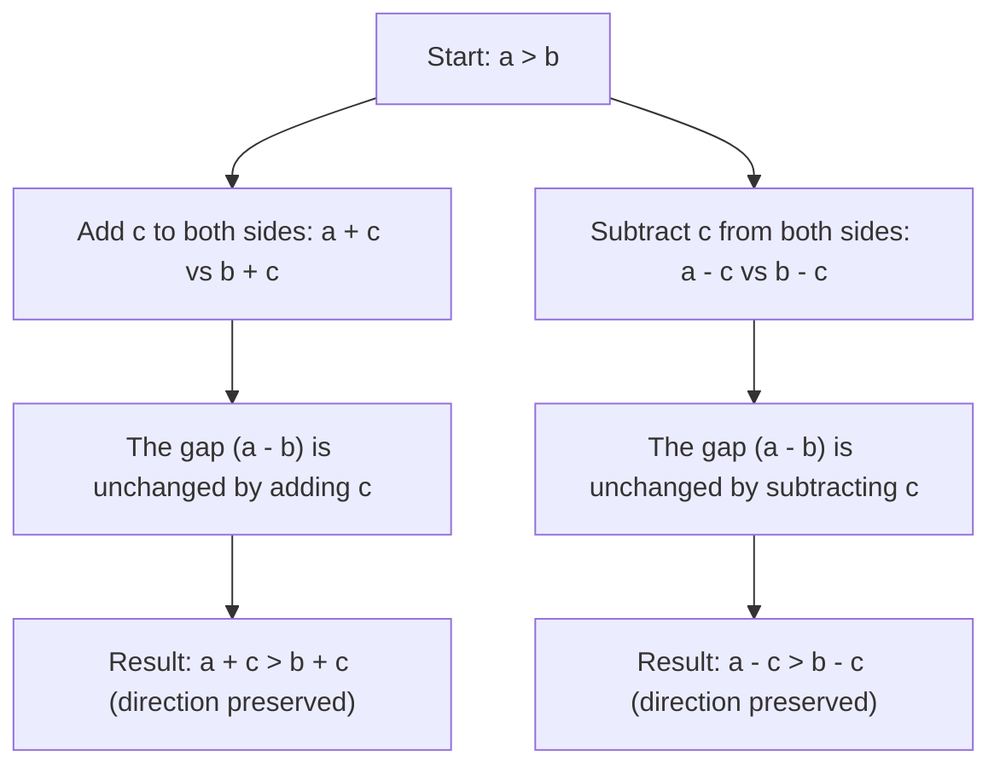

# Inequality addition

If $a > b$, then $a+c > b+c$ and $a-c > b-c$

## Deep Breakdown

What it tells me *(Situation Awareness)*:
Adding or subtracting the same value from both sides of an inequality preserves the direction of the inequality. If revenue $a$ exceeds cost $b$, and you add a fixed tax $c$ to both, revenue + tax still exceeds cost + tax. This rule is used constantly when isolating variables in inequalities (the equivalent of moving terms across the equals sign in equations).

## Flowchart



## Real-world use

### Where it is used

Isolating a variable in inequality constraints (e.g., finding the range of valid prices), solving linear programming feasibility conditions, and algebraically manipulating bound constraints in optimization problems.

### Problem it solves

To isolate a variable in an inequality (e.g., $x + 5 > 10 \implies x > 5$), you need to add/subtract terms from both sides. This rule confirms that doing so is valid: the inequality direction does not change.

### How it solves the problem

Adding $c$ to both sides shifts both $a$ and $b$ by the same amount. Since the gap $a - b > 0$ is unchanged ($a + c - (b + c) = a - b > 0$), the inequality direction is preserved.

### Example in a business

A campaign performance constraint: clicks $C > $ impressions threshold $T - 500$. Adding 500 to both sides: $C + 500 > T$. The inequality is manipulated by addition to isolate the threshold $T$. Same rule, standard algebraic step.

## The formula, piece by piece

- $a, b$: any real numbers (or expressions) with $a > b$
- $c$: any real number (can be positive, negative, or zero)
- Addition: $a + c > b + c$ — direction unchanged
- Subtraction: $a - c > b - c$ — direction unchanged (subtracting $c$ = adding $-c$)
- Works for all inequality types: $>, <, \geq, \leq$ Full rule: $a > b \implies a \pm c > b \pm c$ for any real $c$

## The formula in words

"Adding or subtracting the same value from both sides of an inequality leaves the inequality direction unchanged." $7 > 3$: add $5$ to both sides: $12 > 8$. Subtract $10$: $-3 > -7$. Direction preserved in both cases.

## Critical Concepts

- **Direction is always preserved.** This rule has no exceptions — unlike multiplication/division, sign of $c$ does not matter here.
- **Works for both strict and non-strict inequalities:** $a > b \implies a + c > b + c$; and $a \geq b \implies a + c \geq b + c$.
- **Used to isolate variables:** $x + 5 > 10 \implies x > 5$ (subtract 5 from both sides).
- **Contrast with multiplication rule:** adding any real $c$ is safe; multiplying by negative $c$ flips the sign (that's a different rule).
- **Applies to compound inequalities:** if $a < b < c$ (a chain), adding $d$: $a + d < b + d < d + c$.

## Step-by-step calculation (tiny example)

*Step 1: Start with a known inequality*
Given: $x + 7 > 15$. We want to isolate $x$.

*Step 2: Subtract 7 from both sides*
$x + 7 - 7 > 15 - 7$, which gives $x > 8$.

*Step 3: Verify the direction is preserved*
Pick $x = 10 > 8$: $10 + 7 = 17 > 15$. Satisfied. Pick $x = 5$, which is $< 8$: $5 + 7 = 12 \not> 15$. Correctly excluded. Confirmed.

## Code examples

### Beginner example (Python)

```python
# Inequality addition rule: if a > b, then a + c > b + c
a = 10.0
b = 7.0
c_values = [-5.0, 0.0, 3.0, 100.0]
print(f"Starting inequality: {a} > {b} (True: {a > b})")
print()
print(f"{'c':>8} | {'a+c':>8} | {'b+c':>8} | {'a+c > b+c':>12}")
print("-" * 45)
for c in c_values:
    a_plus_c = a + c
b_plus_c = b + c
inequality_holds = a_plus_c > b_plus_c
print(f"{c:>8.1f} | {a_plus_c:>8.1f} | {b_plus_c:>8.1f} | {str(inequality_holds):>12}")   # Solving an inequality by subtraction
print("\nSolving inequality: x + 7 > 15")
print("Subtract 7 from both sides: x > 15 - 7 = 8")
threshold = 15 - 7
for x in [5, 8, 10, 20]:
    original = x + 7 > 15
simplified = x > threshold
print(f" x={x}: original check (x+7>{15}): {original}, simplified (x>{threshold}): {simplified}")
```

### Beginner example (R)

```r
# Inequality addition rule: if a > b, then a + c > b + c
a <- 10
b <- 7
c_values <- c(-5, 0, 3, 100)
cat(sprintf("Starting: %d > %d (True: %s)\n\n", a, b, a > b))
cat(sprintf("%8s | %8s | %8s | %12s\n", "c", "a+c", "b+c", "a+c > b+c"))
cat(strrep("-", 45), "\n")
for (c in c_values) { cat(sprintf("%8.1f | %8.1f | %8.1f | %12s\n", c, a+c, b+c, as.character(a+c > b+c)))
}  # Solving: x + 7 > 15
cat("\nSolving: x + 7 > 15 -> x > 8\n")
for (x in c(5, 8, 10, 20)) { cat(sprintf(" x=%d: original=%s, simplified=%s\n", x, x+7>15, x>8))
}
```

### Professional example (Python)

```python
import pandas as pd
import numpy as np   # Scenario: campaign budget constraint analysis
# Constraint: revenue - cost > min_profit_margin
# Equivalent after adding 'cost' to both sides: revenue > cost + min_profit_margin
np.random.seed(42)
campaigns = pd.DataFrame({ "campaign": ["Alpha", "Beta", "Gamma", "Delta", "Epsilon"], "revenue": [12000.0, 8500.0, 15000.0, 7000.0, 9200.0], "cost": [9000.0, 7200.0, 11000.0, 8500.0, 6000.0], "min_profit_margin": [1500.0, 1500.0, 1500.0, 1500.0, 1500.0],
})   # Original constraint: revenue - cost > min_profit_margin
campaigns["profit"] = campaigns["revenue"] - campaigns["cost"]
campaigns["passes_original"] = campaigns["profit"] > campaigns["min_profit_margin"]   # Equivalent after adding 'cost' to both sides:
# revenue > cost + min_profit_margin
campaigns["revenue_threshold"] = campaigns["cost"] + campaigns["min_profit_margin"]
campaigns["passes_equivalent"] = campaigns["revenue"] > campaigns["revenue_threshold"]   # Both should be identical (inequality addition rule)
campaigns["rules_agree"] = campaigns["passes_original"] == campaigns["passes_equivalent"]
print("Campaign Profitability Constraint Analysis")
print("Inequality addition rule: (revenue - cost > margin) <-> (revenue > cost + margin)")
print()
print(campaigns[["campaign", "revenue", "cost", "profit", "passes_original", "passes_equivalent", "rules_agree"]].to_string(index=False))
print(f"\nAll rules agree: {campaigns['rules_agree'].all()}")
```

### Professional example (R)

```r
# (revenue - cost > margin) <-> (revenue > cost + margin) (inequality addition)
campaigns <- data.frame( campaign = c("Alpha", "Beta", "Gamma"), revenue = c(12000, 8500, 15000), cost = c(9000, 7200, 11000), min_profit_margin = 1500
)
campaigns$profit <- campaigns$revenue - campaigns$cost
campaigns$passes_original <- campaigns$profit > campaigns$min_profit_margin
campaigns$revenue_threshold <- campaigns$cost + campaigns$min_profit_margin
campaigns$passes_equivalent <- campaigns$revenue > campaigns$revenue_threshold
campaigns$rules_agree <- campaigns$passes_original == campaigns$passes_equivalent
cat("Inequality addition: both forms agree\n")
print(campaigns[c("campaign", "revenue", "cost", "profit", "rules_agree")])
```

---

*Source: domain knowledge*
