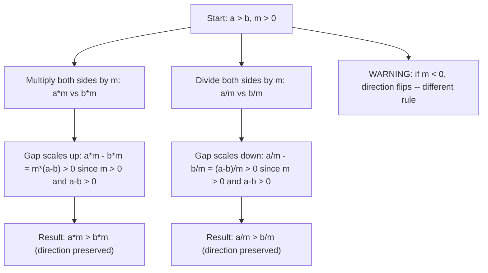

# Inequality multiplication (positive)

If $a > b$ and $m > 0$, then $am > bm$ and $\frac{a}{m} > \frac{b}{m}$

## Deep Breakdown

What it tells me *(Situation Awareness)*:
Multiplying or dividing both sides of an inequality by the same **positive** value preserves the direction of the inequality. This is the safe half of the multiplication rule. The dangerous half — multiplying by a negative — flips the direction (covered separately). This rule is used any time you scale a comparison: normalizing revenue by number of days, converting units, comparing per-user metrics, or scaling constraints in optimization. It is the algebraic license to rescale without breaking the relationship.

## Flowchart



## Real-world use

### Where it is used

Normalizing metrics by a common denominator (revenue per session, cost per click, installs per day), scaling inequality constraints in LP models, converting units (daily clicks to weekly by multiplying by 7 preserves the ranking), and comparing rates where you divide a count by a positive total.

### Problem it solves

In practice, you often need to rescale both sides of an inequality to make it interpretable or to isolate a variable. For example, if total revenue $R_A > R_B$ and both have run for the same number of days $d$, you want to confirm that $R_A / d > R_B / d$ — the daily rate comparison inherits the total comparison. This rule guarantees that dividing by $d > 0$ is valid.

### How it solves the problem

Let $a - b > 0$ (the gap). Multiply by $m > 0$: $m(a - b) > 0$ because a positive times a positive is positive. So $ma - mb > 0$, which means $ma > mb$. Same logic for division: divide by $m > 0$ gives $(a - b)/m > 0$, so $a/m > b/m$. The key is that the gap $a - b$ stays positive after scaling by any $m > 0$.

### Example in a business

Campaign A had 12,000 clicks in 30 days; Campaign B had 9,000 clicks in 30 days. So $12000 > 9000$. Divide both by 30 (positive): $400 > 300$ clicks/day. The per-day comparison is valid and the direction is preserved. Now suppose you want to scale both by a $\times 3$ budget multiplier: $36000 > 27000$. The ranking holds. This is the inequality multiplication rule in action for rate normalization.

## The formula, piece by piece

- $a, b$: any real numbers with $a > b$
- $m$: a **strictly positive** real number ($m > 0$)
- Multiplication: $am > bm$ — direction unchanged
- Division: $\dfrac{a}{m} > \dfrac{b}{m}$ — direction unchanged (dividing by $m$ = multiplying by $\tfrac{1}{m}$, which is also positive)
- Works for all inequality types: $>, <, \geq, \leq$ — as long as $m > 0$ Full rule: $a > b$ and $m > 0 \implies am > bm$ and $\dfrac{a}{m} > \dfrac{b}{m}$

## The formula in words

"Multiplying or dividing both sides of an inequality by the same positive number leaves the direction of the inequality unchanged." $9 > 6$: multiply by $4$: $36 > 24$. Divide by $3$: $3 > 2$. Direction preserved in both.

## Critical Concepts

- **Only safe with $m > 0$.** If $m < 0$, the inequality flips: $9 > 6$ but $9 \times (-1) = -9 < -6 = 6 \times (-1)$. That is the separate negative-multiplier rule.
- **Dividing is just multiplying by the reciprocal:** $\frac{a}{m} = a \cdot \frac{1}{m}$. Since $m > 0 \implies \frac{1}{m} > 0$, division by a positive number falls under the same rule.
- **Used to isolate variables with positive coefficients:** $3x > 15 \implies x > 5$ (divide both sides by $3 > 0$, direction holds).
- **Works for compound inequalities:** if $a < b < c$ and $m > 0$, then $am < bm < cm$.
- **Never assume $m > 0$ without checking.** In data pipelines, a "denominator" could theoretically be zero or negative — always validate before dividing to normalize.

## Step-by-step calculation (tiny example)

*Step 1: Start with a known inequality and positive multiplier*
Given: $3x > 15$. We want to isolate $x$. Here $m = 3 > 0$.

*Step 2: Divide both sides by 3 (positive, so direction is preserved)*
$\frac{3x}{3} > \frac{15}{3}$, which gives $x > 5$.

*Step 3: Verify the direction is preserved*
Pick $x = 7 > 5$: $3(7) = 21 > 15$. Satisfied. Pick $x = 4 < 5$: $3(4) = 12 \not> 15$. Correctly excluded. Confirmed.

## Code examples

### Beginner example (Python)

```python
# Inequality multiplication rule: if a > b and m > 0, then a*m > b*m and a/m > b/m
a = 12.0
b = 9.0
m_values = [0.5, 1.0, 3.0, 100.0]
print(f"Starting inequality: {a} > {b} (True: {a > b})")
print()
print(f"{'m':>8} | {'a*m':>8} | {'b*m':>8} | {'a*m > b*m':>12} | {'a/m':>8} | {'b/m':>8} | {'a/m > b/m':>12}")
print("-" * 75)
for m in m_values:
    a_times_m = a * m
b_times_m = b * m
a_div_m = a / m
b_div_m = b / m
print( f"{m:>8.1f} | {a_times_m:>8.1f} | {b_times_m:>8.1f} | {str(a_times_m > b_times_m):>12}" f" | {a_div_m:>8.3f} | {b_div_m:>8.3f} | {str(a_div_m > b_div_m):>12}" )   # Solving an inequality: 3x > 15
print("\nSolving inequality: 3x > 15")
print("Divide both sides by 3 (positive): x > 5")
threshold = 15 / 3
for x in [3, 5, 6, 10]:
    original = 3 * x > 15
simplified = x > threshold
print(f" x={x}: original (3x>15): {original}, simplified (x>5): {simplified}")
```

### Beginner example (R)

```r
# Inequality multiplication rule: if a > b and m > 0, then a*m > b*m and a/m > b/m
a <- 12
b <- 9
m_values <- c(0.5, 1.0, 3.0, 100.0)
cat(sprintf("Starting: %d > %d (True: %s)\n\n", a, b, a > b))
cat(sprintf("%8s | %8s | %8s | %12s | %8s | %8s | %12s\n", "m", "a*m", "b*m", "a*m>b*m", "a/m", "b/m", "a/m>b/m"))
cat(strrep("-", 80), "\n")
for (m in m_values) { cat(sprintf("%8.1f | %8.1f | %8.1f | %12s | %8.3f | %8.3f | %12s\n", m, a*m, b*m, as.character(a*m > b*m), a/m, b/m, as.character(a/m > b/m)))
}  # Solving: 3x > 15 -> x > 5
cat("\nSolving: 3x > 15 -> x > 5\n")
for (x in c(3, 5, 6, 10)) { cat(sprintf(" x=%d: original=%s, simplified=%s\n", x, 3*x>15, x>5))
}
```

### Professional example (Python)

```python
import pandas as pd
import numpy as np   # Scenario: normalizing campaign metrics by campaign duration (days)
# Rule: if total_clicks_A > total_clicks_B and both ran for duration > 0 days,
# then daily_clicks_A > daily_clicks_B (dividing by positive duration preserves ranking)
np.random.seed(42)
campaigns = pd.DataFrame({ "campaign": ["Alpha", "Beta", "Gamma", "Delta", "Epsilon"], "total_clicks": [36000.0, 27000.0, 15000.0, 48000.0, 21000.0], "duration_days": [30.0, 30.0, 15.0, 60.0, 21.0],
})   # Compute daily rate: dividing by duration (positive) preserves order within same-duration groups
campaigns["daily_clicks"] = campaigns["total_clicks"] / campaigns["duration_days"]   # Rank by total and by daily — they should differ when durations differ
campaigns["rank_total"] = campaigns["total_clicks"].rank(ascending=False).astype(int)
campaigns["rank_daily"] = campaigns["daily_clicks"].rank(ascending=False).astype(int)   # Verify: for same-duration pairs, multiplying/dividing by duration must preserve order
same_duration_pairs = campaigns[campaigns["duration_days"] == 30.0].copy()
p1, p2 = same_duration_pairs.iloc[0], same_duration_pairs.iloc[1]
total_order_preserved = (p1["total_clicks"] > p2["total_clicks"]) == ( p1["daily_clicks"] > p2["daily_clicks"] )
print("Campaign Metric Normalization: Inequality Multiplication Rule")
print("Rule: total_A > total_B and duration > 0 => daily_A > daily_B")
print()
print(campaigns[["campaign", "total_clicks", "duration_days", "daily_clicks", "rank_total", "rank_daily"]].to_string(index=False))
print(f"\nFor same-duration campaigns (30 days): order preserved after dividing = {total_order_preserved}")
print("Note: different durations change the ranking — normalization is essential.")
```

### Professional example (R)

```r
# total_A > total_B and duration > 0 => daily_A > daily_B (inequality multiplication)
campaigns <- data.frame( campaign = c("A", "B", "C"), total_clicks = c(900, 600, 450), duration_days = c(30, 30, 15)
)
campaigns$daily_clicks <- campaigns$total_clicks / campaigns$duration_days
cat("Inequality multiplication: total/duration preserves order when duration equal\n")
print(campaigns)
```

---

*Source: domain knowledge*
