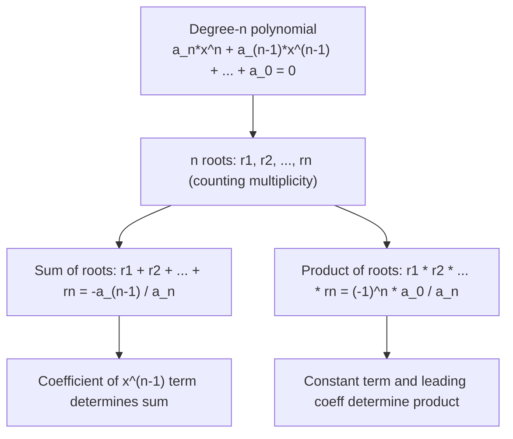

# Polynomial roots (degree $n$)

Sum $= \frac{-a_{n-1}}{a_n}$, Product $= \frac{(-1)^n a_0}{a_n}$

## Deep Breakdown

What it tells me *(Situation Awareness)*:
This is the generalization of Vieta's formulas to polynomials of any degree $n$. For a degree-$n$ polynomial $a_n x^n + a_{n-1} x^{n-1} + \cdots + a_1 x + a_0 = 0$ with $n$ roots $r_1, r_2, \ldots, r_n$, the sum of all roots equals $-a_{n-1}/a_n$ and the product of all roots equals $(-1)^n a_0/a_n$. This generalizes the quadratic Vieta formulas and is useful for verifying polynomial roots and building polynomials from constraints.

## Flowchart



## Real-world use

### Where it is used

Polynomial regression root analysis, characteristic polynomial roots of matrices (eigenvalues in PCA/SVD), control theory (stability analysis), and verifying computed roots of higher-degree polynomials from numerical solvers.

### Problem it solves

For degree $\geq 3$ polynomials, there is no general closed-form quadratic-style formula. Vieta's generalized formulas give coefficient-based constraints on the roots — useful for verification and for building polynomials from partial knowledge of their roots.

### How it solves the problem

The polynomial can be factored as $a_n(x - r_1)(x - r_2) \cdots (x - r_n)$. Expanding and matching coefficients with $a_n x^n + a_{n-1} x^{n-1} + \cdots + a_0$ yields the relationships between symmetric functions of roots and coefficients. The sum of roots comes from the $x^{n-1}$ term; the product from the $x^0$ (constant) term.

### Example in a business

A cubic polynomial model $2x^3 - 6x^2 + 4x - 8 = 0$ has been solved numerically and gives roots $r_1, r_2, r_3$. Quick verification: sum of roots should be $-(-6)/2 = 3$; product of roots should be $(-1)^3 \cdot (-8)/2 = 4$. If the numerical solver returns roots that don't satisfy these, there's a numerical error to investigate.

## The formula, piece by piece

For the polynomial: $a_n x^n + a_{n-1} x^{n-1} + a_{n-2} x^{n-2} + \cdots + a_1 x + a_0 = 0$ - $a_n$: leading coefficient (coefficient of $x^n$)
- $a_{n-1}$: coefficient of $x^{n-1}$ (second-highest power)
- $a_0$: constant term (coefficient of $x^0$)
- $r_1, r_2, \ldots, r_n$: the $n$ roots (real or complex) Key Vieta formulas:
- **Sum of all roots:** $\sum_{i=1}^{n} r_i = -\frac{a_{n-1}}{a_n}$
- **Product of all roots:** $\prod_{i=1}^{n} r_i = \frac{(-1)^n a_0}{a_n}$ The $(-1)^n$ in the product formula comes from the sign pattern when expanding $(x - r_1)(x - r_2)\cdots(x - r_n)$.

## The formula in words

"For any polynomial, the sum of all roots equals the negative of the second-highest coefficient divided by the leading coefficient. The product of all roots equals the constant term divided by the leading coefficient, with a sign that alternates by degree." Degree 2 (quadratic, $n=2$): sum $= -b/a$, product $= (-1)^2 c/a = c/a$. Matches Vieta's quadratic formulas exactly. Degree 3 (cubic, $n=3$): sum $= -a_2/a_3$, product $= (-1)^3 a_0/a_3 = -a_0/a_3$.

## Critical Concepts

- **Works for complex roots too.** Even when roots are complex, the sum and product are determined by the (real) coefficients.
- **"Counting multiplicity":** a repeated root $r$ of multiplicity $k$ contributes $k$ times to the sum and $r^k$ to the product.
- **Only sum and product are covered here.** Full Vieta's formulas also give expressions for all elementary symmetric polynomials of the roots (e.g., $\sum_{i<j} r_i r_j = a_{n-2}/a_n$).
- **Verification use:** numerical root-finders can lose precision; Vieta's formulas provide a coefficient-based sanity check.
- **Does not compute roots.** These formulas relate coefficients to symmetric functions of roots — they do not solve the polynomial.

## Step-by-step calculation (tiny example)

*Step 1: Identify the degree, leading coefficient, second-to-leading coefficient, and constant term*
Polynomial: $2x^3 - 6x^2 + 4x - 8 = 0$. Degree $n = 3$. $a_3 = 2$, $a_2 = -6$, $a_0 = -8$.

*Step 2: Compute sum of roots using Vieta's sum formula*
$r_1 + r_2 + r_3 = -\frac{a_{n-1}}{a_n} = -\frac{-6}{2} = 3$.

*Step 3: Compute product of roots using Vieta's product formula*
$r_1 r_2 r_3 = \frac{(-1)^3 a_0}{a_3} = \frac{(-1) \cdot (-8)}{2} = \frac{8}{2} = 4$.
Numerical solver gives roots approximately $\approx 3.29$, $\approx -0.15 + 0.98i$, $\approx -0.15 - 0.98i$. Sum $\approx 3$ and product $\approx 4$ (within numerical precision). Confirmed.

## Code examples

### Beginner example (Python)

```python
import numpy as np

def vieta_sum_product(coefficients: list) -> dict:
    """ Compute Vieta's sum and product of roots for a polynomial. Coefficients are given in descending order: [a_n, a_(n-1), ..., a_1, a_0] Args: coefficients: List of coefficients [a_n, a_(n-1), ..., a_0] Returns: Dictionary with sum_of_roots, product_of_roots, and degree """
    n = len(coefficients) - 1   # degree
    a_n = coefficients[0]   # leading coefficient
    a_n_minus_1 = coefficients[1]   # second coefficient
    a_0 = coefficients[-1]   # constant term
    sum_roots = -a_n_minus_1 / a_n
    product_roots = ((-1)**n * a_0) / a_n
    return { "degree": n, "sum_of_roots": sum_roots, "product_of_roots": product_roots, }   # Example: 2x^3 - 6x^2 + 4x - 8 = 0
coeffs = [2, -6, 4, -8]
vieta = vieta_sum_product(coeffs)
print("Polynomial: 2x^3 - 6x^2 + 4x - 8 = 0")
print(f"Vieta's Sum of roots: {vieta['sum_of_roots']}")
print(f"Vieta's Product of roots: {vieta['product_of_roots']}")   # Verify with numpy root finder
roots = np.roots(coeffs)
print(f"\nNumerical roots: {roots}")
print(f"Actual sum: {roots.sum().real:.6f}")
print(f"Actual product: {np.prod(roots).real:.6f}")
```

### Beginner example (R)

```r
vieta_sum_product <- function(coefficients) {  #' Compute Vieta's sum and product of roots. #' Coefficients in descending order: c(a_n, a_{n-1}, ..., a_0)
  n <- length(coefficients) - 1
  a_n <- coefficients[1]
  a_nm1 <- coefficients[2]
  a_0 <- coefficients[length(coefficients)] list( degree = n, sum_of_roots = -a_nm1 / a_n, product_of_roots = ((-1)^n * a_0) / a_n )
}
coeffs <- c(2, -6, 4, -8)
vieta <- vieta_sum_product(coeffs)
cat(sprintf("Degree: %d\n", vieta$degree))
cat(sprintf("Vieta's Sum of roots: %.4f\n", vieta$sum_of_roots))
cat(sprintf("Vieta's Product of roots: %.4f\n", vieta$product_of_roots))  # Verify with polyroot
roots <- polyroot(rev(coeffs))  # polyroot expects ascending order
cat(sprintf("\nActual sum: %.6f\n", Re(sum(roots))))
cat(sprintf("Actual product: %.6f\n", Re(prod(roots))))
```

### Professional example (Python)

```python
import numpy as np
import pandas as pd   # Scenario: validating polynomial roots returned by a numerical solver
# For each polynomial, compute Vieta's expected sum and product,
# then compare against the solver output to detect numerical errors
np.random.seed(42)
polynomials = [ {"label": "Quadratic", "coeffs": [1, -5, 6, 0 ][:3]},   # x^2 - 5x + 6
    {"label": "Cubic", "coeffs": [2, -6, 4, -8 ]},   # 2x^3 - 6x^2 + 4x - 8
    {"label": "Quartic", "coeffs": [1, -10, 35, -50, 24]},   # x^4 - 10x^3 + 35x^2 - 50x + 24
]
results = []
for poly in polynomials:
    coeffs = poly["coeffs"]
n = len(coeffs) - 1   # Vieta's formulas
vieta_sum = -coeffs[1] / coeffs[0]
vieta_prod = ((-1)**n * coeffs[-1]) / coeffs[0]   # Numerical roots
roots = np.roots(coeffs)
actual_sum = roots.sum().real
actual_prod = np.prod(roots).real
results.append({ "polynomial": poly["label"], "degree": n, "vieta_sum": round(vieta_sum, 6), "actual_sum": round(actual_sum, 6), "sum_ok": np.isclose(vieta_sum, actual_sum, atol=1e-6), "vieta_product": round(vieta_prod, 6), "actual_product": round(actual_prod, 6), "product_ok": np.isclose(vieta_prod, actual_prod, atol=1e-6), })
df = pd.DataFrame(results)
print("Vieta's Formula Verification for Polynomial Roots")
print()
print(df.to_string(index=False))
print(f"\nAll sums correct: {df['sum_ok'].all()}")
print(f"All products correct: {df['product_ok'].all()}")
```

### Professional example (R)

```r
# Vieta verification for polynomial roots (polyroot)
polynomials <- list( list(label = "Quadratic", coeffs = c(1, -5, 6)), list(label = "Cubic", coeffs = c(2, -6, 4, -8)), list(label = "Quartic", coeffs = c(1, -10, 35, -50, 24))
)
results <- lapply(polynomials, function(p) { coeffs <- p$coeffs n <- length(coeffs) - 1 vieta_sum <- -coeffs[2] / coeffs[1] vieta_prod <- ((-1)^n * coeffs[length(coeffs)]) / coeffs[1] roots <- polyroot(rev(coeffs)) actual_sum <- Re(sum(roots)) actual_prod <- Re(prod(roots)) data.frame(polynomial = p$label, degree = n, vieta_sum = vieta_sum, actual_sum = actual_sum, sum_ok = isTRUE(all.equal(vieta_sum, actual_sum, tolerance = 1e-6)), vieta_product = vieta_prod, actual_product = actual_prod, product_ok = isTRUE(all.equal(vieta_prod, actual_prod, tolerance = 1e-6)))
})
df <- do.call(rbind, results)
cat("Vieta's Formula Verification\n")
print(df)
cat(sprintf("\nAll sums correct: %s All products correct: %s\n", all(df$sum_ok), all(df$product_ok)))
```

---

*Source: MFB p. 143*
