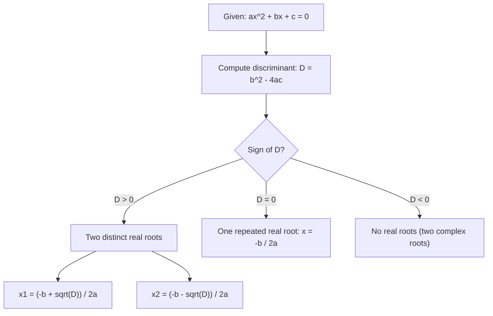

# Quadratic Equation

$$
ax^2 + bx + c = 0 \implies x = \frac{-b \pm \sqrt{b^2 - 4ac}}{2a}
$$

## Deep Breakdown

What it tells me *(Situation Awareness)*:
The quadratic formula gives the exact solutions to any quadratic equation $ax^2 + bx + c = 0$. Quadratics appear in optimization (finding the vertex/minimum of a parabolic cost function), in solving second-degree polynomial models, and in break-even analysis (where revenue and cost curves intersect). Memorize this formula — it is foundational and its structure (especially the discriminant $b^2 - 4ac$) tells you the nature of the solutions before you compute them.

## Flowchart



## Real-world use

### Where it is used

Break-even analysis (intersecting revenue and cost), projectile motion models, optimization of quadratic cost/loss surfaces, revenue maximization with a price-demand quadratic relationship, and interpreting roots of second-degree polynomial regressions.

### Problem it solves

Not every quadratic factors nicely over integers. The quadratic formula works for any values of $a$, $b$, $c$ — it is the universal solver for degree-2 polynomials.

### How it solves the problem

Derived by completing the square on $ax^2 + bx + c = 0$: move $c$ to the right, divide by $a$, add $\frac{b^2}{4a^2}$ to both sides to complete the square, take the square root, then solve for $x$. The $\pm$ comes from the square root step (both positive and negative roots).

### Example in a business

Revenue: $R(p) = -2p^2 + 100p$. Cost: $C = 800$. Break-even when $R = C$: $-2p^2 + 100p - 800 = 0$. Using the quadratic formula with $a = -2$, $b = 100$, $c = -800$: $p = \frac{-100 \pm \sqrt{10000 - 6400}}{-4} = \frac{-100 \pm 60}{-4}$, giving $p = 10$ and $p = 40$. Break-even prices are $\$10$ and $\$40$.

## The formula, piece by piece

- $a$: coefficient of $x^2$ (must be $\neq 0$; if $a = 0$ it's a linear equation)
- $b$: coefficient of $x$
- $c$: constant term
- $b^2 - 4ac$: the **discriminant** — determines number and type of solutions
- $\sqrt{b^2 - 4ac}$: always non-negative when the discriminant is positive
- $\pm$: gives two solutions — one for $+$, one for $-$
- $2a$: denominator — scales both solutions Full formula: $x = \frac{-b \pm \sqrt{b^2 - 4ac}}{2a}$

## The formula in words

"The solutions to $ax^2 + bx + c = 0$ are: negative $b$, plus or minus the square root of $(b$ squared minus $4ac)$, all divided by $2a$." Mnemonic: "Negative $b$, plus or minus root, $b$ squared minus four $a$ $c$, all over two $a$."

## Critical Concepts

- **Discriminant ($\Delta = b^2 - 4ac$) determines solution type:** - $\Delta > 0$: two distinct real roots - $\Delta = 0$: one repeated root (the vertex of the parabola touches the $x$-axis) - $\Delta < 0$: no real roots (complex conjugate pair)
- **The $\pm$ is essential.** Omitting it gives only one of two solutions — a common error.
- **Works only for degree-2 polynomials.** Cubic and higher require different methods.
- **Vertex formula:** the axis of symmetry is at $x = \frac{-b}{2a}$, which is the average of the two roots.
- **Vieta's formulas:** $x_1 + x_2 = -\frac{b}{a}$ and $x_1 \cdot x_2 = \frac{c}{a}$ — use these to verify roots without substituting.

## Step-by-step calculation (tiny example)

*Step 1: Identify a, b, c*
Equation: $2x^2 - 4x - 6 = 0$. $a = 2$, $b = -4$, $c = -6$.

*Step 2: Compute the discriminant*
$\Delta = b^2 - 4ac = (-4)^2 - 4(2)(-6) = 16 + 48 = 64$.

*Step 3: Apply the formula and find both roots*
$x = \frac{-(-4) \pm \sqrt{64}}{2 \cdot 2} = \frac{4 \pm 8}{4}$.
$x_1 = \frac{4 + 8}{4} = 3$, $x_2 = \frac{4 - 8}{4} = -1$.
Verify: $2(3)^2 - 4(3) - 6 = 18 - 12 - 6 = 0$. $2(-1)^2 - 4(-1) - 6 = 2 + 4 - 6 = 0$. Both confirmed.

## Code examples

### Beginner example (Python)

```python
import math

def solve_quadratic(a: float, b: float, c: float) -> tuple:
    """ Solve ax^2 + bx + c = 0 using the quadratic formula. Args: a: coefficient of x^2 (must be non-zero) b: coefficient of x c: constant term Returns: Tuple of roots (two values, or one if repeated, or None if complex) """
    if a == 0:
        raise ValueError("Coefficient 'a' must be non-zero for a quadratic equation.")
    discriminant = b**2 - 4 * a * c
    if discriminant > 0:
        x1 = (-b + math.sqrt(discriminant)) / (2 * a)
        x2 = (-b - math.sqrt(discriminant)) / (2 * a)
        return x1, x2
    elif discriminant == 0:
        x = -b / (2 * a)
        return (x,)
    else:
        return None   # Example: 2x^2 - 4x - 6 = 0
a, b, c = 2, -4, -6
roots = solve_quadratic(a, b, c)
print(f"Equation: {a}x^2 + ({b})x + ({c}) = 0")
print(f"Discriminant: {b**2 - 4*a*c}")
print(f"Roots: {roots}")   # Verify
for root in roots:
    check = a * root**2 + b * root + c
print(f" f({root}) = {check:.10f} (should be 0)")
```

### Beginner example (R)

```r
solve_quadratic <- function(a, b, c) {  #' Solve ax^2 + bx +
  c = 0 using the quadratic formula.  #' #' @param a Coefficient of x^2 (non-zero) #' @param b Coefficient of x #' @param c Constant term #' @return Named vector of roots, or NULL if complex
  if (a == 0) stop("Coefficient 'a' must be non-zero.")
  discriminant <- b^2 - 4 * a * c
  if (discriminant > 0) { x1 <- (-b + sqrt(discriminant)) / (2 * a)
    x2 <- (-b - sqrt(discriminant)) / (2 * a)
    return(c(x1 = x1, x2 = x2))
  }
  else
  if (discriminant == 0) { x <- -b / (2 * a)
    return(c(x_repeated = x))
  }
  else { cat("No real roots (discriminant < 0)\n")
    return(NULL)
  }
}
roots <- solve_quadratic(2, -4, -6)
cat("Roots:", roots, "\n")
for (r in roots) { cat(sprintf(" f(%.4f) = %.10f (should be 0)\n", r, 2*r^2 - 4*r - 6))
}
```

### Professional example (Python)

```python
import numpy as np
import pandas as pd   # Scenario: break-even analysis using quadratic revenue model
# Revenue: R(p) = -demand_slope * p^2 + max_revenue_p * p
# Fixed cost: C
# Break-even when R(p) = C -> solve: demand_slope*p^2 - max_revenue_p*p +
C = 0

def quadratic_roots(a: float, b: float, c: float) -> tuple | None:
    """Return real roots of ax^2 + bx + c = 0, or None if complex."""
    discriminant = b**2 - 4 * a * c
    if discriminant < 0:
        return None
    x1 = (-b + np.sqrt(discriminant)) / (2 * a)
    x2 = (-b - np.sqrt(discriminant)) / (2 * a)
    return sorted([x1, x2])
products = pd.DataFrame({ "product": ["Widget A", "Widget B", "Widget C"], "demand_slope": [2.0, 0.5, 1.5], "max_rev_coeff": [100.0, 60.0, 80.0], "fixed_cost": [800.0, 1200.0, 500.0],
})
results = []
for _, row in products.iterrows():
    # R(p) = -slope*p^2 + coeff*p = C -> slope*p^2 - coeff*p +
    C = 0
a = row["demand_slope"]
b = -row["max_rev_coeff"]
c = row["fixed_cost"]
discriminant = b**2 - 4 * a * c
roots = quadratic_roots(a, b, c)
results.append({ "product": row["product"], "a": a, "b": b, "c": c, "discriminant": discriminant, "break_even_low": roots[0] if roots else None, "break_even_high": roots[1] if roots else None, })
df = pd.DataFrame(results)
print("Break-Even Price Analysis (Quadratic Formula)")
print(f"Model: R(p) = -a*p^2 + (-b)*p = C -> a*p^2 + b*p + c = 0")
print()
print(df.to_string(index=False))
print("\nBreak-even prices bracket the profitable price range: price between low and high is profitable.")
```

### Professional example (R)

```r
# Break-even price analysis: quadratic formula
solve_quadratic <- function(a, b, c) { delta <- b^2 - 4*a*c
  if (delta < 0)
  return(c(NA, NA)) c((-b - sqrt(delta))/(2*a), (-b + sqrt(delta))/(2*a))
}
results <- data.frame( product = c("A", "B"), a = c(2, 1), b = c(-80, -40), c = c(600, 900)
)
roots <- mapply(function(a, b, c) solve_quadratic(a, b, c), results$a, results$b, results$c)
results$root_low <- roots[1, ]; results$root_high <- roots[2, ]
cat("Break-Even Price Analysis (Quadratic Formula)\n")
print(results)
```

---

*Source: 1300 p. 21*
