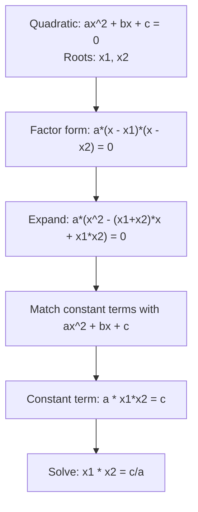

# Vieta's Formulas (Product of roots)

$$
x_1 \cdot x_2 = \frac{c}{a}
$$

## Deep Breakdown

What it tells me *(Situation Awareness)*:
Vieta's product formula says: if $x_1$ and $x_2$ are the roots of $ax^2 + bx + c = 0$, their product equals $c/a$. Together with the sum formula ($x_1 + x_2 = -b/a$), you can verify roots, reconstruct a quadratic from its roots, or determine the sign and magnitude of the root product from the coefficients — all without computing the roots themselves.

## Flowchart



## Real-world use

### Where it is used

Verifying roots (second independent check alongside the sum), determining sign of roots from coefficients (useful for feasibility checks), and reconstructing a quadratic from known roots — e.g., building a revenue model given two known break-even prices.

### Problem it solves

Sign of the product tells you whether roots are both positive, both negative, or of opposite sign — without computing them. For break-even analysis: if $c/a > 0$ and $-b/a > 0$, both roots are positive (both break-even prices are feasible). This is a fast feasibility check.

### How it solves the problem

From the factored form: $a(x - x_1)(x - x_2) = a(x^2 - (x_1 + x_2)x + x_1 x_2) = ax^2 + bx + c$. Matching the constant term: $a \cdot x_1 x_2 = c$, so $x_1 x_2 = c/a$.

### Example in a business

Revenue model at break-even: $-p^2 + 50p - 400 = 0$ ($a = -1$, $b = 50$, $c = -400$). Product of break-even prices: $p_1 \cdot p_2 = c/a = \frac{-400}{-1} = 400$. Sum: $p_1 + p_2 = -b/a = 50$. Since product and sum are both positive, both break-even prices are positive — the model is feasible. You can even reconstruct the prices: they satisfy $x^2 - 50x + 400 = 0$, giving $p = 10$ and $p = 40$.

## The formula, piece by piece

- $x_1, x_2$: the two roots of $ax^2 + bx + c = 0$
- $x_1 \cdot x_2$: their product
- $\frac{c}{a}$: ratio of constant term to leading coefficient
- Sign rule: if $c/a > 0$, roots have the same sign; if $c/a < 0$, roots have opposite signs
- Works for complex roots too: the product $c/a$ is real even when roots are complex conjugates Full formula: $x_1 \cdot x_2 = \frac{c}{a}$ for $ax^2 + bx + c = 0$ with $a \neq 0$

## The formula in words

"The product of the two roots equals $c$ over $a$ — the constant term divided by the leading coefficient." $x^2 - 5x + 6 = 0$: product of roots $= \frac{6}{1} = 6$. Roots are $2$ and $3$: $2 \times 3 = 6$. Confirmed.

## Critical Concepts

- **Sign of product reveals sign relationship of roots:** - $c/a > 0$: both roots positive or both negative (check sum to distinguish) - $c/a < 0$: one positive root, one negative root - $c/a = 0$: one root is zero (i.e., $c = 0$)
- **Pair with sum for full characterization:** sum + product together uniquely determine both roots via $x^2 - (S)x + P = 0$ where $S = x_1 + x_2$, $P = x_1 x_2$.
- **Verification check:** after computing roots with the quadratic formula, verify $x_1 \cdot x_2 = c/a$ as a second independent sanity check.
- **Connection to factoring:** when you factor $ax^2 + bx + c$ as $a(x - r)(x - s)$, you need $r + s = -b/a$ and $r \cdot s = c/a$ — Vieta's formulas guide the factoring directly.

## Step-by-step calculation (tiny example)

*Step 1: Identify a and c from the quadratic*
Equation: $2x^2 - 10x + 12 = 0$. $a = 2$, $c = 12$.

*Step 2: Compute the product of roots*
$x_1 \cdot x_2 = \frac{c}{a} = \frac{12}{2} = 6$.

*Step 3: Verify by solving and multiplying the roots*
Divide by 2: $x^2 - 5x + 6 = 0$. Factor: $(x-2)(x-3) = 0$. Roots: $x_1 = 2$, $x_2 = 3$. Product $= 2 \times 3 = 6$. Confirmed.

## Code examples

### Beginner example (Python)

```python
import math

def vieta_product(a: float, c: float) -> float:
    """ Compute the product of roots of ax^2 + bx + c = 0 using Vieta's formula. Args: a: leading coefficient c: constant term Returns: Product of roots: c/a """
    return c / a

def quadratic_roots(a: float, b: float, c: float) -> tuple | None:
    delta = b**2 - 4 * a * c
    if delta < 0:
        return None
    return ( (-b + math.sqrt(delta)) / (2 * a), (-b - math.sqrt(delta)) / (2 * a), )   # Test: 2x^2 - 10x + 12 = 0
a, b, c = 2, -10, 12
predicted_product = vieta_product(a, c)
roots = quadratic_roots(a, b, c)
actual_product = roots[0] * roots[1]
print(f"Equation: {a}x^2 + ({b})x + {c} = 0")
print(f"Vieta's product: x1 * x2 = {c}/{a} = {predicted_product}")
print(f"Actual roots: {roots}")
print(f"Actual product: {actual_product}")
print(f"Match: {abs(predicted_product - actual_product) < 1e-10}")   # Sign check
sign_of_product = "same sign" if predicted_product > 0 else "opposite signs"
print(f"\nProduct > 0 -> roots have the {sign_of_product}")
```

### Beginner example (R)

```r
vieta_product <- function(a, c) c / a
quadratic_roots <- function(a, b, c) {
  delta <- b^2 - 4 * a * c
  if (delta < 0)
    return(NULL)
  c((-b + sqrt(delta)) / (2*a), (-b - sqrt(delta)) / (2*a))
}
a <- 2; b <- -10; c <- 12
predicted_product <- vieta_product(a, c)
roots <- quadratic_roots(a, b, c)
actual_product <- prod(roots)
cat(sprintf("Equation: %dx^2 + (%d)x + %d = 0\n", a, b, c))
cat(sprintf("Vieta's product: x1 * x2 = %d/%d = %.4f\n", c, a, predicted_product))
cat(sprintf("Actual roots: %.4f, %.4f\n", roots[1], roots[2]))
cat(sprintf("Actual product: %.4f\n", actual_product))
cat(sprintf("Match: %s\n", isTRUE(all.equal(predicted_product, actual_product))))
```

### Professional example (Python)

```python
import numpy as np
import pandas as pd

# Scenario: reconstruct quadratic from known break-even prices, then validate portfolio
# If you know sum S = p1+p2 and product P = p1*p2, the quadratic is:
# p^2 - S*p + P = 0 (assuming leading coefficient = 1 for unit-scale revenue model)
known_break_evens = pd.DataFrame({
    "product": ["Widget", "Gadget", "Doohickey"],
    "p1": [10.0, 5.0, 20.0],
    "p2": [40.0, 25.0, 35.0],
})
known_break_evens["sum_S"] = known_break_evens["p1"] + known_break_evens["p2"]
known_break_evens["product_P"] = known_break_evens["p1"] * known_break_evens["p2"]

# Reconstruct: x^2 - S*x + P = 0 -> a=1, b=-S, c=P
# Vieta's formulas (reverse): b = -S, c = P
known_break_evens["a"] = 1.0
known_break_evens["b"] = -known_break_evens["sum_S"]
known_break_evens["c"] = known_break_evens["product_P"]

# Verify: compute roots from reconstructed quadratic and check they match
def recover_roots(a, b, c):
    delta = b**2 - 4*a*c
    if delta < 0:
        return None, None
    r1 = (-b + np.sqrt(delta)) / (2*a)
    r2 = (-b - np.sqrt(delta)) / (2*a)
    return sorted([r1, r2])


recovered = [
    recover_roots(row.a, row.b, row.c) for _, row in known_break_evens.iterrows()
]
known_break_evens["recovered_p1"] = [r[0] for r in recovered]
known_break_evens["recovered_p2"] = [r[1] for r in recovered]
known_break_evens["match"] = np.isclose(
    np.minimum(known_break_evens["p1"], known_break_evens["p2"]), known_break_evens["recovered_p1"]
)
print("Quadratic Reconstruction from Vieta's Formulas")
print("Given p1, p2 -> compute sum S and product P -> rebuild quadratic -> recover roots")
print()
print(known_break_evens[["product", "p1", "p2", "sum_S", "product_P", "b", "c", "recovered_p1", "recovered_p2"]].to_string(index=False))
print("\nRoots recovered exactly from Vieta's product and sum.")
```

### Professional example (R)

```r
# Reconstruct quadratic from Vieta: p^2 - S*p + P = 0 given p1, p2
known_break_evens <- data.frame(
  product = c("Widget", "Gadget", "Doohickey"),
  p1 = c(10, 5, 20),
  p2 = c(40, 25, 35)
)
known_break_evens$sum_S <- known_break_evens$p1 + known_break_evens$p2
known_break_evens$product_P <- known_break_evens$p1 * known_break_evens$p2
known_break_evens$a <- 1
known_break_evens$b <- -known_break_evens$sum_S
known_break_evens$c <- known_break_evens$product_P
recover_roots <- function(a, b, c) {
  delta <- b^2 - 4*a*c
  if (delta < 0)
    return(c(NA, NA))
  sort(c((-b - sqrt(delta))/(2*a), (-b + sqrt(delta))/(2*a)))
}
rec <- mapply(function(a, b, c) recover_roots(a, b, c), known_break_evens$a, known_break_evens$b, known_break_evens$c)
known_break_evens$recovered_p1 <- rec[1, ]; known_break_evens$recovered_p2 <- rec[2, ]
cat("Quadratic Reconstruction from Vieta's Formulas\n")
print(known_break_evens[c("product", "p1", "p2", "sum_S", "product_P", "recovered_p1", "recovered_p2")])
```

---

*Source: 1300 p. 21*
