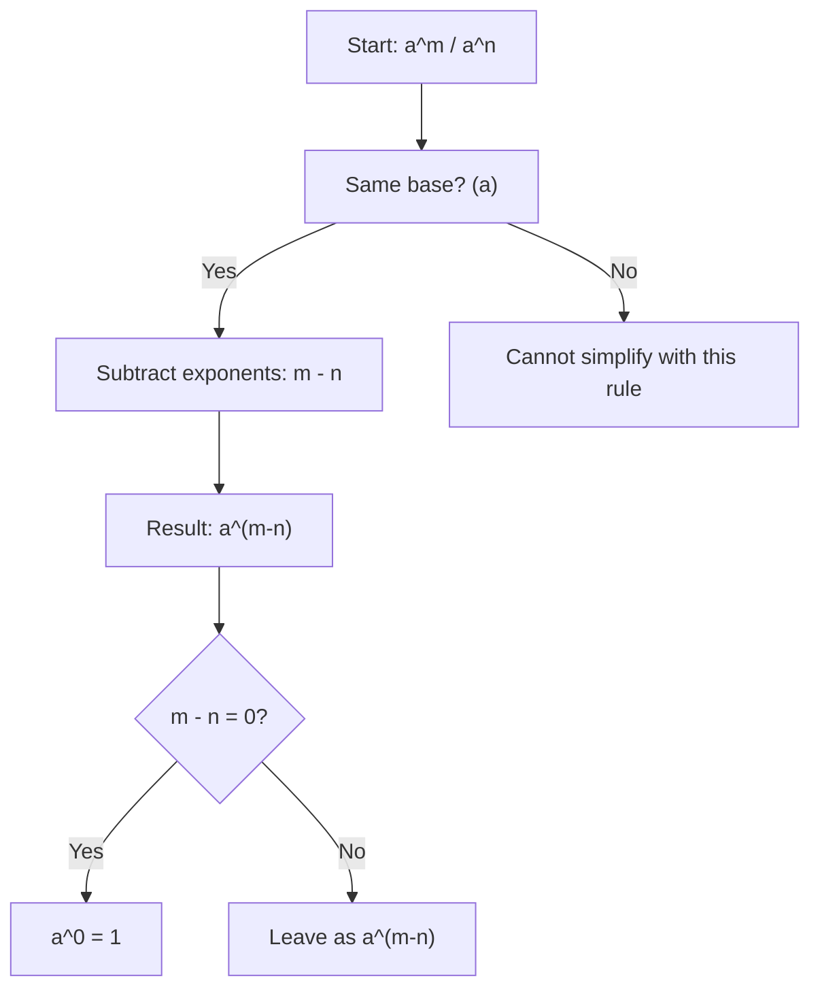

# Division

$$
\frac{a^m}{a^n} = a^{m-n}
$$

## Deep Breakdown

What it tells me *(Situation Awareness)*:
When you divide two powers with the same base, you subtract the exponents. This is the inverse of the multiplication rule. It shows up whenever you cancel repeated factors, compute ratios of exponential quantities, or simplify expressions involving rates (e.g., how much faster is process A versus B when both are powers of the same base?).

## Flowchart



## Real-world use

### Where it is used

Normalizing exponential expressions, canceling shared factors in probability ratios, and computing the relative magnitudes of polynomial terms in Big-O analysis (e.g., $n^5 / n^3 = n^2$).

### Problem it solves

Without this rule, dividing $a^m$ by $a^n$ requires full expansion and manual cancellation. The rule provides a one-step algebraic shortcut that generalizes to any real exponents.

### How it solves the problem

Division cancels common factors: $\frac{a^m}{a^n} = \frac{\underbrace{a \cdots a}_{m}}{\underbrace{a \cdots a}_{n}}$. When $m > n$, exactly $n$ copies cancel in numerator and denominator, leaving $m - n$ copies: $a^{m-n}$.

### Example in a business

When comparing the computational complexity of two model training algorithms, Algorithm A runs in $O(n^5)$ and Algorithm B in $O(n^3)$. The ratio is $\frac{n^5}{n^3} = n^{5-3} = n^2$: Algorithm A is $n^2$ times slower. Subtracting exponents directly gives the scaling factor without algebraic expansion.

## The formula, piece by piece

- $a$: the base (must be identical in numerator and denominator; $a \neq 0$)
- $m$: the exponent in the numerator
- $n$: the exponent in the denominator
- $m - n$: the resulting exponent after cancellation
- Special case: if $m = n$, then $a^{m-n} = a^0 = 1$ (connects to the zero-exponent rule)
- If $m < n$: result is $a^{m-n}$ where $m-n < 0$ (connects to the negative-exponent rule) Full rule: $\frac{a^m}{a^n} = a^{m-n}$, for $a \neq 0$, any real $m$, $n$

## The formula in words

"When you divide a power by another power of the same base, keep the base and subtract the denominator's exponent from the numerator's exponent." $\frac{2^5}{2^3} = 2^{5-3} = 2^2 = 4$ Plain language: "Five copies of 2 divided by three copies of 2 leaves two copies of 2."

## Critical Concepts

- **Base must be non-zero.** Division by zero is undefined; $a = 0$ is excluded.
- **Same base required.** $\frac{a^m}{b^n}$ cannot be simplified with this rule unless $a = b$.
- **Links zero and negative exponents:** When $m = n$, result is $a^0 = 1$. When $m < n$, result is a negative exponent, i.e., $\frac{1}{a^{n-m}}$.
- **Inverse of multiplication rule:** $a^m \cdot a^n = a^{m+n}$, so $\frac{a^{m+n}}{a^n} = a^m$ — division undoes multiplication.
- **In log-space:** $\log\!\left(\frac{a^m}{a^n}\right) = (m-n)\log a$ — division becomes subtraction of log terms.

## Step-by-step calculation (tiny example)

*Step 1: Identify base and exponents*
Expression: $\frac{3^5}{3^2}$. Base = $3$, numerator exponent = $5$, denominator exponent = $2$.

*Step 2: Subtract the exponents*
$5 - 2 = 3$. The resulting exponent is $3$.

*Step 3: Write the result and verify*
$\frac{3^5}{3^2} = 3^3 = 27$.
Verify: $3^5 = 243$, $3^2 = 9$, $243 / 9 = 27$. Confirmed.

## Code examples

### Beginner example (Python)

```python
# Exponent division rule: a^m / a^n = a^(m-n)
base = 3
m = 5
n = 2
result_rule = base ** (m - n)
result_manual = (base ** m) / (base ** n)
print(f"Base: {base}")
print(f"Exponents: m={m}, n={n}")
print(f"Using rule: {base}^{m-n} = {result_rule}")
print(f"Manual check: {base}^{m} / {base}^{n} = {result_manual}")
print(f"Match: {result_rule == result_manual}")
```

### Beginner example (R)

```r
# Exponent division rule: a^m / a^n = a^(m-n)
base <- 3
m <- 5
n <- 2
result_rule <- base^(m - n)
result_manual <- (base^m) / (base^n)
cat(sprintf("Base: %d\n", base))
cat(sprintf("Exponents: m=%d, n=%d\n", m, n))
cat(sprintf("Using rule: %d^%d = %d\n", base, m - n, result_rule))
cat(sprintf("Manual check: %d^%d / %d^%d = %.1f\n", base, m, base, n, result_manual))
cat(sprintf("Match: %s\n", isTRUE(all.equal(result_rule, result_manual))))
```

### Professional example (Python)

```python
import numpy as np
import pandas as pd   # Scenario: Big-O complexity ratio for algorithm comparison
# Compare O(n^m) vs O(n^k) -- the ratio is O(n^(m-k))
np.random.seed(42)
input_sizes = [10, 100, 1_000, 10_000, 100_000]
comparisons = pd.DataFrame({ "n": input_sizes, "algo_A_ops": [n**5 for n in input_sizes],   # O(n^5)
    "algo_B_ops": [n**3 for n in input_sizes],   # O(n^3)
})   # Ratio using exponent division rule: n^5 / n^3 = n^(5-3) = n^2
comparisons["ratio_rule"] = [n**(5-3) for n in input_sizes]
comparisons["ratio_direct"] = comparisons["algo_A_ops"] / comparisons["algo_B_ops"]
comparisons["match"] = np.isclose(comparisons["ratio_rule"], comparisons["ratio_direct"])
print("Algorithm A: O(n^5) vs Algorithm B: O(n^3)")
print("Ratio = n^(5-3) = n^2")
print()
print(comparisons[["n", "ratio_rule", "ratio_direct", "match"]].to_string(index=False))
print(f"\nAll match: {comparisons['match'].all()}")
print("\nInterpretation: for n=10,000, Algo A is n^2 = 100,000,000x slower than Algo B")
```

### Professional example (R)

```r
# Big-O ratio: n^5 / n^3 = n^(5-3) = n^2
input_sizes <- c(10, 100, 1000, 10000, 100000)
comparisons <- data.frame( n = input_sizes, algo_A_ops = input_sizes^5, algo_B_ops = input_sizes^3
)
comparisons$ratio_rule <- input_sizes^(5 - 3)
comparisons$ratio_direct <- comparisons$algo_A_ops / comparisons$algo_B_ops
comparisons$match <- abs(comparisons$ratio_rule - comparisons$ratio_direct) < 1e-9
cat("Algorithm A: O(n^5) vs B: O(n^3) Ratio = n^2\n")
print(comparisons[c("n", "ratio_rule", "ratio_direct", "match")])
cat(sprintf("\nAll match: %s\n", all(comparisons$match)))
```

---

*Source: 1300 p. 19*
