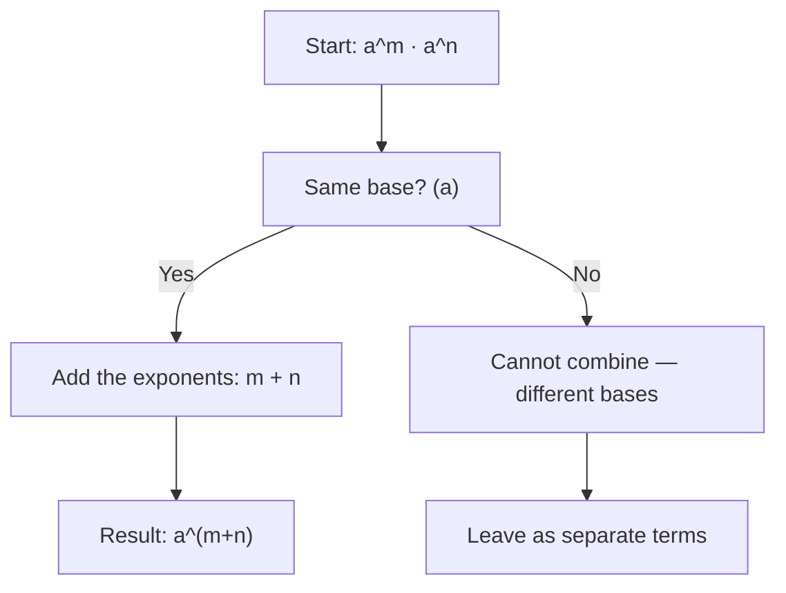

# Multiplication

$$
a^m a^n = a^{m+n}
$$

## Deep Breakdown

What it tells me *(Situation Awareness)*:
When you multiply two powers that share the same base, you simply add their exponents. This rule appears constantly in probability (multiplying probabilities expressed as powers), in model complexity analysis (counting parameter interactions), and whenever you expand expressions involving repeated multiplication. It's one of the four core exponent rules you need to internalize before touching logarithms or exponential functions.

## Flowchart



## Real-world use

### Where it is used

In DA/DS, this rule surfaces when combining repeated operations expressed as powers: compounding growth rates, combining exponential decay terms, or simplifying expressions in log-space (where multiplication becomes addition of exponents).

### Problem it solves

Without this rule, you would need to expand $a^m \cdot a^n$ as a full repeated multiplication every time, which is impractical for large or symbolic exponents. The rule gives you a direct algebraic shortcut.

### How it solves the problem

It exploits the definition of exponentiation: $a^m = \underbrace{a \cdot a \cdots a}_{m}$ and $a^n = \underbrace{a \cdot a \cdots a}_{n}$. Multiplying them gives $\underbrace{a \cdot a \cdots a}_{m+n} = a^{m+n}$. The base stays the same; only the count of multiplicative copies changes.

### Example in a business

A retention model uses weekly churn probability $p$. Survival after $m$ weeks is $p^m$. Survival for an additional $n$ weeks from that point is $p^n$. Total survival over $m + n$ weeks: $p^m \cdot p^n = p^{m+n}$. You don't need to re-multiply from scratch: just sum the exponents.

## The formula, piece by piece

- $a$: the base (the repeated factor, e.g., a growth rate, a probability)
- $m$: the first exponent (how many times $a$ appears in the first group)
- $n$: the second exponent (how many times $a$ appears in the second group)
- $a^m \cdot a^n$: two separate exponential expressions being multiplied
- $a^{m+n}$: the merged result with one exponent equal to the sum Full rule: $a^m \cdot a^n = a^{m+n}$ (bases must be identical; exponents can be any real numbers)

## The formula in words

"When you multiply two powers of the same base, keep the base and add the exponents." $a^3 \cdot a^4 = a^{3+4} = a^7$ Plain language: "Three copies of $a$ multiplied by four copies of $a$ gives seven copies of $a$."

## Critical Concepts

- **Same base required.** $a^2 \cdot b^3$ cannot be combined using this rule because the bases differ ($a \neq b$).
- **Exponents can be any real number** — integers, fractions, negatives, zero. The rule holds universally.
- **Commutative.** $a^m \cdot a^n = a^n \cdot a^m = a^{m+n}$. Order of multiplication doesn't matter.
- **Extends to products of more than two terms:** $a^m \cdot a^n \cdot a^p = a^{m+n+p}$.
- **Connection to logarithms:** Taking $\log$ of both sides gives $\log(a^m \cdot a^n) = (m+n)\log a$, linking multiplication of powers to addition — the key idea behind log-scale arithmetic.

## Step-by-step calculation (tiny example)

*Step 1: Identify the base and both exponents*
Expression: $2^3 \cdot 2^4$. Base = $2$, first exponent = $3$, second exponent = $4$.

*Step 2: Add the exponents*
$3 + 4 = 7$. The combined exponent is $7$.

*Step 3: Write the result and verify*
$2^3 \cdot 2^4 = 2^7 = 128$.
Verify by expanding: $2^3 = 8$, $2^4 = 16$, $8 \times 16 = 128$. Confirmed.

## Code examples

### Beginner example (Python)

```python
# Exponent multiplication rule: a^m * a^n = a^(m+n)
base = 2
m = 3
n = 4   # Using the rule
result_rule = base ** (m + n)   # Manual expansion (to verify)
result_manual = (base ** m) * (base ** n)
print(f"Base: {base}")
print(f"Exponents: m={m}, n={n}")
print(f"Using rule: {base}^{m+n} = {result_rule}")
print(f"Manual check: {base}^{m} * {base}^{n} = {result_manual}")
print(f"Match: {result_rule == result_manual}")
```

### Beginner example (R)

```r
# Exponent multiplication rule: a^m * a^n = a^(m+n)
base <- 2
m <- 3
n <- 4
result_rule <- base^(m + n)
result_manual <- (base^m) * (base^n)
cat(sprintf("Base: %d\n", base))
cat(sprintf("Exponents: m=%d, n=%d\n", m, n))
cat(sprintf("Using rule: %d^%d = %d\n", base, m + n, result_rule))
cat(sprintf("Manual check: %d^%d * %d^%d = %d\n", base, m, base, n, result_manual))
cat(sprintf("Match: %s\n", result_rule == result_manual))
```

### Professional example (Python)

```python
import numpy as np
import pandas as pd   # Scenario: multi-period survival probability in a churn model
# weekly_survival_rate^weeks_in_segment_A * weekly_survival_rate^weeks_in_segment_B
# = weekly_survival_rate^(weeks_A + weeks_B)
np.random.seed(42)
WEEKLY_SURVIVAL_RATE = 0.95   # 5% weekly churn
segments = pd.DataFrame({ "customer_id": range(1, 6), "weeks_segment_A": [4, 8, 2, 6, 3], "weeks_segment_B": [3, 2, 5, 1, 4],
})   # Survival using exponent multiplication rule
segments["total_weeks"] = segments["weeks_segment_A"] + segments["weeks_segment_B"]
segments["survival_rule"] = WEEKLY_SURVIVAL_RATE ** segments["total_weeks"]   # Verify by computing per-segment and multiplying
segments["survival_check"] = ( WEEKLY_SURVIVAL_RATE ** segments["weeks_segment_A"] * WEEKLY_SURVIVAL_RATE ** segments["weeks_segment_B"] )
segments["match"] = np.isclose(segments["survival_rule"], segments["survival_check"])
print(f"Weekly survival rate: {WEEKLY_SURVIVAL_RATE}")
print(segments[["customer_id", "weeks_segment_A", "weeks_segment_B", "total_weeks", "survival_rule", "match"]].to_string(index=False))
print(f"\nAll results match rule: {segments['match'].all()}")
```

### Professional example (R)

```r
# Multi-period survival: s^weeks_A * s^weeks_B = s^(weeks_A + weeks_B)
WEEKLY_SURVIVAL_RATE <- 0.95
segments <- data.frame( customer_id = 1:5, weeks_segment_A = c(4, 8, 2, 6, 3), weeks_segment_B = c(3, 2, 5, 1, 4)
)
segments$total_weeks <- segments$weeks_segment_A + segments$weeks_segment_B
segments$survival_rule <- WEEKLY_SURVIVAL_RATE^segments$total_weeks
segments$survival_check <- WEEKLY_SURVIVAL_RATE^segments$weeks_segment_A * WEEKLY_SURVIVAL_RATE^segments$weeks_segment_B
segments$match <- abs(segments$survival_rule - segments$survival_check) < 1e-10
cat(sprintf("Weekly survival rate: %.2f\n", WEEKLY_SURVIVAL_RATE))
print(segments[c("customer_id", "total_weeks", "survival_rule", "match")])
cat(sprintf("\nAll match: %s\n", all(segments$match)))
```

---

*Source: 1300 p. 19*
