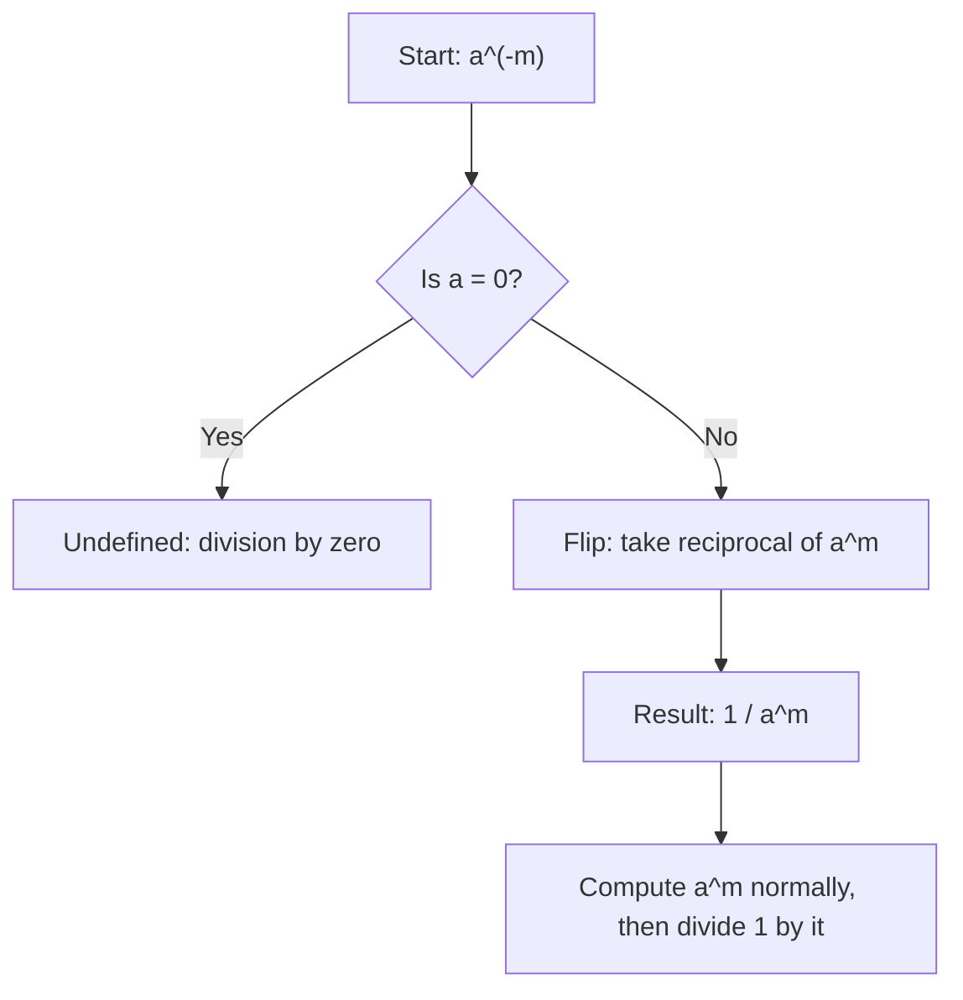

# Negative exponent

$$
a^{-m} = \frac{1}{a^m}
$$

## Deep Breakdown

What it tells me *(Situation Awareness)*:
A negative exponent means "take the reciprocal." $a^{-m}$ is not a negative number — it is $\frac{1}{a^m}$. This rule is the gateway between exponential form and fraction form, and it appears constantly in statistics (e.g., $\sigma^{-2}$ for precision, the inverse of variance), in ML (learning rate written as $10^{-3}$), and in normalization formulas.

## Flowchart



## Real-world use

### Where it is used

Expressing precision (inverse variance) in Bayesian models, writing small learning rates in scientific notation ($10^{-3} = 0.001$), kernel functions involving inverse distance, and decay rates in time-series models.

### Problem it solves

Negative exponents unify the exponent system: rather than treating $a^m$ and $\frac{1}{a^m}$ as two separate objects, the system places them on the same number line of exponents. This makes algebraic manipulation cleaner and more consistent.

### How it solves the problem

Derived from the division rule: $a^{-m} = a^{0-m} = \frac{a^0}{a^m} = \frac{1}{a^m}$. Moving a factor from numerator to denominator is equivalent to negating its exponent, and vice versa.

### Example in a business

Precision (the inverse of variance) in a Gaussian distribution is written $\tau = \sigma^{-2}$. When precision is high, uncertainty is low. Rewriting variance as $\sigma^2 = \tau^{-1}$ keeps algebraic expressions compact and consistent when updating beliefs in Bayesian inference.

## The formula, piece by piece

- $a$: the base (any non-zero real number)
- $-m$: a negative exponent ($m > 0$)
- $\frac{1}{a^m}$: the reciprocal of $a^m$
- Equivalent rewrite: $a^{-m} = (a^m)^{-1}$
- Moving bases: $\frac{a^{-m}}{1} = \frac{1}{a^m}$ and conversely $\frac{1}{a^{-m}} = a^m$ Full rule: $a^{-m} = \frac{1}{a^m}$ for $a \neq 0$, $m$ any real number

## The formula in words

"A negative exponent tells you to flip the base to the denominator, then apply the (now positive) exponent." $2^{-3} = \frac{1}{2^3} = \frac{1}{8} = 0.125$ Plain language: "Two to the negative three equals one eighth."

## Critical Concepts

- **Negative exponent $\neq$ negative result.** $2^{-3} = 0.125 > 0$. The sign of the exponent determines fraction vs. whole number, not the sign of the result.
- **Reciprocal symmetry:** $a^{-m} = \frac{1}{a^m}$ and $a^m = \frac{1}{a^{-m}}$. Moving a factor across the fraction bar flips the sign of its exponent.
- **Fraction bases:** $\left(\frac{2}{3}\right)^{-2} = \left(\frac{3}{2}\right)^2 = \frac{9}{4}$. Negative exponent on a fraction flips the fraction too.
- **Works with division rule:** $\frac{a^3}{a^5} = a^{3-5} = a^{-2} = \frac{1}{a^2}$.
- **Scientific notation:** $10^{-3} = 0.001$, $10^{-6} = 0.000001$.

Negative exponents encode very small numbers compactly.

## Step-by-step calculation (tiny example)

*Step 1: Identify the base and the negative exponent*
Expression: $4^{-2}$. Base = $4$, exponent = $-2$.

*Step 2: Convert the negative exponent to a reciprocal*
$4^{-2} = \frac{1}{4^2}$.

*Step 3: Evaluate and confirm*
$4^2 = 16$, so $4^{-2} = \frac{1}{16} = 0.0625$.
Verify: $4^{-2} \cdot 4^2 = 4^{-2+2} = 4^0 = 1$. Multiplying by the reciprocal gives 1. Confirmed.

## Code examples

### Beginner example (Python)

```python
# Negative exponent rule: a^(-m) = 1 / a^m
base = 4
exponent = -2
result_negative = base ** exponent   # Python handles negative exponents natively
result_reciprocal = 1 / (base ** abs(exponent))   # explicit reciprocal
print(f"Base: {base}, Exponent: {exponent}")
print(f"a^(-m) = {result_negative}")
print(f"1 / a^m = {result_reciprocal}")
print(f"Match: {result_negative == result_reciprocal}")   # Scientific notation examples
print("\nCommon negative exponents in DA/ML:")
for exp in [-1, -2, -3, -4, -6]:
    print(f" 10^{exp:3d} = {10**exp:.10f} (e.g., learning rate 10^{exp})")
```

### Beginner example (R)

```r
# Negative exponent rule: a^(-m) = 1 / a^m
base <- 4
exponent <- -2
result_negative <- base^exponent
result_reciprocal <- 1 / base^abs(exponent)
cat(sprintf("Base: %d, Exponent: %d\n", base, exponent))
cat(sprintf("a^(-m) = %.10f\n", result_negative))
cat(sprintf("1 / a^m = %.10f\n", result_reciprocal))
cat(sprintf("Match: %s\n", isTRUE(all.equal(result_negative, result_reciprocal))))
cat("\nNegative exponents in scientific context:\n")
for (exp in c(-1, -2, -3, -6)) { cat(sprintf(" 10^%d = %.10f\n", exp, 10^exp))
}
```

### Professional example (Python)

```python
import numpy as np
import pandas as pd   # Scenario: Bayesian precision parameter
# Precision tau = sigma^(-2) = 1 / variance
# Higher precision = more concentrated distribution = lower uncertainty
np.random.seed(42)
sigmas = [0.1, 0.5, 1.0, 2.0, 5.0, 10.0]
precision_df = pd.DataFrame({ "sigma": sigmas, "variance": [s**2 for s in sigmas], "precision_rule": [s**(-2) for s in sigmas],   # negative exponent
    "precision_direct": [1 / s**2 for s in sigmas],   # explicit reciprocal
})
precision_df["match"] = np.isclose( precision_df["precision_rule"], precision_df["precision_direct"] )
print("Bayesian Precision: tau = sigma^(-2) = 1 / sigma^2")
print()
print(precision_df[["sigma", "variance", "precision_rule", "precision_direct", "match"]].to_string(index=False))
print("\nInterpretation:")
print(f" sigma=0.1 -> precision={0.1**(-2):.1f}: very tight distribution")
print(f" sigma=10 -> precision={10**(-2):.4f}: very spread distribution")
print("\nNegative exponent encodes reciprocal cleanly — no separate formula needed.")
```

### Professional example (R)

```r
# Bayesian precision:
tau = sigma^(-2) = 1 / sigma^2
sigmas <- c(0.1, 0.5, 1, 2, 5, 10)
precision_df <- data.frame( sigma = sigmas, variance = sigmas^2, precision_rule = sigmas^(-2), precision_direct = 1 / sigmas^2
)
precision_df$match <- abs(precision_df$precision_rule - precision_df$precision_direct) < 1e-10
cat("Bayesian Precision: tau = sigma^(-2)\n")
print(precision_df)
cat(sprintf("\nsigma=0.1 -> precision=%.1f; sigma=10 -> precision=%.4f\n", 0.1^(-2), 10^(-2)))
```

---

*Source: 1300 p. 19*
