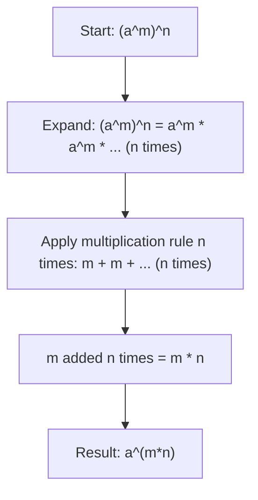

# Power of a power

$$
(a^m)^n = a^{mn}
$$

## Deep Breakdown

What it tells me *(Situation Awareness)*:
When a power is itself raised to another power, the exponents multiply. $(a^m)^n = a^{mn}$. This rule is essential when working with nested exponential structures: squaring an already-squared term, raising a model's complexity factor to a power, or simplifying expressions like $(e^{-\lambda})^t$ that appear in survival analysis and Poisson processes.

## Flowchart



## Real-world use

### Where it is used

Simplifying expressions in survival models (e.g., $(S(t))^k$ where $S(t) = e^{-\lambda t}$), matrix exponentiation, neural network activation function analysis, and polynomial composition. Also critical when converting between different exponent forms (e.g., converting $\sqrt[n]{a^m}$ to $a^{m/n}$).

### Problem it solves

Without this rule, you would need to expand $(a^m)^n$ by writing $a^m$ out $n$ times and applying the multiplication rule repeatedly. The power-of-a-power rule compresses this into a single multiplication of exponents.

### How it solves the problem

By applying the multiplication rule iteratively: $(a^m)^n = \underbrace{a^m \cdot a^m \cdots a^m}_{n\text{ times}} = a^{\underbrace{m+m+\cdots+m}_{n\text{ times}}} = a^{mn}$.

### Example in a business

In survival analysis, the probability that a customer survives (does not churn) through $t$ months given monthly survival rate $s$ is $S(t) = s^t$. If you want to group months into quarters ($t = 3k$ where $k$ = number of quarters), then $S(3k) = s^{3k} = (s^3)^k$ — the quarterly survival rate is $s^3$, raised to the number of quarters. The power-of-a-power rule converts from monthly to quarterly granularity instantly.

## The formula, piece by piece

- $a$: the base
- $m$: the inner exponent (applied first)
- $n$: the outer exponent (applied second, to the whole power $a^m$)
- $mn$: the product of the two exponents — this is the single final exponent
- $(a^m)^n$: a "power of a power" — exponent stacked on exponent
- $a^{mn}$: the collapsed form — one base, one exponent Full rule: $(a^m)^n = a^{mn}$ for any real $a$, $m$, $n$

## The formula in words

"When you raise a power to another power, multiply the exponents and keep the base." $(2^3)^4 = 2^{3 \times 4} = 2^{12} = 4096$ Plain language: "Two cubed, then raised to the fourth power, equals two to the twelfth."

## Critical Concepts

- **Order of exponentiation matters.** $(a^m)^n = a^{mn}$ but $a^{(m^n)} \neq a^{mn}$ in general. The rule only applies to exponents applied sequentially, not composed.
- **Negative and fractional exponents work:** $(a^{1/2})^2 = a^{(1/2) \cdot 2} = a^1 = a$. This is how you undo a square root.
- **Connection to roots:** $(a^m)^{1/n} = a^{m/n}$. Fractional exponents encode both power and root.
- **Useful for standardization:** $((x - \mu)^2)^{1/2} = |x - \mu|$ — the square root of a squared quantity is the absolute value.
- **Do not confuse with** $a^{(m^n)}$ (a tower of exponents, which grows enormously faster).

## Step-by-step calculation (tiny example)

*Step 1: Identify inner and outer exponents*
Expression: $(3^2)^4$. Inner exponent (applied first) = $2$, outer exponent = $4$, base = $3$.

*Step 2: Multiply the exponents*
$2 \times 4 = 8$. The single resulting exponent is $8$.

*Step 3: Compute the result and verify*
$3^8 = 6561$.
Verify by expansion: $3^2 = 9$, then $9^4 = (9^2)^2 = 81^2 = 6561$. Confirmed.

## Code examples

### Beginner example (Python)

```python
# Power of a power: (a^m)^n = a^(m*n)
base = 3
m = 2
n = 4
result_rule = base ** (m * n)   # a^(mn)
result_stacked = (base ** m) ** n   # (a^m)^n
result_expanded = base**m * base**m * base**m * base**m   # manual expansion
print(f"Base: {base}, m={m}, n={n}")
print(f"(a^m)^n using rule: {base}^{m*n} = {result_rule}")
print(f"(a^m)^n computed: ({base}^{m})^{n} = {result_stacked}")
print(f"Manual expansion: {base}^{m} * ... (x{n}) = {result_expanded}")
print(f"All match: {result_rule == result_stacked == result_expanded}")
```

### Beginner example (R)

```r
# Power of a power: (a^m)^n = a^(m*n)
base <- 3
m <- 2
n <- 4
result_rule <- base^(m * n)
result_stacked <- (base^m)^n
cat(sprintf("Base: %d, m=%d, n=%d\n", base, m, n))
cat(sprintf("Using rule: %d^(%d*%d) = %d^%d = %d\n", base, m, n, base, m*n, result_rule))
cat(sprintf("Stacked form: (%d^%d)^%d = %d\n", base, m, n, result_stacked))
cat(sprintf("Match: %s\n", result_rule == result_stacked))
```

### Professional example (Python)

```python
import numpy as np
import pandas as pd   # Scenario: converting monthly survival rate to quarterly survival rate
# Monthly survival: S(t) = s^t where
t = months
# Quarterly: S(3k) = s^(3k) = (s^3)^k -- quarterly survival rate is s^3
MONTHLY_SURVIVAL = 0.92   # 8% monthly churn
QUARTERLY_SURVIVAL = MONTHLY_SURVIVAL ** 3   # power-of-a-power rule
quarters = list(range(1, 9))
survival_df = pd.DataFrame({ "quarter": quarters, "months_elapsed": [q * 3 for q in quarters],
})   # Two equivalent ways to compute survival
survival_df["survival_monthly_form"] = MONTHLY_SURVIVAL ** survival_df["months_elapsed"]
survival_df["survival_quarterly_form"] = QUARTERLY_SURVIVAL ** survival_df["quarter"]
survival_df["match"] = np.isclose( survival_df["survival_monthly_form"], survival_df["survival_quarterly_form"] )
print(f"Monthly survival rate: {MONTHLY_SURVIVAL}")
print(f"Quarterly survival rate: {MONTHLY_SURVIVAL}^3 = {QUARTERLY_SURVIVAL:.6f}")
print()
print(survival_df[["quarter", "months_elapsed", "survival_monthly_form", "survival_quarterly_form", "match"]].to_string(index=False))
print(f"\nAll match (power-of-a-power rule verified): {survival_df['match'].all()}")
```

### Professional example (R)

```r
# Monthly → quarterly survival: S(3k) = s^(3k) = (s^3)^k
MONTHLY_SURVIVAL <- 0.92
QUARTERLY_SURVIVAL <- MONTHLY_SURVIVAL^3
quarters <- 1:8
months_elapsed <- quarters * 3
survival_monthly <- MONTHLY_SURVIVAL^months_elapsed
survival_quarterly <- QUARTERLY_SURVIVAL^quarters
match <- abs(survival_monthly - survival_quarterly) < 1e-10
df <- data.frame(quarter = quarters, months_elapsed, survival_monthly_form = survival_monthly, survival_quarterly_form = survival_quarterly, match = match)
cat(sprintf("Monthly: %.2f Quarterly: %.2f^3 = %.6f\n", MONTHLY_SURVIVAL, MONTHLY_SURVIVAL, QUARTERLY_SURVIVAL))
print(df)
cat(sprintf("\nAll match: %s\n", all(match)))
```

---

*Source: 1300 p. 19*
