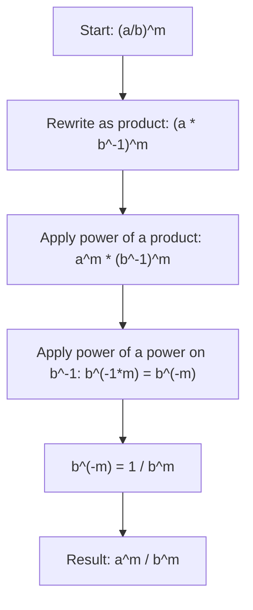

# Power of a quotient

$$
\left( \frac{a}{b} \right)^m = \frac{a^m}{b^m}
$$

## Deep Breakdown

What it tells me *(Situation Awareness)*:
When a fraction (quotient) is raised to a power, you raise both numerator and denominator to that power separately. This is the quotient counterpart of the power-of-a-product rule. It surfaces in ratio-based metrics (e.g., recall, precision, CTR) raised to powers for aggregation, and in probability expressions involving compound conditional rates expressed as fractions.

## Flowchart



## Real-world use

### Where it is used

Raising ratio-form metrics to powers (e.g., geometric mean of rates, normalized distance measures), simplifying expressions in probability (conditional probability products), and working with fraction-based exponential decay formulas.

### Problem it solves

Avoids computing the product $\frac{a}{b}$ before applying the exponent — especially useful when $a$ and $b$ are each simpler to power separately, or when you need to keep numerator and denominator legible for interpretation.

### How it solves the problem

Combine power-of-a-product and negative exponent: $\left(\frac{a}{b}\right)^m = (a \cdot b^{-1})^m = a^m \cdot (b^{-1})^m = a^m \cdot b^{-m} = \frac{a^m}{b^m}$.

### Example in a business

Geometric mean of a rate ratio: if conversion rate is $\frac{p}{q}$ each period, the geometric mean over $n$ periods is $\left(\frac{p}{q}\right)^{1/n} = \frac{p^{1/n}}{q^{1/n}}$ — the $n$-th root applied separately to numerator and denominator. The power-of-a-quotient rule lets you compute the per-component roots instead of dividing first and rooting the combined result.

## The formula, piece by piece

- $a$: numerator of the fraction (any real number)
- $b$: denominator of the fraction ($b \neq 0$)
- $m$: the exponent applied to the entire fraction
- $\frac{a^m}{b^m}$: numerator powered and denominator powered separately
- Special case: $\left(\frac{a}{b}\right)^{-m} = \frac{b^m}{a^m} = \left(\frac{b}{a}\right)^m$ — negative exponent flips the fraction Full rule: $\left(\frac{a}{b}\right)^m = \frac{a^m}{b^m}$ for $b \neq 0$, any real $m$

## The formula in words

"Raise a fraction to a power by raising the top and bottom independently, each to that same power." $\left(\frac{2}{3}\right)^3 = \frac{2^3}{3^3} = \frac{8}{27}$ Verify: $\frac{2}{3} \approx 0.6\overline{6}$, cubed: $\approx 0.296$, and $\frac{8}{27} \approx 0.296$. Confirmed.

## Critical Concepts

- **Denominator must be non-zero.** $b \neq 0$ is required before and after exponentiation.
- **Negative exponent flips the fraction:** $\left(\frac{a}{b}\right)^{-m} = \left(\frac{b}{a}\right)^m$.
- **Fractional exponent = root:** $\left(\frac{a}{b}\right)^{1/n} = \frac{\sqrt[n]{a}}{\sqrt[n]{b}}$.
- **Derived from two simpler rules:** power-of-a-product + negative exponent. No independent memorization needed.
- **Do not confuse with:** $\frac{a^m + b^m}{c^m}$ — powers don't distribute over addition in the numerator.

## Step-by-step calculation (tiny example)

*Step 1: Identify numerator, denominator, and exponent*
Expression: $\left(\frac{3}{4}\right)^3$. Numerator = $3$, denominator = $4$, exponent = $3$.

*Step 2: Power the numerator and denominator separately*
$\frac{3^3}{4^3} = \frac{27}{64}$.

*Step 3: Verify by computing directly*
$\frac{3}{4} = 0.75$. $0.75^3 = 0.421875$. $\frac{27}{64} = 0.421875$. Confirmed.

## Code examples

### Beginner example (Python)

```python
# Power of a quotient: (a/b)^m = a^m / b^m
numerator = 3
denominator = 4
m = 3
result_fraction_first = (numerator / denominator) ** m
result_distribute = (numerator**m) / (denominator**m)
print(f"({numerator}/{denominator})^{m}")
print(f" Fraction first: {result_fraction_first:.10f}")
print(f" Distribute: {result_distribute:.10f}")
print(f" Match: {abs(result_fraction_first - result_distribute) < 1e-12}")   # Negative exponent flips the fraction
result_negative = (numerator / denominator) ** (-m)
result_flipped = (denominator / numerator) ** m
print(f"\n({numerator}/{denominator})^(-{m}) = ({denominator}/{numerator})^{m}")
print(f" Negative exp: {result_negative:.10f}")
print(f" Flipped: {result_flipped:.10f}")
print(f" Match: {abs(result_negative - result_flipped) < 1e-12}")
```

### Beginner example (R)

```r
# Power of a quotient: (a/b)^m = a^m / b^m
numerator <- 3
denominator <- 4
m <- 3
result_fraction_first <- (numerator / denominator)^m
result_distribute <- (numerator^m) / (denominator^m)
cat(sprintf("(%d/%d)^%d\n", numerator, denominator, m))
cat(sprintf(" Fraction first: %.10f\n", result_fraction_first))
cat(sprintf(" Distribute: %.10f\n", result_distribute))
cat(sprintf(" Match: %s\n", isTRUE(all.equal(result_fraction_first, result_distribute))))  # Negative exponent flips
cat(sprintf("\n(%d/%d)^(-%d) = (%d/%d)^%d\n", numerator, denominator, m, denominator, numerator, m))
cat(sprintf(" = %.10f\n", (numerator/denominator)^(-m)))
```

### Professional example (Python)

```python
import numpy as np
import pandas as pd   # Scenario: geometric mean of conversion rate ratio across campaigns
# Each campaign has a rate ratio: clicks / impressions
# Geometric mean of ratios over n
periods = (ratio_1 * ratio_2 * ... * ratio_n)^(1/n)
# For a single campaign over n periods: (p/q)^(1/n) = p^(1/n) / q^(1/n)
np.random.seed(42)
num_periods = 6
campaigns = pd.DataFrame({ "campaign": ["A", "B", "C"], "total_clicks": [1200, 850, 2100], "total_impressions": [20000, 9000, 35000], "periods": [num_periods, num_periods, num_periods],
})   # Power of a quotient: (clicks/impressions)^(1/n)
campaigns["rate"] = campaigns["total_clicks"] / campaigns["total_impressions"]
campaigns["geo_mean_rate_combined"] = campaigns["rate"] ** (1 / campaigns["periods"])
campaigns["geo_mean_rate_distributed"] = ( campaigns["total_clicks"] ** (1 / campaigns["periods"]) / campaigns["total_impressions"] ** (1 / campaigns["periods"]) )
campaigns["match"] = np.isclose( campaigns["geo_mean_rate_combined"], campaigns["geo_mean_rate_distributed"] )
print("Geometric Mean of Conversion Rate: (clicks/impressions)^(1/n)")
print(f"Periods: {num_periods}")
print()
print(campaigns[["campaign", "total_clicks", "total_impressions", "rate", "geo_mean_rate_combined", "match"]].to_string(index=False))
print(f"\nAll match (quotient rule verified): {campaigns['match'].all()}")
```

### Professional example (R)

```r
# Geometric mean of conversion rate: (clicks/impressions)^(1/n) = p^(1/n) / q^(1/n)
set.seed(42)
num_periods <- 6
campaigns <- data.frame( campaign = c("A", "B", "C"), total_clicks = c(1200, 850, 2100), total_impressions = c(20000, 9000, 35000), periods = num_periods
)
campaigns$rate <- campaigns$total_clicks / campaigns$total_impressions
campaigns$geo_mean_combined <- campaigns$rate^(1 / campaigns$periods)
campaigns$geo_mean_distributed <- campaigns$total_clicks^(1/num_periods) / campaigns$total_impressions^(1/num_periods)
campaigns$match <- abs(campaigns$geo_mean_combined - campaigns$geo_mean_distributed) < 1e-10
cat("Geometric Mean of Conversion Rate: (p/q)^(1/n)\n")
print(campaigns[c("campaign", "total_clicks", "total_impressions", "rate", "match")])
cat(sprintf("\nAll match: %s\n", all(campaigns$match)))
```

---

*Source: MRAF*
