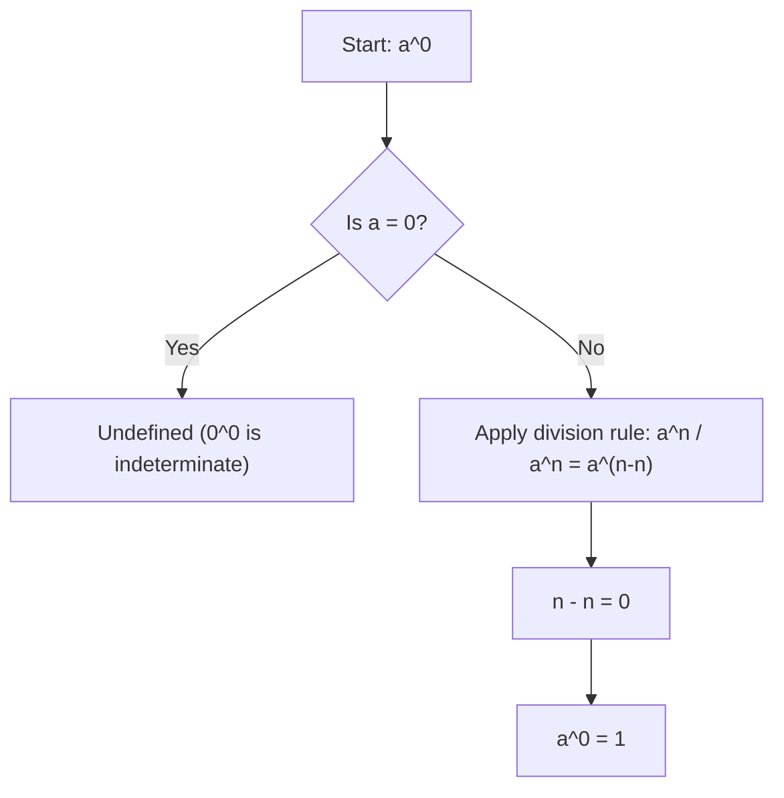

# Zero exponent

$$
a^0 = 1
$$

(for $a \neq 0$)

## Deep Breakdown

What it tells me *(Situation Awareness)*:
Any non-zero number raised to the power zero equals 1. This feels counterintuitive — why would multiplying a number zero times give 1? — but it falls directly from the division rule: $\frac{a^n}{a^n} = a^{n-n} = a^0$, and any non-zero number divided by itself equals 1. You will hit this rule when simplifying expressions, evaluating polynomials at specific values, and in combinatorics (e.g., $n^0$ terms in generating functions).

## Flowchart



## Real-world use

### Where it is used

Evaluating polynomials, initializing running products (the multiplicative identity), one-hot encoding math (the zeroth power term), and in probability mass functions where you need the $x^0 = 1$ base case.

### Problem it solves

Without this defined result, polynomials like $5x^3 + 3x^0$ would break at $x = 0$ or require special case handling. The zero exponent rule gives algebraic continuity and makes the exponent rules a consistent system.

### How it solves the problem

Using the division rule as the justification: $a^0 = a^{n-n} = \frac{a^n}{a^n} = 1$ for any $n$ and any $a \neq 0$. It is a logical consequence of the system being consistent, not an arbitrary definition.

### Example in a business

In a polynomial regression with degree-3 features, the constant term is the coefficient of $x^0 = 1$ — that is, the intercept. When you write the model as $\hat{y} = \beta_0 x^0 + \beta_1 x^1 + \beta_2 x^2 + \beta_3 x^3$, the zero-exponent rule guarantees the intercept $\beta_0$ is always present regardless of $x$.

## The formula, piece by piece

- $a$: the base — any real number except zero
- $0$: the exponent
- $1$: the result — always, for any valid base
- Constraint: $a \neq 0$ (the case $0^0$ is mathematically indeterminate and context-dependent)
- Derived from: $\frac{a^n}{a^n} = a^{n-n} = a^0$ and $\frac{a^n}{a^n} = 1$ Full rule: $a^0 = 1$ for all $a \neq 0$

## The formula in words

"Any non-zero base raised to the power of zero equals exactly 1." Examples: $5^0 = 1$, $(-3)^0 = 1$, $\pi^0 = 1$, $(x + y)^0 = 1$ (for $x + y \neq 0$).

## Critical Concepts

- **$0^0$ is indeterminate.** In limits, $0^0$ can equal different values depending on context. In combinatorics it is conventionally defined as 1, but this is a choice, not a derived fact.
- **Multiplicative identity.** $a^0 = 1$ is the multiplicative identity (the "do nothing" element). This is why it appears as the base case in recursive products.
- **Holds for complex bases too.** The rule applies to complex numbers: $z^0 = 1$ for any $z \neq 0$.
- **Consistency requirement.** If we dropped this rule, $a^m \cdot a^{-m} = a^0$ would not equal $\frac{a^m}{a^m} = 1$, breaking the exponent system.

## Step-by-step calculation (tiny example)

*Step 1: Write as a division using the division rule*
Choose any convenient exponent, say $n = 3$: $a^0 = a^{3-3} = \frac{a^3}{a^3}$.

*Step 2: Compute numerator and denominator with a concrete base*
Let $a = 7$: $\frac{7^3}{7^3} = \frac{343}{343}$.

*Step 3: Simplify and confirm*
$\frac{343}{343} = 1$, so $7^0 = 1$. The result is always 1 regardless of the base chosen.

## Code examples

### Beginner example (Python)

```python
# Zero exponent rule: a^0 = 1 for any a != 0 bases = [2, 5, -3, 0.5, 100, 3.14159] print("Demonstrating a^0 = 1 for various bases:")
print(f"{'Base':>10} | {'a^0':>10}")
print("-" * 25)
for base in bases:
    result = base ** 0
print(f"{base:>10} | {result:>10}")   # Polynomial evaluation example: p(x) = 3x^2 + 2x^1 + 5x^0

def polynomial(x_val: float) -> float:
    """Evaluate 3x^2 + 2x + 5 using explicit exponents."""
    return 3 * x_val**2 + 2 * x_val**1 + 5 * x_val**0
print(f"\nPolynomial 3x^2 + 2x + 5:")
for x in [0, 1, 2, 3]:
    print(f" p({x}) = {polynomial(x)}")
```

### Beginner example (R)

```r
# Zero exponent rule: a^0 = 1 for any a != 0
bases <- c(2, 5, -3, 0.5, 100, pi)
cat("Demonstrating a^0 = 1 for various bases:\n")
cat(sprintf("%10s | %10s\n", "Base", "a^0"))
cat(strrep("-", 25), "\n")
for (b in bases) { cat(sprintf("%10.5g | %10g\n", b, b^0))
}  # Polynomial: p(x) = 3x^2 + 2x + 5 using explicit exponents
polynomial <- function(x) 3 * x^2 + 2 * x^1 + 5 * x^0
cat("\nPolynomial 3x^2 + 2x + 5:\n")
for (x in 0:3) { cat(sprintf(" p(%d) = %.1f\n", x, polynomial(x)))
}
```

### Professional example (Python)

```python
import numpy as np
import pandas as pd   # Scenario: polynomial feature matrix for regression
# X_poly columns = [x^0, x^1, x^2, x^3]
# x^0 = 1 column is the intercept term (bias)
np.random.seed(42)
x_values = np.array([1.0, 2.0, 3.0, 4.0, 5.0])
degree = 3   # Build the Vandermonde-style feature matrix
feature_matrix = pd.DataFrame( {f"x^{d}": x_values**d for d in range(degree + 1)} )
print("Polynomial Feature Matrix (columns = x^0, x^1, x^2, x^3)")
print("Note: x^0 = 1 for all rows — this IS the intercept column")
print()
print(feature_matrix.to_string(index=False))   # Confirm x^0 = 1 always holds
assert (feature_matrix["x^0"] == 1.0).all(), "x^0 should always equal 1"   # Fit simple polynomial coefficients (illustrative)
BETA = np.array([5.0, 2.0, 3.0, 0.5])   # [intercept, x^1, x^2, x^3]
y_hat = feature_matrix.values @ BETA
print(f"\nBeta (coefficients): {BETA}")
print(f"y_hat: {y_hat}")
print(f"\nIntercept (beta_0 * x^0): {BETA[0]} — constant because x^0 = 1 always")
```

### Professional example (R)

```r
# Polynomial feature matrix: columns x^0, x^1, x^2, x^3; x^0 = 1 is intercept
x_values <- c(1, 2, 3, 4, 5)
degree <- 3
feature_matrix <- as.data.frame(lapply(0:degree, function(d) x_values^d))
names(feature_matrix) <- paste0("x^", 0:degree)
cat("Polynomial Feature Matrix (x^0 = 1 is intercept)\n")
print(feature_matrix)
BETA <- c(5, 2, 3, 0.5)
y_hat <- as.matrix(feature_matrix) %*% BETA
cat(sprintf("\nBeta: %s | Intercept (beta_0 * x^0): %.1f\n", paste(BETA, collapse = ", "), BETA[1]))
```

---

*Source: 1300 p. 19*
