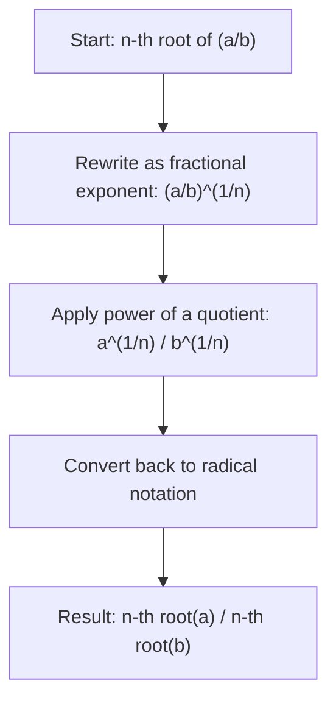

# Division of roots

$$
\sqrt[n]{\frac{a}{b}} = \frac{\sqrt[n]{a}}{\sqrt[n]{b}}
$$

## Deep Breakdown

What it tells me *(Situation Awareness)*:
The $n$-th root of a fraction equals the fraction of the individual $n$-th roots. This is the division counterpart to the multiplication-of-roots rule. It lets you separate a root over a quotient into numerator root over denominator root — useful for simplifying expressions like $\sqrt{\frac{s^2}{n}}$ (standard error), rationalizing denominators, and working with ratio-form expressions under radical signs.

## Flowchart



## Real-world use

### Where it is used

Simplifying the standard error formula $\text{SE} = \sqrt{s^2/n} = s/\sqrt{n}$, rationalizing radical expressions, computing ratio-based metrics under root signs (e.g., root-mean-squared ratios), and working with normalized distance metrics.

### Problem it solves

When the numerator or denominator of a fraction under a root is a perfect power, the division rule lets you simplify each part separately before dividing — or reduce the expression to a cleaner form (e.g., $\sqrt{s^2/n}$ becomes $s/\sqrt{n}$).

### How it solves the problem

Via fractional exponents and the power-of-a-quotient rule: $\sqrt[n]{\frac{a}{b}} = \left(\frac{a}{b}\right)^{1/n} = \frac{a^{1/n}}{b^{1/n}} = \frac{\sqrt[n]{a}}{\sqrt[n]{b}}$.

### Example in a business

Standard error of the mean: $\text{SE} = \sqrt{\frac{s^2}{n}}$. Using division of roots: $= \frac{\sqrt{s^2}}{\sqrt{n}} = \frac{s}{\sqrt{n}}$. This simplified form is what you actually compute in code — sample standard deviation divided by the square root of sample size. The division-of-roots rule is the algebraic justification for this simplification.

## The formula, piece by piece

- $n$: root index (same for both numerator and denominator)
- $a$: numerator under the root ($a \geq 0$ for even $n$)
- $b$: denominator under the root ($b > 0$; cannot be zero)
- $\sqrt[n]{\frac{a}{b}}$: the $n$-th root of the fraction
- $\frac{\sqrt[n]{a}}{\sqrt[n]{b}}$: numerator root divided by denominator root Full rule: $\sqrt[n]{\frac{a}{b}} = \frac{\sqrt[n]{a}}{\sqrt[n]{b}}$ for $b > 0$, $a \geq 0$ when $n$ is even

## The formula in words

"The root of a fraction equals the root of the numerator divided by the root of the denominator — same root index applies to both parts." $\sqrt{\frac{9}{4}} = \frac{\sqrt{9}}{\sqrt{4}} = \frac{3}{2} = 1.5$ Verify: $\frac{9}{4} = 2.25$, $\sqrt{2.25} = 1.5$. Confirmed.

## Critical Concepts

- **Root index must be the same.** You cannot split $\sqrt[3]{\frac{a}{b}}$ using a different root for numerator and denominator.
- **Denominator must be non-zero.** Same constraint as division: $b \neq 0$.
- **Rationalizing denominators:** $\frac{a}{\sqrt{b}} = \frac{a\sqrt{b}}{b}$ involves this rule in reverse.
- **Inverse of multiplication rule:** $\frac{\sqrt[n]{a}}{\sqrt[n]{b}} = \sqrt[n]{\frac{a}{b}}$ — you can merge separate roots of a fraction into one root.
- **Standard error derivation:** $\sqrt{\frac{\sigma^2}{n}} = \frac{\sigma}{\sqrt{n}}$ is a direct application.

## Step-by-step calculation (tiny example)

*Step 1: Identify numerator, denominator, and root index*
Expression: $\sqrt[3]{\frac{8}{27}}$. Numerator = $8$, denominator = $27$, root index = $3$.

*Step 2: Apply the division rule — root each part*
$\frac{\sqrt[3]{8}}{\sqrt[3]{27}}$.

*Step 3: Simplify each root and divide*
$\sqrt[3]{8} = 2$, $\sqrt[3]{27} = 3$, result $= \frac{2}{3} \approx 0.667$.
Verify: $\frac{8}{27} \approx 0.296$, $\sqrt[3]{0.296} \approx 0.667$. Confirmed.

## Code examples

### Beginner example (Python)

```python
# Division of roots: n-th root of (a/b) = n-th
root(a) / n-th
root(b)
a = 8
b = 27
n = 3
root_fraction = (a / b) ** (1/n)   # root of the fraction
fraction_roots = (a ** (1/n)) / (b ** (1/n))   # fraction of roots
print(f"Cube root of ({a}/{b})")
print(f" Root of fraction: {root_fraction:.10f}")
print(f" Fraction of roots: {fraction_roots:.10f}")
print(f" Match: {abs(root_fraction - fraction_roots) < 1e-12}")   # Standard error example
import math
sample_variance = 16.0   # s^2
n_obs = 25
se_formula = math.sqrt(sample_variance / n_obs)   # sqrt(s^2/n)
se_rule = math.sqrt(sample_variance) / math.sqrt(n_obs)   # s / sqrt(n) print(f"\nStandard Error: sqrt(s^2/n) = s / sqrt(n)")
print(f" s^2={sample_variance}, n={n_obs}")
print(f" sqrt(s^2/n): {se_formula:.10f}")
print(f" s / sqrt(n): {se_rule:.10f}")
print(f" Match: {abs(se_formula - se_rule) < 1e-12}")
```

### Beginner example (R)

```r
# Division of roots: n-th root of (a/b) = n-th root(a) / n-th root(b)
a <- 8
b <- 27
n <- 3
root_fraction <- (a / b)^(1/n)
fraction_roots <- (a^(1/n)) / (b^(1/n))
cat(sprintf("Cube root of (%d/%d)\n", a, b))
cat(sprintf(" Root of fraction: %.10f\n", root_fraction))
cat(sprintf(" Fraction of roots: %.10f\n", fraction_roots))
cat(sprintf(" Match: %s\n", isTRUE(all.equal(root_fraction, fraction_roots))))  # Standard error example
sample_variance <- 16
n_obs <- 25
se_formula <- sqrt(sample_variance / n_obs)
se_rule <- sqrt(sample_variance) / sqrt(n_obs)
cat(sprintf("\nSE = sqrt(s^2/n) = s/sqrt(n)\n"))
cat(sprintf(" sqrt(s^2/n) = %.10f\n", se_formula))
cat(sprintf(" s/sqrt(n) = %.10f\n", se_rule))
cat(sprintf(" Match: %s\n", isTRUE(all.equal(se_formula, se_rule))))
```

### Professional example (Python)

```python
import numpy as np
import pandas as pd   # Scenario: confidence interval half-width computation
# CI half-width = z *
sqrt(p*(1-p) / n)
# Using division of roots: = z *
sqrt(p*(1-p)) / sqrt(n)
# This form separates sample size from the proportion variability term
np.random.seed(42)
Z_95 = 1.96   # 95% CI z-score
scenarios = pd.DataFrame({ "label": ["Low p, small n", "Moderate p, medium n", "High p, large n"], "p": [0.05, 0.30, 0.70], "n": [50, 500, 5000],
})   # Two equivalent computations
scenarios["half_width_combined"] = Z_95 * np.sqrt( scenarios["p"] * (1 - scenarios["p"]) / scenarios["n"] )
scenarios["half_width_split"] = Z_95 * ( np.sqrt(scenarios["p"] * (1 - scenarios["p"])) / np.sqrt(scenarios["n"]) )
scenarios["match"] = np.isclose( scenarios["half_width_combined"], scenarios["half_width_split"] )
print("95% CI Half-Width: z * sqrt(p*(1-p) / n) = z * sqrt(p*(1-p)) / sqrt(n)")
print()
print(scenarios[["label", "p", "n", "half_width_combined", "match"]].to_string(index=False))
print(f"\nAll match (division of roots rule verified): {scenarios['match'].all()}")
print("\nNote: split form separates effect of variance from effect of sample size.")
```

### Professional example (R)

```r
# CI half-width: z * sqrt(p*(1-p)/n) = z * sqrt(p*(1-p)) / sqrt(n)
Z_95 <- 1.96
scenarios <- data.frame( label = c("Low p, small n", "Moderate p, medium n", "High p, large n"), p = c(0.05, 0.30, 0.70), n = c(50, 500, 5000)
)
scenarios$half_width_combined <- Z_95 * sqrt(scenarios$p * (1 - scenarios$p) / scenarios$n)
scenarios$half_width_split <- Z_95 * (sqrt(scenarios$p * (1 - scenarios$p)) / sqrt(scenarios$n))
scenarios$match <- abs(scenarios$half_width_combined - scenarios$half_width_split) < 1e-10
cat("95% CI Half-Width: division of roots rule\n")
print(scenarios[c("label", "p", "n", "half_width_combined", "match")])
cat(sprintf("\nAll match: %s\n", all(scenarios$match)))
```

---

*Source: MRAF*
