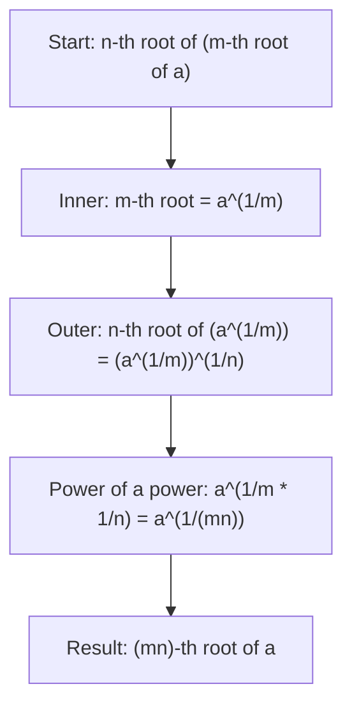

# Nested radicals

$$
\sqrt[n]{\sqrt[m]{a}} = \sqrt[nm]{a}
$$

## Deep Breakdown

What it tells me *(Situation Awareness)*:
When you take a root of a root, the two root indices multiply. $\sqrt[n]{\sqrt[m]{a}} = \sqrt[nm]{a}$. This is a direct consequence of the power-of-a-power rule: each root is a fractional exponent ($\frac{1}{n}$ and $\frac{1}{m}$), and applying them sequentially multiplies the fractions. In practice, nested radicals are rare but appear in iterated geometric mean computations and in certain normalization schemes.

## Flowchart



## Real-world use

### Where it is used

Nested roots surface when composing transformations that each apply a root (e.g., applying a square root twice gives a fourth root), or when working with iterated geometric means. They are uncommon in direct DA/DS work but understanding them prevents errors when simplifying compound expressions.

### Problem it solves

Without this rule, you would evaluate nested radicals by computing the inner root first (possibly losing precision or getting an irrational intermediate), then applying the outer root. The rule lets you jump straight to the equivalent single root of higher index.

### How it solves the problem

Via sequential fractional exponents: $\sqrt[n]{\sqrt[m]{a}} = (a^{1/m})^{1/n} = a^{1/(mn)} = \sqrt[nm]{a}$. The power-of-a-power rule ($\frac{1}{m} \times \frac{1}{n} = \frac{1}{mn}$) collapses the nesting.

### Example in a business

Geometric mean applied twice: computing the geometric mean of geometric means. If the inner geometric mean of 2 values uses $\sqrt{\cdot}$ (square root = $m=2$) and the outer geometric mean of 2 values also uses $\sqrt{\cdot}$ ($n=2$), the combined operation is $\sqrt{\sqrt{a}} = \sqrt[2 \cdot 2]{a} = \sqrt[4]{a} = a^{1/4}$. Nested roots combine to a fourth root.

## The formula, piece by piece

- $m$: inner root index (applied first)
- $n$: outer root index (applied second)
- $a$: the base ($a \geq 0$ for any even root in the chain)
- $\sqrt[m]{a}$: the inner root
- $\sqrt[n]{\sqrt[m]{a}}$: the outer root applied to the inner root — a nested radical
- $\sqrt[nm]{a}$: the collapsed form — single root with index equal to the product of both indices Full rule: $\sqrt[n]{\sqrt[m]{a}} = \sqrt[nm]{a} = a^{1/(nm)}$ for $a \geq 0$

## The formula in words

"Taking a root of a root gives a single root whose index is the product of both indices." $\sqrt{\sqrt[3]{a}} = \sqrt[2 \times 3]{a} = \sqrt[6]{a} = a^{1/6}$ Numeric example: $\sqrt{\sqrt[3]{64}} = \sqrt[6]{64} = 64^{1/6} = 2$ (since $2^6 = 64$).

## Critical Concepts

- **Multiplication is commutative:** $\sqrt[n]{\sqrt[m]{a}} = \sqrt[m]{\sqrt[n]{a}} = \sqrt[nm]{a}$ — the order of the nested roots does not matter.
- **All roots must share the same base.** This rule only applies when the same $a$ is under all roots.
- **Each additional root multiplies the index:** $\sqrt{\sqrt{\sqrt{a}}} = \sqrt[2 \cdot 2 \cdot 2]{a} = \sqrt[8]{a} = a^{1/8}$.
- **Large combined index = very slow growth.** $a^{1/8}$ grows much more slowly than $a^{1/2}$: higher combined root index means the result stays close to 1 for moderate $a$.
- **Simplification direction:** if $nm$ is large and $a$ is a perfect $nm$-th power, the single root form is much easier to compute.

## Step-by-step calculation (tiny example)

*Step 1: Identify both root indices and the base*
Expression: $\sqrt[3]{\sqrt{64}}$. Inner root index $m = 2$, outer root index $n = 3$, base $a = 64$.

*Step 2: Multiply the indices for the combined root*
$nm = 3 \times 2 = 6$. The result is $\sqrt[6]{64}$.

*Step 3: Compute and verify*
$64^{1/6} = 2$ (since $2^6 = 64$).
Verify step-by-step: $\sqrt{64} = 8$, then $\sqrt[3]{8} = 2$. Confirmed.

## Code examples

### Beginner example (Python)

```python
# Nested radicals: n-th root of (m-th root of a) = (nm)-th root of a
a = 64
m = 2   # inner root (square root)
n = 3   # outer root (cube root)
result_nested = (a ** (1/m)) ** (1/n)   # inner first, then outer
result_combined = a ** (1/(n * m))   # single root with index n*m
print(f"Base: {a}, inner root m={m}, outer root n={n}")
print(f"Combined root index: n*m = {n*m}")
print(f"Nested evaluation: {a}^(1/{m}) then ^(1/{n}) = {result_nested:.10f}")
print(f"Single root (n*m): {a}^(1/{n*m}) = {result_combined:.10f}")
print(f"Match: {abs(result_nested - result_combined) < 1e-12}")   # Commutativity check: order of nesting doesn't matter
result_reversed = (a ** (1/n)) ** (1/m)   # outer first, then inner
print(f"\nReversed order ({n}-th root first, then {m}-th): {result_reversed:.10f}")
print(f"Still matches: {abs(result_combined - result_reversed) < 1e-12}")
```

### Beginner example (R)

```r
# Nested radicals: n-th root of (m-th root of a) = (nm)-th root of a
a <- 64
m <- 2  # inner root
n <- 3  # outer root
result_nested <- (a^(1/m))^(1/n)
result_combined <- a^(1/(n * m))
cat(sprintf("Base: %d, inner m=%d, outer n=%d, combined index: %d\n", a, m, n, n*m))
cat(sprintf("Nested: %.10f\n", result_nested))
cat(sprintf("Combined: %.10f\n", result_combined))
cat(sprintf("Match: %s\n", isTRUE(all.equal(result_nested, result_combined))))  # Commutativity
result_reversed <- (a^(1/n))^(1/m)
cat(sprintf("Reversed order: %.10f Match: %s\n", result_reversed, isTRUE(all.equal(result_combined, result_reversed))))
```

### Professional example (Python)

```python
import numpy as np
import pandas as pd   # Scenario: iterated geometric mean (geometric mean of geometric means)
# Two-level hierarchy: groups of items, then groups of groups
# Overall "root of roots" collapses to a single root with multiplied index
np.random.seed(42)   # Level 1: 3 sub-groups, each with 4 values
# Inner geometric mean: root of 4 values (m=4)
# Outer geometric mean: root of 3 sub-group means (n=3)
# Combined: 12th root of the full product (nm=12)
groups = { "Group A": [2.0, 4.0, 8.0, 16.0], "Group B": [3.0, 9.0, 27.0, 81.0], "Group C": [1.5, 2.25, 3.375, 5.0625],
}
all_values = []
geo_means_l1 = []
for group_name, vals in groups.items():
    geo_mean_inner = np.prod(vals) ** (1/len(vals))   # m-th root (m=4)
geo_means_l1.append(geo_mean_inner)
all_values.extend(vals)
print(f" {group_name}: values={vals}, geo_mean={geo_mean_inner:.6f}")   # Outer geometric mean of the level-1 means (n=3)
geo_mean_nested = np.prod(geo_means_l1) ** (1/len(geo_means_l1))   # Combined: single root over all 12 values (nm = 4*3 = 12)
geo_mean_single = np.prod(all_values) ** (1/len(all_values))
print(f"\nLevel-1 geo means: {[round(g, 4) for g in geo_means_l1]}")
print(f"Nested geo mean (outer then inner): {geo_mean_nested:.10f}")
print(f"Single 12th-root over all values: {geo_mean_single:.10f}")
print(f"Match: {np.isclose(geo_mean_nested, geo_mean_single)}")
print(f"\nNested root rule: sqrt[n]{{sqrt[m]{{a}}}} = sqrt[nm]{{a}}")
print(f"Geo mean of geo means = single geo mean over all data.")
```

### Professional example (R)

```r
# Nested geometric mean: geo mean of geo
means = single root over all
groups <- list( "Group A" = c(2, 4, 8, 16), "Group B" = c(3, 9, 27, 81), "Group C" = c(1.5, 2.25, 3.375, 5.0625)
)
geo_means_l1 <- sapply(groups, function(v) prod(v)^(1/length(v)))
all_values <- unlist(groups)
for (i in seq_along(groups))
cat(sprintf(" %s: geo_mean = %.6f\n", names(groups)[i], geo_means_l1[i]))
geo_mean_nested <- prod(geo_means_l1)^(1/length(geo_means_l1))
geo_mean_single <- prod(all_values)^(1/length(all_values))
cat(sprintf("\nNested geo mean: %.10f Single 12th-root: %.10f Match: %s\n", geo_mean_nested, geo_mean_single, isTRUE(all.equal(geo_mean_nested, geo_mean_single))))
```

---

*Source: MRAF*
