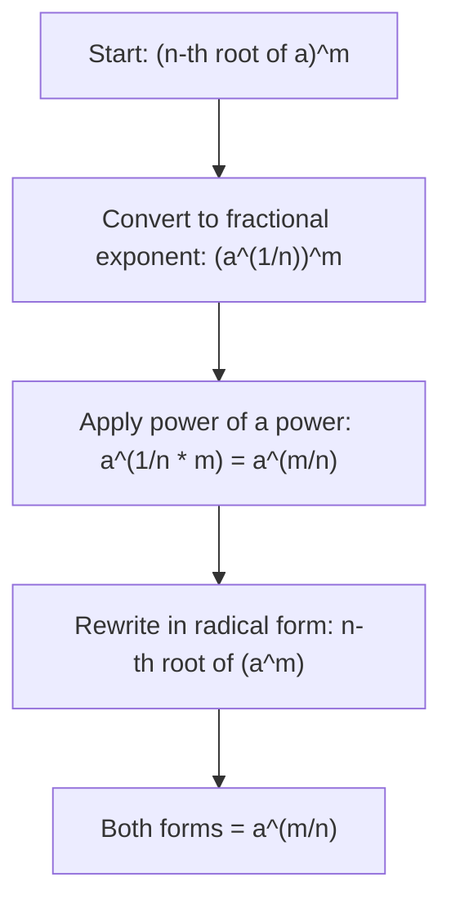

# Power of radical

$$
(\sqrt[n]{a})^m = \sqrt[n]{a^m}
$$

## Deep Breakdown

What it tells me *(Situation Awareness)*:
Raising a radical to a power is equivalent to moving the power inside the radical. $(\sqrt[n]{a})^m = \sqrt[n]{a^m}$. This is the same identity as the fractional exponent rule viewed from the radical side: both expressions equal $a^{m/n}$. You use this when manipulating expressions where a root is raised to an integer power, or when converting between "root first, power second" and "power first, root second" forms.

## Flowchart



## Real-world use

### Where it is used

Simplifying expressions involving square roots raised to even powers (e.g., $(\sqrt{x})^2 = x$), working with Minkowski norms ($\lVert \mathbf{x} \rVert_p = (\sum |x_i|^p)^{1/p}$), and confirming equivalence between different radical forms in proofs and derivations.

### Problem it solves

When you encounter $(\sqrt[n]{a})^m$, you can avoid computing the root first and then powering: instead, move the power inside the root ($\sqrt[n]{a^m}$) and work with whichever form gives simpler intermediate values.

### How it solves the problem

Both forms are unified by fractional exponent notation: $(\sqrt[n]{a})^m = (a^{1/n})^m = a^{m/n} = (a^m)^{1/n} = \sqrt[n]{a^m}$. The power-of-a-power rule does the algebra; radicals are just an alternative notation.

### Example in a business

In PCA, after computing eigenvalues $\lambda_i$ of the covariance matrix, the standard deviation in each principal direction is $\sqrt{\lambda_i}$. Squaring this back gives the variance: $(\sqrt{\lambda_i})^2 = \lambda_i$. The power-of-a-radical rule confirms this round-trip is exact, which matters when reconstructing explained variance from standard deviation values stored in decomposed form.

## The formula, piece by piece

- $n$: root index
- $a$: the base under the radical ($a \geq 0$ when $n$ is even)
- $m$: the power applied to the radical
- $(\sqrt[n]{a})^m$: root first, power second
- $\sqrt[n]{a^m}$: power first, root second
- Both equal $a^{m/n}$ — three equivalent forms of the same expression Full rule: $(\sqrt[n]{a})^m = \sqrt[n]{a^m} = a^{m/n}$ for $a \geq 0$ when $n$ is even

## The formula in words

"Raising a root to a power is the same as putting that power inside the root — you can freely move the exponent across the radical sign." $(\sqrt[3]{8})^2 = \sqrt[3]{8^2} = \sqrt[3]{64} = 4$ Also: $(\sqrt[3]{8})^2 = 2^2 = 4$. Both paths give $4$.

## Critical Concepts

- **Inverse:** $(\sqrt[n]{a})^n = a^{n/n} = a^1 = a$. Raising an $n$-th root to the $n$-th power recovers the original (for non-negative $a$).
- **Special case $m = 2$, $n = 2$:** $(\sqrt{a})^2 = a$. Squaring a square root returns the original. This is how you "cancel" a square root.
- **Order doesn't matter:** $(\sqrt[n]{a})^m = \sqrt[n]{a^m}$ — root then power or power then root, same result.
- **Useful for simplification:** move the power inside if $a$ is a perfect power (easier root), or outside if the power simplifies the root.
- **Connection to fractional exponents:** $a^{m/n}$ is the unified notation that removes ambiguity about which operation to do first.

## Step-by-step calculation (tiny example)

*Step 1: Identify the root, the base, and the outer power*
Expression: $(\sqrt[3]{4})^6$. Root index = $3$, base = $4$, outer power = $6$.

*Step 2: Convert to fractional exponent*
$(\sqrt[3]{4})^6 = 4^{6/3} = 4^2$.

*Step 3: Compute and verify both radical forms*
$4^2 = 16$.
Check "power inside": $\sqrt[3]{4^6} = \sqrt[3]{4096} = 16$ (since $16^3 = 4096$). Confirmed.

## Code examples

### Beginner example (Python)

```python
# Power of a radical: (n-th root of a)^m = n-th root of (a^m) = a^(m/n)
base = 4
n = 3   # cube root
m = 6   # outer power
form_1 = (base ** (1/n)) ** m   # (root)^m
form_2 = (base**m) ** (1/n)   # root(base^m)
form_3 = base ** (m/n)   # fractional exponent
print(f"Base: {base}, n (root index): {n}, m (outer power): {m}")
print(f"Form 1 - (n-th root of a)^m: {form_1:.10f}")
print(f"Form 2 - n-th root of (a^m): {form_2:.10f}")
print(f"Form 3 - a^(m/n): {form_3:.10f}")
print(f"All equal: {abs(form_1 - form_2) < 1e-10 and abs(form_2 - form_3) < 1e-10}")

# Classic case: squaring a square root
x = 7.5
print(f"\n(sqrt({x}))^2 = {(x**0.5)**2} (should be {x})")
```

### Beginner example (R)

```r
# Power of a radical: (n-th root of a)^m = n-th root of (a^m) = a^(m/n)
base <- 4
n <- 3
m <- 6
form_1 <- (base^(1/n))^m  # (root)^m
form_2 <- (base^m)^(1/n)  # root(base^m)
form_3 <- base^(m/n)  # fractional exponent
cat(sprintf("Base: %d, n=%d, m=%d\n", base, n, m))
cat(sprintf("Form 1: %.10f\n", form_1))
cat(sprintf("Form 2: %.10f\n", form_2))
cat(sprintf("Form 3: %.10f\n", form_3))
cat(sprintf("All equal: %s\n", isTRUE(all.equal(form_1, form_2)) & isTRUE(all.equal(form_2, form_3))))

# Squaring a square root
x <- 7.5
cat(sprintf("\n(sqrt(%.1f))^2 = %.10f (should be %.1f)\n", x, (sqrt(x))^2, x))
```

### Professional example (Python)

```python
import numpy as np
import pandas as pd

# Scenario: PCA variance reconstruction
# Eigenvalues lambda_i from covariance matrix = variance in each PC direction
# Standard deviations (singular values) are stored as sqrt(lambda_i)
# To get variance back: (sqrt(lambda_i))^2 = lambda_i -- power of radical with m=n=2
np.random.seed(42)

# Simulate a 4-feature covariance matrix and decompose
n_features = 4
cov_matrix = np.random.randn(n_features, n_features)
cov_matrix = cov_matrix @ cov_matrix.T / n_features   # make it positive semi-definite
eigenvalues, _ = np.linalg.eigh(cov_matrix)
eigenvalues = np.sort(eigenvalues)[::-1]   # descending

# Standard deviations (what PCA often returns as "explained std")
std_devs = np.sqrt(eigenvalues)

# Recover variances using power of radical: (sqrt(lambda))^2 = lambda
variances_recovered = std_devs ** 2
total_variance = eigenvalues.sum()
explained_ratio = eigenvalues / total_variance
results_df = pd.DataFrame({
    "PC": [f"PC{i+1}" for i in range(n_features)],
    "eigenvalue_orig": eigenvalues,
    "std_dev": std_devs,
    "variance_recovered": variances_recovered,
    "match": np.isclose(eigenvalues, variances_recovered),
    "explained_pct": explained_ratio * 100,
})
print("PCA Variance Reconstruction: (sqrt(lambda))^2 = lambda")
print("Power-of-radical rule: (n-th root of a)^n = a")
print()
print(results_df.to_string(index=False))
print(f"\nTotal explained variance: {total_variance:.4f}")
print(f"All variances recovered exactly: {results_df['match'].all()}")
```

### Professional example (R)

```r
# PCA variance: (sqrt(lambda))^2 = lambda (power of radical)
set.seed(42)
n_features <- 4
cov_matrix <- crossprod(matrix(rnorm(n_features * n_features), n_features)) / n_features
eig <- eigen(cov_matrix, symmetric = TRUE)
eigenvalues <- sort(eig$values, decreasing = TRUE)
std_devs <- sqrt(eigenvalues)
variances_recovered <- std_devs^2
results_df <- data.frame(
  PC = paste0("PC", 1:n_features),
  eigenvalue_orig = eigenvalues,
  std_dev = std_devs,
  variance_recovered = variances_recovered,
  match = abs(eigenvalues - variances_recovered) < 1e-10
)
cat("PCA Variance: (sqrt(lambda))^2 = lambda\n")
print(results_df)
cat(sprintf("\nTotal variance: %.4f\n", sum(eigenvalues)))
```

---

*Source: MRAF*
