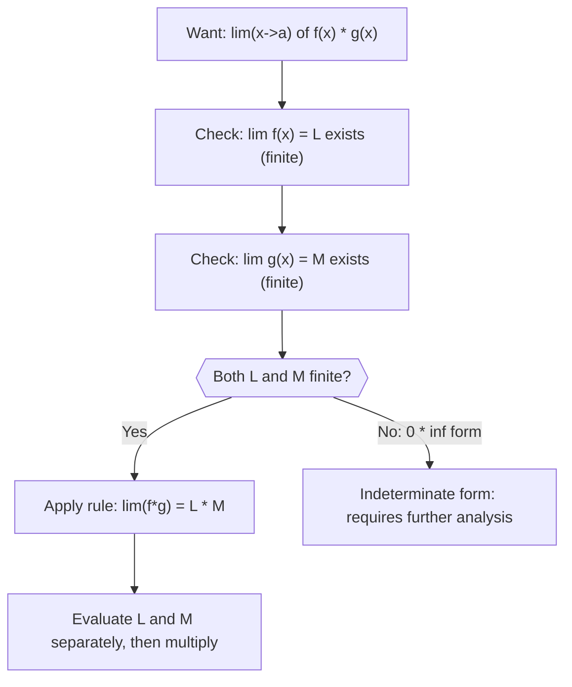

# Multiplication rule

$$
\lim_{x \to a} [f(x) \cdot g(x)] = \lim_{x \to a} f(x) \cdot \lim_{x \to a} g(x)
$$

## Deep Breakdown

What it tells me *(Situation Awareness)*:
If both $\lim_{x \to a} f(x)$ and $\lim_{x \to a} g(x)$ exist, the limit of their product equals the product of their individual limits. This is the multiplicative counterpart to the addition rule. Operationally it means: you can analyze two converging factors independently, then multiply. In DA/DS, this is relevant when analyzing compound rates (e.g., a learning rate that decays as a product of two schedules), or understanding when a product of two approximations converges to the product of their targets.

## Flowchart



## Real-world use

### Where it is used

Analyzing the convergence behavior of compound decay rates (e.g., learning rate $\eta_t = \eta_0 \cdot \alpha^t \cdot \beta^t = \eta_0 \cdot (\alpha\beta)^t$), evaluating limits of separable functions in probability (joint density as product of marginals as a parameter approaches a boundary), and simplifying limit computations by factoring a function into recognizable converging parts.

### Problem it solves

A product like $\lim_{x \to 2} (x+1)(x^2-1)$ could be expanded and evaluated term by term, but it is easier to recognize it as $\lim(x+1) \times \lim(x^2-1) = 3 \times 3 = 9$. The multiplication rule enables this decomposition, saving algebraic work.

### How it solves the problem

The formal argument: write $f(x) = L + (f(x) - L)$ and $g(x) = M + (g(x) - M)$. Expand the product: $f \cdot g = LM + L(g-M) + M(f-L) + (f-L)(g-M)$. As $x \to a$, the last three terms go to 0 (each involves at least one factor that vanishes). So $\lim f \cdot g = LM$.

### Example in a business

A learning rate schedule multiplies two decay factors: $\eta_t = \eta_0 \cdot (0.99)^t \cdot (0.98)^t = \eta_0 \cdot (0.99 \times 0.98)^t = \eta_0 \cdot (0.9702)^t$. As $t \to \infty$: $\lim_{t \to \infty} \eta_t = \eta_0 \cdot \lim (0.99)^t \cdot \lim (0.98)^t = \eta_0 \cdot 0 \cdot 0 = 0$. Both factors converge to 0 independently; the product rule confirms the combined schedule also converges to 0.

## The formula, piece by piece

- $\lim_{x \to a}$: limit as $x$ approaches $a$
- $f(x)$: first function with limit $L = \lim_{x \to a} f(x)$
- $g(x)$: second function with limit $M = \lim_{x \to a} g(x)$
- $f(x) \cdot g(x)$: the product function Full rule: $\lim_{x \to a} [f(x) \cdot g(x)] = \lim_{x \to a} f(x) \cdot \lim_{x \to a} g(x) = L \cdot M$ Required condition: both $L$ and $M$ must exist (be finite).

The form $0 \cdot \infty$ is indeterminate and cannot use this rule directly.

## The formula in words

"The limit of a product is the product of the limits, as long as both individual limits exist and are finite." $\lim_{x \to 3} (x+1)(2x) = \lim_{x \to 3}(x+1) \cdot \lim_{x \to 3}(2x) = 4 \cdot 6 = 24$.

## Critical Concepts

- **Both limits must be finite.** The rule fails for $0 \cdot \infty$ (indeterminate) — requires rewriting as $0 / (1/\infty)$ and L'Hôpital, or algebraic simplification.
- **Product of a constant and a function:** $\lim_{x \to a} c \cdot f(x) = c \cdot \lim_{x \to a} f(x)$ — this is constant extraction for limits, a special case of the product rule with $g(x) = c$.
- **Power rule as a consequence:** $\lim_{x \to a} [f(x)]^n = \left[\lim_{x \to a} f(x)\right]^n$ — apply the product rule $n$ times.
- **Used in probability:** $\lim_{n \to \infty} (1 - \lambda/n)^n = e^{-\lambda}$. This requires recognizing the structure — not a simple product of independent limits.
- **Complement to addition rule:** addition rule = linear structure of limits; multiplication rule = extends to multiplicative structure.

## Step-by-step calculation (tiny example)

*Step 1: Identify the two factor functions and the limiting point*
Evaluate $\lim_{x \to 2} (x+3)(x^2)$. Factors: $f(x) = x+3$, $g(x) = x^2$, point $a = 2$.

*Step 2: Compute each limit separately*
$\lim_{x \to 2} (x+3) = 5$. $\lim_{x \to 2} x^2 = 4$.

*Step 3: Multiply the limits*
$\lim_{x \to 2} (x+3)(x^2) = 5 \times 4 = 20$. Verify: $(2+3)(2^2) = 5 \times 4 = 20$. Confirmed.

## Code examples

### Beginner example (Python)

```python
import numpy as np   # Limit product rule:
lim[f(x) * g(x)] = lim
f(x) * lim
g(x)
# Verify numerically by approaching
a = 2

def f(x: float) -> float:
    return x + 3.0

def g(x: float) -> float:
    return x ** 2
TARGET_A = 2.0
epsilons = [0.1, 0.01, 0.001, 0.0001]
lim_f = f(TARGET_A)   # limit of f as x->2
lim_g = g(TARGET_A)   # limit of g as x->2
predicted_product = lim_f * lim_g
print(f"f(x) = x + 3, g(x) = x^2")
print(f"Limit point a = {TARGET_A}")
print(f"lim f = {lim_f}, lim g = {lim_g}, product of limits = {predicted_product}")
print()
print(f"{'epsilon':>10} | {'f*g at a+eps':>15} | {'matches prediction':>18}")
print("-" * 50)
for eps in epsilons:
    x_val = TARGET_A + eps
product_at_x = f(x_val) * g(x_val)
print(f"{eps:>10.4f} | {product_at_x:>15.8f} | {abs(product_at_x - predicted_product) < 0.01}")
print(f"\nAs eps -> 0, f*g -> {predicted_product}. Rule confirmed.")
```

### Beginner example (R)

```r
# Limit product rule:
lim[f(x) * g(x)] = lim f(x) * lim g(x)
f <- function(x) x + 3
g <- function(x) x^2
TARGET_A <- 2
epsilons <- c(0.1, 0.01, 0.001, 0.0001)
lim_f <- f(TARGET_A)
lim_g <- g(TARGET_A)
cat(sprintf("lim f = %.1f, lim g = %.1f, product of limits = %.1f\n\n", lim_f, lim_g, lim_f * lim_g))
cat(sprintf("%10s | %15s\n", "epsilon", "f*g at a+eps"))
cat(strrep("-", 30), "\n")
for (eps in epsilons) { x_val <- TARGET_A + eps
  cat(sprintf("%10.4f | %15.8f\n", eps, f(x_val) * g(x_val)))
}
```

### Professional example (Python)

```python
import numpy as np
import pandas as pd   # Scenario: analyzing decay of a compound learning rate schedule
# eta(t) = eta_0 *
decay_A(t) * decay_B(t)
# Both factors -> 0 as t -> infinity
# Product rule: lim eta(t) = eta_0 * lim decay_A * lim decay_B
INITIAL_LR = 0.1
DECAY_A = 0.97   # exponential decay per step
DECAY_B = 0.99   # second decay schedule
steps = np.array([0, 10, 50, 100, 200, 500, 1000])
records = []
for t in steps:
    factor_a = DECAY_A ** t
factor_b = DECAY_B ** t
combined = INITIAL_LR * factor_a * factor_b   # Product rule: separately analyze then multiply
combined_via_rule = INITIAL_LR * (DECAY_A * DECAY_B) ** t
records.append({ "step": t, "factor_A": round(factor_a, 8), "factor_B": round(factor_b, 8), "eta_direct": round(combined, 10), "eta_via_rule": round(combined_via_rule, 10), "agree": np.isclose(combined, combined_via_rule), })
df = pd.DataFrame(records)
print("Compound Learning Rate Decay: Limit Product Rule")
print(f"eta(t) = {INITIAL_LR} * {DECAY_A}^t * {DECAY_B}^t")
print(f"Combined decay rate = {DECAY_A} * {DECAY_B} = {DECAY_A * DECAY_B}")
print(f"lim(t->inf) eta(t) = {INITIAL_LR} * 0 * 0 = 0 (product rule)")
print()
print(df.to_string(index=False))
print(f"\nAll product-rule values agree with direct computation: {df['agree'].all()}")
```

### Professional example (R)

```r
# Compound decay: lim (a^t * b^t) = lim(a^t) * lim(b^t)
INITIAL_LR <- 0.1
DECAY_A <- 0.9
DECAY_B <- 0.95
t <- 0:50
eta_direct <- INITIAL_LR * DECAY_A^t * DECAY_B^t
eta_product_rule <- INITIAL_LR * (DECAY_A * DECAY_B)^t
records <- data.frame(t = t, eta_direct = eta_direct, eta_product_rule = eta_product_rule, agree = abs(eta_direct - eta_product_rule) < 1e-10)
cat("Limit product rule: eta(t) = LR * A^t * B^t\n")
print(tail(records, 5))
cat(sprintf("\nAll agree: %s\n", all(records$agree)))
```

---

*Source: AIO p. 44*
