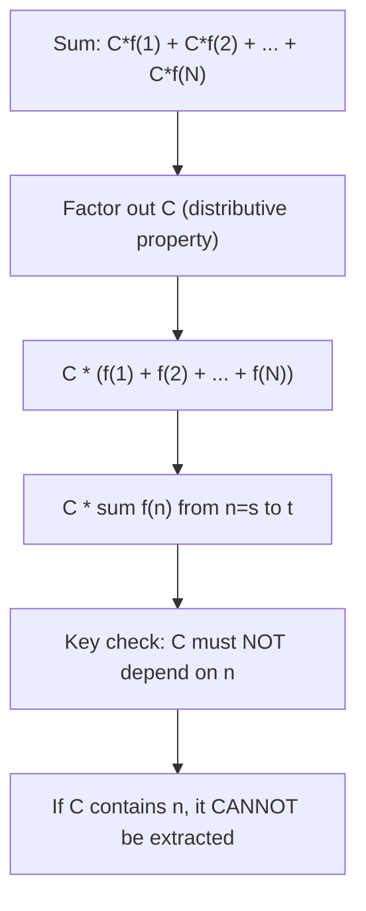

# Constant extraction

$$
\sum_{n=s}^t C \cdot f(n) = C \cdot \sum_{n=s}^t f(n)
$$

## Deep Breakdown

What it tells me *(Situation Awareness)*:
A constant factor $C$ that does not depend on the summation index $n$ can be pulled outside the summation. This is the summation equivalent of the distributive property: $C \cdot a + C \cdot b = C(a + b)$, scaled to $N$ terms. In DA/DS, this shows up when: converting units (multiply every record by a conversion factor, then sum = factor times sum of originals), computing weighted averages with a shared weight, factoring out a sample size to convert total-loss to mean-loss, and simplifying loss function gradients.

## Flowchart



## Real-world use

### Where it is used

Unit conversion across a dataset (multiply every revenue by an exchange rate), computing mean squared error as $\frac{1}{N} \sum e_n^2$ (the $\frac{1}{N}$ is a constant factor), scaling a loss function by a learning rate, and converting a total cost sum to a per-unit cost by dividing by $N$.

### Problem it solves

Without this rule, you might apply a scaling factor $N$ times inside a loop when you only need to apply it once to the result. This matters for: code efficiency (one multiplication vs. $N$ multiplications), algebraic simplification (deriving mean from sum), and understanding ML loss functions (total loss is $N$ times mean loss, and the gradient scales accordingly).

### How it solves the problem

Since addition is distributive over multiplication: $\sum_{n=s}^{t} C \cdot f(n) = C \cdot f(s) + C \cdot f(s+1) + \cdots + C \cdot f(t) = C \cdot (f(s) + f(s+1) + \cdots + f(t)) = C \cdot \sum_{n=s}^{t} f(n)$. Valid because $C$ is the same for every term.

### Example in a business

A campaign's cost in USD needs converting to EUR. Exchange rate $C = 0.92$. Total USD cost = $\sum_{n=1}^{5} \text{cost}_n$. Total EUR cost = $0.92 \times \sum_{n=1}^{5} \text{cost}_n$. You sum once in USD and multiply by $0.92$ once — same as converting each record and then summing.

## The formula, piece by piece

- $C$: a constant that does **not** depend on the index $n$
- $f(n)$: a function of the summation index $n$
- $\sum_{n=s}^{t}$: summation from $s$ to $t$ Full rule: $\sum_{n=s}^{t} C \cdot f(n) = C \cdot \sum_{n=s}^{t} f(n)$ Division version (dividing by positive constant $K$): $\sum_{n=s}^{t} \frac{f(n)}{K} = \frac{1}{K} \sum_{n=s}^{t} f(n)$.

The $\frac{1}{K}$ is just a constant $C = 1/K$.

## The formula in words

"A constant multiplied inside a sum can be factored out to multiply the entire sum." $\sum_{n=1}^{4} 3n = 3(1) + 3(2) + 3(3) + 3(4) = 3 + 6 + 9 + 12 = 30$. Factor out: $3 \sum_{n=1}^{4} n = 3 \times 10 = 30$. Same result.

## Critical Concepts

- **$C$ must be truly constant w.r.t. $n$.** If $C$ depends on $n$ (even indirectly), it cannot be factored out. $\sum n^2 \neq n \sum n$.
- **Division is the same as multiplying by $1/K$:** $\sum f(n)/K = (1/K) \sum f(n)$. Both directions use the same rule.
- **Used to derive mean from sum:** $\bar{x} = \frac{1}{N} \sum_{n=1}^{N} x_n = \frac{\sum x_n}{N}$. The $1/N$ is the constant.
- **MSE and MAE in ML:** $\text{MSE} = \frac{1}{N} \sum e_n^2 = \frac{1}{N} \cdot \sum e_n^2$. Gradient of MSE w.r.t. parameters scales by $\frac{1}{N}$.
- **The constant can be negative:** $\sum (-2) f(n) = -2 \sum f(n)$. Works with any real $C$.

## Step-by-step calculation (tiny example)

*Step 1: Identify the constant factor and the index-dependent part*
Expression: $\sum_{n=1}^{5} 4n$. Here $C = 4$ (does not depend on $n$), $f(n) = n$.

*Step 2: Factor out the constant*
$\sum_{n=1}^{5} 4n = 4 \sum_{n=1}^{5} n = 4 \times (1 + 2 + 3 + 4 + 5) = 4 \times 15 = 60$.

*Step 3: Verify by direct computation*
$4(1) + 4(2) + 4(3) + 4(4) + 4(5) = 4 + 8 + 12 + 16 + 20 = 60$. Confirmed.

## Code examples

### Beginner example (Python)

```python
# Constant extraction: sum of C*f(n) = C * sum of f(n)
EXCHANGE_RATE = 0.92   # USD -> EUR, a constant (independent of n)
usd_costs = [1500.0, 2300.0, 900.0, 3100.0, 750.0]

# Method 1: convert each then sum
total_eur_method1 = sum(EXCHANGE_RATE * cost for cost in usd_costs)

# Method 2: sum first, then convert once (constant extraction)
total_eur_method2 = EXCHANGE_RATE * sum(usd_costs)
print(f"USD costs: {usd_costs}")
print(f"Exchange rate (constant C): {EXCHANGE_RATE}")
print(f"Method 1 (convert each, then sum): {total_eur_method1:.2f} EUR")
print(f"Method 2 (sum first, then convert): {total_eur_method2:.2f} EUR")
print(f"Equal: {abs(total_eur_method1 - total_eur_method2) < 1e-9}")

# MSE example: mean = (1/N) * sum
errors = [2.0, -1.5, 3.0, -0.5, 1.0]
N = len(errors)
mse_method1 = sum(e**2 for e in errors) / N
mse_method2 = (1 / N) * sum(e**2 for e in errors)
print(f"\nMSE method 1: {mse_method1:.4f}")
print(f"MSE method 2: {mse_method2:.4f}")
print(f"Equal: {abs(mse_method1 - mse_method2) < 1e-9}")
```

### Beginner example (R)

```r
# Constant extraction: sum(C * f(n)) = C * sum(f(n))
EXCHANGE_RATE <- 0.92
usd_costs <- c(1500, 2300, 900, 3100, 750)
total_eur_method1 <- sum(EXCHANGE_RATE * usd_costs)  # convert each, then sum
total_eur_method2 <- EXCHANGE_RATE * sum(usd_costs)  # sum first, then convert
cat(sprintf("Method 1 (convert each, sum): %.2f EUR\n", total_eur_method1))
cat(sprintf("Method 2 (sum, then convert): %.2f EUR\n", total_eur_method2))
cat(sprintf("Equal: %s\n", isTRUE(all.equal(total_eur_method1, total_eur_method2))))

# Mean squared error
errors <- c(2.0, -1.5, 3.0, -0.5, 1.0)
n <- length(errors)
mse <- (1 / n) * sum(errors^2)
cat(sprintf("\nMSE = (1/%d) * sum(e^2) = %.4f\n", n, mse))
```

### Professional example (Python)

```python
import pandas as pd
import numpy as np

# Scenario: compute per-unit metrics and currency-converted totals
# across multiple campaigns using constant extraction for efficiency
np.random.seed(42)
USD_TO_EUR = 0.92   # constant: does not depend on campaign
USD_TO_GBP = 0.79   # constant: does not depend on campaign
campaigns = pd.DataFrame({
    "campaign": ["Alpha", "Beta", "Gamma", "Delta", "Epsilon"],
    "impressions": [120000, 85000, 200000, 95000, 150000],
    "clicks": [3600, 2125, 7000, 1900, 4500],
    "spend_usd": [4500.0, 3200.0, 8100.0, 2700.0, 5900.0],
    "conversions": [180, 95, 340, 88, 210],
})

# Constant extraction: convert total spend once instead of per row
# (both methods identical, but the rule explains WHY)
campaigns["spend_eur"] = campaigns["spend_usd"] * USD_TO_EUR
campaigns["spend_gbp"] = campaigns["spend_usd"] * USD_TO_GBP

# Per-unit metrics: divide total by N (constant 1/N extraction)
total_spend_usd = campaigns["spend_usd"].sum()
total_spend_eur_via_extraction = USD_TO_EUR * total_spend_usd   # C * sum
total_spend_eur_direct = campaigns["spend_eur"].sum()   # sum of C*f(n)
campaigns["cpc_usd"] = campaigns["spend_usd"] / campaigns["clicks"]   # cost per click
campaigns["roas"] = campaigns["conversions"] / campaigns["spend_usd"] * 1000   # per 1k spend
print("Campaign Metrics: Constant Extraction in Unit Conversion and Per-Unit Rates")
print(f"USD->EUR rate (constant C = {USD_TO_EUR})")
print()
print(campaigns[["campaign", "spend_usd", "spend_eur", "cpc_usd", "roas"]].to_string(index=False))
print(f"\nTotal USD: {total_spend_usd:>10,.2f}")
print(f"Total EUR (extraction): {total_spend_eur_via_extraction:>10,.2f}")
print(f"Total EUR (direct): {total_spend_eur_direct:>10,.2f}")
print(f"Both methods agree: {np.isclose(total_spend_eur_via_extraction, total_spend_eur_direct)}")
```

### Professional example (R)

```r
# sum(C * x_i) = C * sum(x_i) (constant extraction)
USD_TO_EUR <- 0.92
spend_usd <- c(1000, 1500, 800)
total_usd <- sum(spend_usd)
total_eur_extraction <- USD_TO_EUR * total_usd
total_eur_direct <- sum(USD_TO_EUR * spend_usd)
cat(sprintf("Total USD: %.2f EUR (extraction): %.2f EUR (direct): %.2f Agree: %s\n", total_usd, total_eur_extraction, total_eur_direct, isTRUE(all.equal(total_eur_extraction, total_eur_direct))))
```

---

*Source: AIO p. 44*
