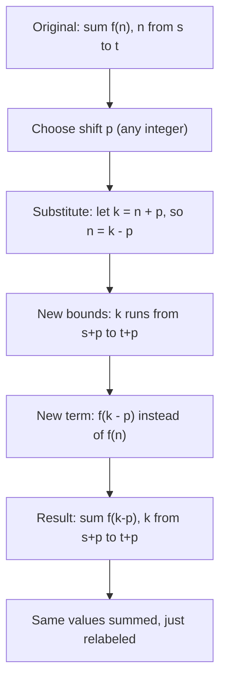

# Index shifting

$$
\sum_{n=s}^t f(n) = \sum_{n=s+p}^{t+p} f(n-p)
$$

## Deep Breakdown

What it tells me *(Situation Awareness)*:
Index shifting re-labels the summation index by a constant offset $p$, without changing the actual values being summed. The bounds shift from $[s, t]$ to $[s+p, t+p]$, and the term changes from $f(n)$ to $f(n-p)$ to compensate. The sum is identical. This is purely notational: the summation index is a "dummy variable" — its name and starting value are arbitrary. In DA/DS and mathematical proofs, index shifting is used to align two series with different index origins, to rewrite recurrence relations in standard form, or to massage a summation into a recognizable pattern.

## Flowchart



## Real-world use

### Where it is used

Aligning a lagged feature in time series (e.g., shifting a sum from day-1-indexed to day-0-indexed), converting a recurrence relation into a telescoping sum, comparing two series that start at different indices, and simplifying proofs of summation identities by putting them into canonical form.

### Problem it solves

Two series over the same data may be indexed differently — one starting at $n = 0$, another at $n = 1$. Index shifting lets you rewrite either to match the other for side-by-side algebraic manipulation. It also lets you convert a sum $\sum_{n=3}^{10} f(n)$ into $\sum_{k=0}^{7} f(k+3)$ when a formula is only defined for $k \geq 0$.

### How it solves the problem

Let $k = n + p$ (equivalently $n = k - p$). When $n = s$, $k = s + p$. When $n = t$, $k = t + p$. Substituting: $\sum_{n=s}^{t} f(n) = \sum_{k=s+p}^{t+p} f(k-p)$. Since $k$ is a dummy index (like a loop variable), you can rename it back to $n$ if preferred.

### Example in a business

A time-series sum of weekly sales is indexed from week 3 to week 10: $\sum_{n=3}^{10} S_n$. A second dataset starts at week 0. To align them, shift by $p = -3$: $\sum_{k=0}^{7} S_{k+3}$. The values $S_3, S_4, \ldots, S_{10}$ are unchanged; only the loop index label changed. This makes joining or cross-referencing the two datasets straightforward.

## The formula, piece by piece

- $\sum_{n=s}^{t}$: original sum, index $n$ from $s$ to $t$
- $f(n)$: the term at index $n$
- $p$: the shift amount (any integer, positive = shift forward, negative = shift back)
- $\sum_{n=s+p}^{t+p}$: shifted sum, bounds each increased by $p$
- $f(n-p)$: the term rewritten to access the same original value at the shifted index Full identity: $\sum_{n=s}^{t} f(n) = \sum_{n=s+p}^{t+p} f(n-p)$ Common case $p = -s$ (shift to start at 0): $\sum_{n=s}^{t} f(n) = \sum_{k=0}^{t-s} f(k+s)$.

## The formula in words

"The sum does not change if you relabel the index by adding a constant offset to the bounds and adjusting the term to compensate." $\sum_{n=1}^{3} n^2 = 1 + 4 + 9 = 14$. Shift by $p = 2$: $\sum_{n=3}^{5} (n-2)^2 = 1^2 + 2^2 + 3^2 = 1 + 4 + 9 = 14$. Same sum.

## Critical Concepts

- **The index is a dummy variable.** $\sum_{n=1}^{5} f(n) = \sum_{k=1}^{5} f(k) = \sum_{i=1}^{5} f(i)$. The letter does not matter.
- **Both bounds shift by the same $p$.** $[s, t]$ becomes $[s+p, t+p]$. The count of terms $t - s + 1$ is unchanged.
- **The term compensates with $-p$:** the new index $k$ maps back to the original $n$ via $n = k - p$, so $f(n) = f(k - p)$.
- **Works for any integer $p$** — including negative shifts (shift backward) and zero (identity, no change).
- **Do not confuse with changing the number of terms.** Index shifting preserves the count and values of all terms.

## Step-by-step calculation (tiny example)

*Step 1: Write the original sum and choose a shift*
Original: $\sum_{n=2}^{4} n^2 = 4 + 9 + 16 = 29$. Choose shift $p = -2$ (re-index to start at 0).

*Step 2: Apply the shift to bounds and term*
New bounds: $s + p = 0$, $t + p = 2$. New term: $f(n - p) = f(n - (-2)) = f(n + 2) = (n+2)^2$.
Rewritten: $\sum_{n=0}^{2} (n+2)^2$.

*Step 3: Evaluate and verify*
$= 0^2 + 1^2 + 2^2$... wait: $(0+2)^2 + (1+2)^2 + (2+2)^2 = 4 + 9 + 16 = 29$. Confirmed. Same values, shifted index.

## Code examples

### Beginner example (Python)

```python
# Index shifting: sum f(n) from s to
t = sum
f(n-p) from s+p to t+p

def sum_original(s: int, t: int, f) -> float:
    """Sum f(n) for n from s to t inclusive."""
    return sum(f(n) for n in range(s, t + 1))

def sum_shifted(s: int, t: int, p: int, f) -> float:
    """Sum f(n-p) for n from s+p to t+p inclusive (shifted by p)."""
    return sum(f(n - p) for n in range(s + p, t + p + 1))   # Test with f(n) = n^2
f = lambda n: n ** 2
s, t = 2, 6
print(f"f(n) = n^2, original sum from {s} to {t}")
print(f"Original sum: {sum_original(s, t, f)}")
print()
for p in [-2, 0, 3, 10]:
    shifted = sum_shifted(s, t, p, f)
original = sum_original(s, t, f)
print(f" Shift p={p:>3}: new range [{s+p}, {t+p}], shifted sum = {shifted}, match = {original == shifted}")
```

### Beginner example (R)

```r
# Index shifting: sum f(n) for n in s:t = sum f(n-p) for n in (s+p):(t+p)
sum_original <- function(s, t, f) sum(sapply(s:t, f))
sum_shifted <- function(s, t, p, f) sum(sapply((s+p):(t+p), function(n) f(n - p)))
f <- function(n) n^2
s <- 2; t <- 6
original <- sum_original(s, t, f)
cat(sprintf("f(n) = n^2, original sum [%d, %d] = %.0f\n\n", s, t, original))
for (p in c(-2, 0, 3, 10)) { shifted <- sum_shifted(s, t, p, f)
  cat(sprintf(" Shift p=%3d: new range [%d, %d], shifted sum = %.0f, match = %s\n", p, s+p, t+p, shifted, isTRUE(all.equal(original, shifted))))
}
```

### Professional example (Python)

```python
import pandas as pd
import numpy as np   # Scenario: two time-series datasets with different index origins
# Dataset A: week index starts at week 1
# Dataset B: week index starts at week 0 (0-indexed)
# We need to align them to compare corresponding weeks
np.random.seed(42)
n_weeks = 8   # Dataset A: week 1 to 8
ds_a = pd.DataFrame({ "week_a": range(1, n_weeks + 1), "revenue_a": np.round(np.random.uniform(40000, 60000, n_weeks), 2),
})   # Dataset B: week 0 to 7 (same data, different index origin)
ds_b = pd.DataFrame({ "week_b": range(0, n_weeks), "revenue_b": ds_a["revenue_a"].values,   # same underlying revenue
})   # Apply index shift p = -1 to align A's index with B's (week_a - 1 = week_b)
ds_a["week_shifted"] = ds_a["week_a"] - 1   # shift by
p = -1   # Merge on aligned index
merged = ds_a.merge(ds_b, left_on="week_shifted", right_on="week_b")
merged["revenues_match"] = np.isclose(merged["revenue_a"], merged["revenue_b"])   # Verify: sum over original range == sum over shifted range
sum_original_a = ds_a["revenue_a"].sum()
sum_shifted_b = ds_b["revenue_b"].sum()
print("Index Shift: aligning two time-series with different index origins")
print(f"Sum (A, weeks 1-8): {sum_original_a:,.2f}")
print(f"Sum (B, weeks 0-7): {sum_shifted_b:,.2f}")
print(f"Sums equal: {np.isclose(sum_original_a, sum_shifted_b)}")
print()
print(merged[["week_a", "week_shifted", "week_b", "revenue_a", "revenue_b", "revenues_match"]].to_string(index=False))
print(f"\nAll values matched after alignment: {merged['revenues_match'].all()}")
```

### Professional example (R)

```r
# Index shift: align two series with different week origins
revenue_a <- c(100, 110, 105, 120, 115, 125, 130, 128)  # weeks 1..8
revenue_b <- c(100, 110, 105, 120, 115, 125, 130, 128)  # weeks 0..7
week_a <- 1:8
week_b <- 0:7
merged <- data.frame(week_a = week_a, week_shifted = week_a - 1, week_b = week_b, revenue_a = revenue_a, revenue_b = revenue_b)
merged$revenues_match <- merged$revenue_a == merged$revenue_b
cat(sprintf("Sum A (weeks 1-8): %.2f Sum B (weeks 0-7): %.2f Equal: %s\n", sum(revenue_a), sum(revenue_b), isTRUE(all.equal(sum(revenue_a), sum(revenue_b)))))
```

---

*Source: AIO p. 44*
