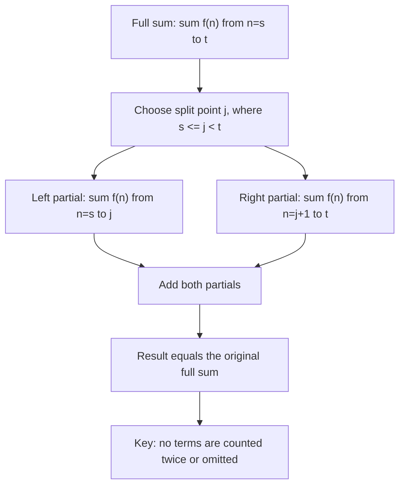

# Splitting sums

$$
\sum_{n=s}^t f(n) = \sum_{n=s}^j f(n) + \sum_{n=j+1}^t f(n)
$$

## Deep Breakdown

What it tells me *(Situation Awareness)*:
A summation over a range $[s, t]$ can be split at any interior index $j$ (where $s \leq j < t$) into two consecutive partial sums: $[s, j]$ and $[j+1, t]$. Nothing is added or subtracted; you are just partitioning the range. This is the summation analog of "divide and conquer." In DA/DS, this rule underpins: computing before/after-event metrics (pre-intervention vs. post-intervention totals), building incremental aggregation pipelines, and constructing running totals from sub-batch sums.

## Flowchart



## Real-world use

### Where it is used

Before/after analysis on time-series data (pre/post campaign, pre/post policy change), computing quarterly subtotals from daily sums, building cumulative sum checkpoints in ETL pipelines, and validating aggregation logic by confirming partial sums recombine to the total.

### Problem it solves

In large datasets, you often cannot aggregate everything at once. You process data in chunks — by time window, by partition, by batch. The splitting rule guarantees that summing each chunk independently and then adding them together gives the same result as one full pass. This is the mathematical foundation for MapReduce-style aggregation.

### How it solves the problem

Addition is associative: $\sum_{n=s}^{t} f(n) = f(s) + f(s+1) + \cdots + f(j) + f(j+1) + \cdots + f(t)$. Regroup the first $j - s + 1$ terms and the remaining terms: $\left[\sum_{n=s}^{j} f(n)\right] + \left[\sum_{n=j+1}^{t} f(n)\right]$. The split is valid at any $j$ in $[s, t-1]$.

### Example in a business

Monthly revenue totals: January through June. Split at month 3 (March): $\sum_{m=1}^{6} R_m = \sum_{m=1}^{3} R_m + \sum_{m=4}^{6} R_m$ = Q1 total + Q2 total. If Q1 = 45,000 and Q2 = 52,000, total H1 = 97,000. Same result as summing all six months directly.

## The formula, piece by piece

- $\sum_{n=s}^{t}$: sum from index $s$ (start) to $t$ (end), inclusive
- $f(n)$: the term being summed at each index $n$
- $j$: the split point — must satisfy $s \leq j < t$
- $\sum_{n=s}^{j}$: the left partial sum (first part, indices $s$ through $j$)
- $\sum_{n=j+1}^{t}$: the right partial sum (second part, indices $j+1$ through $t$) Full rule: $\sum_{n=s}^{t} f(n) = \sum_{n=s}^{j} f(n) + \sum_{n=j+1}^{t} f(n)$, for any $j$ with $s \leq j < t$.

## The formula in words

"A sum over a full range equals the sum over the first part of the range plus the sum over the second part, where the split can occur at any point inside the range." $\sum_{n=1}^{5} n = (1+2+3) + (4+5) = 6 + 9 = 15$. Same as $1+2+3+4+5 = 15$.

## Critical Concepts

- **The split point $j$ is arbitrary** as long as $s \leq j < t$. You can split anywhere and the identity holds.
- **No overlap, no gap:** the left sum includes $j$, the right sum starts at $j+1$. Together they cover exactly $[s, t]$ with no duplicates.
- **Can be applied recursively:** split multiple times to get any number of partitions. $\sum_{s}^{t} = \sum_{s}^{j_1} + \sum_{j_1+1}^{j_2} + \sum_{j_2+1}^{t}$.
- **Foundation of cumulative sums:** a running total $S_k = \sum_{n=1}^{k} f(n)$ satisfies $S_t = S_j + \sum_{n=j+1}^{t} f(n)$. New total = old total + new terms.
- **Also applies to integrals:** $\int_a^b f = \int_a^c f + \int_c^b f$ is the same idea in continuous form.

## Step-by-step calculation (tiny example)

*Step 1: Write out the full sum*
Let $f(n) = n^2$. Full sum: $\sum_{n=1}^{5} n^2 = 1 + 4 + 9 + 16 + 25 = 55$.

*Step 2: Choose a split point and compute partial sums*
Split at $j = 3$: left partial $\sum_{n=1}^{3} n^2 = 1 + 4 + 9 = 14$. Right partial $\sum_{n=4}^{5} n^2 = 16 + 25 = 41$.

*Step 3: Verify the partials add to the full sum*
$14 + 41 = 55$. Matches. Confirmed. The split is valid and no terms were missed or double-counted.

## Code examples

### Beginner example (Python)

```python
# Splitting sums: full sum = left partial + right partial
values = [3.0, 7.0, 2.0, 9.0, 4.0, 6.0, 1.0, 8.0]  # f(n) for n = 0..7
n = len(values)
full_sum = sum(values)
print(f"Values: {values}")
print(f"Full sum (n=0 to {n-1}): {full_sum}")
print()

# Try three different split points
for split_j in [1, 3, 5]:
    left_partial = sum(values[:split_j + 1])  # indices 0 .. j
    right_partial = sum(values[split_j + 1:])  # indices j+1 .. n-1
    total = left_partial + right_partial
    print(f"Split at j={split_j}: left={left_partial} right={right_partial} total={total} match={total == full_sum}")
```

### Beginner example (R)

```r
# Splitting sums: full sum = left partial + right partial
values <- c(3, 7, 2, 9, 4, 6, 1, 8)
n <- length(values)
full_sum <- sum(values)
cat(sprintf("Full sum (1 to %d): %.0f\n\n", n, full_sum))
for (split_j in c(2, 4, 6)) {  # R is 1-indexed
  left_partial <- sum(values[1:split_j])
  right_partial <- sum(values[(split_j + 1):n])
  total <- left_partial + right_partial
  cat(sprintf("Split at j=%d: left=%.0f right=%.0f total=%.0f match=%s\n", split_j, left_partial, right_partial, total, isTRUE(all.equal(total, full_sum))))
}
```

### Professional example (Python)

```python
import pandas as pd
import numpy as np

# Scenario: validate monthly revenue aggregation by comparing
# quarterly partials (Q1 + Q2 + Q3 + Q4) to the full-year total
# This verifies that the ETL partial-aggregation pipeline produces correct totals
np.random.seed(42)
monthly_revenue = pd.DataFrame({
    "month": range(1, 13),
    "quarter": [1, 1, 1, 2, 2, 2, 3, 3, 3, 4, 4, 4],
    "revenue": [41000, 38500, 43200, 47800, 51000, 49500, 53200, 55800, 52100, 48900, 46700, 50300],
})
full_year_total = monthly_revenue["revenue"].sum()

# Split sum by quarter: sum_q1 + sum_q2 + sum_q3 + sum_q4 = full_year
quarterly_totals = (
    monthly_revenue.groupby("quarter")["revenue"]
    .sum()
    .reset_index()
    .rename(columns={"revenue": "quarterly_total"})
)
reconstructed_total = quarterly_totals["quarterly_total"].sum()
quarterly_totals["cumulative"] = quarterly_totals["quarterly_total"].cumsum()
print("Monthly Revenue: Full-Year = Sum of Quarterly Partials")
print("Rule: sum(s..t) = sum(s..j) + sum(j+1..t)")
print()
print(quarterly_totals.to_string(index=False))
print(f"\nFull year (direct sum): {full_year_total:>10,.0f}")
print(f"Full year (sum of Q partials): {reconstructed_total:>10,.0f}")
print(f"Match: {np.isclose(full_year_total, reconstructed_total)}")
```

### Professional example (R)

```r
# Full year = sum of quarterly partials (splitting sums)
monthly <- rep(c(100, 110, 105), 4)
full_year_total <- sum(monthly)
Q1 <- sum(monthly[1:3]); Q2 <- sum(monthly[4:6]); Q3 <- sum(monthly[7:9]); Q4 <- sum(monthly[10:12])
reconstructed_total <- Q1 + Q2 + Q3 + Q4
quarterly_totals <- data.frame(quarter = 1:4, quarterly_total = c(Q1, Q2, Q3, Q4), cumulative = cumsum(c(Q1, Q2, Q3, Q4)))
cat(sprintf("Full year (direct): %.0f (sum of Q partials): %.0f Match: %s\n", full_year_total, reconstructed_total, isTRUE(all.equal(full_year_total, reconstructed_total))))
```

---

*Source: AIO p. 44*
