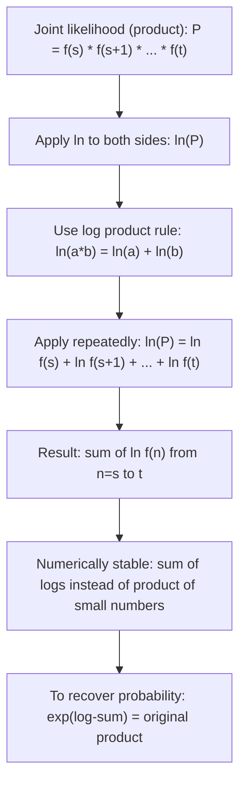

# Sum of a product (log)

$$
\ln \prod_{n=s}^t f(n) = \sum_{n=s}^t \ln f(n)
$$

## Deep Breakdown

What it tells me *(Situation Awareness)*:
The natural log of a product equals the sum of the natural logs of each factor. This is one of the most important identities in data science and statistics. It is the mathematical backbone of: maximum likelihood estimation (MLE), log-likelihood computation, the Naive Bayes classifier, logistic regression cross-entropy loss, and any model that works with probabilities. Products of many small numbers underflow to zero in floating point — by taking logs first, you convert a numerically unstable product into a numerically stable sum.

## Flowchart



## Real-world use

### Where it is used

Maximum likelihood estimation (finding model parameters that maximize $\prod P(x_i \mid \theta)$ is done by maximizing $\sum \ln P(x_i \mid \theta)$), log-likelihood in logistic regression and Naive Bayes, computing joint survival probability in retention models, and any scenario where independent event probabilities must be multiplied.

### Problem it solves

The joint probability of $N$ independent observations is $\prod_{n=1}^{N} P(x_n \mid \theta)$. For $N = 1000$ observations each with $P \approx 0.01$, this product is $0.01^{1000} \approx 10^{-2000}$: numerically zero in any floating-point system. Taking the log converts this to $1000 \times \ln(0.01) \approx -4605$: a perfectly representable float. Same maximizer, no underflow.

### How it solves the problem

From the log product rule: $\ln(a \cdot b) = \ln a + \ln b$ (a property of logarithms, derivable from $e^{a+b} = e^a \cdot e^b$). Apply it inductively: $\ln\left(\prod_{n=s}^{t} f(n)\right) = \ln(f(s)) + \ln(f(s+1)) + \cdots + \ln(f(t)) = \sum_{n=s}^{t} \ln f(n)$.

### Example in a business

A Naive Bayes spam classifier computes $P(\text{spam} \mid \text{email}) \propto P(\text{spam}) \prod_{w} P(w \mid \text{spam})$. Direct product of word probabilities underflows. Log-space: $\ln P(\text{spam}) + \sum_{w} \ln P(w \mid \text{spam})$. Numerically stable, same argmax. This is the identity applied in production.

## The formula, piece by piece

- $\prod_{n=s}^{t}$: product operator (capital pi), the multiplicative analog of $\sum$
- $f(n)$: the factor at index $n$ — must be $> 0$ for $\ln$ to be defined
- $\ln$: natural logarithm (base $e$)
- $\sum_{n=s}^{t} \ln f(n)$: sum of logs — numerically stable form Full identity: $\ln \prod_{n=s}^{t} f(n) = \sum_{n=s}^{t} \ln f(n)$ Inverse direction: $\exp\!\left(\sum_{n=s}^{t} \ln f(n)\right) = \prod_{n=s}^{t} f(n)$ — recover the product from the log-sum.

## The formula in words

"The log of a product of terms is the sum of the logs of those terms." $\ln(2 \times 3 \times 4) = \ln 2 + \ln 3 + \ln 4 = 0.693 + 1.099 + 1.386 = 3.178$. Check: $\ln 24 = 3.178$. Confirmed.

## Critical Concepts

- **Requires $f(n) > 0$ for all $n$.** Logarithm is undefined for non-positive values. Probabilities are always positive, so this is satisfied in MLE.
- **Maximizing the log-likelihood gives the same solution as maximizing the likelihood.** $\ln$ is a strictly monotone increasing function, so it preserves the location of the maximum.
- **The inverse is $\exp(\text{log-sum}) = \text{product}$.** This is the exponentiation-of-sum identity in reverse.
- **Works with any base:** $\log_b \prod f(n) = \sum \log_b f(n)$. Base $e$ is standard in statistics; base 2 is used in information theory.
- **Numerical stability is the primary engineering reason** to prefer the sum-of-logs form over the product.

## Step-by-step calculation (tiny example)

*Step 1: Write the product and its logarithm*
Product: $P = 0.8 \times 0.9 \times 0.7 = 0.504$. Log: $\ln(0.504) = -0.6856$.

*Step 2: Apply the identity: convert to sum of logs*
$\ln(0.8) + \ln(0.9) + \ln(0.7) = -0.2231 + (-0.1054) + (-0.3567) = -0.6852$.

*Step 3: Verify both sides are equal (within floating-point precision)*
$-0.6856 \approx -0.6852$. Confirmed (tiny rounding from intermediate steps). $\exp(-0.6852) = 0.504 = 0.8 \times 0.9 \times 0.7$.

## Code examples

### Beginner example (Python)

```python
import math

# ln(product f(n)) = sum of ln(f(n))
probs = [0.8, 0.9, 0.7, 0.95, 0.6]

# Direct product (can underflow for many small probs)
direct_product = math.prod(probs)

# Log-sum form (numerically stable)
log_sum = sum(math.log(p) for p in probs)

# Recover product via exp
product_via_log = math.exp(log_sum)
print(f"Probabilities: {probs}")
print(f"Direct product: {direct_product:.8f}")
print(f"ln(product): {math.log(direct_product):.8f}")
print(f"Sum of ln(p): {log_sum:.8f}")
print(f"exp(log_sum): {product_via_log:.8f}")
print(f"Identity holds: {math.isclose(math.log(direct_product), log_sum)}")

# Underflow demo: 1000 small probabilities
print("\nUnderflow demo with 1000 probabilities of 0.99:")
probs_large = [0.99] * 1000
product_large = math.prod(probs_large)
log_sum_large = sum(math.log(p) for p in probs_large)
print(f" Direct product: {product_large:.6f}")
print(f" Log-sum: {log_sum_large:.6f}")
print(f" exp(log-sum): {math.exp(log_sum_large):.6f}")
```

### Beginner example (R)

```r
# ln(product f(n)) = sum of ln(f(n))
probs <- c(0.8, 0.9, 0.7, 0.95, 0.6)
direct_product <- prod(probs)
log_sum <- sum(log(probs))
product_via_log <- exp(log_sum)
cat(sprintf("Direct product: %.8f\n", direct_product))
cat(sprintf("ln(product): %.8f\n", log(direct_product)))
cat(sprintf("Sum of ln(p): %.8f\n", log_sum))
cat(sprintf("exp(log_sum): %.8f\n", product_via_log))
cat(sprintf("Identity holds: %s\n", isTRUE(all.equal(log(direct_product), log_sum))))

# Underflow demo
probs_large <- rep(0.99, 1000)
cat(sprintf("\nDirect product of 1000 * 0.99: %.6f\n", prod(probs_large)))
cat(sprintf("Log-sum form: %.6f, exp = %.6f\n", sum(log(probs_large)), exp(sum(log(probs_large)))))
```

### Professional example (Python)

```python
import numpy as np
import pandas as pd

# Scenario: log-likelihood evaluation for a simple Bernoulli model
# We have N independent binary outcomes (converted = 1, not = 0)
# Likelihood: product of p^y * (1-p)^(1-y) for each observation
# Log-likelihood: sum of y*log(p) + (1-y)*log(1-p) -- numerically stable
np.random.seed(42)
TRUE_CONVERSION_RATE = 0.15
N_OBSERVATIONS = 500
outcomes = np.random.binomial(1, TRUE_CONVERSION_RATE, N_OBSERVATIONS)

# Evaluate log-likelihood at several candidate rates p
candidate_rates = np.arange(0.05, 0.35, 0.01)
log_likelihoods = []
for p in candidate_rates:
    # log-likelihood: sum of log P(y_i | p) using the identity
    # ln product P(y_i|p) = sum ln P(y_i|p)
    log_prob_per_obs = outcomes * np.log(p) + (1 - outcomes) * np.log(1 - p)
    log_lik = log_prob_per_obs.sum()
    log_likelihoods.append({
        "candidate_rate": round(p, 2),
        "log_likelihood": round(log_lik, 4),
    })
df = pd.DataFrame(log_likelihoods)
best_row = df.loc[df["log_likelihood"].idxmax()]
print("Bernoulli Log-Likelihood: ln(product P) = sum ln(P)")
print(f"True rate: {TRUE_CONVERSION_RATE}, N = {N_OBSERVATIONS}")
print()
print(df.head(10).to_string(index=False))
print(f" ...")
print(f"\nMLE estimate (argmax of log-likelihood): p = {best_row['candidate_rate']}")
print(f"Sample mean (observed rate): p = {outcomes.mean():.2f}")
print("Both agree — maximizing log-likelihood gives the MLE.")
```

### Professional example (R)

```r
# Bernoulli MLE: argmax sum ln(P) = argmax ln(prod P)
set.seed(42)
TRUE_RATE <- 0.35
N_OBS <- 100
outcomes <- rbinom(N_OBS, 1, TRUE_RATE)
candidate_rates <- seq(0.01, 0.99, by = 0.01)
log_lik <- sapply(candidate_rates, function(p) sum(log(ifelse(outcomes == 1, p, 1 - p))))
best_idx <- which.max(log_lik)
best_p <- candidate_rates[best_idx]
cat(sprintf("MLE p = %.2f | Sample mean = %.2f | Match: %s\n", best_p, mean(outcomes), isTRUE(all.equal(best_p, mean(outcomes), tolerance = 0.02))))
```

---

*Source: AIO p. 44*
