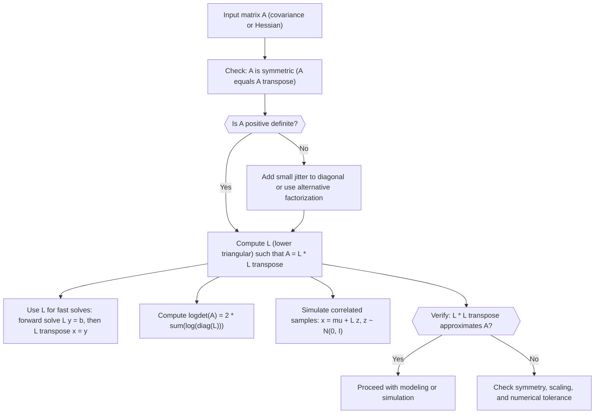

# Cholesky Decomposition (for PD matrix $A$)

$$
A = LL^T
$$

where $L$ is lower triangular

## Deep Breakdown

What it tells me *(Situation Awareness)*:
Cholesky decomposition is what you reach for when you have a *symmetric positive definite* (PD) matrix that you need to use repeatedly, most often a covariance matrix. In DA/DS this appears in multivariate normal models, Gaussian processes, Kalman filters, and any likelihood that needs a log-determinant plus a fast way to solve $Ax = b$ without forming $A^{-1}$. Operationally, it replaces an expensive and unstable inverse with two cheap triangular solves, and it gives you a clean way to simulate *correlated* outcomes, for example correlated channel ROI scenarios.

## Flowchart



## Real-world use

### Where it is used

You use Cholesky when your pipeline includes a covariance matrix, for example in Bayesian marketing mix models (MMM), multivariate A/B test lifts across segments, or anomaly detection with a Gaussian assumption. It is also useful in optimization when $A$ is a PD Hessian or normal-equation matrix and you need stable linear solves.

### Problem it solves

Without Cholesky, people often compute an explicit matrix inverse or do generic decomposition work they do not need. That is slower and numerically brittle, especially when features are correlated and $A$ is ill-conditioned. You also cannot efficiently compute $\log(\det(A))$ or draw correlated samples at scale without a stable factorization.

### How it solves the problem

Cholesky exploits the PD property to factor $A$ into $LL^T$ where $L$ is triangular. Triangular structure matters: solving $Ly = b$ and then $L^T x = y$ is $O(n^2)$ per right-hand side, which is much cheaper than $O(n^3)$ inversion. The diagonal of $L$ also gives $\log(\det(A))$ directly, which is a core term in multivariate normal log-likelihoods.

### Example in a business

Imagine you model weekly incremental revenue lifts for three channels as correlated: Search, Social, and TV. You estimate mean lifts of [€12k, €8k, €20k] with covariance (in €k²): $A = [[25, 10, 5], [10, 16, 4], [5, 4, 36]]$. Cholesky gives $L$ so you can generate 10,000 simulated weeks $x = \mu + Lz$ and answer business questions like "What is $P(\text{total lift} > \text{€50k})$?" or "How often does TV underperform while Search overperforms?" This turns a sensitivity discussion into a reproducible Monte Carlo risk view.

## The formula, piece by piece

- $A$: a symmetric positive definite matrix ($n \times n$), often a covariance matrix or Hessian
- $L$: a lower triangular matrix ($n \times n$) with positive diagonal entries
- $L^T$: the transpose of $L$ (upper triangular)
- $LL^T$: matrix multiplication that reconstructs $A$
- "positive definite": for any non-zero vector $v$, $v^T A v > 0$, which guarantees the factorization exists and is unique Full formula: $A = LL^T$

## The formula in words

"Cholesky factorization rewrites a valid covariance-like matrix $A$ as a lower-triangular matrix $L$ times its transpose, so you can solve systems, compute log-determinants, and simulate correlated values efficiently." Tiny numeric example: if $A = \begin{bmatrix}4 & 2 \\ 2 & 3\end{bmatrix}$, then $L = \begin{bmatrix}2 & 0 \\ 1 & \sqrt{2}\end{bmatrix} \approx \begin{bmatrix}2 & 0 \\ 1 & 1.4142\end{bmatrix}$ because $LL^T = \begin{bmatrix}4 & 2 \\ 2 & 3\end{bmatrix} = A$.

## Critical Concepts

- **PD requirement:** Cholesky exists only if $A$ is symmetric and positive definite; small numerical negatives on eigenvalues can break it.
- **Jitter trick:** in practice you may add $\varepsilon I$ (for example $\varepsilon = 10^{-8}$ to $10^{-6}$) to make a near-PD covariance usable.
- **Log-determinant shortcut:** $\log(\det(A)) = 2 \sum_i \log(L_{ii})$ is stable and fast, crucial in Gaussian log-likelihoods.
- **Solving beats inverting:** compute $x$ via two triangular solves, do not form $A^{-1}$ unless you have a strong reason.
- **Cost profile:** factorization is $O(n^3)$, but each additional solve or simulation is $O(n^2)$, so it pays off when reused.
- **PSD case:** if $A$ is only positive semidefinite (rank-deficient), use an SVD or an $LDL^T$ or pivoted Cholesky variant.

## Step-by-step calculation (tiny example)

*Step 1: Compute the first diagonal entry of L*
Compute $l_{11} = \sqrt{a_{11}} = \sqrt{4} = 2$. So the first column of $L$ starts with $l_{11} = 2$, all entries below it follow.

*Step 2: Compute the remaining entries of L column by column*
Compute $l_{21} = a_{21} / l_{11} = 2 / 2 = 1$.
Now compute $l_{22} = \sqrt{a_{22} - l_{21}^2} = \sqrt{3 - 1^2} = \sqrt{2} \approx 1.4142$.
So $L = \begin{bmatrix}2 & 0 \\ 1 & 1.4142\end{bmatrix}$.

*Step 3: Verify by reconstructing A = L L^T*
$LL^T = \begin{bmatrix}2 & 0 \\ 1 & 1.4142\end{bmatrix}\begin{bmatrix}2 & 1 \\ 0 & 1.4142\end{bmatrix}$ - $(1,1)$: $2 \cdot 2 + 0 \cdot 0 = 4$ ✓
- $(1,2)$: $2 \cdot 1 + 0 \cdot 1.4142 = 2$ ✓
- $(2,1)$: $1 \cdot 2 + 1.4142 \cdot 0 = 2$ ✓
- $(2,2)$: $1 \cdot 1 + 1.4142 \cdot 1.4142 = 1 + 2 = 3$ ✓ We recover $A$ exactly (up to rounding), sanity check passes.

## Code examples

### Beginner example (Python)

```python
import math   # -- Input: 2x2 positive definite covariance matrix -------------------
COV_11 = 4.0
COV_12 = 2.0
COV_21 = 2.0
COV_22 = 3.0   # Step 1: compute L(1,1)
l_11 = math.sqrt(COV_11)   # Step 2: compute L(2,1) and L(2,2)
l_21 = COV_21 / l_11
l_22 = math.sqrt(COV_22 - l_21 ** 2)
L = [ [l_11, 0.0], [l_21, l_22],
]
print(f"L[0] = {L[0]}")
print(f"L[1] = {L[1]}")   # Step 3: verify L * L^T reconstructs A
a11_hat = L[0][0] * L[0][0] + L[0][1] * L[0][1]
a12_hat = L[0][0] * L[1][0] + L[0][1] * L[1][1]
a22_hat = L[1][0] * L[1][0] + L[1][1] * L[1][1]
print(f"\nReconstructed A = [[{a11_hat:.4f}, {a12_hat:.4f}], [{a12_hat:.4f}, {a22_hat:.4f}]]")
print("Expected A = [[4.0000, 2.0000], [2.0000, 3.0000]]")
```

### Beginner example (R)

```r
# -- Input: 2x2 positive definite covariance matrix -------------------
cov_11 <- 4
cov_21 <- 2
cov_22 <- 3  # Step 1: compute l_11
l_11 <- sqrt(cov_11)  # Step 2: compute l_21 and l_22
l_21 <- cov_21 / l_11
l_22 <- sqrt(cov_22 - l_21^2)
L <- matrix(c(l_11, l_21, 0, l_22), nrow = 2, byrow = FALSE)
cat("L =\n")
print(L)  # Step 3: verify
a_hat <- L %*% t(L)
cat("\nL %*% t(L) =\n")
print(a_hat)
cat(sprintf("\nExpected: [[4, 2], [2, 3]]\n"))
```

### Professional example (Python)

```python
import numpy as np
import pandas as pd
np.random.seed(42)   # -- Business scenario: simulate correlated weekly channel lifts -------
N_SIM = 10_000
TARGET_TOTAL_LIFT_EUR = 50_000
JITTER = 1e-8
channels = ["search", "social", "tv"]   # Mean incremental lift per week (EUR)
mu = np.array([12_000.0, 8_000.0, 20_000.0])   # Covariance of lifts (EUR^2), must be symmetric and positive definite
cov = np.array( [ [25_000_000.0, 10_000_000.0, 5_000_000.0], [10_000_000.0, 16_000_000.0, 4_000_000.0], [ 5_000_000.0, 4_000_000.0, 36_000_000.0], ], dtype=float,
)   # Guard: small jitter ensures numerical positive definiteness
cov_stable = cov + JITTER * np.eye(len(channels))   # Cholesky factorization: cov = L L^T
L = np.linalg.cholesky(cov_stable)   # Simulate: draw z ~ N(0, I), transform to x = mu + L z
z = np.random.normal(loc=0.0, scale=1.0, size=(N_SIM, len(channels)))
sim_lifts = mu + z @ L.T
df = pd.DataFrame(sim_lifts, columns=channels)
df["total_lift"] = df.sum(axis=1)
prob_hit_target = (df["total_lift"] > TARGET_TOTAL_LIFT_EUR).mean()   # Diagnostics: empirical covariance should resemble input covariance
emp_cov = df[channels].cov().to_numpy()
print("Cholesky L (lower triangular):")
print(L.round(2))
print()
print(f"P(total_lift > {TARGET_TOTAL_LIFT_EUR:,.0f} EUR) = {prob_hit_target:.3f}")
print()
print("Empirical covariance from simulations (EUR^2):")
print(pd.DataFrame(emp_cov, index=channels, columns=channels).round(0))
print(f"\nInterpretation: the weekly lift target is hit about {prob_hit_target:.1%} of the time.")
```

---

*Source: MML1*
