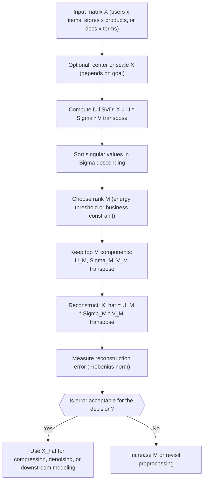

# Low-Rank Approximation (truncated SVD)

$$
X \approx U_M \Sigma_M V_M^T
$$

## Deep Breakdown

What it tells me *(Situation Awareness)*:
Low-rank approximation is the practical move you make when your data matrix is large, noisy, and mostly driven by a small number of latent factors. In DA/DS you see this in recommender systems (user-item matrices), topic-style compression of document-term matrices, and denoising KPI tables where you want the signal without week-to-week noise. Truncated SVD gives you a controlled way to trade accuracy for simplicity, memory, and speed, while keeping the most informative structure in the matrix.

## Flowchart



## Real-world use

### Where it is used

Use truncated SVD when you need to compress a matrix but still keep its dominant patterns, for example reducing a 5,000-product basket matrix into 50 latent demand factors. It is also common when you want a denoised version of a metric table before clustering or anomaly detection.

### Problem it solves

Raw matrices can be high-dimensional and sparse, making models slow, unstable, and hard to interpret. Noise often dominates the small singular components, so downstream models chase randomness. You need a principled way to keep the dominant structure and drop the rest.

### How it solves the problem

SVD decomposes $X$ into orthogonal directions with strengths given by singular values. Truncating to $M$ keeps only the top $M$ singular values and their vectors, which is the best rank-$M$ approximation of $X$ under squared error (Frobenius norm). Practically, you keep the strongest latent factors and discard low-signal components.

### Example in a business

A retailer has a 200 stores × 500 product-categories weekly sales matrix $X$. They believe sales behavior is driven by a few store archetypes (urban, suburban, tourist) and a few category bundles (fresh food, home care, seasonal). By taking $M = 10$, they reconstruct $\hat{X}$ that removes most week-to-week noise and lets them spot true changes, like a store whose residuals jump in seasonal categories after a local event.

## The formula, piece by piece

- $X$: the original data matrix ($m \times n$), for example users × items or stores × product categories
- $U_M$: the first $M$ left singular vectors ($m \times M$), dominant directions on the row side
- $\Sigma_M$: diagonal matrix of the top $M$ singular values ($M \times M$), strengths of the latent factors
- $V_M^T$: transpose of the first $M$ right singular vectors ($M \times n$), dominant directions on the column side
- $M$: chosen rank (integer), controls compression and reconstruction error
- $\approx$: approximate equality because components beyond rank $M$ were dropped Full formula: $X \approx U_M \Sigma_M V_M^T$

## The formula in words

"Truncated SVD rebuilds your data matrix using only the top $M$ latent factors, keeping the main structure and discarding smaller, mostly-noise components." Tiny numeric example: if $X = \begin{bmatrix}3 & 0 \\ 0 & 1\end{bmatrix}$ and you keep $M = 1$, then $\hat{X} = \begin{bmatrix}3 & 0 \\ 0 & 0\end{bmatrix}$. You kept the strongest component (singular value 3) and dropped the weaker one (singular value 1). Frobenius error $= \|X - \hat{X}\|_F = 1$.

## Critical Concepts

- **Best rank-M guarantee:** truncated SVD is optimal for squared reconstruction error (Frobenius norm), but only for that objective, not for, say, MAE or classification accuracy.
- **Choosing M:** use cumulative energy $\sum_{i=1}^M \sigma_i^2 / \sum_i \sigma_i^2$ or validate on the downstream task; do not guess.
- **Centering matters:** for PCA-like use, center columns first; for user-item matrices, subtract user or item means before decomposing.
- **Scale and outliers:** very large rows or columns can dominate the top singular vectors; consider scaling or winsorization before SVD.
- **Large sparse matrices:** full SVD is $O(mn \cdot \min(m,n))$; use randomized or iterative truncated methods (e.g., `sklearn.utils.extmath.randomized_svd`) for big data.
- **Not the same as NMF:** SVD allows negative entries in $U$ and $V$, yielding mixed-sign factors; NMF enforces non-negativity and yields part-based, more interpretable factors.

## Step-by-step calculation (tiny example)

*Step 1: Identify the SVD of X*
Start with $X = \begin{bmatrix}3 & 0 \\ 0 & 1\end{bmatrix}$. Because $X$ is already diagonal with non-negative entries, its SVD is trivial: $U = I$, $\Sigma = \text{diag}(3, 1)$, $V = I$.

*Step 2: Truncate to rank M = 1*
Keep only the first column of $U$, the first diagonal of $\Sigma$, and the first row of $V^T$:
$U_M = \begin{bmatrix}1 \\ 0\end{bmatrix}$, $\Sigma_M = [3]$, $V_M^T = [1, 0]$.

*Step 3: Reconstruct X_hat and measure the error*
$\hat{X} = U_M \Sigma_M V_M^T = \begin{bmatrix}1 \\ 0\end{bmatrix}[3][1, 0] = \begin{bmatrix}3 & 0 \\ 0 & 0\end{bmatrix}$. Frobenius error: $\|X - \hat{X}\|_F = \sqrt{0^2 + 0^2 + 0^2 + 1^2} = 1$. Rank dropped from 2 to 1; we lost exactly the smaller singular component (value 1).

## Code examples

### Beginner example (Python)

```python
import numpy as np
RANK_M = 1   # -- Tiny matrix with an obvious low-rank structure -------------------
X = np.array([[3.0, 0.0], [0.0, 1.0]])   # Full SVD (economy size)
U, s, V_t = np.linalg.svd(X, full_matrices=False)   # Truncate to top RANK_M components
U_m = U[:, :RANK_M]
S_m = np.diag(s[:RANK_M])
V_m_t = V_t[:RANK_M, :]   # Reconstruct and measure error
X_hat = U_m @ S_m @ V_m_t
error_fro = np.linalg.norm(X - X_hat, ord="fro")
print("X:")
print(X)
print(f"\nSingular values: {s}")
print(f"\nRank-{RANK_M} approximation X_hat:")
print(X_hat)
print(f"\nFrobenius error ||X - X_hat||_F = {error_fro:.4f}")
print("Interpretation: we dropped the component with singular value 1.0, error = 1.")
```

### Beginner example (R)

```r
rank_m <- 1  # -- Tiny matrix with an obvious low-rank structure -------------------
X <- matrix(c(3, 0, 0, 1), nrow = 2, byrow = TRUE)
sv <- svd(X)  # Truncate to rank_m
u_m <- sv$u[, 1:rank_m, drop = FALSE]
s_m <- diag(sv$d[1:rank_m])
v_m_t <- t(sv$v[, 1:rank_m, drop = FALSE])
X_hat <- u_m %*% s_m %*% v_m_t
error_fro <- sqrt(sum((X - X_hat)^2))
cat("X =\n")
print(X)
cat(sprintf("\nSingular values: %s\n", paste(round(sv$d, 4), collapse = ", ")))
cat(sprintf("\nRank-%d approximation X_hat =\n", rank_m))
print(X_hat)
cat(sprintf("\nFrobenius error = %.4f\n", error_fro))
```

### Professional example (Python)

```python
import numpy as np
import pandas as pd
np.random.seed(42)   # -- Business scenario: denoise a store x category sales matrix -------
N_STORES = 30
N_CATEGORIES = 12
ENERGY_THRESHOLD = 0.90   # keep enough components to explain 90% variance
BASE_SCALE_EUR = 50_000
LATENT_SCALE_EUR = 12_000
NOISE_STD_EUR = 8_000   # Latent structure: 3 store archetypes x 3 category bundles
store_factors = np.random.normal(size=(N_STORES, 3))
category_factors = np.random.normal(size=(N_CATEGORIES, 3))
latent = store_factors @ category_factors.T   # Scale to realistic EUR weekly sales and add noise
X = BASE_SCALE_EUR + LATENT_SCALE_EUR * latent + np.random.normal(0.0, NOISE_STD_EUR, latent.shape)
X = np.maximum(X, 0.0)
store_ids = [f"store_{i:02d}" for i in range(N_STORES)]
cat_ids = [f"cat_{j:02d}" for j in range(N_CATEGORIES)]
X_df = pd.DataFrame(X, index=store_ids, columns=cat_ids)   # SVD and choose M by cumulative energy
U, s, V_t = np.linalg.svd(X_df.to_numpy(), full_matrices=False)
energy = np.cumsum(s ** 2) / np.sum(s ** 2)
rank_m = int(np.searchsorted(energy, ENERGY_THRESHOLD) + 1)   # Truncated reconstruction
U_m = U[:, :rank_m]
S_m = np.diag(s[:rank_m])
V_m_t = V_t[:rank_m, :]
X_hat = U_m @ S_m @ V_m_t
X_hat_df = pd.DataFrame(X_hat, index=store_ids, columns=cat_ids)
residual_df = X_df - X_hat_df
error_fro = np.linalg.norm(X_df.to_numpy() - X_hat, ord="fro")
print(f"Chosen rank M = {rank_m} to capture at least {ENERGY_THRESHOLD:.0%} energy")
print(f"Reconstruction error (Frobenius) = {error_fro:.2f}")   # Top residuals can flag local events, stockouts, or reporting issues
flat = residual_df.stack().rename("residual_eur").reset_index()
flat.columns = ["store_id", "category_id", "residual_eur"]
flat["abs_residual_eur"] = flat["residual_eur"].abs()
top_anomalies = flat.sort_values("abs_residual_eur", ascending=False).head(8)
print("\nTop residuals (potential anomalies):")
print(top_anomalies[["store_id", "category_id", "residual_eur"]].to_string(index=False))
print("\nInterpretation: X_hat is a denoised baseline driven by a small number of latent demand factors.")
```

---

*Source: MML1*
