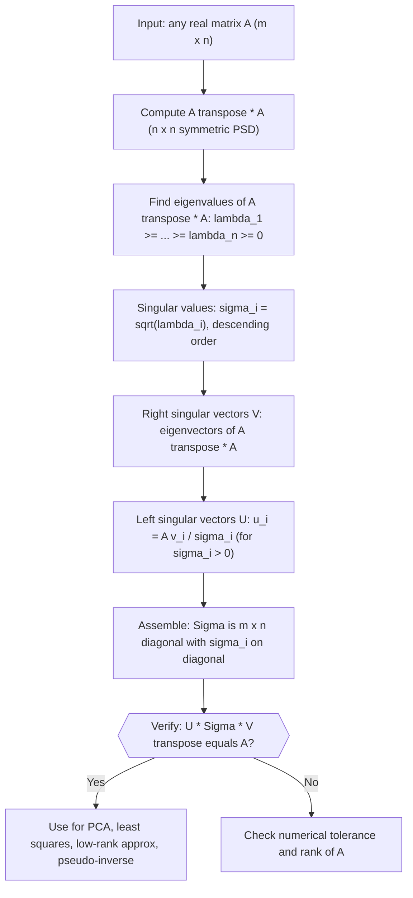

# Singular Value Decomposition

$$
A = U \Sigma V^T
$$

where $U, V$ are orthogonal and $\Sigma$ is diagonal

## Deep Breakdown

What it tells me *(Situation Awareness)*:
SVD is the most general matrix factorization in applied linear algebra: it works on *any* matrix, not just square or symmetric ones. In DA/DS you encounter it every time you do PCA (the principal components are the right singular vectors of the centered data matrix), build a recommendation engine (latent factors in a user-item matrix), solve an ill-conditioned least-squares problem, or need the pseudo-inverse of a non-square matrix. It is the factorization that reveals what a linear transformation *actually does*: it rotates, scales, and rotates again.

## Flowchart



## Real-world use

### Where it is used

SVD is used whenever you need to understand the intrinsic structure of a data matrix: how many independent directions of variation exist, how strong each one is, and what patterns in rows and columns align. Common entry points are PCA on a customer feature matrix, document-term topic modeling, image compression, and numerically stable regression.

### Problem it solves

Many DA/DS tasks require working with rectangular matrices that may be rank-deficient, ill-conditioned, or very large. Direct inversion is impossible (non-square) or unstable (nearly singular). SVD provides a complete, stable decomposition that enables all downstream operations: solving, projecting, compressing, and diagnosing.

### How it solves the problem

SVD factors $A = U\Sigma V^T$ into two orthogonal matrices ($U$, $V$) and one diagonal matrix ($\Sigma$). The singular values on $\Sigma$ measure the "energy" in each direction. You can truncate small singular values to get a low-rank approximation, invert via the pseudo-inverse, or read off the rank as the number of non-zero singular values.

### Example in a business

A streaming platform has a 10,000-user × 5,000-movie rating matrix $A$ (mostly zeros). SVD with $M = 50$ latent factors gives $\hat{A} = U_{50}\Sigma_{50}V_{50}^T$. The latent factors capture genres, mood, and popularity. To recommend movies to user $i$, extract row $i$ of $U_{50}\Sigma_{50}$ (their latent taste vector) and find the movies in $V_{50}$ with the highest dot product. This is the mathematical core of collaborative filtering.

## The formula, piece by piece

- $A$: the original $m \times n$ data matrix (can be any shape, need not be square or full rank)
- $U$: $m \times m$ orthogonal matrix; columns are the *left singular vectors* (directions in row space of $A$)
- $\Sigma$: $m \times n$ diagonal matrix; the $r = \min(m,n)$ diagonal entries $\sigma_1 \geq \sigma_2 \geq \cdots \geq 0$ are the *singular values*
- $V^T$: transpose of the $n \times n$ orthogonal matrix $V$; columns of $V$ are the *right singular vectors* (directions in column space of $A^T$)
- $U^T U = I_m$, $V^T V = I_n$: both $U$ and $V$ are orthogonal, so they preserve lengths and angles
- The number of non-zero singular values equals $\text{rank}(A)$ Full formula: $A = U \Sigma V^T$

## The formula in words

"SVD expresses any matrix as a sequence of three operations: rotate the input space, scale along the new axes, then rotate again — and it tells you exactly how much scaling happens in each direction." Tiny numeric example: $A = \begin{bmatrix}3 & 0 \\ 0 & 1\end{bmatrix}$.
This is already diagonal, so $U = I$, $\Sigma = \begin{bmatrix}3 & 0 \\ 0 & 1\end{bmatrix}$, $V = I$.
Verify: $U \Sigma V^T = I \cdot \begin{bmatrix}3 & 0 \\ 0 & 1\end{bmatrix} \cdot I = A$. Singular values are 3 and 1.

## Critical Concepts

- **Economy SVD:** for $m \gg n$, computing the full $m \times m$ matrix $U$ wastes memory; use `full_matrices=False` to get the thin/economy form ($U$ is $m \times n$).
- **Singular values vs eigenvalues:** singular values $\sigma_i = \sqrt{\lambda_i(A^T A)}$ are always non-negative; eigenvalues of $A$ can be negative or complex.
- **SVD gives PCA:** center your data matrix $X$, then SVD it: the right singular vectors $V$ are the principal component directions, and $\sigma_i^2 / (n-1)$ are the explained variances.
- **Pseudo-inverse:** $A^+ = V \Sigma^+ U^T$ where $\Sigma^+$ replaces each non-zero $\sigma_i$ with $1/\sigma_i$; this is the numerically stable way to solve least squares.
- **Numerical rank:** a singular value below a threshold (e.g., $\sigma_i < \varepsilon \cdot \sigma_1$) is treated as zero; this gives the effective rank.
- **Cost:** full SVD is $O(mn \cdot \min(m,n))$; for large sparse matrices use randomized SVD or iterative methods.

## Step-by-step calculation (tiny example)

*Step 1: Compute A^T A and find its eigenvalues*
Let $A = \begin{bmatrix}1 & 1 \\ 0 & 1\end{bmatrix}$.
$A^T A = \begin{bmatrix}1 & 0 \\ 1 & 1\end{bmatrix}\begin{bmatrix}1 & 1 \\ 0 & 1\end{bmatrix} = \begin{bmatrix}1 & 1 \\ 1 & 2\end{bmatrix}$.
Characteristic equation: $(1-\lambda)(2-\lambda) - 1 = 0 \Rightarrow \lambda^2 - 3\lambda + 1 = 0$.
$\lambda = \frac{3 \pm \sqrt{5}}{2}$, so $\lambda_1 \approx 2.618$, $\lambda_2 \approx 0.382$.

*Step 2: Compute singular values and right singular vectors V*
$\sigma_1 = \sqrt{2.618} \approx 1.618$, $\sigma_2 = \sqrt{0.382} \approx 0.618$.
Right singular vectors: eigenvectors of $A^T A$ (normalized). For $\lambda_1$: solve $(A^T A - 2.618 I)v = 0$, giving $v_1 \approx [0.526, 0.851]^T$. For $\lambda_2$: $v_2 \approx [-0.851, 0.526]^T$.

*Step 3: Compute left singular vectors U and assemble the decomposition*
$u_1 = A v_1 / \sigma_1 = [1.618, 0.851]^T / 1.618 \approx [1, 0.526]^T$ (then normalize). Similarly $u_2$. Assemble $U, \Sigma, V^T$ and verify $U\Sigma V^T \approx A$.

## Code examples

### Beginner example (Python)

```python
import numpy as np   # -- Simple 3x2 matrix: think of 3 documents, 2 keyword features ------
A = np.array([[1.0, 2.0], [3.0, 4.0], [5.0, 6.0]])   # Full SVD (economy/thin form)
U, s, V_t = np.linalg.svd(A, full_matrices=False)
print("Original matrix A:")
print(A)
print(f"\nSingular values: {s.round(4)}")
print(f"\nU (left singular vectors, shape {U.shape}):")
print(U.round(4))
print(f"\nV^T (right singular vectors, shape {V_t.shape}):")
print(V_t.round(4))   # Verify reconstruction
A_reconstructed = U @ np.diag(s) @ V_t
print(f"\nReconstructed A (should match original):")
print(A_reconstructed.round(4))
print(f"\nMax reconstruction error: {np.max(np.abs(A - A_reconstructed)):.2e}")
print(f"\nCumulative energy: {np.cumsum(s**2)/np.sum(s**2).round(4)}")
```

### Beginner example (R)

```r
# -- Simple 3x2 matrix: 3 documents, 2 keyword features ---------------
A <- matrix(c(1, 3, 5, 2, 4, 6), nrow = 3, ncol = 2)
sv <- svd(A)
cat("Original matrix A:\n")
print(A)
cat(sprintf("\nSingular values: %s\n", paste(round(sv$d, 4), collapse = ", ")))
cat("\nU (left singular vectors):\n")
print(round(sv$u, 4))
cat("\nV (right singular vectors):\n")
print(round(sv$v, 4))  # Verify reconstruction
A_hat <- sv$u %*% diag(sv$d) %*% t(sv$v)
cat(sprintf("\nMax reconstruction error: %.2e\n", max(abs(A - A_hat))))  # Cumulative energy
energy <- cumsum(sv$d^2) / sum(sv$d^2)
cat(sprintf("\nCumulative energy: %s\n", paste(round(energy, 4), collapse = ", ")))
```

### Professional example (Python)

```python
import numpy as np
import pandas as pd
np.random.seed(42)   # -- Business scenario: latent factor discovery in a user-item matrix --
N_USERS = 200
N_ITEMS = 80
N_LATENT = 5   # true number of latent factors in the data
RANK_M = 5   # how many singular values to retain # Simulate a low-rank user-item rating matrix with noise
user_factors = np.random.normal(size=(N_USERS, N_LATENT))
item_factors = np.random.normal(size=(N_ITEMS, N_LATENT))
true_signal = user_factors @ item_factors.T
noise = np.random.normal(0, 0.5, size=true_signal.shape)
ratings_raw = true_signal + noise
user_ids = [f"user_{i:03d}" for i in range(N_USERS)]
item_ids = [f"item_{j:03d}" for j in range(N_ITEMS)]
X_df = pd.DataFrame(ratings_raw, index=user_ids, columns=item_ids)   # SVD on the ratings matrix
U, s, V_t = np.linalg.svd(X_df.to_numpy(), full_matrices=False)   # Energy analysis: how many components explain 90% of variance?
energy = np.cumsum(s ** 2) / np.sum(s ** 2)
rank_90_pct = int(np.searchsorted(energy, 0.90) + 1)   # Truncated reconstruction at chosen rank
U_m = U[:, :RANK_M]
S_m = np.diag(s[:RANK_M])
V_m_t = V_t[:RANK_M, :]
X_hat = U_m @ S_m @ V_m_t
error_fro = np.linalg.norm(X_df.to_numpy() - X_hat, ord="fro")
print(f"Top-{RANK_M} singular values: {s[:RANK_M].round(2)}")
print(f"Energy captured by rank-{RANK_M}: {energy[RANK_M-1]:.1%}")
print(f"Components needed for 90% energy: {rank_90_pct}")
print(f"Frobenius error (rank-{RANK_M} approx): {error_fro:.2f}")   # Recommend top-5 unrated items for user_000
user_idx = 0
user_latent = U_m[user_idx] @ S_m   # latent taste vector
item_scores = user_latent @ V_m_t   # predicted rating for each item
top_item_idx = np.argsort(item_scores)[::-1][:5]
top_items = [item_ids[i] for i in top_item_idx]
print(f"\nTop-5 recommendations for {user_ids[user_idx]}: {top_items}")
print("Interpretation: SVD compressed 200x80 ratings into 5 latent factors for fast, interpretable recommendation.")
```

---

*Source: MML1*
