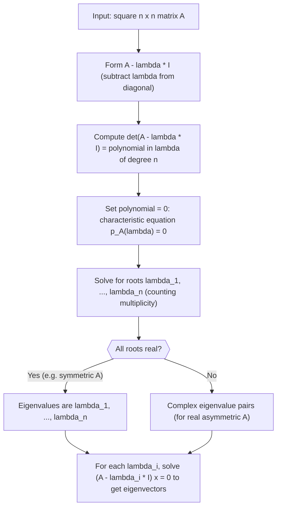

# Characteristic Equation

$$
p_A(\lambda) = \det(A - \lambda I) = 0
$$

## Deep Breakdown

What it tells me *(Situation Awareness)*:
The characteristic equation is the algebraic gateway to finding eigenvalues: you cannot get eigenvectors without it. In practice, you rarely solve this polynomial by hand for large matrices (libraries do it numerically), but you need to understand it to know *why* $n \times n$ matrices have at most $n$ eigenvalues, why symmetric matrices always have real eigenvalues, and how the determinant and trace connect to eigenvalues. In DA/DS this appears when you want to reason about the spectrum of a covariance matrix without computing all eigenvectors, or when checking if a matrix is positive definite by verifying all roots are positive.

## Flowchart



## Real-world use

### Where it is used

You use the characteristic equation conceptually when analyzing a covariance matrix: if all roots of its characteristic polynomial are positive, the matrix is positive definite and Cholesky will work. You also use it when checking the stability of a dynamical system (all eigenvalues inside the unit circle means stable convergence), or when the trace and determinant of a 2×2 covariance block give you the eigenvalues analytically without a full solve.

### Problem it solves

To find eigenvalues numerically, libraries use iterative algorithms (QR iteration), not this polynomial. But to understand *how many* eigenvalues exist, *why* they are real for symmetric matrices, and *what the trace and determinant encode*, you need the characteristic polynomial.

### How it solves the problem

$\det(A - \lambda I) = 0$ says: find the values of $\lambda$ for which $A - \lambda I$ is singular, meaning there exists a non-zero vector $x$ with $(A - \lambda I)x = 0$, i.e., $Ax = \lambda x$. Expanding the determinant gives a degree-$n$ polynomial whose roots are precisely the eigenvalues.

### Example in a business

A risk analyst has a 2×2 correlation matrix for two revenue streams. Rather than calling `np.linalg.eig`, they use the characteristic equation directly: for $A = \begin{bmatrix}1 & r \\ r & 1\end{bmatrix}$, $p_A(\lambda) = (1-\lambda)^2 - r^2 = 0$, giving $\lambda = 1 \pm |r|$. If $r = 0.7$, eigenvalues are 1.7 and 0.3, both positive so $A$ is PD. The dominant eigenvector (for $\lambda = 1.7$) points in the direction of maximum joint variance.

## The formula, piece by piece

- $p_A(\lambda)$: the characteristic polynomial of $A$, a polynomial of degree $n$ in $\lambda$
- $\det(\cdot)$: the determinant, a scalar function of a square matrix
- $A - \lambda I$: the matrix $A$ with $\lambda$ subtracted from every diagonal entry; $I$ is the identity matrix
- $= 0$: we are looking for the values of $\lambda$ that make this determinant zero, i.e., that make $A - \lambda I$ singular
- $\lambda$: the unknown eigenvalue, the root of the polynomial Full formula: $p_A(\lambda) = \det(A - \lambda I) = 0$

## The formula in words

"Find the values of $\lambda$ for which subtracting $\lambda$ from every diagonal entry of $A$ makes the matrix non-invertible." Tiny numeric example: $A = \begin{bmatrix}4 & 1 \\ 2 & 3\end{bmatrix}$.
$\det(A - \lambda I) = (4-\lambda)(3-\lambda) - 2 = \lambda^2 - 7\lambda + 10 = (\lambda-5)(\lambda-2) = 0$.
Eigenvalues: $\lambda_1 = 5$, $\lambda_2 = 2$. Sum $= 7 = \text{tr}(A)$ ✓. Product $= 10 = \det(A)$ ✓.

## Critical Concepts

- **Trace-eigenvalue link:** the sum of all eigenvalues equals $\text{tr}(A) = \sum A_{ii}$; a quick sanity check on any eigenvalue computation.
- **Determinant-eigenvalue link:** the product of all eigenvalues equals $\det(A)$; if any eigenvalue is 0, the matrix is singular.
- **Degree = size:** the polynomial has degree $n$, so exactly $n$ eigenvalues exist (counting complex and repeated roots by the fundamental theorem of algebra).
- **Symmetric matrices:** $A = A^T$ guarantees all roots of $p_A$ are real (via spectral theorem); use `np.linalg.eigh` for speed and stability.
- **Repeated roots:** a repeated eigenvalue (algebraic multiplicity $> 1$) may or may not yield enough independent eigenvectors (geometric multiplicity can be lower).
- **Never solve this for large matrices:** for $n > 3$, use `np.linalg.eig` or `eigh`; solving the degree-$n$ polynomial directly is numerically unstable.

## Step-by-step calculation (tiny example)

*Step 1: Form A - lambda I and write the determinant expression*
$A = \begin{bmatrix}5 & 2 \\ 2 & 2\end{bmatrix}$. Subtract $\lambda I$: $A - \lambda I = \begin{bmatrix}5-\lambda & 2 \\ 2 & 2-\lambda\end{bmatrix}$.
$\det(A - \lambda I) = (5-\lambda)(2-\lambda) - (2)(2) = 10 - 7\lambda + \lambda^2 - 4 = \lambda^2 - 7\lambda + 6$.

*Step 2: Solve the characteristic polynomial for lambda*
$\lambda^2 - 7\lambda + 6 = 0$.
Discriminant: $49 - 24 = 25$. Roots: $\lambda = \frac{7 \pm 5}{2}$, giving $\lambda_1 = 6$ and $\lambda_2 = 1$.

*Step 3: Verify using trace and determinant*
$\text{tr}(A) = 5 + 2 = 7 = \lambda_1 + \lambda_2 = 6 + 1$. ✓
$\det(A) = (5)(2) - (2)(2) = 6 = \lambda_1 \cdot \lambda_2 = 6 \cdot 1$. ✓
Both checks pass: eigenvalues are correct.

## Code examples

### Beginner example (Python)

```python
import math

# -- Characteristic polynomial for a 2x2 matrix ----------------------
# A = [[a, b], [c, d]]
A_11 = 5.0
A_12 = 2.0
A_21 = 2.0
A_22 = 2.0

# Coefficients of lambda^2 - tr(A)*lambda + det(A) = 0
trace_a = A_11 + A_22
det_a = A_11 * A_22 - A_12 * A_21
print(f"tr(A) = {trace_a}")
print(f"det(A) = {det_a}")

# Solve lambda^2 - trace*lambda + det = 0
discriminant = trace_a ** 2 - 4 * det_a
print(f"Discriminant = {discriminant}")
if discriminant < 0:
    print("Complex eigenvalues (matrix is not symmetric with real eigenvalues)")
else:
    lambda_1 = (trace_a + math.sqrt(discriminant)) / 2
    lambda_2 = (trace_a - math.sqrt(discriminant)) / 2
    print(f"\nEigenvalues: lambda_1 = {lambda_1:.4f}, lambda_2 = {lambda_2:.4f}")
    print(f"Verification: sum = {lambda_1 + lambda_2:.4f} (should equal tr = {trace_a})")
    print(f"Verification: product = {lambda_1 * lambda_2:.4f} (should equal det = {det_a})")
```

### Beginner example (R)

```r
# -- Characteristic polynomial for a 2x2 matrix ----------------------
A <- matrix(c(5, 2, 2, 2), nrow = 2)
trace_a <- sum(diag(A))
det_a <- det(A)
cat(sprintf("tr(A) = %.4f\n", trace_a))
cat(sprintf("det(A) = %.4f\n", det_a))

# Solve lambda^2 - trace*lambda + det = 0
discriminant <- trace_a^2 - 4 * det_a
cat(sprintf("Discriminant = %.4f\n", discriminant))
if (discriminant >= 0) {
  lambda_1 <- (trace_a + sqrt(discriminant)) / 2
  lambda_2 <- (trace_a - sqrt(discriminant)) / 2
  cat(sprintf("Eigenvalues: %.4f, %.4f\n", lambda_1, lambda_2))
  cat(sprintf("Sum = %.4f (should equal trace = %.4f)\n", lambda_1 + lambda_2, trace_a))
  cat(sprintf("Product = %.4f (should equal det = %.4f)\n", lambda_1 * lambda_2, det_a))
}
```

### Professional example (Python)

```python
import numpy as np
import pandas as pd
np.random.seed(42)   # -- Business scenario: check positive definiteness of covariance blocks
# For a portfolio of 4 asset returns, check if each 2x2 sub-covariance
# block is positive definite using the characteristic equation analytically.
N_ASSETS = 4
N_PERIODS = 300
ASSET_NAMES = ["search_rev", "social_rev", "email_rev", "display_rev"]   # Simulate correlated weekly revenue increments (EUR thousands)
true_cov = np.array([ [4.0, 1.5, 0.8, 0.3], [1.5, 3.0, 1.0, 0.5], [0.8, 1.0, 2.5, 0.4], [0.3, 0.5, 0.4, 1.5],
])
L_sim = np.linalg.cholesky(true_cov)
returns = (np.random.normal(size=(N_PERIODS, N_ASSETS)) @ L_sim.T)
df = pd.DataFrame(returns, columns=ASSET_NAMES)
cov_matrix = df.cov().to_numpy()   # For each 2x2 sub-block, compute eigenvalues analytically via characteristic equation
results = []
for i in range(N_ASSETS):
    for j in range(i + 1, N_ASSETS):
        block = cov_matrix[np.ix_([i, j], [i, j])]
    trace_b = block[0, 0] + block[1, 1]
det_b = block[0, 0] * block[1, 1] - block[0, 1] * block[1, 0]
disc = trace_b ** 2 - 4 * det_b
lam_1 = (trace_b + np.sqrt(disc)) / 2
lam_2 = (trace_b - np.sqrt(disc)) / 2
is_pd = lam_1 > 0 and lam_2 > 0
results.append({ "pair": f"{ASSET_NAMES[i]} / {ASSET_NAMES[j]}", "lambda_1": round(lam_1, 4), "lambda_2": round(lam_2, 4), "is_positive_definite": is_pd, })
result_df = pd.DataFrame(results)
print("2x2 covariance block eigenvalues (via characteristic equation):")
print(result_df.to_string(index=False))
print("\nInterpretation: all blocks PD means each pair of assets has a valid covariance structure for Cholesky sampling.")
```

---

*Source: 1300 p. 121*
