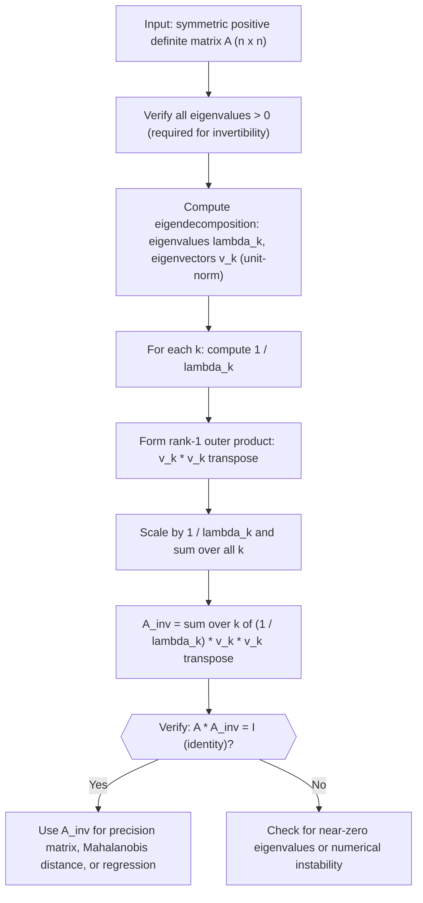

# Computing Inverse via Eigenvectors

$$
A^{-1} = \sum_k \lambda_k^{-1} v_k v_k^\dagger
$$

## Deep Breakdown

What it tells me *(Situation Awareness)*:
This is the spectral formula for the matrix inverse: if you already have the eigendecomposition of a symmetric (or Hermitian) matrix, you get its inverse for free by replacing each eigenvalue $\lambda_k$ with its reciprocal $\lambda_k^{-1}$. The formula holds because eigenvectors form an orthonormal basis, so the inverse of the scaling in each direction is simply $1/\lambda_k$. In DA/DS this matters for precision matrix computation (the inverse of a covariance matrix, used in Mahalanobis distance and Gaussian likelihood), ridge regression (the inverse of $X^T X + \lambda I$), and checking whether a covariance matrix is invertible by confirming all eigenvalues are strictly positive.

## Flowchart



## Real-world use

### Where it is used

Use this when you need the inverse of a covariance matrix and you already have (or need) the eigendecomposition for other purposes, such as PCA or covariance regularization. It is also the right tool when you want a numerically stable pseudo-inverse: set $1/\lambda_k = 0$ for eigenvalues below a threshold instead of dividing by near-zero values.

### Problem it solves

Direct matrix inversion via Gaussian elimination or LU decomposition becomes unstable when eigenvalues are small or near-zero (near-singular matrix). The spectral formula exposes each direction's contribution to the inverse, so you can selectively truncate ill-conditioned directions.

### How it solves the problem

Since eigenvectors of a symmetric matrix form an orthonormal basis, the inverse of the linear transformation $A$ is simply the same rotation but with scaling $\lambda_k^{-1}$ in each eigendirection. Summing the rank-1 terms $\lambda_k^{-1} v_k v_k^T$ reconstructs the full inverse. Dropping near-zero terms gives the Moore-Penrose pseudo-inverse.

### Example in a business

A data scientist builds a Mahalanobis anomaly detector on 5 media spend metrics. The covariance matrix is estimated from 80 weeks of data. Before inverting it, they decompose it spectrally, find that 2 eigenvalues are below $10^{-4}$ (near-singular due to collinear channels), and compute a regularized inverse by flooring those eigenvalues at $10^{-3}$. The resulting precision matrix is stable and gives a reliable anomaly score for each weekly observation.

## The formula, piece by piece

- $A^{-1}$: the inverse of matrix $A$; defined only when all $\lambda_k \neq 0$ (i.e., $A$ is non-singular)
- $\sum_k$: sum over all $n$ eigenpairs
- $\lambda_k^{-1}$: the reciprocal of the $k$-th eigenvalue; this replaces $\lambda_k$ from the forward spectral expansion
- $v_k$: the $k$-th unit-norm eigenvector of $A$
- $v_k^\dagger$: conjugate transpose of $v_k$; for real vectors this is just $v_k^T$
- $v_k v_k^\dagger$: rank-1 projection matrix onto the direction of $v_k$, same structure as in the forward expansion $A = \sum_k \lambda_k v_k v_k^\dagger$ Full formula: $A^{-1} = \sum_k \lambda_k^{-1} v_k v_k^\dagger$

## The formula in words

"The inverse of a symmetric matrix is built the same way as the matrix itself, except each eigendirection is scaled by the reciprocal of its eigenvalue instead of the eigenvalue itself." Tiny numeric example: $A = \begin{bmatrix}4 & 0 \\ 0 & 2\end{bmatrix}$.
Eigenpairs: $(\lambda_1=4, v_1=[1,0]^T)$ and $(\lambda_2=2, v_2=[0,1]^T)$.
Spectral inverse: $\frac{1}{4}\begin{bmatrix}1&0\\0&0\end{bmatrix} + \frac{1}{2}\begin{bmatrix}0&0\\0&1\end{bmatrix} = \begin{bmatrix}0.25&0\\0&0.5\end{bmatrix}$.
Check: $A \cdot A^{-1} = \begin{bmatrix}4&0\\0&2\end{bmatrix}\begin{bmatrix}0.25&0\\0&0.5\end{bmatrix} = \begin{bmatrix}1&0\\0&1\end{bmatrix} = I$ ✓.

## Critical Concepts

- **Symmetric/Hermitian only:** the formula $A^{-1} = \sum_k \lambda_k^{-1} v_k v_k^T$ requires an orthonormal eigenbasis; for general square matrices use $A^{-1} = V \Lambda^{-1} V^{-1}$ (when $V$ is not orthogonal, $V^{-1} \neq V^T$).
- **Zero eigenvalue means non-invertible:** if any $\lambda_k = 0$, division is undefined and $A$ has no inverse. Use the pseudo-inverse instead: set $1/\lambda_k = 0$ for zero eigenvalues.
- **Near-zero eigenvalues are dangerous:** eigenvalues close to zero but not exactly zero cause numerical blowup ($1/\lambda_k \to \infty$). Always floor or threshold before inverting.
- **Regularization connection:** ridge regression adds $\lambda I$ to $X^T X$ before inversion; in spectral terms, this replaces $\lambda_k$ with $\lambda_k + \lambda$, so the inverse replaces $1/\lambda_k$ with $1/(\lambda_k + \lambda)$, shrinking large-impact directions smoothly.
- **Efficiency note:** never explicitly invert large matrices if you only need to solve $Ax = b$. Use `np.linalg.solve(A, b)` or Cholesky factorization; the spectral form is for understanding and regularization, not raw computation.
- **Precision matrix:** in a multivariate Gaussian, $\Sigma^{-1}$ (the precision matrix) controls feature correlations.

Its spectral form shows which directions in feature space have high precision (large $1/\lambda_k$, i.e., small variance).

## Step-by-step calculation (tiny example)

*Step 1: Compute eigenvalues and normalized eigenvectors*
$A = \begin{bmatrix}3 & 1 \\ 1 & 3\end{bmatrix}$.
Characteristic equation: $(3-\lambda)^2 - 1 = \lambda^2 - 6\lambda + 8 = (\lambda-4)(\lambda-2) = 0$.
Eigenvalues: $\lambda_1 = 4$, $\lambda_2 = 2$.
For $\lambda_1=4$: $(A-4I)v = 0 \Rightarrow [-1,1;1,-1]v=0 \Rightarrow v_1 = [1,1]^T/\sqrt{2}$.
For $\lambda_2=2$: $(A-2I)v = 0 \Rightarrow [1,1;1,1]v=0 \Rightarrow v_2 = [1,-1]^T/\sqrt{2}$.

*Step 2: Form the reciprocal-scaled rank-1 terms*
$\frac{1}{\lambda_1} v_1 v_1^T = \frac{1}{4} \cdot \frac{1}{2}\begin{bmatrix}1\\1\end{bmatrix}[1,1] = \frac{1}{8}\begin{bmatrix}1&1\\1&1\end{bmatrix}$.
$\frac{1}{\lambda_2} v_2 v_2^T = \frac{1}{2} \cdot \frac{1}{2}\begin{bmatrix}1\\-1\end{bmatrix}[1,-1] = \frac{1}{4}\begin{bmatrix}1&-1\\-1&1\end{bmatrix}$.

*Step 3: Sum the terms and verify*
$A^{-1} = \frac{1}{8}\begin{bmatrix}1&1\\1&1\end{bmatrix} + \frac{1}{4}\begin{bmatrix}1&-1\\-1&1\end{bmatrix} = \begin{bmatrix}3/8 & -1/8 \\ -1/8 & 3/8\end{bmatrix}$.
Verify: $A \cdot A^{-1} = \begin{bmatrix}3&1\\1&3\end{bmatrix}\begin{bmatrix}3/8&-1/8\\-1/8&3/8\end{bmatrix} = \begin{bmatrix}9/8-1/8 & -3/8+3/8 \\ 3/8-3/8 & -1/8+9/8\end{bmatrix} = \begin{bmatrix}1&0\\0&1\end{bmatrix} = I$ ✓.

## Code examples

### Beginner example (Python)

```python
import numpy as np

# -- Spectral inverse of a small symmetric positive definite matrix ----
A = np.array([[3.0, 1.0], [1.0, 3.0]])

# Eigendecomposition (eigh: symmetric, guaranteed real + orthonormal output)
eigenvalues, eigenvectors = np.linalg.eigh(A)
print("Eigenvalues:", eigenvalues.round(4))
print("Eigenvectors (columns):")
print(eigenvectors.round(4))

# Spectral inverse: sum of (1/lambda_k) * v_k * v_k^T
n = A.shape[0]
A_inv_spectral = np.zeros((n, n))
for k in range(n):
    lam_k = eigenvalues[k]
    v_k = eigenvectors[:, k].reshape(-1, 1)
    A_inv_spectral += (1.0 / lam_k) * (v_k @ v_k.T)

# Compare against numpy direct inverse
A_inv_direct = np.linalg.inv(A)
print("\nSpectral inverse:")
print(A_inv_spectral.round(6))
print("\nnp.linalg.inv result:")
print(A_inv_direct.round(6))
print(f"\nMax difference: {np.max(np.abs(A_inv_spectral - A_inv_direct)):.2e}")

# Verify A * A_inv = I
product = A @ A_inv_spectral
print(f"\nA * A_inv (should be identity):")
print(product.round(6))
```

### Beginner example (R)

```r
# -- Spectral inverse of a small symmetric positive definite matrix ----
A <- matrix(c(3, 1, 1, 3), nrow = 2)
result <- eigen(A, symmetric = TRUE)
eigenvalues <- result$values
eigenvectors <- result$vectors
cat("Eigenvalues:\n")
print(round(eigenvalues, 4))

# Spectral inverse: sum of (1 / lambda_k) * v_k %*% t(v_k)
n <- nrow(A)
A_inv_spec <- matrix(0, n, n)
for (k in seq_len(n)) {
  v_k <- eigenvectors[, k, drop = FALSE]
  A_inv_spec <- A_inv_spec + (1.0 / eigenvalues[k]) * (v_k %*% t(v_k))
}
cat("\nSpectral inverse:\n")
print(round(A_inv_spec, 6))
cat("\nsolve(A) result:\n")
print(round(solve(A), 6))
cat(sprintf("\nMax difference: %.2e\n", max(abs(A_inv_spec - solve(A)))))
cat("\nVerification A %*% A_inv (should be identity):\n")
print(round(A %*% A_inv_spec, 6))
```

### Professional example (Python)

```python
import numpy as np
import pandas as pd
np.random.seed(42)

# -- Business scenario: regularized precision matrix for Mahalanobis anomaly detection
# A digital analyst monitors 5 media channel metrics weekly.
# The covariance matrix is estimated from limited history and may be near-singular.
N_WEEKS = 80
N_CHANNELS = 5
EIGENVAL_FLOOR = 1e-3  # floor near-zero eigenvalues before inverting
channel_names = ["search", "social", "display", "video", "email"]

# Simulate correlated weekly spend increments (EUR thousands)
true_cov = np.array([
    [4.0, 1.5, 0.8, 0.4, 0.2],
    [1.5, 3.0, 1.0, 0.5, 0.3],
    [0.8, 1.0, 2.5, 0.6, 0.2],
    [0.4, 0.5, 0.6, 2.0, 0.4],
    [0.2, 0.3, 0.2, 0.4, 1.5],
])
L_sim = np.linalg.cholesky(true_cov)
data = np.random.normal(size=(N_WEEKS, N_CHANNELS)) @ L_sim.T
df = pd.DataFrame(data, columns=channel_names)
cov_est = df.cov().to_numpy()

# Eigendecomposition of estimated covariance
eigenvalues, eigenvectors = np.linalg.eigh(cov_est)
order = np.argsort(eigenvalues)[::-1]
eigenvalues = eigenvalues[order]
eigenvectors = eigenvectors[:, order]

# Floor near-zero eigenvalues (regularization)
eigenvalues_reg = np.maximum(eigenvalues, EIGENVAL_FLOOR)

# Spectral inverse (regularized precision matrix)
precision_matrix = np.zeros((N_CHANNELS, N_CHANNELS))
for k in range(N_CHANNELS):
    v_k = eigenvectors[:, k].reshape(-1, 1)
    precision_matrix += (1.0 / eigenvalues_reg[k]) * (v_k @ v_k.T)

# Compute Mahalanobis distance for each weekly observation
mean_vec = df.mean().to_numpy()
anomaly_scores = []
for i in range(N_WEEKS):
    delta = df.iloc[i].to_numpy() - mean_vec
    score = float(delta @ precision_matrix @ delta)
    anomaly_scores.append(score)
anomaly_series = pd.Series(anomaly_scores, name="mahalanobis_sq")
threshold_95 = anomaly_series.quantile(0.95)
print(f"Eigenvalues (estimated): {eigenvalues.round(4)}")
print(f"Eigenvalues (regularized): {eigenvalues_reg.round(4)}")
print(f"\nMahalanobis scores (first 5): {anomaly_series.head().round(2).tolist()}")
print(f"95th percentile threshold: {threshold_95:.2f}")
print(f"Anomalous weeks (above threshold): {(anomaly_series > threshold_95).sum()}")
print("\nInterpretation: regularized spectral inverse avoids division by near-zero eigenvalues, yielding a stable precision matrix for anomaly detection.")
```

---

*Source: MYLA p. 7*
