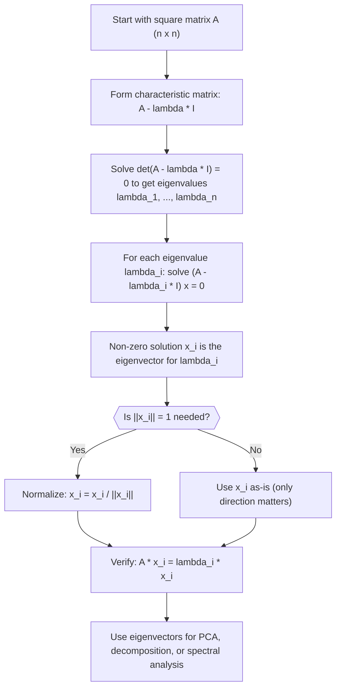

# Eigenvector Equation

$$
Ax = \lambda x
$$

## Deep Breakdown

What it tells me *(Situation Awareness)*:
The eigenvector equation defines the special vectors that a matrix $A$ only *scales*, never rotates. These directions are structurally privileged: they reveal how a linear transformation stretches or compresses space. In DA/DS, eigenvectors are the principal components in PCA (the directions of maximum variance in your feature matrix), the page importance scores in PageRank, and the cluster indicators in spectral clustering. Any time a question boils down to "what are the natural axes of this system?", you are solving this equation.

## Flowchart



## Real-world use

### Where it is used

You compute eigenvectors when you need the principal directions of a covariance matrix (PCA), when you need the stationary distribution of a Markov chain (e.g., PageRank), or when you want to cluster data by the natural geometry of a similarity graph (spectral clustering). Also appears in portfolio optimization when finding the variance-minimizing portfolio direction.

### Problem it solves

High-dimensional data lives in a space with many correlated directions. Working in all directions is expensive and noisy. Eigenvectors identify the directions along which the data varies most (or least), letting you rotate into a basis that is aligned with the data's structure, not an arbitrary axis system.

### How it solves the problem

$Ax = \lambda x$ says: applying $A$ to $x$ gives back a scaled version of $x$. The scale factor $\lambda$ tells you how much $A$ stretches or compresses in that direction. By finding all such directions, you decompose the action of $A$ into independent scaling operations, one per eigenvector.

### Example in a business

A marketing analyst has a covariance matrix of 8 campaign KPIs (click-through rate, conversion rate, spend, revenue, ...). The eigenvectors of that covariance matrix are the principal components. The first eigenvector points in the direction of maximum KPI variance, often a "general performance" axis where all KPIs are high or all are low. The second eigenvector captures the next independent source of variation. Projecting campaigns onto the top 2 eigenvectors gives a 2D map where similar campaigns cluster together, which is much more informative than looking at all 8 KPIs separately.

## The formula, piece by piece

- $A$: a square $n \times n$ matrix (e.g., a covariance matrix, a transition matrix, or a graph Laplacian)
- $x$: the eigenvector, an $n$-dimensional non-zero vector that does not change *direction* under $A$
- $\lambda$: the eigenvalue, a scalar that tells you how much $A$ stretches ($|\lambda| > 1$), compresses ($|\lambda| < 1$), or flips ($\lambda < 0$) the eigenvector
- $Ax$: the result of applying the linear transformation $A$ to vector $x$
- $\lambda x$: the same vector $x$ scaled by $\lambda$, meaning the two sides are proportional Full formula: $Ax = \lambda x$

## The formula in words

"An eigenvector is a direction that the matrix only stretches or flips, never rotates." Tiny numeric example: $A = \begin{bmatrix}2 & 0 \\ 0 & 3\end{bmatrix}$, $x = \begin{bmatrix}1 \\ 0\end{bmatrix}$.
$Ax = \begin{bmatrix}2 \\ 0\end{bmatrix} = 2 \begin{bmatrix}1 \\ 0\end{bmatrix} = \lambda x$ with $\lambda = 2$.
So $[1, 0]^T$ is an eigenvector with eigenvalue 2. The $x$-axis is just scaled by 2, not rotated.

## Critical Concepts

- **Square matrix only:** eigenvectors are only defined for square matrices; for rectangular matrices, use singular vectors (SVD).
- **Non-uniqueness:** eigenvectors are only determined up to a scalar multiple; $cx$ is also an eigenvector for any $c \neq 0$.
- **Complex eigenvalues:** real matrices can have complex eigenvalue/eigenvector pairs (e.g., rotation matrices); symmetric matrices always have real eigenvalues.
- **Symmetric matrices:** for symmetric $A$ (like any covariance matrix), eigenvectors corresponding to distinct eigenvalues are orthogonal, and all eigenvalues are real.
- **Eigenvalue = 0:** a zero eigenvalue means $A$ is singular; the corresponding eigenvector is in the null space of $A$.
- **Numerical pitfall:** repeated or very close eigenvalues make eigenvectors numerically unstable; use `np.linalg.eigh` for symmetric matrices instead of `np.linalg.eig`.

## Step-by-step calculation (tiny example)

*Step 1: Set up the characteristic equation det(A - lambda I) = 0*
$A = \begin{bmatrix}3 & 1 \\ 0 & 2\end{bmatrix}$. Subtract $\lambda I$: $A - \lambda I = \begin{bmatrix}3-\lambda & 1 \\ 0 & 2-\lambda\end{bmatrix}$.
$\det(A - \lambda I) = (3-\lambda)(2-\lambda) - 0 = \lambda^2 - 5\lambda + 6 = (\lambda-2)(\lambda-3) = 0$.
Eigenvalues: $\lambda_1 = 2$, $\lambda_2 = 3$.

*Step 2: Find the eigenvector for lambda_1 = 2*
$(A - 2I)x = 0$: $\begin{bmatrix}1 & 1 \\ 0 & 0\end{bmatrix}\begin{bmatrix}x_1 \\ x_2\end{bmatrix} = 0$.
From row 1: $x_1 + x_2 = 0$, so $x_2 = -x_1$. Eigenvector: $x = [1, -1]^T$.
Verify: $A[1,-1]^T = [3-1, 0-2]^T = [2, -2]^T = 2[1,-1]^T$. ✓

*Step 3: Find the eigenvector for lambda_2 = 3*
$(A - 3I)x = 0$: $\begin{bmatrix}0 & 1 \\ 0 & -1\end{bmatrix}\begin{bmatrix}x_1 \\ x_2\end{bmatrix} = 0$.
From row 1: $x_2 = 0$. Eigenvector: $x = [1, 0]^T$ (any $x_1 \neq 0$).
Verify: $A[1,0]^T = [3, 0]^T = 3[1,0]^T$. ✓

## Code examples

### Beginner example (Python)

```python
import numpy as np   # -- Covariance-like 2x2 symmetric matrix -----------------------------
A = np.array([[3.0, 1.0], [1.0, 2.0]])   # Compute eigenvalues and eigenvectors
# eigh is preferred for symmetric matrices: guaranteed real, orthogonal output
eigenvalues, eigenvectors = np.linalg.eigh(A)   # eigh returns in ascending order; flip to descending for convention
eigenvalues = eigenvalues[::-1]
eigenvectors = eigenvectors[:, ::-1]
print("Matrix A:")
print(A)
print(f"\nEigenvalues: {eigenvalues.round(4)}")
print(f"\nEigenvectors (columns):")
print(eigenvectors.round(4))   # Verify: A * v = lambda * v for each eigenvector
for i in range(len(eigenvalues)):
    lam = eigenvalues[i]
vec = eigenvectors[:, i]
lhs = A @ vec
rhs = lam * vec
print(f"\nEigenvector {i+1}: {vec.round(4)}, eigenvalue: {lam:.4f}")
print(f" A*v = {lhs.round(4)}, lambda*v = {rhs.round(4)}")
print(f" Match: {np.allclose(lhs, rhs)}")
```

### Beginner example (R)

```r
# -- Covariance-like 2x2 symmetric matrix -----------------------------
A <- matrix(c(3, 1, 1, 2), nrow = 2)
result <- eigen(A)
cat("Matrix A:\n")
print(A)
cat(sprintf("\nEigenvalues: %s\n", paste(round(result$values, 4), collapse = ", ")))
cat("\nEigenvectors (columns):\n")
print(round(result$vectors, 4))  # Verify A *
v = lambda * v
for (i in seq_along(result$values)) { lam <- result$values[i]
  vec <- result$vectors[, i]
  lhs <- A %*% vec
  rhs <- lam * vec
  cat(sprintf("\nEigenvector %d: max error = %.2e\n", i, max(abs(lhs - rhs))))
}
```

### Professional example (Python)

```python
import numpy as np
import pandas as pd
np.random.seed(42)   # -- Business scenario: PCA via covariance matrix eigendecomposition ---
N_CAMPAIGNS = 150
N_KPIS = 6
N_COMPONENTS = 2   # keep top 2 principal components for visualization
kpi_names = ["ctr", "cvr", "cpc", "roas", "spend", "revenue"]   # Simulate correlated KPI data across campaigns
true_factors = np.random.normal(size=(N_CAMPAIGNS, 2))
loading_matrix = np.random.normal(size=(2, N_KPIS))
kpi_data = true_factors @ loading_matrix + np.random.normal(0, 0.3, (N_CAMPAIGNS, N_KPIS))
df_kpis = pd.DataFrame(kpi_data, columns=kpi_names)   # Center the data (required for PCA via eigendecomposition)
X_centered = df_kpis - df_kpis.mean()
cov_matrix = (X_centered.T @ X_centered).to_numpy() / (N_CAMPAIGNS - 1)   # Eigendecomposition of the covariance matrix
eigenvalues, eigenvectors = np.linalg.eigh(cov_matrix)   # Sort descending
order = np.argsort(eigenvalues)[::-1]
eigenvalues = eigenvalues[order]
eigenvectors = eigenvectors[:, order]   # Explained variance
explained_var = eigenvalues / eigenvalues.sum()   # Project campaigns onto top N_COMPONENTS principal components
principal_components = X_centered.to_numpy() @ eigenvectors[:, :N_COMPONENTS]
pc_df = pd.DataFrame( principal_components, columns=[f"pc_{i+1}" for i in range(N_COMPONENTS)] )
print("Eigenvalues (variance in each PC direction):")
for i, (lam, exp) in enumerate(zip(eigenvalues, explained_var)):
    print(f" PC{i+1}: eigenvalue = {lam:.4f}, explained variance = {exp:.1%}")
print(f"\nTop-{N_COMPONENTS} PCs capture {explained_var[:N_COMPONENTS].sum():.1%} of total variance")
print(f"\nPrincipal component loadings (top 2 eigenvectors):")
print(pd.DataFrame(eigenvectors[:, :N_COMPONENTS].round(3), index=kpi_names, columns=["pc_1", "pc_2"]))
print("\nInterpretation: each eigenvector shows which KPIs co-vary; campaigns projected onto PC1 and PC2 reveal performance clusters.")
```

---

*Source: 1300 p. 121*
