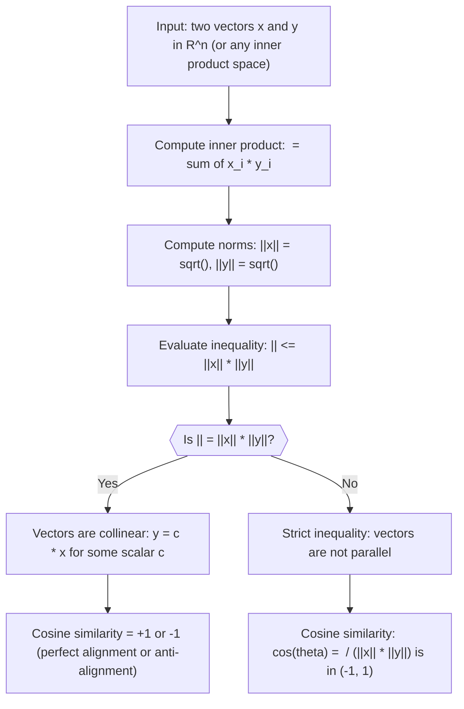

# Cauchy-Schwarz Inequality

$$
|\langle x, y \rangle| \le \|x\| \|y\|
$$

## Deep Breakdown

What it tells me *(Situation Awareness)*:
The Cauchy-Schwarz inequality puts a hard upper bound on how large an inner product can be: it can never exceed the product of the two vectors' lengths. Equality holds if and only if the vectors are parallel (one is a scalar multiple of the other). In DA/DS this is the theoretical backbone of cosine similarity, the proof that correlation coefficients are bounded between -1 and 1, and the reason that dot-product attention scores in transformer models are bounded. Whenever you see a formula that divides a dot product by a product of norms, Cauchy-Schwarz is the guarantee that the result stays in $[-1, 1]$.

## Flowchart



## Real-world use

### Where it is used

Used implicitly every time you compute cosine similarity between document embeddings, user feature vectors, or product representations. Also invoked when you verify that Pearson correlation is always in $[-1, 1]$, and when analyzing whether two feature vectors are nearly collinear (which causes multicollinearity in regression).

### Problem it solves

Without a bound on the inner product, similarity scores could be unbounded and meaningless for comparison. Cauchy-Schwarz guarantees that normalizing by the product of norms always produces a value in $[-1, 1]$, making cosine similarity interpretable as an angle.

### How it solves the problem

The inequality $|\langle x, y \rangle| \leq \|x\| \|y\|$ is equivalent to $\cos\theta = \langle x, y \rangle / (\|x\| \|y\|)$ being in $[-1, 1]$. You can prove it by expanding $\|x - ty\|^2 \geq 0$ for the optimal scalar $t = \langle x, y \rangle / \|y\|^2$ and noting the discriminant must be non-positive.

### Example in a business

A search engine ranks product descriptions by semantic similarity to a query. Each description and query is embedded as a 768-dimensional vector. The retrieval system uses cosine similarity: $\cos\theta = \langle \text{query}, \text{doc} \rangle / (\|\text{query}\| \cdot \|\text{doc}\|)$. Cauchy-Schwarz guarantees this value is in $[-1, 1]$ regardless of the magnitude of the embeddings, so the ranking is stable and interpretable across all queries.

## The formula, piece by piece

- $|\cdot|$: absolute value; we bound the magnitude of the inner product, not its sign
- $\langle x, y \rangle$: the inner product of $x$ and $y$; for real vectors in $\mathbb{R}^n$ this is $\sum_{i=1}^n x_i y_i$
- $\leq$: less than or equal; equality holds only when $x$ and $y$ are parallel
- $\|x\|$: the norm (length) of $x$, defined as $\sqrt{\langle x, x \rangle} = \sqrt{\sum_i x_i^2}$
- $\|y\|$: the norm (length) of $y$, same definition
- $\|x\| \|y\|$: the product of the two norms; this is the maximum possible magnitude of the inner product Full formula: $|\langle x, y \rangle| \leq \|x\| \|y\|$

## The formula in words

"The absolute value of the dot product of two vectors can never exceed the product of their lengths. Equality means the vectors point in the same (or exactly opposite) direction." Tiny numeric example: $x = [3, 4]^T$, $y = [1, 2]^T$.
$\langle x, y \rangle = 3 \cdot 1 + 4 \cdot 2 = 11$.
$\|x\| = \sqrt{9+16} = 5$, $\|y\| = \sqrt{1+4} = \sqrt{5} \approx 2.236$.
$\|x\| \|y\| = 5\sqrt{5} \approx 11.18$.
Check: $|11| \leq 11.18$. Cosine similarity: $11 / 11.18 \approx 0.984$ (very high directional similarity).

## Critical Concepts

- **Cosine similarity derived from Cauchy-Schwarz:** dividing both sides of the inequality by $\|x\| \|y\|$ gives $-1 \leq \cos\theta \leq 1$ directly; the inequality is why cosine similarity is a valid bounded score.
- **Correlation as a special case:** Pearson correlation between two mean-centered vectors $x$ and $y$ is exactly $\cos\theta = \langle x, y \rangle / (\|x\| \|y\|)$; Cauchy-Schwarz guarantees $r \in [-1, 1]$.
- **Equality condition:** $|\langle x, y \rangle| = \|x\| \|y\|$ if and only if $y = cx$ for some scalar $c$; this means collinear features in a design matrix, i.e., perfect multicollinearity.
- **Works in any inner product space:** the inequality holds for functions (e.g., $L^2$ integrals), matrices (Frobenius inner product), and sequences, not just finite vectors.
- **Cauchy-Schwarz in attention:** the unnormalized dot-product attention score $q^T k$ is bounded by $\|q\| \|k\|$; scaling by $1/\sqrt{d}$ keeps gradients well-behaved, motivated by this bound.
- **Numerical angle computation:** $\arccos(\langle x,y\rangle / (\|x\|\|y\|))$ can return `NaN` if floating-point errors push the argument slightly outside $[-1,1]$; always clip to $[-1, 1]$ before taking `arccos`.

## Step-by-step calculation (tiny example)

*Step 1: Compute the inner product and both norms*
$x = [1, 2, 2]^T$, $y = [2, 1, 0]^T$.
$\langle x, y \rangle = 1 \cdot 2 + 2 \cdot 1 + 2 \cdot 0 = 4$.
$\|x\| = \sqrt{1+4+4} = 3$, $\|y\| = \sqrt{4+1+0} = \sqrt{5} \approx 2.236$.

*Step 2: Evaluate the Cauchy-Schwarz bound*
$|\langle x, y \rangle| = 4$.
$\|x\| \|y\| = 3\sqrt{5} \approx 6.708$.
Check: $4 \leq 6.708$. The inequality holds with room to spare (vectors are not parallel).

*Step 3: Compute cosine similarity and interpret the angle*
$\cos\theta = \langle x, y \rangle / (\|x\| \|y\|) = 4 / (3\sqrt{5}) \approx 0.596$.
$\theta = \arccos(0.596) \approx 53.4°$.
Interpretation: the two vectors point in moderately similar directions; a cosine of 1.0 would mean identical direction.

## Code examples

### Beginner example (Python)

```python
import numpy as np

# -- Verify Cauchy-Schwarz and compute cosine similarity ---------------
x = np.array([1.0, 2.0, 2.0])
y = np.array([2.0, 1.0, 0.0])
inner_product = float(x @ y)
norm_x = float(np.linalg.norm(x))
norm_y = float(np.linalg.norm(y))
cs_bound = norm_x * norm_y
cosine_sim = inner_product / cs_bound
angle_deg = float(np.degrees(np.arccos(np.clip(cosine_sim, -1.0, 1.0))))
print(f"<x, y> = {inner_product:.4f}")
print(f"||x|| = {norm_x:.4f}")
print(f"||y|| = {norm_y:.4f}")
print(f"||x|| * ||y|| = {cs_bound:.4f}")
print(f"\nCauchy-Schwarz: |<x,y>| = {abs(inner_product):.4f} <= {cs_bound:.4f}: {abs(inner_product) <= cs_bound + 1e-10}")
print(f"Cosine similarity = {cosine_sim:.4f}")
print(f"Angle between vectors = {angle_deg:.2f} degrees")

# Demonstrate equality case: y = c * x (collinear)
y_collinear = 2.0 * x
inner_col = float(x @ y_collinear)
bound_col = float(np.linalg.norm(x) * np.linalg.norm(y_collinear))
print(f"\nCollinear case: |<x, 2x>| = {abs(inner_col):.4f}, bound = {bound_col:.4f}")
print(f"Equality holds: {np.isclose(abs(inner_col), bound_col)}")
```

### Beginner example (R)

```r
# -- Verify Cauchy-Schwarz and compute cosine similarity ---------------
x <- c(1.0, 2.0, 2.0)
y <- c(2.0, 1.0, 0.0)
inner_product <- sum(x * y)
norm_x <- sqrt(sum(x^2))
norm_y <- sqrt(sum(y^2))
cs_bound <- norm_x * norm_y
cosine_sim <- inner_product / cs_bound
angle_deg <- acos(max(-1, min(1, cosine_sim))) * 180 / pi
cat(sprintf("<x, y> = %.4f\n", inner_product))
cat(sprintf("||x|| = %.4f\n", norm_x))
cat(sprintf("||y|| = %.4f\n", norm_y))
cat(sprintf("||x|| * ||y|| = %.4f\n", cs_bound))
cat(sprintf("\nCauchy-Schwarz: |<x,y>| = %.4f <= %.4f: %s\n", abs(inner_product), cs_bound, abs(inner_product) <= cs_bound + 1e-10))
cat(sprintf("Cosine similarity = %.4f\n", cosine_sim))
cat(sprintf("Angle between vectors = %.2f degrees\n", angle_deg))

# Collinear equality case
y_col <- 2 * x
inner_col <- sum(x * y_col)
bound_col <- sqrt(sum(x^2)) * sqrt(sum(y_col^2))
cat(sprintf("\nCollinear case: |<x, 2x>| = %.4f, bound = %.4f, equal: %s\n", abs(inner_col), bound_col, isTRUE(all.equal(abs(inner_col), bound_col))))
```

### Professional example (Python)

```python
import numpy as np
import pandas as pd
np.random.seed(42)

# -- Business scenario: semantic similarity ranking of product embeddings
# 500 product descriptions are embedded in 64 dimensions.
# Rank all products by cosine similarity to a query embedding.
N_PRODUCTS = 500
EMBED_DIM = 64
TOP_K = 5
product_ids = [f"prod_{i:03d}" for i in range(N_PRODUCTS)]

# Simulate query and product embeddings (unit-normalized, as from a sentence encoder)
query_raw = np.random.normal(size=EMBED_DIM)
query_vec = query_raw / np.linalg.norm(query_raw)
product_raw = np.random.normal(size=(N_PRODUCTS, EMBED_DIM))
product_vecs = product_raw / np.linalg.norm(product_raw, axis=1, keepdims=True)

# Compute dot products (= cosine similarity since all vectors are unit-norm)
dot_products = product_vecs @ query_vec

# Verify Cauchy-Schwarz holds for all pairs
norms_q = np.linalg.norm(query_vec)   # 1.0 (unit-normalized)
norms_p = np.linalg.norm(product_vecs, axis=1)   # all 1.0
bounds = norms_q * norms_p
violations = int(np.sum(np.abs(dot_products) > bounds + 1e-10))
print(f"Query norm: {norms_q:.6f} (should be 1.0)")
print(f"Max product norm deviation from 1: {np.max(np.abs(norms_p - 1.0)):.2e}")
print(f"Cauchy-Schwarz violations: {violations} (should be 0)")
print(f"All cosine scores in [-1,1]: {bool(np.all(np.abs(dot_products) <= 1.0 + 1e-10))}")

# Retrieve top-K products by cosine similarity
top_k_idx = np.argsort(dot_products)[::-1][:TOP_K]
result_df = pd.DataFrame({
    "product_id": [product_ids[i] for i in top_k_idx],
    "cosine_similarity": dot_products[top_k_idx].round(4),
})
print(f"\nTop-{TOP_K} products by semantic similarity to query:")
print(result_df.to_string(index=False))
print("\nInterpretation: Cauchy-Schwarz guarantees all similarity scores are bounded in [-1, 1], making ranking meaningful and stable.")
```

---

*Source: AIO*
