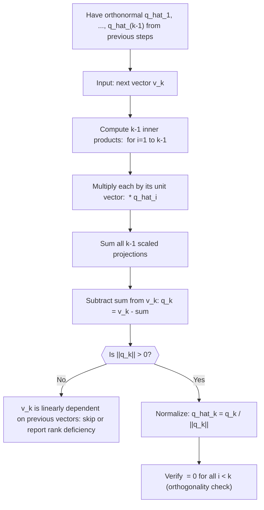

# Gram-Schmidt (Alternative)

$$
q_k = v_k - \sum_{i=1}^{k-1} \langle v_k, \hat{q}_i \rangle \hat{q}_i
$$

## Deep Breakdown

What it tells me *(Situation Awareness)*:
This is the explicit closed-form statement of the Gram-Schmidt iterative step: the unnormalized new orthogonal vector $q_k$ equals the input vector $v_k$ minus the sum of its projections onto all previously computed orthonormal vectors. While the previous note ($u_k = b_k - \pi_{\text{span}}(b_k)$) wrote the subtraction using abstract projection notation, this version writes the projection sum explicitly using inner products. In DA/DS you encounter this exact formula when implementing QR from scratch, when writing a modified Gram-Schmidt loop, or when reading derivations of PCA, least-squares, and Krylov subspace methods (e.g., conjugate gradient).

## Flowchart



## Real-world use

### Where it is used

This is the formula you write when implementing QR decomposition, the Arnoldi iteration for eigenvalues of large sparse matrices, or the Lanczos algorithm for PCA on very large covariance matrices. It also appears in Krylov-based linear solvers. In applied work, you call `np.linalg.qr` or `scipy.linalg.qr`, but understanding this formula tells you what those functions actually do at each step.

### Problem it solves

The same problem as all Gram-Schmidt steps: given a new input vector, make it orthogonal to all previously computed orthonormal directions. This explicit form shows the sum structure clearly, making it easier to implement in code and reason about computational cost ($k-1$ inner products and $k-1$ vector subtractions at step $k$).

### How it solves the problem

Because $\hat{q}_1, \ldots, \hat{q}_{k-1}$ are orthonormal, the projection of $v_k$ onto their span is exactly $\sum_{i=1}^{k-1} \langle v_k, \hat{q}_i \rangle \hat{q}_i$. Each term $\langle v_k, \hat{q}_i \rangle \hat{q}_i$ is a rank-1 projection onto the $i$-th direction. Subtracting all of them leaves the component of $v_k$ orthogonal to the entire previously built subspace.

### Example in a business

A machine learning engineer implements a streaming PCA variant for an IoT sensor dashboard. At each new feature dimension, they apply this formula to maintain an orthonormal basis for the current principal subspace. For dimension $k$, they compute the inner product of the new sensor signal with each existing principal direction, subtract those projections, and normalize the residual. The result is a new orthonormal basis vector that captures the variance in the new signal unexplained by the existing components.

## The formula, piece by piece

- $q_k$: the new unnormalized orthogonal vector at step $k$ (some notations call this $u_k$; here $q_k$ before normalization)
- $v_k$: the $k$-th input vector, not yet modified
- $\sum_{i=1}^{k-1}$: sum over all $k-1$ previously built directions
- $\langle v_k, \hat{q}_i \rangle$: the scalar projection coefficient (inner product), how much $v_k$ points in the $i$-th direction
- $\hat{q}_i$: the $i$-th previously built orthonormal vector (unit-norm)
- $\langle v_k, \hat{q}_i \rangle \hat{q}_i$: the projection of $v_k$ onto the direction $\hat{q}_i$ (a scaled vector)
- The sum gives the total projection of $v_k$ onto the subspace spanned by all previous directions Full formula: $q_k = v_k - \sum_{i=1}^{k-1} \langle v_k, \hat{q}_i \rangle \hat{q}_i$

## The formula in words

"The new orthogonal vector is the input vector minus its shadow on all existing orthonormal directions. The shadow is computed by dotting the input vector with each existing direction and scaling that direction by the dot product." Tiny numeric example ($k=3$, building the third orthonormal vector):
$\hat{q}_1 = [1,0,0]^T$, $\hat{q}_2 = [0,1,0]^T$, $v_3 = [2,3,4]^T$.
$\langle v_3, \hat{q}_1 \rangle = 2$, $\langle v_3, \hat{q}_2 \rangle = 3$.
$q_3 = [2,3,4]^T - 2[1,0,0]^T - 3[0,1,0]^T = [0,0,4]^T$.
$\hat{q}_3 = [0,0,4]^T / 4 = [0,0,1]^T$.
Check: $\langle \hat{q}_3, \hat{q}_1 \rangle = 0$, $\langle \hat{q}_3, \hat{q}_2 \rangle = 0$ ✓.

## Critical Concepts

- **This is the classical form:** it computes all projections against the original $v_k$. The modified Gram-Schmidt (MGS) form sequentially subtracts each projection from an evolving copy of $v_k$, which is equivalent mathematically but more numerically stable.
- **Inner products as R matrix entries:** in QR, the coefficients $r_{ik} = \langle v_k, \hat{q}_i \rangle$ are the above-diagonal entries of the upper triangular $R$ matrix; $r_{kk} = \|q_k\|$ is the diagonal.
- **Floating-point accumulation:** in the classical form, all projections are computed off the original $v_k$, so rounding errors in early projections can compound. Modified GS is preferred for dimensions $> 10$.
- **Reorthogonalization:** for very ill-conditioned inputs, even MGS may lose orthogonality; practitioners apply one or two rounds of reorthogonalization (running the step again on $q_k$) for high-precision work.
- **Connection to least squares:** QR decomposition is the numerically stable method to solve $Ax = b$; the $R$ entries in QR come directly from these projection coefficients.
- **Spans the same subspace:** after all steps, the orthonormal vectors $\hat{q}_1, \ldots, \hat{q}_n$ span exactly the same subspace as the original $v_1, \ldots, v_n$.

## Step-by-step calculation (tiny example)

*Step 1: Set up the input vectors and the two previously built orthonormal vectors*
$v_1 = [1,0,0]^T$, $v_2 = [1,1,0]^T$, $v_3 = [1,1,1]^T$.
From previous steps: $\hat{q}_1 = [1,0,0]^T$, $\hat{q}_2 = [0,1,0]^T$ (easy to verify they are orthonormal).

*Step 2: Compute the two projection coefficients for k=3*
$\langle v_3, \hat{q}_1 \rangle = 1 \cdot 1 + 1 \cdot 0 + 1 \cdot 0 = 1$.
$\langle v_3, \hat{q}_2 \rangle = 1 \cdot 0 + 1 \cdot 1 + 1 \cdot 0 = 1$.

*Step 3: Subtract projections and normalize to get q_hat_3*
$q_3 = v_3 - 1 \cdot \hat{q}_1 - 1 \cdot \hat{q}_2 = [1,1,1]^T - [1,0,0]^T - [0,1,0]^T = [0,0,1]^T$.
$\hat{q}_3 = [0,0,1]^T / 1 = [0,0,1]^T$.
Check: $\langle \hat{q}_3, \hat{q}_1 \rangle = 0$, $\langle \hat{q}_3, \hat{q}_2 \rangle = 0$, $\|\hat{q}_3\| = 1$ ✓.
Result: $\{[1,0,0]^T, [0,1,0]^T, [0,0,1]^T\}$ — the standard basis $\{e_1, e_2, e_3\}$.

## Code examples

### Beginner example (Python)

```python
import numpy as np   # -- Explicit Gram-Schmidt formula: q_k = v_k - sum of projections -----
V = np.array([ [1.0, 0.0, 0.0], [1.0, 1.0, 0.0], [1.0, 1.0, 1.0],
]).T   # shape (3, 3): each column is one input vector
n_vectors = V.shape[1]
Q = np.zeros_like(V)
for k in range(n_vectors):
    v_k = V[:, k].copy()
for i in range(k):
    proj_coeff = float(v_k @ Q[:, i])   # <v_k, q_hat_i>
v_k = v_k - proj_coeff * Q[:, i]   # subtract projection
Q[:, k] = v_k / np.linalg.norm(v_k)   # normalize # Verify orthonormality
qtq = Q.T @ Q
print("Q (columns are orthonormal vectors):")
print(Q.round(4))
print(f"\nQ^T Q (should be identity):")
print(qtq.round(4))
print(f"Max off-diagonal: {np.max(np.abs(qtq - np.eye(n_vectors))):.2e}")
```

### Beginner example (R)

```r
# -- Explicit Gram-Schmidt formula:
q_k = v_k - sum of projections -----
V <- matrix(c( 1, 0, 0, 1, 1, 0, 1, 1, 1
), nrow = 3, byrow = TRUE)
V <- t(V)  # each column is one input vector
n_vectors <- ncol(V)
Q <- matrix(0, nrow(V), n_vectors)
for (k in seq_len(n_vectors)) { v_k <- V[, k]
  for (i in seq_len(k - 1)) { proj_coeff <- sum(v_k * Q[, i])
    v_k <- v_k - proj_coeff * Q[, i]
  }
  Q[, k] <- v_k / sqrt(sum(v_k^2))
}
cat("Q (columns are orthonormal vectors):\n")
print(round(Q, 4))
qtq <- t(Q) %*% Q
cat("\nQ^T Q (should be identity):\n")
print(round(qtq, 4))
cat(sprintf("Max off-diagonal: %.2e\n", max(abs(qtq - diag(n_vectors)))))
```

### Professional example (Python)

```python
import numpy as np
import pandas as pd
np.random.seed(42)   # -- Business scenario: compare classical vs modified Gram-Schmidt on nearly collinear features
# Near-collinearity is common in marketing data: correlated channel spends.
# Show how modified GS (sequential projection subtraction) maintains orthogonality better.
N_OBS = 200
FEATURE_NAMES = ["search", "brand_search", "social", "display"]
EPSILON = 1e-3   # degree of near-collinearity perturbation # Build a nearly rank-deficient feature matrix (search and brand_search are nearly collinear)
base = np.random.normal(size=(N_OBS,))
feature_data = np.column_stack([ base + EPSILON * np.random.normal(size=(N_OBS,)), base + EPSILON * np.random.normal(size=(N_OBS,)), np.random.normal(size=(N_OBS,)), np.random.normal(size=(N_OBS,)),
])
df = pd.DataFrame(feature_data, columns=FEATURE_NAMES)
A = df.to_numpy()

def classical_gram_schmidt(V):
    """Classical Gram-Schmidt: projections computed against original v_k."""
    n = V.shape[1]
    Q = np.zeros_like(V)
    for k in range(n):
        v_k = V[:, k].copy()
    for i in range(k):
        v_k = v_k - float(V[:, k] @ Q[:, i]) * Q[:, i]
    norm_k = np.linalg.norm(v_k)
    Q[:, k] = v_k / norm_k if norm_k > 1e-14 else v_k
    return Q

def modified_gram_schmidt(V):
    """Modified Gram-Schmidt: projections computed against evolving v_k."""
    n = V.shape[1]
    Q = np.zeros_like(V)
    for k in range(n):
        v_k = V[:, k].copy()
    for i in range(k):
        v_k = v_k - float(v_k @ Q[:, i]) * Q[:, i]
    norm_k = np.linalg.norm(v_k)
    Q[:, k] = v_k / norm_k if norm_k > 1e-14 else v_k
    return Q
Q_classical = classical_gram_schmidt(A)
Q_modified = modified_gram_schmidt(A)
err_classical = np.max(np.abs(Q_classical.T @ Q_classical - np.eye(len(FEATURE_NAMES))))
err_modified = np.max(np.abs(Q_modified.T @ Q_modified - np.eye(len(FEATURE_NAMES))))
print(f"Near-collinearity epsilon: {EPSILON}")
print(f"Classical GS max orthogonality error: {err_classical:.2e}")
print(f"Modified GS max orthogonality error: {err_modified:.2e}")
print("\nInterpretation: modified GS maintains better orthogonality than classical GS on near-collinear inputs.")
```

---

*Source: domain knowledge*
