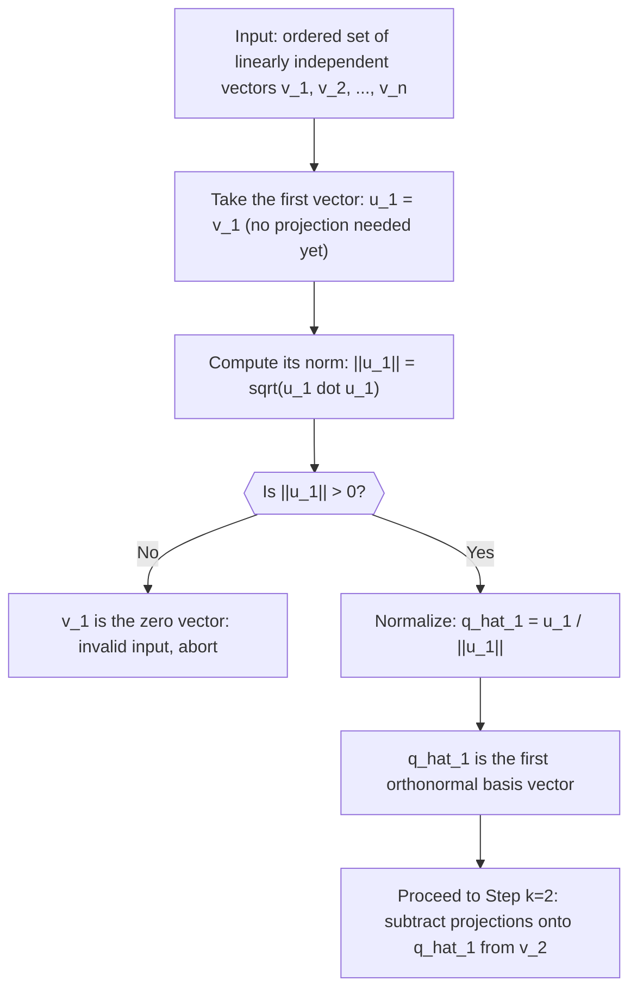

# Gram-Schmidt (Initialization)

$$
u_1 = b_1
$$

, $\hat{q}_1 = \frac{v_1}{\|v_1\|}$

## Deep Breakdown

What it tells me *(Situation Awareness)*:
This is the seed step of the Gram-Schmidt orthogonalization process. Before you can subtract projections (the iterative part), you need to start somewhere: take the first vector $v_1$ from your input set, keep it as-is for the unnormalized basis ($u_1 = v_1$), and normalize it to unit length ($\hat{q}_1 = v_1 / \|v_1\|$). In DA/DS, Gram-Schmidt appears whenever you need an orthonormal basis from a set of linearly independent vectors: QR decomposition, orthogonal feature construction, building orthogonal polynomial bases for regression, or constructing orthonormal frames for 3D coordinate systems in spatial analytics.

## Flowchart



## Real-world use

### Where it is used

You see this initialization step whenever you perform QR decomposition by hand or implement a numerical solver that needs to build an orthonormal basis incrementally. It is also the conceptual starting point when you think about why PCA loads are orthogonal: the first principal component is just a normalized direction in feature space, analogous to $\hat{q}_1$.

### Problem it solves

An arbitrary set of linearly independent vectors is not orthogonal. Gram-Schmidt converts them into an orthonormal set that spans the same space. The initialization sets up the first "clean" direction from which all subsequent vectors will be made orthogonal.

### How it solves the problem

Setting $u_1 = v_1$ preserves the first direction exactly. Normalizing gives $\hat{q}_1$ with $\|\hat{q}_1\| = 1$. All subsequent steps will subtract the component of each new vector along $\hat{q}_1$ (and earlier vectors), ensuring the resulting basis is orthonormal. The initialization is trivial because there is nothing to project against yet.

### Example in a business

A data engineer builds a custom feature matrix for a regression model. The raw features include revenue, cost, and margin (which are linearly dependent: margin = revenue - cost). After dropping one redundant feature, they apply Gram-Schmidt to the remaining linearly independent features to decorrelate them before feeding into a ridge regression. The initialization picks the first feature vector (e.g., revenue), normalizes it, and from that point the process removes revenue's component from all other features.

## The formula, piece by piece

- $u_1$: the first unnormalized basis vector, set equal to $v_1$ (the first input vector); notation uses $u$ for "unnormalized" and $b$ interchangeably in some textbooks
- $b_1$ / $v_1$: the first input vector from the set to be orthogonalized; no projection is applied here
- $\hat{q}_1$: the first orthonormal basis vector; the hat ($\hat{\phantom{q}}$) denotes unit-norm normalization
- $\|v_1\|$: the Euclidean norm of $v_1$, equal to $\sqrt{v_1 \cdot v_1}$; dividing by this scales $v_1$ to unit length
- The formula $\hat{q}_1 = v_1 / \|v_1\|$ is just vector normalization: point in the same direction as $v_1$ but with length 1 Full formula: $u_1 = v_1$, $\hat{q}_1 = \dfrac{v_1}{\|v_1\|}$

## The formula in words

"The first orthonormal basis vector is just the first input vector rescaled to have length 1. No projection is needed yet because there are no previous basis vectors to be orthogonal to." Tiny numeric example: $v_1 = [3, 4]^T$.
$u_1 = [3, 4]^T$.
$\|v_1\| = \sqrt{9+16} = 5$.
$\hat{q}_1 = [3/5, 4/5]^T = [0.6, 0.8]^T$.
Verify: $\|\hat{q}_1\| = \sqrt{0.36+0.64} = \sqrt{1} = 1$ ✓.

## Critical Concepts

- **Direction is preserved:** normalization changes only the length, not the direction; $\hat{q}_1$ points exactly where $v_1$ points.
- **Zero vector is invalid:** if $v_1 = 0$, division is undefined and the input set is not linearly independent; always check $\|v_1\| > 0$.
- **Notation variation:** some texts write $e_1$, $q_1$, or $\phi_1$ for the first orthonormal vector; the process is identical regardless of notation.
- **Connection to QR:** in the QR decomposition $A = QR$, the first column of $Q$ is exactly $\hat{q}_1 = v_1/\|v_1\|$, and the first diagonal entry of $R$ is $\|v_1\|$.
- **Numerical stability:** the classical Gram-Schmidt process can accumulate floating-point errors in later steps; the modified Gram-Schmidt process or Householder reflections are preferred in production numerical solvers.
- **This step alone is just normalization:** the orthogonalization only happens in the subsequent steps ($k \geq 2$) when projections are subtracted.

## Step-by-step calculation (tiny example)

*Step 1: Identify the first input vector*
Given input set: $v_1 = [1, 1, 0]^T$, $v_2 = [1, 0, 1]^T$, $v_3 = [0, 1, 1]^T$.
Take $v_1 = [1, 1, 0]^T$ directly: $u_1 = [1, 1, 0]^T$.

*Step 2: Compute the norm of the first vector*
$\|u_1\| = \sqrt{1^2 + 1^2 + 0^2} = \sqrt{2} \approx 1.414$.

*Step 3: Normalize to get the first orthonormal basis vector*
$\hat{q}_1 = u_1 / \|u_1\| = [1/\sqrt{2},\, 1/\sqrt{2},\, 0]^T \approx [0.707,\, 0.707,\, 0]^T$.
Verify: $\|\hat{q}_1\|^2 = (1/\sqrt{2})^2 + (1/\sqrt{2})^2 + 0^2 = 0.5 + 0.5 = 1$ ✓.
The first orthonormal basis vector is ready; proceed to $k=2$.

## Code examples

### Beginner example (Python)

```python
import numpy as np   # -- Gram-Schmidt initialization: normalize the first vector -----------
v1 = np.array([1.0, 1.0, 0.0])
norm_v1 = float(np.linalg.norm(v1))
q1_hat = v1 / norm_v1
print(f"v1 = {v1}")
print(f"||v1|| = {norm_v1:.4f}")
print(f"q_hat_1 = {q1_hat.round(4)}")
print(f"||q_hat_1|| = {np.linalg.norm(q1_hat):.6f} (should be 1.0)")   # Also verify: q_hat_1 and v1 point in the same direction
cos_angle = float(q1_hat @ v1 / (np.linalg.norm(q1_hat) * np.linalg.norm(v1)))
print(f"cos(angle between q_hat_1 and v1) = {cos_angle:.6f} (should be 1.0: same direction)")
```

### Beginner example (R)

```r
# -- Gram-Schmidt initialization: normalize the first vector -----------
v1 <- c(1.0, 1.0, 0.0)
norm_v1 <- sqrt(sum(v1^2))
q1_hat <- v1 / norm_v1
cat(sprintf("v1 = %s\n", paste(round(v1, 4), collapse = ", ")))
cat(sprintf("||v1|| = %.4f\n", norm_v1))
cat(sprintf("q_hat_1 = %s\n", paste(round(q1_hat, 4), collapse = ", ")))
cat(sprintf("||q_hat_1|| = %.6f (should be 1.0)\n", sqrt(sum(q1_hat^2))))
cos_angle <- sum(q1_hat * v1) / (sqrt(sum(q1_hat^2)) * sqrt(sum(v1^2)))
cat(sprintf("cos(angle between q_hat_1 and v1) = %.6f (should be 1.0)\n", cos_angle))
```

### Professional example (Python)

```python
import numpy as np
import pandas as pd
np.random.seed(42)   # -- Business scenario: build an orthonormal feature basis for a regression model
# 4 raw marketing features: spend, impressions, clicks, conversions.
# They are correlated. Gram-Schmidt initialization picks the first orthonormal direction.
N_WEEKS = 100
FEATURE_NAMES = ["spend_keur", "impressions_m", "clicks_k", "conversions"]   # Simulate correlated weekly feature data
true_cov = np.array([ [4.0, 2.0, 1.5, 0.8], [2.0, 3.0, 1.8, 0.9], [1.5, 1.8, 2.0, 1.0], [0.8, 0.9, 1.0, 1.5],
])
L_sim = np.linalg.cholesky(true_cov)
feature_data = np.random.normal(size=(N_WEEKS, len(FEATURE_NAMES))) @ L_sim.T
df = pd.DataFrame(feature_data, columns=FEATURE_NAMES)   # Extract column vectors as the input to Gram-Schmidt
feature_matrix = df.to_numpy()
v1 = feature_matrix[:, 0]   # first feature: spend # Gram-Schmidt initialization
norm_v1 = float(np.linalg.norm(v1))
q1_hat = v1 / norm_v1   # Show properties of the first orthonormal basis vector
cov_q1_q1 = float(q1_hat @ q1_hat)
print(f"First feature column: '{FEATURE_NAMES[0]}'")
print(f"||v1|| = {norm_v1:.4f}")
print(f"||q_hat_1|| = {np.linalg.norm(q1_hat):.6f} (should be 1.0)")
print(f"<q_hat_1, q_hat_1> = {cov_q1_q1:.6f} (should be 1.0)")
print(f"q_hat_1 direction (first 5 obs): {q1_hat[:5].round(4)}")   # Verify it spans the same subspace as v1
explained = float((q1_hat @ v1) ** 2) / float(v1 @ v1)
print(f"\nVariance of v1 explained by q_hat_1: {explained:.4f} (should be 1.0: same span)")
print("\nInterpretation: q_hat_1 is the unit-norm version of the first feature direction; subsequent Gram-Schmidt steps will build orthogonal directions from the remaining features.")
```

---

*Source: domain knowledge*
