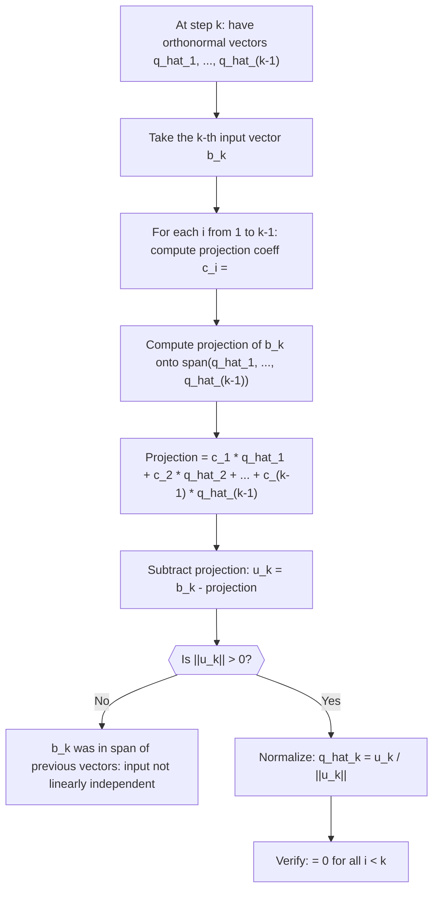

# Gram-Schmidt (Step $k$, projection subtraction)

$$
u_k = b_k - \pi_{\text{span}[u_1, \dots, u_{k-1}]}(b_k)
$$

## Deep Breakdown

What it tells me *(Situation Awareness)*:
This is the core iterative step of Gram-Schmidt orthogonalization. At step $k$, you have already built $k-1$ orthonormal vectors $\hat{q}_1, \ldots, \hat{q}_{k-1}$. To make the new vector $b_k$ orthogonal to all of them, you subtract from $b_k$ its entire projection onto the subspace spanned by the previous vectors. What remains ($u_k$) is the component of $b_k$ that is perpendicular to all previous directions. You then normalize $u_k$ to get $\hat{q}_k$. In DA/DS this step is the computational heart of QR decomposition and orthogonal feature decorrelation.

## Flowchart



## Real-world use

### Where it is used

The projection subtraction step runs inside every QR decomposition you do (in least-squares regression, pseudoinverse computation, or solving linear systems). It is also what happens conceptually when you use `sklearn`'s PCA: each principal component direction is orthogonal to the previous ones, which is produced by projecting out already-found variance directions.

### Problem it solves

If you simply take a set of linearly independent vectors, they are generally not orthogonal, meaning they share components along each other's directions. Downstream algorithms that assume an orthonormal basis (like QR solvers or coordinate projections) will produce wrong or unstable results. Projection subtraction removes the "shared" part so only the new, independent direction survives.

### How it solves the problem

The projection of $b_k$ onto the subspace spanned by $\hat{q}_1, \ldots, \hat{q}_{k-1}$ is $\sum_{i=1}^{k-1} \langle b_k, \hat{q}_i \rangle \hat{q}_i$ (this is exact because the $\hat{q}_i$ are orthonormal). Subtracting this from $b_k$ zeros out all components of $b_k$ that lie along any previous direction, leaving only the perpendicular residual $u_k$.

### Example in a business

A BI analyst has 3 campaign features: total_spend, branded_spend, non_branded_spend. Since total = branded + non-branded, they are linearly dependent. The analyst drops one and applies Gram-Schmidt to the remaining two. Step $k=2$ subtracts from non_branded_spend its projection onto the normalized total_spend direction, yielding a new feature that captures purely the variation in non_branded_spend that is not explained by total_spend. This decorrelated feature is then used in a regression to isolate the branded vs non-branded effect.

## The formula, piece by piece

- $u_k$: the new unnormalized orthogonal vector at step $k$; what remains of $b_k$ after removing all components along previous directions
- $b_k$: the $k$-th input vector to be orthogonalized (original, not yet modified)
- $\pi_{\text{span}[u_1, \ldots, u_{k-1}]}(b_k)$: the orthogonal projection of $b_k$ onto the subspace spanned by all previously computed directions
- The projection expands as: $\sum_{i=1}^{k-1} \langle b_k, \hat{q}_i \rangle \hat{q}_i$ (using the normalized vectors $\hat{q}_i$)
- $-$ (minus): subtraction removes the shared component; the result is perpendicular to the subspace Full formula: $u_k = b_k - \pi_{\text{span}[u_1, \dots, u_{k-1}]}(b_k) = b_k - \sum_{i=1}^{k-1} \langle b_k, \hat{q}_i \rangle \hat{q}_i$

## The formula in words

"At each step, take the next input vector and strip away every component it shares with the directions you have already built. What is left is a new direction that is perpendicular to all the previous ones." Tiny numeric example ($k=2$, 2D):
$v_1 = [1, 0]^T$, $v_2 = [1, 1]^T$.
$\hat{q}_1 = [1, 0]^T$ (already unit-norm).
$\langle v_2, \hat{q}_1 \rangle = 1 \cdot 1 + 1 \cdot 0 = 1$.
$u_2 = v_2 - 1 \cdot \hat{q}_1 = [1,1]^T - [1,0]^T = [0,1]^T$.
$\hat{q}_2 = [0,1]^T / 1 = [0,1]^T$.
Verify: $\langle \hat{q}_1, \hat{q}_2 \rangle = 1 \cdot 0 + 0 \cdot 1 = 0$ ✓.

## Critical Concepts

- **Order matters:** the resulting orthonormal basis depends on the order of the input vectors; different orders give different (but equally valid) orthonormal bases for the same subspace.
- **If $u_k = 0$, the inputs are linearly dependent:** the $k$-th vector was already in the span of the previous ones; discard it and move on (or report rank deficiency).
- **Modified vs classical Gram-Schmidt:** in the classical form you compute all projections onto the original $b_k$; in the modified form you sequentially subtract projections onto each $\hat{q}_i$ as you go, which is numerically more stable.
- **Connection to QR:** the projection coefficients $\langle b_k, \hat{q}_i \rangle$ are exactly the entries in the upper triangular matrix $R$ of the QR decomposition.
- **Cost:** each step requires $k-1$ inner products and $k-1$ vector subtractions; total cost for $n$ vectors is $O(n^2 d)$ where $d$ is the vector dimension.
- **Orthogonality check:** after the process, verify $Q^T Q \approx I$ (up to numerical tolerance); deviations indicate accumulated floating-point error.

## Step-by-step calculation (tiny example)

*Step 1: Start from initialization; have q_hat_1*
Input: $v_1 = [1, 1, 0]^T$, $v_2 = [1, 0, 1]^T$, $v_3 = [0, 1, 1]^T$.
From initialization: $\hat{q}_1 = [1/\sqrt{2},\, 1/\sqrt{2},\, 0]^T$.

*Step 2: Apply projection subtraction at k=2*
$\langle v_2, \hat{q}_1 \rangle = 1 \cdot \frac{1}{\sqrt{2}} + 0 \cdot \frac{1}{\sqrt{2}} + 1 \cdot 0 = \frac{1}{\sqrt{2}}$.
$u_2 = v_2 - \frac{1}{\sqrt{2}} \hat{q}_1 = [1, 0, 1]^T - \frac{1}{\sqrt{2}} \cdot \frac{1}{\sqrt{2}}[1, 1, 0]^T = [1, 0, 1]^T - [1/2, 1/2, 0]^T = [1/2, -1/2, 1]^T$.
$\|u_2\| = \sqrt{1/4 + 1/4 + 1} = \sqrt{3/2} \approx 1.225$.
$\hat{q}_2 = u_2 / \|u_2\| = [1/\sqrt{6},\, -1/\sqrt{6},\, 2/\sqrt{6}]^T \approx [0.408, -0.408, 0.816]^T$.

*Step 3: Verify orthogonality between q_hat_1 and q_hat_2*
$\langle \hat{q}_1, \hat{q}_2 \rangle = \frac{1}{\sqrt{2}} \cdot \frac{1}{\sqrt{6}} + \frac{1}{\sqrt{2}} \cdot \frac{-1}{\sqrt{6}} + 0 = \frac{1}{\sqrt{12}} - \frac{1}{\sqrt{12}} = 0$ ✓.
Both vectors are unit-norm and mutually orthogonal; $\hat{q}_2$ is the new orthonormal basis vector.

## Code examples

### Beginner example (Python)

```python
import numpy as np   # -- Gram-Schmidt step k=2: subtract projection onto q_hat_1 ----------
v1 = np.array([1.0, 1.0, 0.0])
v2 = np.array([1.0, 0.0, 1.0])   # Initialization: q_hat_1
q1_hat = v1 / np.linalg.norm(v1)   # Step k=2: projection subtraction
proj_coeff = float(v2 @ q1_hat)   # <v2, q_hat_1>
proj_vec = proj_coeff * q1_hat   # scalar * unit vector
u2 = v2 - proj_vec   # remove the projection
q2_hat = u2 / np.linalg.norm(u2)
print(f"q_hat_1 = {q1_hat.round(4)}")
print(f"<v2, q_hat_1> = {proj_coeff:.4f}")
print(f"Projection of v2 onto q_hat_1 = {proj_vec.round(4)}")
print(f"u2 (residual) = {u2.round(4)}")
print(f"q_hat_2 = {q2_hat.round(4)}")
print(f"\n||q_hat_2|| = {np.linalg.norm(q2_hat):.6f} (should be 1.0)")
print(f"<q_hat_1, q_hat_2> = {float(q1_hat @ q2_hat):.2e} (should be ~0)")
```

### Beginner example (R)

```r
# -- Gram-Schmidt step
k=2: subtract projection onto q_hat_1 ----------
v1 <- c(1.0, 1.0, 0.0)
v2 <- c(1.0, 0.0, 1.0)  # Initialization
q1_hat <- v1 / sqrt(sum(v1^2))  # Step
k=2
proj_coeff <- sum(v2 * q1_hat)
proj_vec <- proj_coeff * q1_hat
u2 <- v2 - proj_vec
q2_hat <- u2 / sqrt(sum(u2^2))
cat(sprintf("q_hat_1 = %s\n", paste(round(q1_hat, 4), collapse = ", ")))
cat(sprintf("<v2, q_hat_1> = %.4f\n", proj_coeff))
cat(sprintf("u2 (residual) = %s\n", paste(round(u2, 4), collapse = ", ")))
cat(sprintf("q_hat_2 = %s\n", paste(round(q2_hat, 4), collapse = ", ")))
cat(sprintf("\n||q_hat_2|| = %.6f (should be 1.0)\n", sqrt(sum(q2_hat^2))))
cat(sprintf("<q_hat_1, q_hat_2> = %.2e (should be ~0)\n", sum(q1_hat * q2_hat)))
```

### Professional example (Python)

```python
import numpy as np
import pandas as pd
np.random.seed(42)   # -- Business scenario: decorrelate 4 marketing features via full Gram-Schmidt
# Produces orthonormal feature matrix Q and upper triangular R (QR decomposition).
N_OBS = 120
FEATURE_NAMES = ["spend_keur", "impressions_m", "clicks_k", "conversions"]
N_FEATURES = len(FEATURE_NAMES)   # Simulate correlated feature data
true_cov = np.array([ [4.0, 2.5, 1.8, 0.9], [2.5, 3.5, 2.0, 1.0], [1.8, 2.0, 2.5, 1.2], [0.9, 1.0, 1.2, 1.5],
])
L_sim = np.linalg.cholesky(true_cov)
data = np.random.normal(size=(N_OBS, N_FEATURES)) @ L_sim.T
df = pd.DataFrame(data, columns=FEATURE_NAMES)   # Build orthonormal basis via classical Gram-Schmidt (column vectors = observations)
# Treat each feature as a vector in R^N_OBS
A = df.to_numpy()
Q = np.zeros_like(A)
R = np.zeros((N_FEATURES, N_FEATURES))
for k in range(N_FEATURES):
    v_k = A[:, k].copy()
for i in range(k):
    r_ik = float(A[:, k] @ Q[:, i])
R[i, k] = r_ik
v_k = v_k - r_ik * Q[:, i]
r_kk = float(np.linalg.norm(v_k))
R[k, k] = r_kk
Q[:, k] = v_k / r_kk   # Verify Q^T
Q = I and Q
R = A
qtq_error = np.max(np.abs(Q.T @ Q - np.eye(N_FEATURES)))
recon_error = np.max(np.abs(A - Q @ R))
print(f"Q^T Q - I max error: {qtq_error:.2e} (should be ~0: columns are orthonormal)")
print(f"Q R - A max error: {recon_error:.2e} (should be ~0: reconstruction correct)")
print(f"\nR (upper triangular, contains projection coefficients):")
print(pd.DataFrame(R.round(3), index=FEATURE_NAMES, columns=FEATURE_NAMES).to_string())
print("\nInterpretation: columns of Q are orthonormal feature directions; R encodes how much of each original feature was shared with previous orthonormal directions.")
```

---

*Source: domain knowledge*
