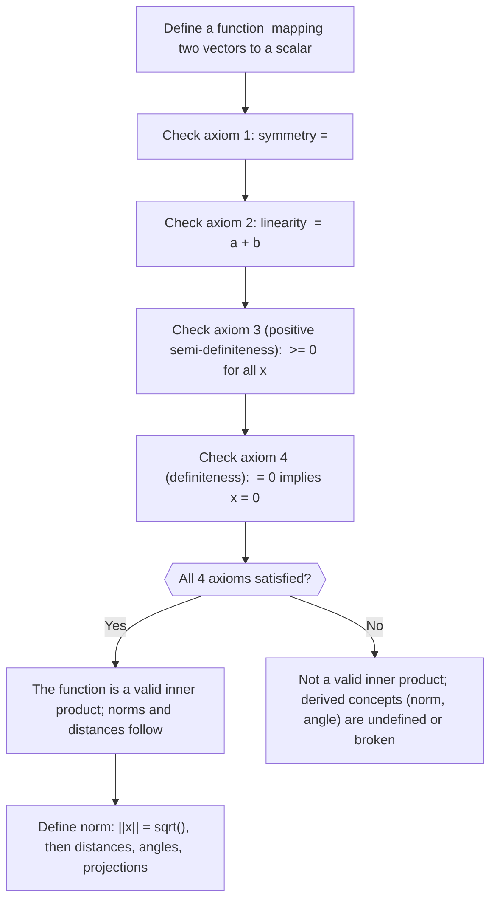

# Inner Product Axioms (positive definiteness)

$$
\langle x, x \rangle \ge 0
$$

, $\langle x, x \rangle = 0 \iff x = 0$

## Deep Breakdown

What it tells me *(Situation Awareness)*:
This axiom is the positive-definiteness property of an inner product. It says two things: (1) the inner product of any vector with itself is non-negative, and (2) that inner product equals zero only if the vector is the zero vector. Together, these two conditions are what makes $\langle x, x \rangle$ a valid measure of "squared length." Without them, you could not define a norm from an inner product, and the whole chain of concepts — norm, distance, orthogonality, cosine similarity, Gram-Schmidt — would collapse. In DA/DS you invoke this axiom implicitly every time you call `np.linalg.norm`, compute a covariance matrix diagonal (all variances must be non-negative), or assert that a kernel function is a valid similarity measure.

## Flowchart



## Real-world use

### Where it is used

Positive definiteness is checked when validating that a kernel function is a legitimate similarity measure for kernel SVMs or Gaussian processes. It is also the reason that all diagonal entries of a covariance matrix are non-negative: each diagonal entry is $\text{Var}(X_i) = \langle X_i - \mu_i, X_i - \mu_i \rangle \geq 0$.

### Problem it solves

If an inner product could be negative for $\langle x, x \rangle$, it would not be a valid squared length, and you could not define a meaningful distance. The axiom ensures the inner product space has the geometric structure we expect: vectors have non-negative lengths, and the only zero-length vector is the zero vector.

### How it solves the problem

Non-negativity ($\langle x, x \rangle \geq 0$) comes from the sum of squares structure: for the dot product on $\mathbb{R}^n$, $\langle x, x \rangle = \sum_i x_i^2 \geq 0$ because each term is a square. The "zero implies zero vector" part (definiteness) ensures injectivity: different vectors have different lengths. Together, $\|x\| = \sqrt{\langle x, x \rangle}$ is a proper norm.

### Example in a business

A data scientist builds a custom kernel function for a kernel SVM that classifies customer sessions: $k(x, y) = f(x) \cdot f(y)$ where $f$ is a feature map. To confirm it is a valid kernel (Mercer's theorem), they check that the Gram matrix $K_{ij} = k(x_i, x_j)$ is positive semi-definite. The PSD condition directly extends the inner product positive-definiteness axiom: the diagonal entries ($k(x_i, x_i) \geq 0$) and the full PSD structure guarantee the kernel is a valid inner product in the feature space.

## The formula, piece by piece

- $\langle x, x \rangle$: the inner product of a vector with itself; for the standard dot product on $\mathbb{R}^n$ this equals $\sum_{i=1}^n x_i^2$
- $\geq 0$: non-negative; the inner product of any vector with itself is zero or positive
- $= 0$: equality in the first condition
- $\iff$: if and only if; both directions must hold
- $x = 0$: the zero vector, the unique vector with all components equal to zero
- The biconditional says: $\langle x, x \rangle = 0$ is equivalent to $x$ being the zero vector.

One implication is obvious ($x=0 \Rightarrow \langle x,x\rangle = 0$); the non-trivial direction is $\langle x,x\rangle = 0 \Rightarrow x = 0$. Full formula: $\langle x, x \rangle \geq 0$, with $\langle x, x \rangle = 0 \iff x = 0$

## The formula in words

"The 'length squared' of any vector is zero or positive. The only vector with length zero is the zero vector itself — everything else has positive length." Tiny numeric example: $x = [3, -4]^T$.
$\langle x, x \rangle = 3^2 + (-4)^2 = 9 + 16 = 25 \geq 0$ ✓.
$\|x\| = \sqrt{25} = 5$.
Now try $x = [0, 0]^T$: $\langle x, x \rangle = 0$ and indeed $x = 0$ ✓.
Try $x = [0, 1]^T$: $\langle x, x \rangle = 0 + 1 = 1 > 0$ ✓ (non-zero vector has positive inner product with itself).

## Critical Concepts

- **Positive semi-definite vs positive definite:** $\langle x, x \rangle \geq 0$ alone is called positive semi-definiteness (PSD); adding the condition $= 0 \iff x = 0$ makes it positive definite (PD). Inner products require PD; some norms (like semi-norms) only require PSD.
- **Covariance matrix connection:** a covariance matrix $\Sigma$ is PSD because $v^T \Sigma v = \text{Var}(v^T X) \geq 0$ for all $v$; if all features are non-degenerate, $\Sigma$ is PD.
- **Induced norm:** $\|x\| = \sqrt{\langle x, x \rangle}$ is only a valid norm (satisfies non-negativity, definiteness, triangle inequality, and homogeneity) because the inner product satisfies these axioms.
- **Kernel validity:** a kernel function $k(x, y)$ is a valid inner product in some feature space if and only if the Gram matrix $K_{ij} = k(x_i, x_j)$ is PSD for all finite sets of points. Checking $K$'s eigenvalues tells you whether your kernel is valid.
- **Weighted inner products:** $\langle x, y \rangle_W = x^T W y$ (for a PD weight matrix $W$) also satisfies all inner product axioms, including this one; this generalizes Mahalanobis distance.
- **Breaking the axiom:** if you define $\langle x, x \rangle = -\|x\|^2$, you break positive definiteness; this no longer defines a length or geometry (though indefinite forms arise in relativity theory).

## Step-by-step calculation (tiny example)

*Step 1: Verify non-negativity for a specific non-zero vector*
$x = [2, -1, 3]^T$.
$\langle x, x \rangle = 2^2 + (-1)^2 + 3^2 = 4 + 1 + 9 = 14 \geq 0$ ✓.
$\|x\| = \sqrt{14} \approx 3.742$.

*Step 2: Verify the zero vector gives inner product zero*
$x = [0, 0, 0]^T$.
$\langle x, x \rangle = 0^2 + 0^2 + 0^2 = 0$ ✓.
$\|x\| = \sqrt{0} = 0$ (the zero vector has zero length).

*Step 3: Verify the converse — inner product zero implies zero vector*
Suppose $\langle x, x \rangle = x_1^2 + x_2^2 + x_3^2 = 0$. Since each term $x_i^2 \geq 0$ and they sum to zero, each term must be zero: $x_1^2 = 0 \Rightarrow x_1 = 0$, and similarly $x_2 = x_3 = 0$. Therefore $x = 0$ ✓. The implication holds.

## Code examples

### Beginner example (Python)

```python
import numpy as np   # -- Verify positive definiteness axiom for the standard dot product ---
vectors = [ np.array([3.0, -4.0]), np.array([0.0, 0.0]), np.array([1.0, 0.0]), np.array([-2.0, 5.0]),
]
print("Checking <x, x> >= 0 and <x, x> = 0 iff x = 0:")
for x in vectors:
    inner_self = float(x @ x)
is_zero_vec = np.allclose(x, 0)
axiom_holds = (inner_self >= 0) and (is_zero_vec == np.isclose(inner_self, 0))
print(f" x = {x}, <x,x> = {inner_self:.4f}, ||x|| = {np.linalg.norm(x):.4f}, axiom: {axiom_holds}")   # Verify for a randomly generated vector
x_rand = np.random.default_rng(42).normal(size=5)
print(f"\nRandom x = {x_rand.round(4)}")
print(f"<x, x> = {float(x_rand @ x_rand):.6f} >= 0: {float(x_rand @ x_rand) >= 0}")
```

### Beginner example (R)

```r
# -- Verify positive definiteness axiom for the standard dot product ---
vectors <- list( c(3.0, -4.0), c(0.0, 0.0), c(1.0, 0.0), c(-2.0, 5.0)
) cat("Checking <x, x> >= 0 and <x, x> = 0 iff x = 0:\n")
for (x in vectors) { inner_self <- sum(x * x)
  is_zero_vec <- all(x == 0)
  axiom_holds <- (inner_self >= 0) && (is_zero_vec == isTRUE(all.equal(inner_self, 0)))
  cat(sprintf(" x = [%s], <x,x> = %.4f, ||x|| = %.4f, axiom: %s\n", paste(round(x, 2), collapse = ", "), inner_self, sqrt(inner_self), axiom_holds))
}
```

### Professional example (Python)

```python
import numpy as np
import pandas as pd
np.random.seed(42)   # -- Business scenario: validate that a custom kernel matrix is PSD ---
# A data scientist defines a similarity kernel for customer sessions.
# k(x, y) = exp(-||x - y||^2 / sigma^2) (RBF kernel)
# Validates positive semi-definiteness by checking all eigenvalues >= 0.
N_SAMPLES = 50
N_FEATURES = 4
RBF_SIGMA = 1.5
feature_names = ["avg_session_min", "pages_per_visit", "add_to_cart", "purchase"]   # Simulate session feature vectors
raw_data = np.random.normal(size=(N_SAMPLES, N_FEATURES))
df = pd.DataFrame(raw_data, columns=feature_names)
X = df.to_numpy()   # Compute RBF (Gaussian) kernel Gram matrix K_ij = exp(-||x_i - x_j||^2 / sigma^2)

def rbf_kernel_matrix(X_data, sigma):
    """Compute RBF kernel Gram matrix."""
    sq_dists = np.sum((X_data[:, None, :] - X_data[None, :, :]) ** 2, axis=-1)
    return np.exp(-sq_dists / sigma ** 2)
K = rbf_kernel_matrix(X, sigma=RBF_SIGMA)   # Eigenvalue check for PSD (inner product positive-definiteness axiom on Gram matrix)
eigenvalues = np.linalg.eigvalsh(K)
min_eig = float(eigenvalues.min())
n_negative = int(np.sum(eigenvalues < -1e-10))   # Diagonal check: K_ii = k(x_i, x_i) >= 0 (direct application of <x,x> >= 0)
diag_values = np.diag(K)
print(f"Kernel matrix shape: {K.shape}")
print(f"All diagonal entries k(x_i, x_i) = 1.0: {np.allclose(diag_values, 1.0)} (RBF self-similarity = 1)")
print(f"Minimum eigenvalue: {min_eig:.6f}")
print(f"Eigenvalues < -1e-10 (violations): {n_negative}")
print(f"Kernel is PSD (valid inner product): {n_negative == 0}")
print(f"\nTop 5 eigenvalues: {sorted(eigenvalues, reverse=True)[:5]}")
print("\nInterpretation: all eigenvalues >= 0 confirms the RBF kernel satisfies positive semi-definiteness, making it a valid inner product in feature space.")
```

---

*Source: AIO*
