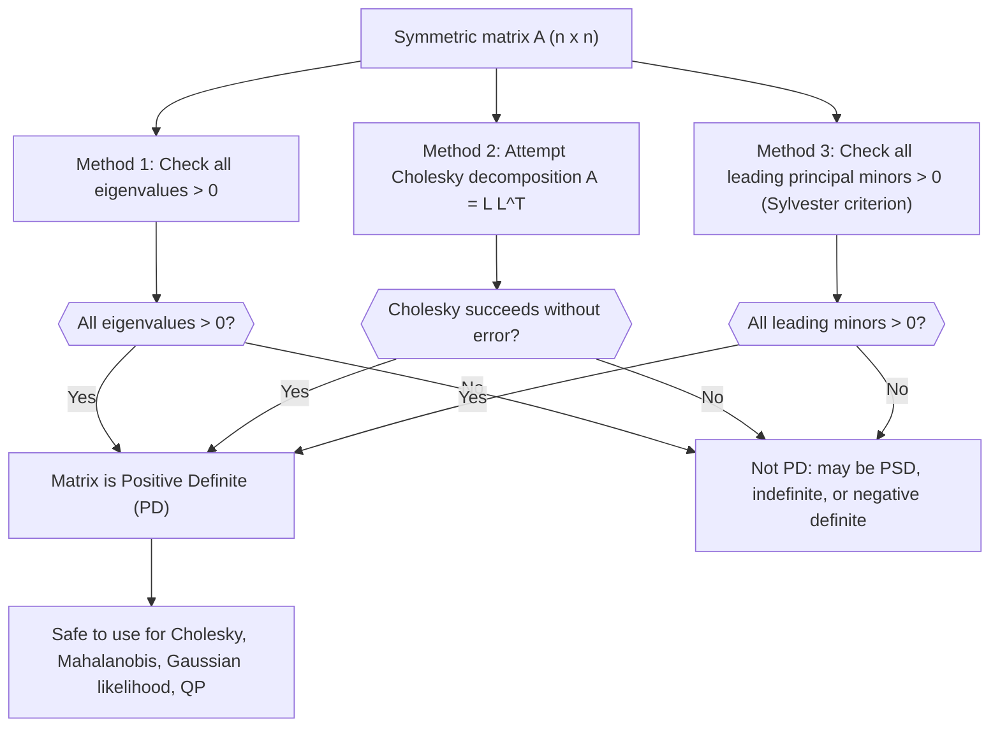

# Positive Definite (PD)

$$
x^T A x > 0
$$

for all $x \ne 0$

## Deep Breakdown

What it tells me *(Situation Awareness)*:
A matrix $A$ is positive definite (PD) if the quadratic form $x^T A x$ is strictly positive for every non-zero vector $x$. This is one of the most important properties in applied linear algebra: a PD matrix can be Cholesky-decomposed ($A = LL^T$), has a well-defined inverse, and guarantees that a multivariate optimization objective has a unique global minimum. In DA/DS you check for positive definiteness whenever you use a covariance matrix to simulate correlated data, compute Mahalanobis distance, run Gaussian process regression, or solve a quadratic program for portfolio optimization.

## Flowchart



## Real-world use

### Where it is used

Positive definiteness is checked before every Cholesky factorization (used for fast sampling from multivariate distributions), before computing the Mahalanobis distance (which requires a valid precision matrix), and before solving the normal equations in regression (the Gram matrix $B^T B$ must be PD for a unique solution to exist).

### Problem it solves

Indefinite or singular matrices cause numerical failures in factorization, non-convex optimization landscapes, and undefined distances. A PD matrix guarantees: Cholesky works, the inverse exists, the associated quadratic form has a unique minimum, and the matrix defines a valid geometry.

### How it solves the problem

The quadratic form $x^T A x$ measures "how much $A$ stretches $x$ in the $x$ direction." Positive definiteness means $A$ always stretches positively, never compresses to zero or reflects. Equivalently, all eigenvalues are positive, meaning the matrix stretches space in every direction.

### Example in a business

A quant analyst wants to simulate 10,000 correlated weekly return scenarios for 5 assets. They call `np.linalg.cholesky(cov_matrix)` to get the simulation factor $L$. If the covariance matrix is not PD, Cholesky raises a `LinAlgError`. The analyst first checks all eigenvalues; if any are negative (due to numerical noise in the estimation), they apply a small diagonal correction (jitter) to make the matrix PD before proceeding.

## The formula, piece by piece

- $x^T$: the transpose of column vector $x$, making it a row vector ($1 \times n$)
- $A$: a symmetric ($n \times n$) matrix; positive definiteness is usually only defined for symmetric matrices
- $x$: any non-zero column vector in $\mathbb{R}^n$ ($n \times 1$)
- $x^T A x$: the scalar result of the quadratic form; multiply row $x^T$ by matrix $A$, then by column $x$; result is a single number
- $> 0$: strictly positive; the quadratic form must be positive for all non-zero $x$, not just most of them
- "for all $x \neq 0$": the condition must hold universally; the zero vector is excluded because $0^T A 0 = 0$ trivially Full formula: $x^T A x > 0$ for all $x \neq 0$

## The formula in words

"No matter what non-zero direction you point, the matrix always stretches that direction positively outward rather than compressing or flipping it." Tiny numeric example: $A = \begin{bmatrix}2 & 1 \\ 1 & 2\end{bmatrix}$, $x = [a, b]^T$.
$x^T A x = [a, b]\begin{bmatrix}2 & 1 \\ 1 & 2\end{bmatrix}\begin{bmatrix}a \\ b\end{bmatrix} = [a,b]\begin{bmatrix}2a+b \\ a+2b\end{bmatrix} = 2a^2 + 2ab + 2b^2 = 2(a^2 + ab + b^2)$.
Note: $a^2 + ab + b^2 = (a + b/2)^2 + 3b^2/4 > 0$ for $(a,b) \neq (0,0)$.
Eigenvalues: $\lambda_1 = 3$, $\lambda_2 = 1$ (both positive).

## Critical Concepts

- **Equivalent conditions for PD:** all eigenvalues $> 0$; Cholesky decomposition exists; all leading principal minors are positive; $A = M^T M$ for some invertible $M$.
- **PD vs PSD:** positive definite (PD) requires strict inequality $> 0$ for all $x \neq 0$; positive semi-definite (PSD) allows equality ($\geq 0$). PSD matrices are singular (some eigenvalue = 0); PD matrices are invertible.
- **Covariance matrices:** a sample covariance matrix is always PSD; it is PD only if the number of observations exceeds the number of features (full rank). Regularization ($\Sigma + \varepsilon I$) makes it PD.
- **Cholesky as the practical test:** `np.linalg.cholesky(A)` succeeds without error if and only if $A$ is PD (numerically). For near-PD matrices, a small jitter $\varepsilon I$ is the standard fix.
- **Optimization connection:** a twice-differentiable function $f$ has a local minimum at $x^*$ if the Hessian $H = \partial^2 f / \partial x^2$ is PD there; if $H$ is PD everywhere, $f$ is strictly convex with a unique global minimum.
- **Numerical near-PD:** eigenvalues slightly below zero due to floating-point arithmetic are common; use `np.linalg.eigvalsh(A)` to diagnose and add `jitter * I` to fix.

## Step-by-step calculation (tiny example)

*Step 1: Compute the quadratic form symbolically and check sign*
$A = \begin{bmatrix}3 & 1 \\ 1 & 2\end{bmatrix}$, $x = [a, b]^T$.
$x^T A x = [a,b]\begin{bmatrix}3 & 1 \\ 1 & 2\end{bmatrix}\begin{bmatrix}a \\ b\end{bmatrix} = [3a+b, a+2b] \cdot [a,b]^T = 3a^2 + ab + ab + 2b^2 = 3a^2 + 2ab + 2b^2$.

*Step 2: Verify positivity by completing the square*
$3a^2 + 2ab + 2b^2 = 3(a + b/3)^2 + 2b^2 - b^2/3 = 3(a + b/3)^2 + 5b^2/3$.
Both terms are non-negative; the sum is zero only when $a + b/3 = 0$ and $b = 0$, i.e., $a = b = 0$.
Therefore $x^T A x > 0$ for all $x \neq 0$.

*Step 3: Verify via eigenvalues as a cross-check*
$\det(A - \lambda I) = (3-\lambda)(2-\lambda) - 1 = \lambda^2 - 5\lambda + 5 = 0$.
$\lambda = (5 \pm \sqrt{5})/2$, so $\lambda_1 \approx 3.618$ and $\lambda_2 \approx 1.382$.
Both eigenvalues are positive. Consistent with the PD conclusion.

## Code examples

### Beginner example (Python)

```python
import numpy as np

# -- Check positive definiteness via eigenvalues and Cholesky ----------
A = np.array([[3.0, 1.0], [1.0, 2.0]])

# Method 1: eigenvalues
eigenvalues = np.linalg.eigvalsh(A)
print(f"Eigenvalues: {eigenvalues.round(4)}")
print(f"All positive (PD): {bool(np.all(eigenvalues > 0))}")

# Method 2: Cholesky (succeeds if and only if A is PD)
try:
    L = np.linalg.cholesky(A)
    print(f"\nCholesky succeeded: A = L L^T (PD confirmed)")
    print(f"L =\n{L.round(4)}")
except np.linalg.LinAlgError:
    print("\nCholesky failed: A is not PD")

# Method 3: directly evaluate quadratic form for a test vector
x_test = np.array([1.0, 2.0])
qf = float(x_test @ A @ x_test)
print(f"\nQuadratic form x^T A x for x={x_test}: {qf:.4f} (> 0 confirms PD for this x)")
```

### Beginner example (R)

```r
# -- Check positive definiteness via eigenvalues and Cholesky ----------
A <- matrix(c(3, 1, 1, 2), nrow = 2)

# Method 1: eigenvalues
eigenvalues <- eigen(A, symmetric = TRUE)$values
cat(sprintf("Eigenvalues: %s\n", paste(round(eigenvalues, 4), collapse = ", ")))
cat(sprintf("All positive (PD): %s\n", all(eigenvalues > 0)))

# Method 2: Cholesky
tryCatch({
  L <- chol(A)
  cat(sprintf("\nCholesky succeeded: A is PD\n"))
  cat("L =\n")
  print(round(L, 4))
}, error = function(e) {
  cat(sprintf("\nCholesky failed: %s\n", e$message))
})

# Method 3: quadratic form
x_test <- c(1.0, 2.0)
qf <- as.numeric(x_test %*% A %*% x_test)
cat(sprintf("\nQuadratic form x^T A x = %.4f (> 0: PD confirmed for this x)\n", qf))
```

### Professional example (Python)

```python
import numpy as np
import pandas as pd
np.random.seed(42)

# -- Business scenario: validate covariance matrix before Cholesky sampling
# A risk model needs to sample correlated returns for 6 assets.
# Estimate the covariance from data and handle near-PD issues.
N_PERIODS = 52  # 1 year of weekly data
N_ASSETS = 6
JITTER = 1e-6   # small diagonal fix for numerical PD
asset_names = [f"asset_{chr(65+i)}" for i in range(N_ASSETS)]

# Simulate returns from a known PD covariance
true_cov = np.eye(N_ASSETS) + 0.3 * np.ones((N_ASSETS, N_ASSETS))
# true_cov is PD: diagonal dominant with all off-diagonal = 0.3
L_true = np.linalg.cholesky(true_cov)
returns = np.random.normal(size=(N_PERIODS, N_ASSETS)) @ L_true.T
df = pd.DataFrame(returns, columns=asset_names)
cov_est = df.cov().to_numpy()

# Diagnose PD status
eigenvalues = np.linalg.eigvalsh(cov_est)
is_pd = bool(np.all(eigenvalues > 0))
min_eig = float(eigenvalues.min())
print(f"Estimated covariance eigenvalues: {eigenvalues.round(4)}")
print(f"Is PD: {is_pd}, Min eigenvalue: {min_eig:.6f}")

# Apply jitter if needed to ensure PD
if not is_pd or min_eig < 1e-8:
    cov_pd = cov_est + JITTER * np.eye(N_ASSETS)
    print(f"\nApplied jitter {JITTER} to ensure PD")
else:
    cov_pd = cov_est

# Cholesky factorization and simulation
L_est = np.linalg.cholesky(cov_pd)
N_SIM = 1_000
simulated = np.random.normal(size=(N_SIM, N_ASSETS)) @ L_est.T
sim_df = pd.DataFrame(simulated, columns=asset_names)
sim_cov = sim_df.cov()

# Quadratic form check: x^T cov_pd x > 0 for a test portfolio
test_weights = np.ones(N_ASSETS) / N_ASSETS
portfolio_var = float(test_weights @ cov_pd @ test_weights)
print(f"\nCholesky factorization: success")
print(f"Equal-weight portfolio variance (x^T A x): {portfolio_var:.6f} > 0")
print(f"Simulated covariance diagonal (variances): {np.diag(sim_cov.to_numpy()).round(4)}")
print("\nInterpretation: PD check + jitter ensures the covariance matrix is safe for Cholesky sampling and Mahalanobis computation.")
```

---

*Source: MML2*
