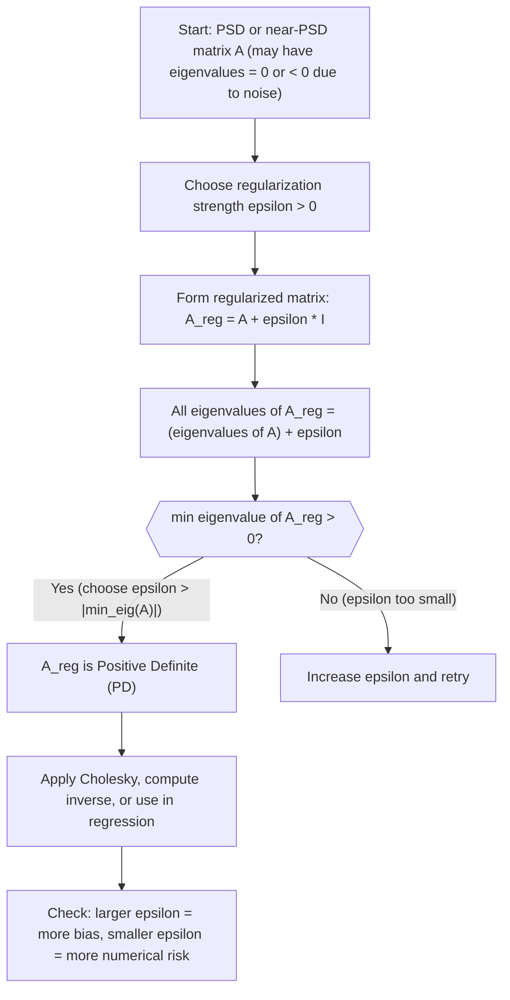

# Regularized Positive Definite

$$
x^T(A + \epsilon I)x = x^T A x + \epsilon \|x\|_2^2 > 0
$$

(for $\epsilon > 0$)

## Deep Breakdown

What it tells me *(Situation Awareness)*:
This formula shows that adding $\varepsilon I$ (a small multiple of the identity matrix) to any symmetric PSD matrix $A$ always yields a PD matrix. The algebraic proof is in the expansion: $x^T(A + \varepsilon I)x = x^T A x + \varepsilon \|x\|_2^2$. Since $x^T A x \geq 0$ (PSD) and $\varepsilon \|x\|_2^2 > 0$ for any non-zero $x$ and $\varepsilon > 0$, the sum is always strictly positive. In DA/DS this is the standard "jitter trick": when a covariance matrix fails Cholesky due to near-zero eigenvalues, you add a tiny diagonal term to force positive definiteness. It also underlies ridge regression: $(X^T X + \lambda I)^{-1}$ is the regularized normal equation matrix.

## Flowchart



## Real-world use

### Where it is used

Used in every context where a PSD or near-singular matrix needs to be made PD: Cholesky factorization for simulation, ridge regression in `sklearn.linear_model.Ridge` (where `alpha` is $\varepsilon$), Gaussian process regression (adding observation noise to the kernel matrix), and Mahalanobis distance computation when the covariance is estimated from a small sample.

### Problem it solves

Numerical issues caused by near-zero or slightly negative eigenvalues in estimated covariance matrices. These arise from limited data (fewer observations than features), floating-point arithmetic, or minor model misspecifications. The diagonal shift $\varepsilon I$ fixes the spectrum without changing the eigenvectors.

### How it solves the problem

Adding $\varepsilon I$ to $A$ shifts every eigenvalue of $A$ by exactly $+\varepsilon$ (the identity adds the same amount to every direction). The eigenvectors of $A + \varepsilon I$ are identical to those of $A$ (because $Av = \lambda v \Rightarrow (A+\varepsilon I)v = (\lambda + \varepsilon)v$). So you keep the same directional structure of $A$ while ensuring all eigenvalues are at least $\varepsilon$.

### Example in a business

An analyst runs a Gaussian process model to predict weekly revenue from 10 input features. The kernel Gram matrix $K$ has 200 rows and columns. Due to near-duplicate training points, the minimum eigenvalue of $K$ is $-4 \times 10^{-9}$ (floating-point noise). Adding $10^{-6} I$ ensures all eigenvalues are positive and the Cholesky factorization required by the GP posterior computation succeeds. The choice $\varepsilon = 10^{-6}$ is small enough to leave predictions essentially unchanged while fixing the numerical issue.

## The formula, piece by piece

- $x^T(A + \varepsilon I)x$: the quadratic form of the regularized matrix
- $= x^T A x + x^T(\varepsilon I)x$: linearity of the quadratic form; distributes over matrix addition
- $x^T A x$: contribution from $A$; non-negative because $A$ is PSD
- $+ \varepsilon \|x\|_2^2$: the extra term from $\varepsilon I$; equals $\varepsilon \sum_i x_i^2 > 0$ for any $x \neq 0$ and $\varepsilon > 0$
- $> 0$: strictly positive sum of two non-negative terms, one of which is strictly positive Full formula: $x^T(A + \varepsilon I)x = x^T A x + \varepsilon \|x\|_2^2 > 0$ for all $x \neq 0$, $\varepsilon > 0$

## The formula in words

"Adding a tiny amount to every diagonal entry of a matrix guarantees it can never compress any direction to zero or below, because the extra term $\varepsilon \|x\|^2$ always contributes positive energy in every direction." Tiny numeric example: $A = \begin{bmatrix}1 & 1 \\ 1 & 1\end{bmatrix}$ (PSD, not PD; eigenvalues 2 and 0). Take $\varepsilon = 0.1$.
$A + \varepsilon I = \begin{bmatrix}1.1 & 1 \\ 1 & 1.1\end{bmatrix}$.
Eigenvalues: $1.1 + 1 = 2.1$ and $1.1 - 1 = 0.1$. Both positive ✓.
For $x = [1,-1]^T$ (was in null space of $A$): $x^T (A+\varepsilon I) x = (1-1)^2 + 0.1(1+1) = 0 + 0.2 = 0.2 > 0$ ✓.

## Critical Concepts

- **Eigenvalue shift:** adding $\varepsilon I$ shifts all eigenvalues by exactly $+\varepsilon$; eigenvectors are unchanged. This is why it preserves the "shape" of the distribution while fixing the spectrum.
- **Ridge regression:** the regularized normal equations $(X^T X + \lambda I)\theta = X^T y$ are the same structure; $\lambda$ plays the role of $\varepsilon$. Ridge shrinks coefficients toward zero, balancing bias and variance.
- **Choosing $\varepsilon$:** set $\varepsilon > |\min(\text{eigenvalues of } A)|$ to guarantee PD. Common choices: $10^{-6}$ for covariance jitter, $0.001$ to $1.0$ for ridge regression (tuned by cross-validation).
- **Condition number improvement:** the condition number of $A + \varepsilon I$ is $(\lambda_{\max} + \varepsilon) / (\lambda_{\min} + \varepsilon)$. For small $\varepsilon$ relative to the spectrum, this can dramatically improve conditioning when $\lambda_{\min} \approx 0$.
- **Tikhonov regularization:** the general form $A + \varepsilon I$ is a special case of Tikhonov regularization; more general forms use $A + \lambda L^T L$ where $L$ encodes a smoothness or sparsity prior.
- **Not a free lunch:** larger $\varepsilon$ makes the matrix better conditioned but introduces more bias.

In Gaussian processes, too large a noise jitter over-smooths predictions.

## Step-by-step calculation (tiny example)

*Step 1: Identify the problem — A is PSD but not PD*
$A = \begin{bmatrix}4 & 2 \\ 2 & 1\end{bmatrix}$.
Eigenvalues (characteristic polynomial): $\lambda^2 - 5\lambda = \lambda(\lambda-5) = 0$, so $\lambda_1 = 5$, $\lambda_2 = 0$.
$A$ is PSD (eigenvalues $\geq 0$) but not PD ($\lambda_2 = 0$); Cholesky will fail.

*Step 2: Apply regularization with epsilon = 0.01*
$A_\varepsilon = A + 0.01 I = \begin{bmatrix}4.01 & 2 \\ 2 & 1.01\end{bmatrix}$.
New eigenvalues: $\lambda_1 + 0.01 = 5.01$ and $\lambda_2 + 0.01 = 0.01$. Both positive ✓.

*Step 3: Verify via quadratic form for the formerly null-space vector*
$x = [1, -2]^T$ was in the null space of $A$ ($A x = 0$, so $x^T A x = 0$).
$x^T A_\varepsilon x = x^T A x + 0.01 \|x\|^2 = 0 + 0.01(1 + 4) = 0.05 > 0$ ✓.
Regularization fixed the deficiency.

## Code examples

### Beginner example (Python)

```python
import numpy as np
EPSILON = 0.01

# -- Regularize a PSD-but-not-PD matrix to make it PD ----------------
A = np.array([[4.0, 2.0], [2.0, 1.0]])   # rank-1: eigenvalues 5 and 0
print("Original A:")
print(A)
print(f"Eigenvalues of A: {np.linalg.eigvalsh(A).round(6)}")

# Apply diagonal regularization
A_reg = A + EPSILON * np.eye(A.shape[0])
print(f"\nA + {EPSILON} * I:")
print(A_reg)
print(f"Eigenvalues of A_reg: {np.linalg.eigvalsh(A_reg).round(6)}")

# Verify Cholesky now succeeds
try:
    L = np.linalg.cholesky(A_reg)
    print(f"\nCholesky succeeded after regularization")
    print(f"L =\n{L.round(4)}")
except np.linalg.LinAlgError:
    print("\nCholesky still failed: increase epsilon")

# Verify quadratic form for former null-space vector
x_null = np.array([1.0, -2.0])
qf_orig = float(x_null @ A @ x_null)
qf_reg = float(x_null @ A_reg @ x_null)
print(f"\nQuadratic form (original): {qf_orig:.6f} (= 0, null space)")
print(f"Quadratic form (regularized): {qf_reg:.6f} (> 0, fixed)")
```

### Beginner example (R)

```r
EPSILON <- 0.01

# -- Regularize a PSD-but-not-PD matrix to make it PD ----------------
A <- matrix(c(4, 2, 2, 1), nrow = 2)
cat("Original A:\n")
print(A)
cat(sprintf("Eigenvalues of A: %s\n", paste(round(eigen(A)$values, 6), collapse = ", ")))
A_reg <- A + EPSILON * diag(nrow(A))
cat(sprintf("\nA + %g * I:\n", EPSILON))
print(A_reg)
cat(sprintf("Eigenvalues of A_reg: %s\n", paste(round(eigen(A_reg)$values, 6), collapse = ", ")))

# Cholesky check
tryCatch({
  L <- chol(A_reg)
  cat("\nCholesky succeeded after regularization\n")
}, error = function(e) {
  cat(sprintf("\nCholesky failed: %s\n", e$message))
})

# Quadratic form check for former null-space vector
x_null <- c(1.0, -2.0)
qf_orig <- as.numeric(x_null %*% A %*% x_null)
qf_reg <- as.numeric(x_null %*% A_reg %*% x_null)
cat(sprintf("\nQuadratic form (original): %.6f (= 0)\n", qf_orig))
cat(sprintf("Quadratic form (regularized): %.6f (> 0)\n", qf_reg))
```

### Professional example (Python)

```python
import numpy as np
import pandas as pd
np.random.seed(42)

# -- Business scenario: ridge regression on a near-collinear feature matrix
# Estimate marketing ROI coefficients when spend channels are highly correlated.
N_WEEKS = 60
CHANNEL_NAMES = ["tv", "digital", "branded_search", "nonbranded_search"]
LAMBDA_VALUES = [0.0, 0.01, 0.1, 1.0, 10.0]   # regularization strengths to compare
TRUE_COEFS = np.array([0.5, 1.2, 0.9, 0.6])

# Simulate near-collinear spend data: branded and nonbranded search are ~90% correlated
base_spend = np.abs(np.random.normal(20_000, 3_000, size=(N_WEEKS,)))
spend_raw = np.column_stack([
    np.abs(np.random.normal(15_000, 4_000, N_WEEKS)),   # tv
    np.abs(np.random.normal(12_000, 2_000, N_WEEKS)),   # digital
    base_spend + np.random.normal(0, 500, N_WEEKS),     # branded search
    base_spend + np.random.normal(0, 600, N_WEEKS),     # nonbranded search
])
X = spend_raw / spend_raw.std(axis=0)   # standardize
y = X @ TRUE_COEFS + np.random.normal(0, 0.3, N_WEEKS)

results = []
for lam in LAMBDA_VALUES:
    xtx = X.T @ X
    xty = X.T @ y
    xtx_reg = xtx + lam * np.eye(X.shape[1])
    theta = np.linalg.solve(xtx_reg, xty)
    cond = float(np.linalg.cond(xtx_reg))
    y_hat = X @ theta
    mse = float(np.mean((y - y_hat) ** 2))
    results.append({
        "lambda": lam,
        "condition_number": round(cond, 1),
        "mse": round(mse, 4),
        "coef_norm": round(float(np.linalg.norm(theta)), 4),
    })
results_df = pd.DataFrame(results)
print("Ridge regression: effect of epsilon (lambda) on condition number and MSE:")
print(results_df.to_string(index=False))
print("\nInterpretation: adding lambda * I reduces condition number (more stable) at the cost of some bias (higher MSE for true lambda=0).")
```

---

*Source: MML2*
