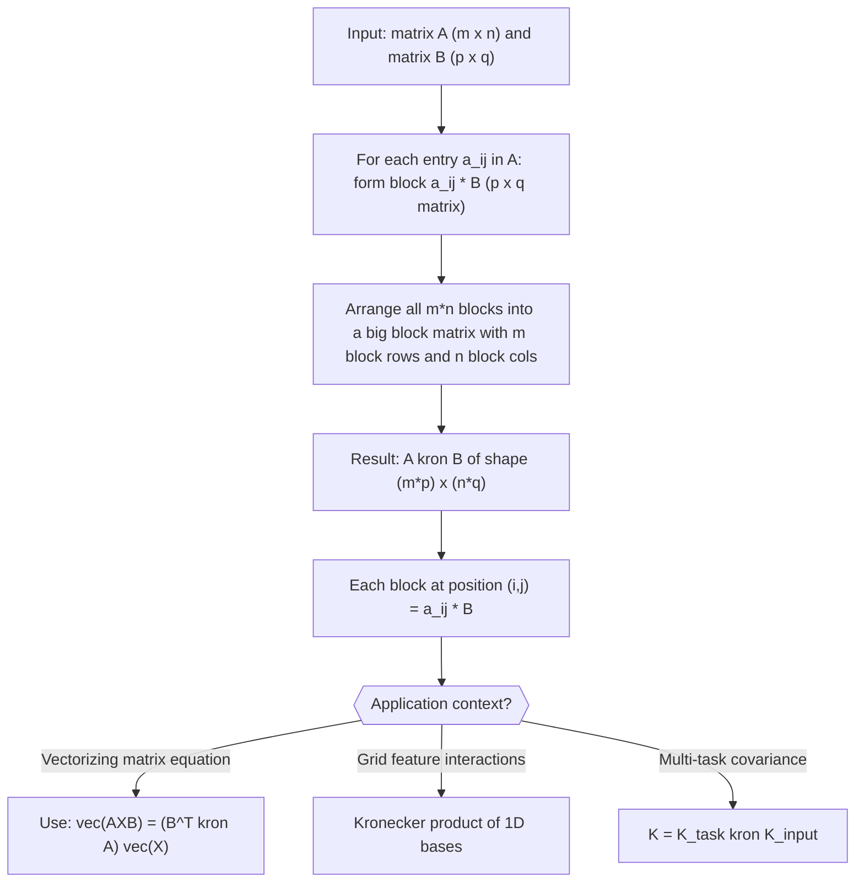

# Kronecker Product

$$
A \otimes B = \begin{bmatrix} a_{11}B & \dots & a_{1n}B \\ \vdots & \ddots & \vdots \\ a_{m1}B & \dots & a_{mn}B \end{bmatrix}
$$

## Deep Breakdown

What it tells me *(Situation Awareness)*:
The Kronecker product $A \otimes B$ is a block matrix where every scalar entry of $A$ is replaced by a scaled copy of the full matrix $B$. If $A$ is $m \times n$ and $B$ is $p \times q$, the result is $(mp) \times (nq)$. In DA/DS the Kronecker product appears in multi-output linear models (vectorizing matrix equations into a single least-squares system), constructing grid-based feature interactions (the design matrix for a 2D spline is a Kronecker product of two 1D spline bases), and in multi-task learning where the joint covariance of outputs and inputs factorizes as $\Sigma_{\text{task}} \otimes \Sigma_{\text{input}}$.

## Flowchart



## Real-world use

### Where it is used

Used when vectorizing a matrix regression model $AXB = C$ into a single linear system, when constructing tensor product feature spaces (e.g., a 2D grid of radial basis functions), and in multi-output Gaussian processes where the joint covariance has Kronecker structure, enabling efficient $O(n^3/p + p^3/n)$ computation instead of $O((np)^3)$.

### Problem it solves

Many problems with structured dependencies (across tasks, time, and space) have covariance or basis matrices that factor as Kronecker products. Exploiting this structure allows $O(n^3 + p^3)$ algorithms instead of $O((np)^3)$, turning billion-entry computations into feasible ones.

### How it solves the problem

$A \otimes B$ creates a structured block matrix where the block pattern of $A$ and the fine structure of $B$ are both preserved. This structure can be exploited algebraically: $(A \otimes B)(C \otimes D) = (AC) \otimes (BD)$ (mixed product property), $(A \otimes B)^{-1} = A^{-1} \otimes B^{-1}$, and $\text{vec}(XBY) = (Y^T \otimes X) \text{vec}(B)$.

### Example in a business

A data scientist models weekly sales as a multi-output regression across 5 product categories and 10 regions. The coefficient matrix $\Theta$ ($5 \times 10$) connects features to outputs. The system $A\Theta B = C$ can be vectorized to $(B^T \otimes A)\,\text{vec}(\Theta) = \text{vec}(C)$, enabling solution via standard least-squares solvers without custom code for matrix-valued regression.

## The formula, piece by piece

- $A$: an $m \times n$ matrix; the "outer" structure that scales copies of $B$
- $\otimes$: the Kronecker product symbol; produces a larger block-structured matrix
- $B$: a $p \times q$ matrix; the "inner" pattern that is replicated and scaled
- $a_{ij}$: the scalar entry in row $i$, column $j$ of $A$
- $a_{ij} B$: every scalar entry of $A$ becomes the coefficient for a full copy of $B$
- The resulting matrix has block $(i,j)$ equal to $a_{ij} B$, making the output $(mp) \times (nq)$ Full formula: $A \otimes B = \begin{bmatrix} a_{11}B & \cdots & a_{1n}B \\ \vdots & \ddots & \vdots \\ a_{m1}B & \cdots & a_{mn}B \end{bmatrix}$

## The formula in words

"Replace each entry of $A$ with a scaled copy of $B$, where the scale factor is that entry. Stack all the copies into a big block matrix." Tiny numeric example: $A = \begin{bmatrix}1 & 2 \\ 3 & 4\end{bmatrix}$, $B = \begin{bmatrix}0 & 5 \\ 6 & 7\end{bmatrix}$.
$A \otimes B = \begin{bmatrix}1 \cdot B & 2 \cdot B \\ 3 \cdot B & 4 \cdot B\end{bmatrix} = \begin{bmatrix}0 & 5 & 0 & 10 \\ 6 & 7 & 12 & 14 \\ 0 & 15 & 0 & 20 \\ 18 & 21 & 24 & 28\end{bmatrix}$.

## Critical Concepts

- **Size:** if $A$ is $m \times n$ and $B$ is $p \times q$, then $A \otimes B$ is $(mp) \times (nq)$.
- **Not commutative:** $A \otimes B \neq B \otimes A$ in general, though they are related by permutation matrices.
- **Mixed product property:** $(A \otimes B)(C \otimes D) = (AC) \otimes (BD)$; this lets you compute products of Kronecker matrices efficiently.
- **Eigenvalues:** if $\lambda$ is an eigenvalue of $A$ with eigenvector $u$, and $\mu$ is an eigenvalue of $B$ with eigenvector $v$, then $\lambda\mu$ is an eigenvalue of $A \otimes B$ with eigenvector $u \otimes v$.
- **Vectorization identity:** $\text{vec}(AXB) = (B^T \otimes A)\,\text{vec}(X)$; this converts matrix equations to vector equations solvable by standard solvers.
- **NumPy implementation:** `np.kron(A, B)` computes the Kronecker product directly.

For large matrices, exploit structure rather than materializing the full product.

## Step-by-step calculation (tiny example)

*Step 1: Write A's entries and identify the block structure*
$A = \begin{bmatrix}2 & 1 \\ 0 & 3\end{bmatrix}$, $B = \begin{bmatrix}1 & 0 \\ 0 & 1\end{bmatrix}$ (identity matrix).
$A \otimes B$ will be $4 \times 4$. Block $(i,j)$ = $a_{ij} \cdot I_2$.

*Step 2: Fill in each 2x2 block*
Block $(1,1)$: $a_{11} \cdot B = 2I = \begin{bmatrix}2&0\\0&2\end{bmatrix}$.
Block $(1,2)$: $a_{12} \cdot B = 1I = \begin{bmatrix}1&0\\0&1\end{bmatrix}$.
Block $(2,1)$: $a_{21} \cdot B = 0I = \begin{bmatrix}0&0\\0&0\end{bmatrix}$.
Block $(2,2)$: $a_{22} \cdot B = 3I = \begin{bmatrix}3&0\\0&3\end{bmatrix}$.

*Step 3: Assemble the full 4x4 matrix*
$A \otimes B = \begin{bmatrix}2&0&1&0\\0&2&0&1\\0&0&3&0\\0&0&0&3\end{bmatrix}$.
Note: $A \otimes I = \text{block-diag structure replicated}$; eigenvalues of $A \otimes I$ are just eigenvalues of $A$, each with multiplicity 2.

## Code examples

### Beginner example (Python)

```python
import numpy as np   # -- Compute Kronecker product and verify properties -------------------
A = np.array([[1.0, 2.0], [3.0, 4.0]])
B = np.array([[0.0, 5.0], [6.0, 7.0]])
K = np.kron(A, B)
print(f"A shape: {A.shape}, B shape: {B.shape}")
print(f"A kron B shape: {K.shape} (should be {A.shape[0]*B.shape[0]} x {A.shape[1]*B.shape[1]})")
print(f"\nA kron B:\n{K}")   # Verify mixed product property: (A kron B)(C kron D) = (AC) kron (BD)
C = np.array([[1.0, 0.0], [0.0, 1.0]])   # identity
D = np.array([[2.0, 0.0], [0.0, 2.0]])   # 2 * identity
lhs = np.kron(A, B) @ np.kron(C, D)
rhs = np.kron(A @ C, B @ D)
print(f"\nMixed product property holds: {np.allclose(lhs, rhs)}")   # Verify eigenvalue property: eigenvalues of A kron B = all products lambda_i * mu_j
eig_A = np.linalg.eigvals(A)
eig_B = np.linalg.eigvals(B)
eig_K = np.sort(np.linalg.eigvals(K).real)
expected_eigs = np.sort(np.outer(eig_A, eig_B).ravel().real)
print(f"Eigenvalue property holds: {np.allclose(eig_K, expected_eigs, atol=1e-8)}")
```

### Beginner example (R)

```r
# -- Compute Kronecker product and verify properties -------------------
A <- matrix(c(1, 3, 2, 4), nrow = 2)  # column-major: [[1,3],[2,4]]
A <- matrix(c(1, 2, 3, 4), nrow = 2, byrow = TRUE)
B <- matrix(c(0, 5, 6, 7), nrow = 2, byrow = TRUE)
K <- kronecker(A, B)
cat(sprintf("A kron B shape: %d x %d\n", nrow(K), ncol(K)))
cat("A kron B:\n")
print(K)  # Mixed product property
C <- diag(2)
D <- 2 * diag(2)
lhs <- kronecker(A, B) %*% kronecker(C, D)
rhs <- kronecker(A %*% C, B %*% D)
cat(sprintf("\nMixed product property holds: %s\n", isTRUE(all.equal(lhs, rhs))))
```

### Professional example (Python)

```python
import numpy as np
import pandas as pd
np.random.seed(42)   # -- Business scenario: multi-output regression via vectorization
# Predict sales for P=3 products and Q=4 regions using F=5 features.
# Model: S = X * Theta + noise, where S is (N x P*Q), Theta is (F x P*Q).
# Vectorized form: vec(S^T) = (I_PQ kron X) vec(Theta^T)
N_OBS = 100
N_FEATURES = 5
N_PRODUCTS = 3
N_REGIONS = 4
N_OUTPUTS = N_PRODUCTS * N_REGIONS   # 12 total outputs
feature_names = [f"feat_{k}" for k in range(N_FEATURES)]
output_names = [f"prod{p}_reg{r}" for p in range(N_PRODUCTS) for r in range(N_REGIONS)]   # True coefficient matrix (F x N_OUTPUTS)
theta_true = np.random.normal(size=(N_FEATURES, N_OUTPUTS))   # Simulate features and sales
X = np.random.normal(size=(N_OBS, N_FEATURES))
noise = np.random.normal(0, 0.5, size=(N_OBS, N_OUTPUTS))
S = X @ theta_true + noise   # OLS via normal equations (Kronecker structure not exploited here, just vectorized)
theta_hat, _, _, _ = np.linalg.lstsq(X, S, rcond=None)   # Verify Kronecker identity: vec(S^T) = (I kron X) vec(Theta_true^T)
I_pq = np.eye(N_OUTPUTS)
design_kron = np.kron(I_pq, X)   # shape: (N*N_OUTPUTS) x (F*N_OUTPUTS)
s_vec = S.T.ravel()   # vec(S^T): shape (N*N_OUTPUTS,)
theta_kron, _, _, _ = np.linalg.lstsq(design_kron, s_vec, rcond=None)
theta_kron_mat = theta_kron.reshape(N_OUTPUTS, N_FEATURES).T
max_diff = float(np.max(np.abs(theta_hat - theta_kron_mat)))
r2_vals = np.array([1 - np.sum((S[:, j] - X @ theta_hat[:, j])**2) / np.sum((S[:, j] - S[:, j].mean())**2) for j in range(N_OUTPUTS)])
print(f"Max difference between direct OLS and Kronecker OLS: {max_diff:.2e} (should be ~0)")
print(f"R-squared range across {N_OUTPUTS} outputs: [{r2_vals.min():.3f}, {r2_vals.max():.3f}]")
print("\nInterpretation: Kronecker vectorization transforms multi-output regression into a single linear system solvable with standard lstsq.")
```

---

*Source: domain knowledge*
