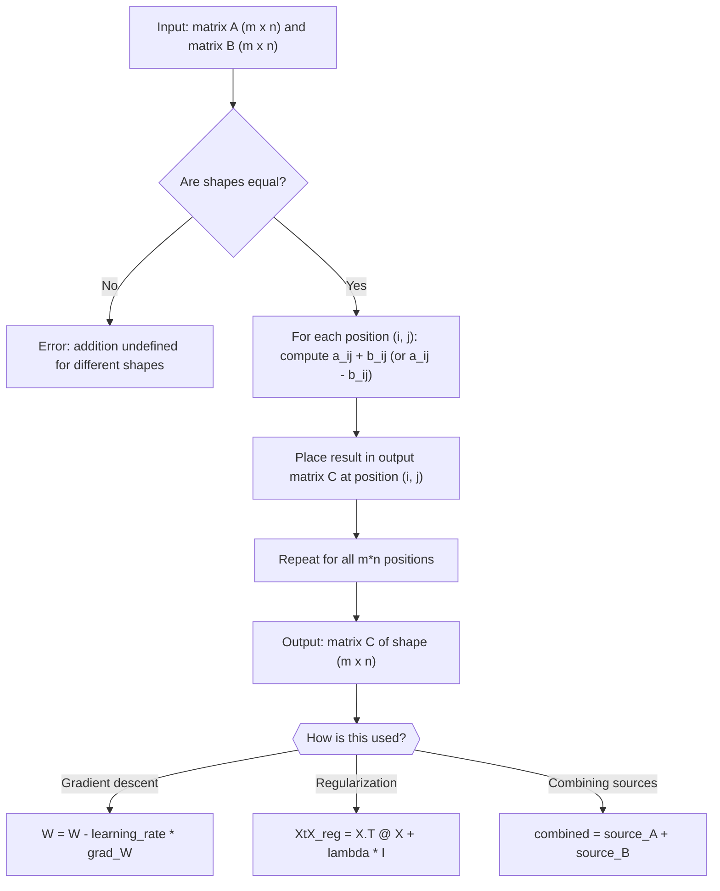

# Matrix addition

$$
[A \pm B]_{ij} = a_{ij} \pm b_{ij}
$$

## Deep Breakdown

What it tells me *(Situation Awareness)*:
Matrix addition (and subtraction) is the simplest matrix operation: you add two matrices of identical shape by adding corresponding entries. The result has the same shape as both inputs. This is the structural foundation for everything from updating model parameters in gradient descent ($W \leftarrow W - \alpha \nabla L$, which is a matrix subtraction) to combining partial results in parallel computation. In DA/DS, matrix addition appears constantly: adding a regularization term to a Gram matrix ($X^T X + \lambda I$), combining feature matrices from different data sources of the same shape, updating running statistics, and accumulating gradients across mini-batches.

## Flowchart



## Real-world use

### Where it is used

Used in gradient descent weight updates, merging feature matrices from different data pipelines, updating confusion matrices across batches, computing residuals ($\hat{Y} - Y$), adding regularization to normal equations, and combining covariance estimates in federated or distributed learning.

### Problem it solves

Many computations produce structured results that need to be combined position-by-position — for instance, accumulating gradient updates from multiple workers, or merging partial cross-tabulations from different data partitions. Matrix addition makes this combination exact, linear, and shape-preserving.

### How it solves the problem

Since $[A \pm B]_{ij} = a_{ij} \pm b_{ij}$, each entry of the output depends only on the same-position entries of the inputs. There are no cross-entry interactions. This elementwise structure means the operation is trivially parallelizable (each position computed independently), numerically stable (no accumulation of cross-terms), and reversible ($C - B = A$).

### Example in a business

A data scientist trains a regression model on two regional datasets. Region A produces normal equations $X_A^T X_A$ and $X_A^T y_A$; Region B produces $X_B^T X_B$ and $X_B^T y_B$. Because the normal equations accumulate as sums, the combined solution is $\theta = (X_A^T X_A + X_B^T X_B)^{-1}(X_A^T y_A + X_B^T y_B)$. Two matrix additions replace re-running OLS on the full dataset, which may be too large to hold in memory.

## The formula, piece by piece

- $[A \pm B]_{ij}$: the $(i, j)$ entry of the result matrix; bracket notation means "the element at row $i$, column $j$"
- $a_{ij}$: the entry of matrix $A$ at row $i$, column $j$
- $\pm$: either addition or subtraction; both apply the same elementwise rule
- $b_{ij}$: the entry of matrix $B$ at the same position $(i, j)$
- The operation requires $A$ and $B$ to have identical dimensions $m \times n$; the result is also $m \times n$ Full formula: $[A \pm B]_{ij} = a_{ij} \pm b_{ij}$ for all $1 \leq i \leq m$, $1 \leq j \leq n$

## The formula in words

"To add (or subtract) two matrices, go to each position in the grid and add (or subtract) the two numbers sitting at that position. Do this for every position. The shape of the result is the same as the shape of both inputs." Tiny numeric example:
$A = \begin{bmatrix}1 & 2 \\ 3 & 4\end{bmatrix}$, $B = \begin{bmatrix}5 & 0 \\ -1 & 2\end{bmatrix}$.
$A + B = \begin{bmatrix}1+5 & 2+0 \\ 3+(-1) & 4+2\end{bmatrix} = \begin{bmatrix}6 & 2 \\ 2 & 6\end{bmatrix}$.
$A - B = \begin{bmatrix}1-5 & 2-0 \\ 3-(-1) & 4-2\end{bmatrix} = \begin{bmatrix}-4 & 2 \\ 4 & 2\end{bmatrix}$.

## Critical Concepts

- **Shape requirement:** $A$ and $B$ must have exactly the same dimensions. Adding a $3 \times 4$ matrix to a $4 \times 3$ matrix is undefined, even though they have the same number of entries.
- **Commutativity:** $A + B = B + A$; order does not matter for addition (unlike matrix multiplication).
- **Associativity:** $(A + B) + C = A + (B + C)$; you can group additions in any order.
- **Additive identity:** the zero matrix $0$ (all entries are 0) satisfies $A + 0 = A$.
- **Additive inverse:** $A + (-A) = 0$; the negative of a matrix is the matrix with all signs flipped.
- **Broadcasting:** NumPy and R allow broadcasting vectors or scalars against matrices (e.g., `A + v` where `v` is a row vector). This is NOT classical matrix addition; it is a generalization. Be explicit about what you intend.
- **Gradient descent connection:** the weight update $W \leftarrow W - \alpha G$ (where $G$ is the gradient matrix) is matrix subtraction scaled by a scalar; it preserves the shape of the parameter matrix.

## Step-by-step calculation (tiny example)

*Step 1: Write both matrices side by side and confirm shapes match*
$A = \begin{bmatrix}2 & -1 & 0 \\ 4 & 3 & 1\end{bmatrix}$ (shape $2 \times 3$), $B = \begin{bmatrix}1 & 2 & -3 \\ 0 & -1 & 5\end{bmatrix}$ (shape $2 \times 3$). Shapes match.

*Step 2: Add each corresponding entry*
Row 1: $2+1=3$, $-1+2=1$, $0+(-3)=-3$.
Row 2: $4+0=4$, $3+(-1)=2$, $1+5=6$.

*Step 3: Assemble the result and verify shape*
$A + B = \begin{bmatrix}3 & 1 & -3 \\ 4 & 2 & 6\end{bmatrix}$ (shape $2 \times 3$).
Sanity check: sum of all entries of $A+B$ should equal sum of all entries of $A$ plus sum of all entries of $B$. $\text{sum}(A) = 9$, $\text{sum}(B) = 4$, $\text{sum}(A+B) = 3+1-3+4+2+6=13 = 9+4$.

## Code examples

### Beginner example (Python)

```python
import numpy as np   # -- Matrix addition and subtraction: basics + gradient update demo -----
A = np.array([[2.0, -1.0, 0.0], [4.0, 3.0, 1.0]])
B = np.array([[1.0, 2.0, -3.0], [0.0, -1.0, 5.0]])
C_add = A + B
C_sub = A - B
print(f"A shape: {A.shape}, B shape: {B.shape}")
print(f"\nA + B:\n{C_add}")
print(f"\nA - B:\n{C_sub}")   # Verify commutativity: A + B == B + A
print(f"\nA + B == B + A: {np.allclose(A + B, B + A)}")   # Gradient descent weight update demo
LEARNING_RATE = 0.01
W = np.array([[1.0, 0.5], [0.3, 0.8]])   # current weights
grad_W = np.array([[0.2, -0.1], [0.4, 0.0]])   # gradient from backprop
W_updated = W - LEARNING_RATE * grad_W
print(f"\nWeight matrix W:\n{W}")
print(f"Gradient matrix:\n{grad_W}")
print(f"Updated weights (W - lr * grad):\n{W_updated}")
```

### Beginner example (R)

```r
# -- Matrix addition and subtraction: basics + gradient update demo -----
A <- matrix(c(2, 4, -1, 3, 0, 1), nrow = 2)  # column-major fill
A <- matrix(c(2, -1, 0, 4, 3, 1), nrow = 2, byrow = TRUE)
B <- matrix(c(1, 2, -3, 0, -1, 5), nrow = 2, byrow = TRUE)
C_add <- A + B
C_sub <- A - B
cat("A + B:\n")
print(C_add)
cat("A - B:\n")
print(C_sub)  # Commutativity check
cat(sprintf("\nA + B == B + A: %s\n", isTRUE(all.equal(A + B, B + A))))  # Gradient descent weight update
LEARNING_RATE <- 0.01
W <- matrix(c(1.0, 0.5, 0.3, 0.8), nrow = 2, byrow = TRUE)
grad_W <- matrix(c(0.2, -0.1, 0.4, 0.0), nrow = 2, byrow = TRUE)
W_updated <- W - LEARNING_RATE * grad_W
cat("\nUpdated weights:\n")
print(W_updated)
```

### Professional example (Python)

```python
import numpy as np
import pandas as pd
np.random.seed(42)   # -- Business scenario: federated normal equations across two regional datasets
# Region A and Region B each compute their own normal equation matrices.
# Combined OLS is obtained by summing them (no raw data sharing needed).
N_OBS_A = 80
N_OBS_B = 60
N_FEATURES = 4
LAMBDA = 0.1   # regularization strength
FEATURE_NAMES = ["spend_tv", "spend_digital", "spend_print", "spend_radio"]   # Simulate regional datasets
X_A = np.random.normal(0, 1, size=(N_OBS_A, N_FEATURES))
X_B = np.random.normal(0, 1, size=(N_OBS_B, N_FEATURES))
true_coefs = np.array([0.5, 1.2, 0.3, 0.8])
y_A = X_A @ true_coefs + np.random.normal(0, 0.3, N_OBS_A)
y_B = X_B @ true_coefs + np.random.normal(0, 0.3, N_OBS_B)   # Local normal equation components (no raw data leaves each region)
XtX_A = X_A.T @ X_A
XtX_B = X_B.T @ X_B
Xty_A = X_A.T @ y_A
Xty_B = X_B.T @ y_B   # Federated aggregation via matrix addition
XtX_combined = XtX_A + XtX_B + LAMBDA * np.eye(N_FEATURES)   # regularized
Xty_combined = Xty_A + Xty_B
theta_federated = np.linalg.solve(XtX_combined, Xty_combined)   # Centralized OLS (ground truth to compare)
X_all = np.vstack([X_A, X_B])
y_all = np.concatenate([y_A, y_B])
XtX_full = X_all.T @ X_all + LAMBDA * np.eye(N_FEATURES)
Xty_full = X_all.T @ y_all
theta_central = np.linalg.solve(XtX_full, Xty_full)
comparison_df = pd.DataFrame({ "feature": FEATURE_NAMES, "true_coef": true_coefs, "federated": theta_federated.round(4), "centralized": theta_central.round(4), "abs_diff": np.abs(theta_federated - theta_central).round(6),
})
print("Federated OLS via matrix addition of normal equations:")
print(comparison_df.to_string(index=False))
print("\nInterpretation: summing local XtX and Xty matrices is equivalent to pooling all data, enabling privacy-preserving federated training.")
```

### Professional example (R)

```r
# Federated OLS: XtX_A + XtX_B, Xty_A + Xty_B (matrix addition)
set.seed(42)
N_OBS_A <- 80; N_OBS_B <- 60; N_FEATURES <- 4; LAMBDA <- 0.1
X_A <- matrix(rnorm(N_OBS_A * N_FEATURES), nrow = N_OBS_A)
X_B <- matrix(rnorm(N_OBS_B * N_FEATURES), nrow = N_OBS_B)
true_coefs <- c(0.5, 1.2, 0.3, 0.8)
y_A <- X_A %*% true_coefs + rnorm(N_OBS_A, 0, 0.3)
y_B <- X_B %*% true_coefs + rnorm(N_OBS_B, 0, 0.3)
XtX_A <- t(X_A) %*% X_A; XtX_B <- t(X_B) %*% X_B
Xty_A <- t(X_A) %*% y_A; Xty_B <- t(X_B) %*% y_B
XtX_combined <- XtX_A + XtX_B + LAMBDA * diag(N_FEATURES)
Xty_combined <- Xty_A + Xty_B
theta_federated <- solve(XtX_combined, Xty_combined)
X_all <- rbind(X_A, X_B); y_all <- c(y_A, y_B)
theta_central <- solve(t(X_all) %*% X_all + LAMBDA * diag(N_FEATURES), t(X_all) %*% y_all)
cat("Federated vs centralized OLS (matrix addition of normal equations)\n")
print(data.frame(feature = c("spend_tv", "spend_digital", "spend_print", "spend_radio"), federated = round(theta_federated, 4), centralized = round(theta_central, 4)))
```

---

*Source: 1300 p. 119*
