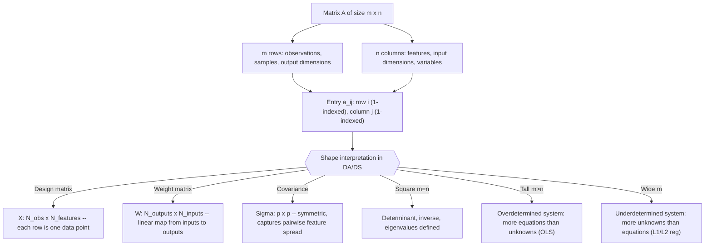

# Matrix definition

$$
A = [a_{ij}]
$$

of size $m \times n$

## Deep Breakdown

What it tells me *(Situation Awareness)*:
$A = [a_{ij}]$ is the defining notation for a matrix: a rectangular array of numbers arranged in $m$ rows and $n$ columns, where $a_{ij}$ denotes the entry in row $i$, column $j$. This is the data container that underpins all of linear algebra. In DA/DS, a matrix is the fundamental way to represent tabular data ($N$ observations × $p$ features), a linear transformation (weights mapping one vector space to another), covariance structure, adjacency in a graph, a convolution kernel, or any rectangular array of numbers that must be operated on collectively. Knowing how to read matrix notation — what $m$, $n$, $i$, $j$ each mean — unlocks every formula in linear algebra.

## Flowchart



## Real-world use

### Where it is used

Every time you load a CSV into `pandas` or `numpy`, you are working with a matrix. The design matrix $X$ in regression, the weight matrices in neural networks, the covariance matrix in PCA, the adjacency matrix in graph analytics, the confusion matrix in classification evaluation, and the ratings matrix in collaborative filtering are all instances of $A = [a_{ij}]$.

### Problem it solves

Data and linear transformations are fundamentally 2D structures (or can be reshaped into 2D). Matrix notation provides a compact, algebraically manipulable representation: instead of tracking $m \times n$ separate numbers, you manipulate a single object $A$ using rules (addition, multiplication, transposition, inversion) that encode the collective behavior of all entries.

### How it solves the problem

By indexing entries as $a_{ij}$ (row first, column second), matrix notation makes explicit the two-dimensional structure. Operations on $A$ translate to entry-level rules: $[A + B]_{ij} = a_{ij} + b_{ij}$, $[AB]_{ij} = \sum_k a_{ik} b_{kj}$, etc. Code maps directly to this notation: `A[i, j]` in NumPy is $a_{ij}$ (0-indexed).

### Example in a business

A retail data scientist works with a sales dataset of $N = 5000$ weekly store-SKU combinations, each described by $p = 12$ features (price, promotions, seasonality index, etc.). This is stored as a NumPy array $X$ of shape $(5000, 12)$: 5000 rows (observations), 12 columns (features). The matrix notation $X = [x_{ij}]$ tells them immediately: $x_{i, 3}$ is the 4th feature of the $i$-th observation. The normal equations $X^T X$ (shape $12 \times 12$) and $X^T y$ (shape $12 \times 1$) are derived purely from this 2D structure.

## The formula, piece by piece

- $A$: the matrix object; a rectangular array identified by its name
- $[a_{ij}]$: shorthand for "the matrix whose $(i,j)$ entry is $a_{ij}$"; square brackets indicate the entry rule that defines the whole matrix
- $a_{ij}$: a single scalar (real number); $i$ is the row index ($1 \leq i \leq m$), $j$ is the column index ($1 \leq j \leq n$)
- $m \times n$: the shape or dimensions; $m$ = number of rows, $n$ = number of columns; read as "m by n"
- $m = n$: square matrix; $m > n$: tall/skinny; $m < n$: wide/fat Full notation: $A = [a_{ij}]_{m \times n} = \begin{bmatrix} a_{11} & a_{12} & \cdots & a_{1n} \\ a_{21} & a_{22} & \cdots & a_{2n} \\ \vdots & \vdots & \ddots & \vdots \\ a_{m1} & a_{m2} & \cdots & a_{mn} \end{bmatrix}$

## The formula in words

"A matrix is a grid of numbers with $m$ rows and $n$ columns. The entry $a_{ij}$ is the number in row $i$ and column $j$. The two indices tell you exactly where in the grid to look: first go down $i$ rows, then go right $j$ columns." Tiny numeric example:
$A = \begin{bmatrix}7 & 2 & 5 \\ 1 & 0 & 3\end{bmatrix}$ has $m = 2$ rows, $n = 3$ columns.
$a_{11} = 7$, $a_{12} = 2$, $a_{13} = 5$, $a_{21} = 1$, $a_{22} = 0$, $a_{23} = 3$.
In NumPy (0-indexed): `A[0, 0] = 7`, `A[1, 2] = 3`.

## Critical Concepts

- **Row-first indexing:** $a_{ij}$ always means row $i$, column $j$. Never invert this.
- **1-indexed vs 0-indexed:** mathematical notation uses 1-based indexing ($i$ from 1 to $m$); NumPy/Python use 0-based indexing. When translating formulas to code, subtract 1 from each index.
- **Shape vs size:** "shape" is the pair $(m, n)$; "size" is $m \times n$ (total number of entries). `A.shape` in NumPy returns the tuple `(m, n)`; `A.size` returns `m*n`.
- **Row vector:** $1 \times n$ matrix; **column vector:** $m \times 1$ matrix. A 1D NumPy array is neither until you add a dimension.
- **Square matrix ($m = n$):** the only case where determinant, trace, eigenvalues, and inverse are defined in the classical sense.
- **Sparse vs dense:** in practice, many matrices (adjacency, TF-IDF, one-hot encodings) are mostly zeros. Storing them as dense $[a_{ij}]$ arrays wastes memory; use `scipy.sparse` instead.
- **Data matrix convention:** in statistics and ML, rows are observations and columns are features ($N \times p$ convention).

In pure linear algebra, a matrix often represents a linear map from $\mathbb{R}^n$ to $\mathbb{R}^m$. Both are valid; be explicit about which convention you use.

## Step-by-step calculation (tiny example)

*Step 1: Read the matrix and extract its dimensions*
Given $A = \begin{bmatrix}3 & -1 \\ 0 & 4 \\ 2 & 7\end{bmatrix}$.
Count rows: 3 (top to bottom). Count columns: 2 (left to right). So $A$ is $3 \times 2$.

*Step 2: Index individual entries using row-first notation*
$a_{11} = 3$ (row 1, column 1), $a_{12} = -1$ (row 1, column 2).
$a_{21} = 0$ (row 2, column 1), $a_{22} = 4$ (row 2, column 2).
$a_{31} = 2$ (row 3, column 1), $a_{32} = 7$ (row 3, column 2).

*Step 3: Translate to NumPy (0-indexed) and verify shape*

```python
import numpy as np
A_numpy = np.array([[3, -1], [0, 4], [2, 7]])
# a_{11} = A_numpy[0, 0], a_{32} = A_numpy[2, 1]
```

`A_numpy.shape` returns `(3, 2)`: $m=3$, $n=2$ ✓.

## Code examples

### Beginner example (Python)

```python
import numpy as np   # -- Defining a matrix and accessing entries ---------------------------
A = np.array([[7.0, 2.0, 5.0], [1.0, 0.0, 3.0]])
m, n = A.shape
print(f"Matrix A ({m} x {n}):")
print(A)
print(f"\nm = {m} rows, n = {n} columns, total entries = {A.size}")   # Access entries using 0-indexed NumPy syntax
# Mathematical
a_11 = A[0, 0], a_23 = A[1, 2]
print(f"\na_11 (row 1, col 1) = {A[0, 0]:.1f}")
print(f"a_12 (row 1, col 2) = {A[0, 1]:.1f}")
print(f"a_23 (row 2, col 3) = {A[1, 2]:.1f}")   # Extract a full row and full column
row_2 = A[1, :]   # second row (index 1)
col_3 = A[:, 2]   # third column (index 2)
print(f"\nRow 2 (a_2j): {row_2}")
print(f"Col 3 (a_i3): {col_3}")   # Common shapes in DA/DS
print(f"\nShape {A.shape}: wide (m < n) -> more features than observations")
B = A.T
print(f"Transposed shape {B.shape}: tall (m > n) -> more observations than features")
```

### Beginner example (R)

```r
# -- Defining a matrix and accessing entries ---------------------------
A <- matrix(c(7, 2, 5, 1, 0, 3), nrow = 2, byrow = TRUE)
cat(sprintf("Matrix A (%d x %d):\n", nrow(A), ncol(A)))
print(A)  # R uses 1-based indexing, same as math notation
cat(sprintf("\na_11 = %.1f\n", A[1, 1]))  # row 1, col 1
cat(sprintf("a_12 = %.1f\n", A[1, 2]))  # row 1, col 2
cat(sprintf("a_23 = %.1f\n", A[2, 3]))  # row 2, col 3 # Extract row and column
row_2 <- A[2, ]
col_3 <- A[, 3]
cat(sprintf("Row 2: %s\n", paste(row_2, collapse = ", ")))
cat(sprintf("Col 3: %s\n", paste(col_3, collapse = ", ")))
```

### Professional example (Python)

```python
import numpy as np
import pandas as pd
np.random.seed(42)   # -- Business scenario: inspect and validate a design matrix for regression
# Sales dataset: N observations, p features. Verify shape, sparsity, range.
N_OBS = 500
N_FEATURES = 8
FEATURE_NAMES = [ "price_index", "promo_flag", "seasonality", "store_size_sqm", "competitor_dist_km", "foot_traffic", "online_share", "weather_index",
]   # Simulate realistic feature matrix
X = np.column_stack([ np.random.uniform(0.8, 1.2, N_OBS),   # price_index np.random.binomial(1,
    0.3, N_OBS),   # promo_flag
    (sparse: ~70% zeros) np.sin(2 * np.pi * np.arange(N_OBS) / 52),   # seasonality
    (weekly cycle) np.random.normal(1200, 300, N_OBS),   # store_size_sqm np.random.exponential(2.0, N_OBS), # competitor_dist_km np.random.poisson(500, N_OBS).astype(float),# foot_traffic np.random.beta(2,
    5, N_OBS),   # online_share (0-1)
np.random.normal(0, 1, N_OBS),   # weather_index
]) df = pd.DataFrame(X, columns=FEATURE_NAMES)   # Matrix-level diagnostics
m, n = X.shape
sparsity = float(np.sum(X == 0)) / X.size
cond_num = float(np.linalg.cond(X)) print(f"Design matrix X: {m} observations x {n} features (m x n = {m} x {n})")
print(f"Shape type: {'tall (overdetermined)' if m > n else 'wide (underdetermined)'}")
print(f"Sparsity (fraction of zeros): {sparsity:.3f}")
print(f"Condition number: {cond_num:.1f} ({'well-conditioned' if cond_num < 1000 else 'ill-conditioned'})")
print(f"\nSummary statistics per feature (columns = a_ij for each j):")
print(df.describe().round(3).to_string())
print(f"\nInterpretation: a_ij is the {n}-feature value for observation i. The tall shape (m={m} >> n={n}) makes OLS well-defined.")
```

### Professional example (R)

```r
# Design matrix X (m x n):
columns = features, rows = observations
set.seed(42)
N_OBS <- 500
N_FEATURES <- 8
X <- cbind( runif(N_OBS, 0.8, 1.2), rbinom(N_OBS, 1, 0.3), sin(2 * pi * (1:N_OBS) / 52), rnorm(N_OBS, 1200, 300), rexp(N_OBS, 0.5), rpois(N_OBS, 500) + 0, rbeta(N_OBS, 2, 5), rnorm(N_OBS)
)
m <- nrow(X)
n <- ncol(X)
sparsity <- sum(X == 0) / length(X)
cond_num <- kappa(X)
cat(sprintf("X: %d x %d Sparsity: %.3f Condition number: %.1f\n", m, n, sparsity, cond_num))
cat("Summary per column:\n")
print(summary(as.data.frame(X)))
```

---

*Source: 1300 p. 118*
