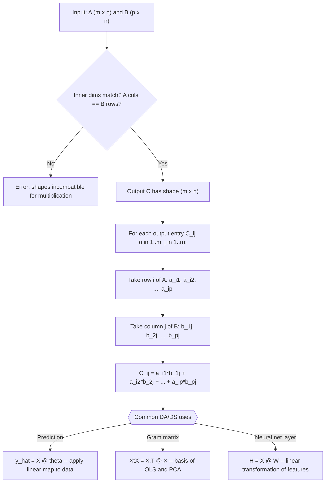

# Matrix multiplication

$$
[AB]_{ij} = \sum_{k} a_{ik} b_{kj}
$$

## Deep Breakdown

What it tells me *(Situation Awareness)*:
Matrix multiplication computes each entry of the output $C = AB$ as the dot product of a row from $A$ with a column from $B$: $[AB]_{ij} = \sum_k a_{ik} b_{kj}$. This requires the inner dimensions to match: if $A$ is $m \times p$ and $B$ is $p \times n$, then $C = AB$ is $m \times n$. Matrix multiplication encodes the composition of linear transformations, which is why it is not commutative ($AB \neq BA$ in general). In DA/DS, matrix multiplication is everywhere: the prediction $\hat{y} = X\theta$ (design matrix times coefficient vector), the normal equation $X^T X$ (Gram matrix), the hidden-layer activations in a neural network $H = XW + b$, and every step of the SVD algorithm.

## Flowchart



## Real-world use

### Where it is used

Used in every linear model prediction ($\hat{y} = X\theta$), in computing the Gram matrix for normal equations ($X^T X$), in multi-layer neural network forward passes, in applying rotation or projection matrices to point clouds, and in computing covariance-weighted scores ($x^T \Sigma^{-1} x$ for Mahalanobis distance).

### Problem it solves

A single matrix multiply represents the application of a linear transformation to all rows (or columns) of a data matrix simultaneously. Without matrix multiplication, you would have to loop over every data point and compute the transformation individually — which is both slow and conceptually fragmented. Matrix multiply bundles all those dot products into a single vectorized operation.

### How it solves the problem

$[AB]_{ij} = \sum_{k=1}^p a_{ik} b_{kj}$: the output at row $i$, column $j$ is the dot product of the $i$-th row of $A$ with the $j$-th column of $B$. NumPy's `A @ B` (or `np.matmul`) calls BLAS routines that exploit CPU SIMD instructions, making this orders of magnitude faster than a Python loop. The shape rule ensures dimensional consistency: the $p$ "inner" dimension is consumed by the summation.

### Example in a business

A marketing analyst builds a linear regression model with $N = 1000$ observations and $p = 6$ features. The model prediction for all observations at once is $\hat{y} = X\theta$: a $(1000 \times 6)$ matrix times a $(6 \times 1)$ column vector gives a $(1000 \times 1)$ prediction vector. The normal equations require $X^T X$ (a $6 \times 6$ Gram matrix, computed as `X.T @ X`) and $X^T y$ (a $6 \times 1$ vector, computed as `X.T @ y`). Three matrix multiplications replace thousands of individual dot products.

## The formula, piece by piece

- $[AB]_{ij}$: the entry at row $i$, column $j$ of the product matrix $C = AB$
- $\sum_k$: sum over the shared (inner) dimension index $k$, running from 1 to $p$ (the number of columns in $A$ = number of rows in $B$)
- $a_{ik}$: entry in row $i$, column $k$ of matrix $A$ (the $k$-th element of the $i$-th row of $A$)
- $b_{kj}$: entry in row $k$, column $j$ of matrix $B$ (the $k$-th element of the $j$-th column of $B$)
- Shape rule: $A$ is $m \times p$, $B$ is $p \times n$, result is $m \times n$; the middle dimension $p$ is consumed Full formula: $[AB]_{ij} = \sum_{k=1}^{p} a_{ik} b_{kj}$

## The formula in words

"Each entry of the product is the dot product of one row from the left matrix with one column from the right matrix. You scan across a row of $A$ and down a column of $B$, multiply pairs, and sum them all up." Tiny numeric example:
$A = \begin{bmatrix}1 & 2 \\ 3 & 4\end{bmatrix}$, $B = \begin{bmatrix}5 & 6 \\ 7 & 8\end{bmatrix}$.
$[AB]_{11} = 1 \cdot 5 + 2 \cdot 7 = 19$, $[AB]_{12} = 1 \cdot 6 + 2 \cdot 8 = 22$.
$[AB]_{21} = 3 \cdot 5 + 4 \cdot 7 = 43$, $[AB]_{22} = 3 \cdot 6 + 4 \cdot 8 = 50$.
$AB = \begin{bmatrix}19 & 22 \\ 43 & 50\end{bmatrix}$.

## Critical Concepts

- **Not commutative:** $AB \neq BA$ in general; even when both products are defined, they typically differ. Predicting with $X\theta$ (correct) vs $\theta X$ (wrong shape or wrong meaning) is the most common error.
- **Shape rule (inner dimensions must match):** if `A.shape = (m, p)` and `B.shape = (p, n)`, then `(A @ B).shape = (m, n)`. If the inner dimensions differ, NumPy raises `ValueError`.
- **Associativity:** $(AB)C = A(BC)$; you can group multiplications in any order. Use this to save computation: multiply smaller matrices first.
- **Distributivity:** $A(B + C) = AB + AC$; matrix multiply distributes over addition.
- **Identity matrix:** $AI = IA = A$; the identity matrix $I$ acts as the multiplicative "one."
- **Cost:** multiplying an $m \times p$ matrix by a $p \times n$ matrix requires $O(mpn)$ multiplications. For large matrices, use optimized BLAS (NumPy does this automatically).
- **Batch matrix multiply:** `np.matmul` (and `@`) broadcast over leading batch dimensions; a $(b, m, p)$ array times a $(b, p, n)$ array gives $(b, m, n)$ without an explicit loop.

## Step-by-step calculation (tiny example)

*Step 1: Verify shape compatibility and determine output shape*
$A$ is $2 \times 3$, $B$ is $3 \times 2$. Inner dimension: $A$ has 3 columns, $B$ has 3 rows. Match ✓. Output $C = AB$ is $2 \times 2$.
$A = \begin{bmatrix}1 & 0 & 2 \\ -1 & 3 & 1\end{bmatrix}$, $B = \begin{bmatrix}3 & 1 \\ 2 & -1 \\ 0 & 4\end{bmatrix}$.

*Step 2: Compute each of the 4 output entries*
$c_{11}$: row 1 of $A$ = $[1, 0, 2]$, col 1 of $B$ = $[3, 2, 0]^T$. $c_{11} = 1\cdot3 + 0\cdot2 + 2\cdot0 = 3$.
$c_{12}$: row 1 of $A$ = $[1, 0, 2]$, col 2 of $B$ = $[1, -1, 4]^T$. $c_{12} = 1\cdot1 + 0\cdot(-1) + 2\cdot4 = 9$.
$c_{21}$: row 2 of $A$ = $[-1, 3, 1]$, col 1 of $B$ = $[3, 2, 0]^T$. $c_{21} = -3+6+0 = 3$.
$c_{22}$: row 2 of $A$ = $[-1, 3, 1]$, col 2 of $B$ = $[1, -1, 4]^T$. $c_{22} = -1-3+4 = 0$.

*Step 3: Assemble result and verify with NumPy*
$AB = \begin{bmatrix}3 & 9 \\ 3 & 0\end{bmatrix}$.
NumPy: `np.array([[1,0,2],[-1,3,1]]) @ np.array([[3,1],[2,-1],[0,4]])` → `[[3, 9], [3, 0]]` ✓.

## Code examples

### Beginner example (Python)

```python
import numpy as np   # -- Matrix multiplication: entry-level mechanics and shape rules ------
A = np.array([[1.0, 0.0, 2.0], [-1.0, 3.0, 1.0]])   # shape: (2, 3)
B = np.array([[3.0, 1.0], [2.0, -1.0], [0.0, 4.0]])   # shape: (3, 2)
C = A @ B   # same as
np.matmul(A, B)
print(f"A shape: {A.shape}, B shape: {B.shape}")
print(f"C = A @ B shape: {C.shape} (should be (2, 2))")
print(f"\nC:\n{C}")   # Show that AB != BA in general (when both are square, compare)
A_sq = np.array([[1.0, 2.0], [3.0, 4.0]])
B_sq = np.array([[5.0, 6.0], [7.0, 8.0]])
print(f"\nAB:\n{A_sq @ B_sq}")
print(f"\nBA:\n{B_sq @ A_sq}")
print(f"\nAB == BA: {np.allclose(A_sq @ B_sq, B_sq @ A_sq)}")   # should be False
```

### Beginner example (R)

```r
# -- Matrix multiplication: entry-level mechanics and shape rules ------
A <- matrix(c(1, 0, 2, -1, 3, 1), nrow = 2, byrow = TRUE)  # (2 x 3)
B <- matrix(c(3, 1, 2, -1, 0, 4), nrow = 3, byrow = TRUE)  # (3 x 2)
C <- A %*% B  # matrix multiply in R
cat(sprintf("A: %d x %d, B: %d x %d\n", nrow(A), ncol(A), nrow(B), ncol(B)))
cat(sprintf("C = A %%*%% B: %d x %d\n", nrow(C), ncol(C)))
print(C)  # Non-commutativity
A_sq <- matrix(c(1, 2, 3, 4), nrow = 2, byrow = TRUE)
B_sq <- matrix(c(5, 6, 7, 8), nrow = 2, byrow = TRUE)
cat("\nAB:\n"); print(A_sq %*% B_sq)
cat("\nBA:\n"); print(B_sq %*% A_sq)
cat(sprintf("AB == BA: %s\n", isTRUE(all.equal(A_sq %*% B_sq, B_sq %*% A_sq))))
```

### Professional example (Python)

```python
import numpy as np
import pandas as pd
np.random.seed(42)   # -- Business scenario: multi-channel attribution model predictions
# Design matrix X (N x p): N weekly observations, p media spend features.
# Coefficient matrix W (p x K): maps each feature to K attribution outputs.
# Prediction: Y_hat = X @ W, shape (N x K) -- all channels and periods at once.
N_WEEKS = 104   # 2 years
N_CHANNELS = 5
N_KPIS = 3   # conversions, revenue, brand_lift
CHANNEL_NAMES = ["tv", "digital", "search", "print", "radio"]
KPI_NAMES = ["conversions", "revenue_eur", "brand_lift"]   # Simulate design matrix (standardized spend)
X = np.random.normal(0, 1, size=(N_WEEKS, N_CHANNELS))   # True coefficient matrix (channels x KPIs)
W_true = np.array([ [0.3, 500.0, 0.05],   # tv
    [0.8, 1200.0, 0.02],   # digital
    [1.2, 2000.0, 0.01],   # search
    [0.1, 300.0, 0.03],   # print
    [0.05, 150.0, 0.01],   # radio
])   # Multi-output prediction via single matrix multiply
Y_hat = X @ W_true   # shape: (104, 3)
noise = np.random.normal(0, [0.05, 80.0, 0.005], size=(N_WEEKS, N_KPIS))
Y = Y_hat + noise
print(f"Design matrix X shape: {X.shape} (weeks x channels)")
print(f"Coefficient matrix W : {W_true.shape} (channels x KPIs)")
print(f"Prediction Y_hat shape: {Y_hat.shape} (weeks x KPIs)")   # Solve for W via normal equations (OLS per-KPI, vectorized)
XtX = X.T @ X   # (p x p) Gram matrix
XtY = X.T @ Y   # (p x K) right-hand side
W_hat = np.linalg.solve(XtX, XtY)   # (p x K)
coef_df = pd.DataFrame( np.column_stack([W_true, W_hat]), index=CHANNEL_NAMES, columns=[f"{k}_true" for k in KPI_NAMES] + [f"{k}_est" for k in KPI_NAMES],
)
print(f"\nTrue vs estimated coefficients:")
print(coef_df.round(3).to_string())
print("\nInterpretation: single matrix multiply X @ W simultaneously applies the linear attribution model to all N weeks and all K KPIs.")
```

### Professional example (R)

```r
# Multi-output prediction
Y_hat = X %*% W (matrix multiplication)
set.seed(42)
N_WEEKS <- 104
N_CHANNELS <- 5
N_KPIS <- 3
X <- matrix(rnorm(N_WEEKS * N_CHANNELS), nrow = N_WEEKS)
W_true <- matrix(c(0.3, 500, 0.05, 0.8, 1200, 0.02, 1.2, 2000, 0.01, 0.1, 300, 0.03, 0.05, 150, 0.01), nrow = N_CHANNELS, byrow = TRUE)
Y_hat <- X %*% W_true
Y <- Y_hat + matrix(rnorm(N_WEEKS * N_KPIS, 0, c(0.05, 80, 0.005)), nrow = N_WEEKS, ncol = N_KPIS, byrow = TRUE)
XtX <- t(X) %*% X
XtY <- t(X) %*% Y
W_hat <- solve(XtX, XtY)
cat("True vs estimated W (first column):\n")
print(data.frame(true = W_true[,1], est = W_hat[,1]))
```

---

*Source: 1300 p. 119*
