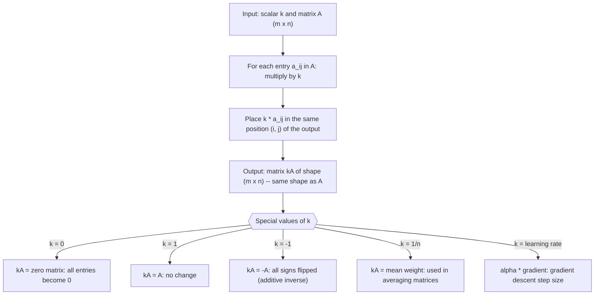

# Scalar multiplication

$$
[kA]_{ij} = k a_{ij}
$$

## Deep Breakdown

What it tells me *(Situation Awareness)*:
Scalar multiplication scales every entry of a matrix by the same constant $k$: $[kA]_{ij} = k \cdot a_{ij}$. The shape of the matrix is unchanged; only the magnitudes change. This is the simplest way to stretch or shrink a matrix uniformly. In DA/DS, scalar multiplication appears in: the learning rate update $W \leftarrow W - \alpha \nabla L$ (scaling the gradient by $\alpha$), normalizing a covariance matrix to a correlation matrix (multiplying by $1/\sigma_i \sigma_j$ is scalar-like per-entry), averaging $n$ matrices $\bar{A} = \frac{1}{n}\sum A_k$ (scaling the sum by $1/n$), and rescaling feature matrices to change units or range.

## Flowchart



## Real-world use

### Where it is used

Used in gradient descent (scaling gradients by learning rate), normalizing feature matrices (dividing by standard deviation), averaging model updates in federated learning ($\bar{\Delta W} = \frac{1}{n}\sum_i \Delta W_i$), applying regularization coefficients ($\lambda I$), and rescaling predictions to business units (multiplying by price per unit).

### Problem it solves

Many algorithms produce matrices that are off by a constant factor from what you need: gradients need to be dampened before applying to weights, covariance matrices need to be normalized, partial sums need to be averaged. Scalar multiplication handles all of these in a single vectorized operation without changing the matrix structure.

### How it solves the problem

Since every entry is multiplied by the same $k$, the operation is fully vectorized (no cross-entry interactions) and shape-preserving. In NumPy, `k * A` or `A * k` broadcasts the scalar across the entire array using BLAS-level operations. The result maintains all structural properties of $A$ (symmetry, sign patterns of rows/columns) up to a global scale.

### Example in a business

A data scientist trains a neural network on a marketing attribution dataset. After one backward pass, the gradient matrix $G$ has shape $(5, 3)$ (5 channels, 3 KPI outputs). The weight update is $W \leftarrow W - \alpha G$ where $\alpha = 0.001$. Computing $\alpha G = 0.001 \cdot G$ via scalar multiplication scales down the gradient before subtracting it from $W$. Without this scaling, the update step would be too large and the loss would diverge.

## The formula, piece by piece

- $k$: the scalar (a single real number); it can be any value, positive, negative, or zero
- $A$: the matrix being scaled; shape $m \times n$
- $[kA]_{ij}$: the entry at row $i$, column $j$ of the result; equals $k$ times the corresponding entry of $A$
- $a_{ij}$: the entry of the original matrix $A$ at position $(i, j)$
- The result $kA$ has the same shape as $A$ Full formula: $[kA]_{ij} = k \cdot a_{ij}$ for all $1 \leq i \leq m$, $1 \leq j \leq n$

## The formula in words

"Multiply every single number in the matrix by $k$. The grid structure and dimensions stay the same; only the values change, all by the same factor." Tiny numeric example ($k = 3$):
$A = \begin{bmatrix}1 & -2 \\ 0 & 4\end{bmatrix}$, $3A = \begin{bmatrix}3 & -6 \\ 0 & 12\end{bmatrix}$.
Each entry tripled. Zero stays zero. Negative values stay negative (just three times as negative).

## Critical Concepts

- **Shape invariance:** $kA$ has the same dimensions as $A$. Scalar multiplication never changes shape.
- **Distributivity over matrix addition:** $k(A + B) = kA + kB$; distributes across matrices.
- **Distributivity over scalar addition:** $(k_1 + k_2)A = k_1 A + k_2 A$.
- **Associativity with matrix multiply:** $k(AB) = (kA)B = A(kB)$; the scalar can be absorbed into either factor.
- **Effect on determinant:** $\det(kA) = k^n \det(A)$ for an $n \times n$ matrix; scaling a matrix by $k$ scales its determinant by $k^n$, not $k$.
- **Effect on eigenvalues:** eigenvalues of $kA$ are $k$ times the eigenvalues of $A$; eigenvectors are unchanged.
- **Gradient descent:** the learning rate $\alpha$ is the scalar in $W \leftarrow W - \alpha \nabla L$. Choosing $\alpha$ too large causes divergence; too small causes slow convergence.
- **Normalization:** dividing a matrix by its Frobenius norm ($\|A\|_F = \sqrt{\sum_{ij} a_{ij}^2}$) is scalar multiplication by $1/\|A\|_F$, and produces a unit-Frobenius-norm matrix.

## Step-by-step calculation (tiny example)

*Step 1: Identify the scalar and the matrix*
$k = -0.5$, $A = \begin{bmatrix}4 & -2 & 0 \\ 8 & 6 & 10\end{bmatrix}$.
Output will have the same shape: $2 \times 3$.

*Step 2: Multiply each entry by k*
Row 1: $-0.5 \cdot 4 = -2$, $-0.5 \cdot (-2) = 1$, $-0.5 \cdot 0 = 0$.
Row 2: $-0.5 \cdot 8 = -4$, $-0.5 \cdot 6 = -3$, $-0.5 \cdot 10 = -5$.

*Step 3: Assemble result and verify sum*
$kA = \begin{bmatrix}-2 & 1 & 0 \\ -4 & -3 & -5\end{bmatrix}$.
Sanity check: $\text{sum}(kA) = k \cdot \text{sum}(A) = -0.5 \cdot (4-2+0+8+6+10) = -0.5 \cdot 26 = -13$.
$-2+1+0-4-3-5 = -13$ ✓.

## Code examples

### Beginner example (Python)

```python
import numpy as np

# -- Scalar multiplication: mechanics + learning rate demo -------------
A = np.array([[4.0, -2.0, 0.0], [8.0, 6.0, 10.0]])
SCALE_FACTOR = -0.5
B = SCALE_FACTOR * A
print(f"Original A:\n{A}")
print(f"\n{SCALE_FACTOR} * A:\n{B}")
print(f"\nShapes: A={A.shape}, B={B.shape} (same shape)")

# Verify distributivity: k(A + C) == kA + kC
C = np.ones_like(A)
lhs = SCALE_FACTOR * (A + C)
rhs = SCALE_FACTOR * A + SCALE_FACTOR * C
print(f"\nk(A + C) == kA + kC: {np.allclose(lhs, rhs)}")

# Gradient descent weight update
ALPHA = 0.01   # learning rate
W = np.array([[1.0, 2.0], [3.0, 4.0], [5.0, 6.0]])
grad_W = np.array([[0.5, -0.2], [0.1, 0.3], [-0.4, 0.6]])
W_new = W - ALPHA * grad_W   # scalar multiplication then subtraction
print(f"\nGradient descent: W - alpha * grad_W:")
print(W_new.round(4))
```

### Beginner example (R)

```r
# -- Scalar multiplication: mechanics + learning rate demo -------------
A <- matrix(c(4, -2, 0, 8, 6, 10), nrow = 2, byrow = TRUE)
SCALE_FACTOR <- -0.5
B <- SCALE_FACTOR * A
cat("Original A:\n"); print(A)
cat(sprintf("\n%.1f * A:\n", SCALE_FACTOR)); print(B)
cat(sprintf("Shape unchanged: %s\n", paste(dim(B), collapse = " x ")))

# Distributivity check
C <- matrix(1, nrow = nrow(A), ncol = ncol(A))
lhs <- SCALE_FACTOR * (A + C)
rhs <- SCALE_FACTOR * A + SCALE_FACTOR * C
cat(sprintf("\nk(A+C) == kA + kC: %s\n", isTRUE(all.equal(lhs, rhs))))

# Gradient descent
ALPHA <- 0.01
W <- matrix(seq(1, 6), nrow = 3, byrow = TRUE)
grad_W <- matrix(c(0.5, -0.2, 0.1, 0.3, -0.4, 0.6), nrow = 3, byrow = TRUE)
W_new <- W - ALPHA * grad_W
cat("\nUpdated weights:\n"); print(round(W_new, 4))
```

### Professional example (Python)

```python
import numpy as np
import pandas as pd
np.random.seed(42)

# -- Business scenario: federated model averaging via scalar multiplication
# K clients each train a model and return gradient updates Delta_W_k.
# Server averages them: W_global = W_global - (1/K) * sum_k(Delta_W_k)
# The (1/K) factor is scalar multiplication by the averaging weight.
N_CLIENTS = 5
N_IN = 8    # input features
N_OUT = 3   # output classes
CLIENT_NAMES = [f"client_{k}" for k in range(N_CLIENTS)]

# Simulate per-client gradient updates (as if from one SGD step)
delta_W_list = [np.random.normal(0, 0.1, size=(N_IN, N_OUT)) for _ in range(N_CLIENTS)]

# Federated averaging: W_new = W_old - learning_rate * (1/K) * sum(Delta_W_k)
LEARNING_RATE = 0.01
W_global = np.zeros((N_IN, N_OUT))

# Step 1: sum all client updates
sum_delta = np.sum(delta_W_list, axis=0)   # matrix addition

# Step 2: scalar multiplication to average (1/K) and apply learning rate
averaged_update = (1.0 / N_CLIENTS) * sum_delta   # scalar mult by 1/K
step = LEARNING_RATE * averaged_update            # scalar mult by lr
W_global = W_global - step

# Report norms to confirm convergence behavior
print(f"Number of clients: {N_CLIENTS}")
print(f"Gradient update shape: {delta_W_list[0].shape}")
print(f"\nPer-client update Frobenius norms:")
for name, dW in zip(CLIENT_NAMES, delta_W_list):
    print(f" {name}: {np.linalg.norm(dW):.4f}")
print(f"\nAveraged update norm (1/K * sum): {np.linalg.norm(averaged_update):.4f}")
print(f"Step norm (lr * averaged update): {np.linalg.norm(step):.6f}")
print(f"\nFinal W_global (first row): {W_global[0].round(6)}")
print("\nInterpretation: scalar multiplication by 1/K is the key operation in federated averaging; it prevents larger clients from dominating the global model update.")
```

### Professional example (R)

```r
# Federated averaging: (1/K) * sum(Delta_W_k) (scalar multiplication)
set.seed(42)
N_CLIENTS <- 5
N_IN <- 8
N_OUT <- 3
delta_W_list <- lapply(1:N_CLIENTS, function(k) matrix(rnorm(N_IN * N_OUT, 0, 0.1), nrow = N_IN))
sum_delta <- Reduce("+", delta_W_list)
averaged_update <- (1 / N_CLIENTS) * sum_delta
LEARNING_RATE <- 0.01
step <- LEARNING_RATE * averaged_update
W_global <- -step
cat(sprintf("Averaged update norm: %.4f Step norm: %.6f\n", sqrt(sum(averaged_update^2)), sqrt(sum(step^2))))
cat("Scalar mult by 1/K is key in federated averaging.\n")
```

---

*Source: 1300 p. 119*
