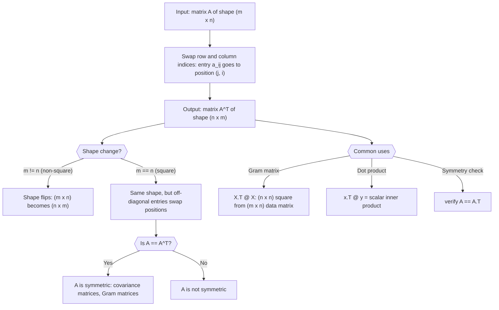

# Transpose

$$
[A^T]_{ij} = a_{ji}
$$

## Deep Breakdown

What it tells me *(Situation Awareness)*:
The transpose $A^T$ flips a matrix over its main diagonal: the entry at row $i$, column $j$ of $A$ becomes the entry at row $j$, column $i$ of $A^T$. If $A$ is $m \times n$, then $A^T$ is $n \times m$ — rows and columns are swapped. In DA/DS, transpose is ubiquitous: the Gram matrix for normal equations is $X^T X$ (transpose is how you "turn a data matrix into a square covariance-like matrix"), the hat matrix is $H = X(X^T X)^{-1} X^T$, every dot product can be written as $x^T y$, and verifying that a matrix is symmetric means checking $A = A^T$. Understanding transpose is prerequisite to reading any linear algebra formula.

## Flowchart



## Real-world use

### Where it is used

Used to form the Gram matrix ($X^T X$) for least-squares normal equations, to convert a column vector to a row vector for dot product notation ($x^T y$), to check symmetry of covariance matrices ($\Sigma = \Sigma^T$), in the QR decomposition property $(QR)^T = R^T Q^T$, and in deriving the backpropagation gradient of a linear layer ($\partial L / \partial W = x \delta^T$, shape of $W$ is recovered by keeping track of which dimension is transposed).

### Problem it solves

Linear algebra formulas frequently need to align dimensions. A data matrix $X$ is $N \times p$ (observations × features). To compute pairwise feature covariances you need a $p \times p$ matrix, which requires $X^T X$. Without transpose, you could not turn a tall data matrix into a square matrix suitable for inversion or eigendecomposition.

### How it solves the problem

$[A^T]_{ij} = a_{ji}$ swaps every row and column index. This turns a column vector $(n \times 1)$ into a row vector $(1 \times n)$, enabling the dot product $x^T y$. It turns a tall data matrix $(N \times p)$ into a wide matrix $(p \times N)$, enabling $X^T X$ to be $p \times p$. And it is its own inverse: $(A^T)^T = A$.

### Example in a business

A data scientist solves OLS regression for a media mix model with $N = 200$ weeks and $p = 5$ channels. The design matrix $X$ is $200 \times 5$. The normal equations require: (1) $X^T X$ (shape $5 \times 5$, invertible if columns are linearly independent), (2) $X^T y$ (shape $5 \times 1$). Both require transposing $X$. Without the transpose operation, the shapes are incompatible: $X X$ is undefined (inner dims: 5 vs 200).

## The formula, piece by piece

- $A^T$: the transpose of $A$; the superscript $T$ (or sometimes $'$ in some texts) denotes transpose
- $[A^T]_{ij}$: the entry at row $i$, column $j$ of the transposed matrix
- $a_{ji}$: the entry at row $j$, column $i$ of the original matrix $A$; the indices are swapped (row becomes column and vice versa)
- Shape: if $A$ is $m \times n$, then $A^T$ is $n \times m$ Full formula: $[A^T]_{ij} = a_{ji}$ for all valid $i$, $j$

## The formula in words

"To transpose a matrix, flip it over its main diagonal. Rows become columns and columns become rows. The entry that was in row $j$, column $i$ of the original is now in row $i$, column $j$ of the transpose." Tiny numeric example:
$A = \begin{bmatrix}1 & 2 & 3 \\ 4 & 5 & 6\end{bmatrix}$ (shape $2 \times 3$).
$A^T = \begin{bmatrix}1 & 4 \\ 2 & 5 \\ 3 & 6\end{bmatrix}$ (shape $3 \times 2$).
Row 1 of $A$ ($[1, 2, 3]$) became column 1 of $A^T$. Row 2 of $A$ ($[4, 5, 6]$) became column 2 of $A^T$.

## Critical Concepts

- **Shape flip:** $A$ is $m \times n$, $A^T$ is $n \times m$. Non-square matrices change shape; square matrices keep the same shape but their off-diagonal entries swap.
- **Double transpose:** $(A^T)^T = A$; transposing twice returns the original matrix.
- **Transpose of product:** $(AB)^T = B^T A^T$; order reverses. This is why the gradient of $XW$ with respect to $W$ involves $X^T$.
- **Transpose of sum:** $(A + B)^T = A^T + B^T$; distributes over addition.
- **Symmetric matrix:** $A = A^T$; covariance matrices, Gram matrices $X^T X$, and Laplacian matrices are always symmetric.
- **Anti-symmetric matrix:** $A = -A^T$; diagonal entries must be zero.
- **Orthogonal matrix:** $Q^T Q = I$ (columns are orthonormal); in this case $Q^T = Q^{-1}$, making the transpose equivalent to the inverse.
- **In NumPy:** `A.T` or `np.transpose(A)`.

For batched arrays (3D+), `np.transpose` lets you specify which axes to swap.

## Step-by-step calculation (tiny example)

*Step 1: Write the original matrix and note its shape*
$A = \begin{bmatrix}3 & -1 \\ 0 & 2 \\ 5 & 4\end{bmatrix}$. Shape: $3 \times 2$ (3 rows, 2 columns).
After transposing: shape will be $2 \times 3$.

*Step 2: Map each entry to its transposed position*
$a_{11}=3 \to [A^T]_{11}=3$. $a_{12}=-1 \to [A^T]_{21}=-1$.
$a_{21}=0 \to [A^T]_{12}=0$. $a_{22}=2 \to [A^T]_{22}=2$.
$a_{31}=5 \to [A^T]_{13}=5$. $a_{32}=4 \to [A^T]_{23}=4$.

*Step 3: Assemble the transposed matrix and verify with double transpose*
$A^T = \begin{bmatrix}3 & 0 & 5 \\ -1 & 2 & 4\end{bmatrix}$ (shape $2 \times 3$ ✓).
$(A^T)^T = A$ ✓ (rows of $A^T$ are columns of $A$).

## Code examples

### Beginner example (Python)

```python
import numpy as np   # -- Transpose: mechanics, shape change, and symmetry check -----------
A = np.array([[3.0, -1.0], [0.0, 2.0], [5.0, 4.0]])
A_T = A.T
print(f"A shape: {A.shape} (m x n = {A.shape[0]} x {A.shape[1]})")
print(f"A.T shape: {A_T.shape} (n x m = {A_T.shape[0]} x {A_T.shape[1]})")
print(f"\nA:\n{A}")
print(f"\nA.T:\n{A_T}")   # Double transpose property
print(f"\n(A.T).T == A: {np.allclose((A.T).T, A)}")   # Product transpose: (AB)^T == B^T A^T
B = np.array([[1.0, 2.0, 3.0], [4.0, 5.0, 6.0]])   # shape (2, 3): compatible for B @ A (3x2)
# A is (3x2), B is (2x3), so A@B is (3x3)
AB = A @ B
print(f"\n(A @ B).T shape: {(A @ B).T.shape}")
print(f"B.T @ A.T shape: {(B.T @ A.T).shape}")
print(f"(AB)^T == B^T A^T: {np.allclose((A @ B).T, B.T @ A.T)}")   # Symmetry: X.T @ X is always symmetric
X = np.random.default_rng(42).normal(size=(5, 3))
XtX = X.T @ X
print(f"\nX.T @ X is symmetric: {np.allclose(XtX, XtX.T)}")
```

### Beginner example (R)

```r
# -- Transpose: mechanics, shape change, and symmetry check -----------
A <- matrix(c(3, -1, 0, 2, 5, 4), nrow = 3, byrow = TRUE)
A_t <- t(A)  # R function for transpose
cat(sprintf("A shape: %d x %d\n", nrow(A), ncol(A)))
cat(sprintf("t(A) shape: %d x %d\n", nrow(A_t), ncol(A_t)))
cat("\nA:\n"); print(A)
cat("\nt(A):\n"); print(A_t)  # Double transpose
cat(sprintf("\nt(t(A)) == A: %s\n", isTRUE(all.equal(t(A_t), A))))  # Product transpose: (AB)^T == B^T A^T
B <- matrix(1:6, nrow = 2, byrow = TRUE)
cat(sprintf("(A %%*%% B).T == t(B) %%*%% t(A): %s\n", isTRUE(all.equal(t(A %*% B), t(B) %*% t(A)))))  # Symmetry: X^T X is always symmetric
set.seed(42)
X <- matrix(rnorm(15), nrow = 5)
XtX <- t(X) %*% X
cat(sprintf("X^T X is symmetric: %s\n", isTRUE(all.equal(XtX, t(XtX)))))
```

### Professional example (Python)

```python
import numpy as np
import pandas as pd
np.random.seed(42)   # -- Business scenario: OLS regression normal equations using transpose
# The entire solve depends on X.T for both the Gram matrix and the right-hand side.
N_OBS = 250
N_CHANNELS = 6
CHANNEL_NAMES = ["tv", "digital", "search", "social", "print", "radio"]
LAMBDA = 0.5   # ridge regularization # Simulate design matrix (standardized channel spend)
X = np.random.normal(0, 1, size=(N_OBS, N_CHANNELS))
true_coefs = np.array([0.4, 1.1, 0.9, 0.7, 0.2, 0.1])
y = X @ true_coefs + np.random.normal(0, 0.4, N_OBS)   # OLS via normal equations -- both require X.T
XtX = X.T @ X   # (p x p) Gram matrix
Xty = X.T @ y   # (p,) right-hand side
XtX_reg = XtX + LAMBDA * np.eye(N_CHANNELS)   # ridge regularization
theta = np.linalg.solve(XtX_reg, Xty)   # Verify symmetry of Gram matrix
is_symmetric = bool(np.allclose(XtX, XtX.T))
cond_XtX = float(np.linalg.cond(XtX_reg))
residuals = y - X @ theta
r_squared = float(1 - np.sum(residuals**2) / np.sum((y - y.mean())**2))
print(f"Design matrix X shape: {X.shape}")
print(f"X.T shape: {X.T.shape} (used to build Gram matrix and Xty)")
print(f"X.T @ X shape: {XtX.shape} (square Gram matrix)")
print(f"X.T @ X is symmetric: {is_symmetric}")
print(f"Condition number (regularized): {cond_XtX:.1f}")
print(f"R-squared: {r_squared:.4f}")
print(f"\nCoefficients (true vs estimated):")
coef_df = pd.DataFrame({ "channel": CHANNEL_NAMES, "true": true_coefs, "estimated": theta.round(4), "error": np.abs(theta - true_coefs).round(4),
})
print(coef_df.to_string(index=False))
print("\nInterpretation: the transpose operation is what allows the (250 x 6) data matrix to produce a (6 x 6) invertible Gram matrix and (6,) right-hand side for OLS.")
```

### Professional example (R)

```r
# OLS normal equations:
XtX = t(X) %*% X, Xty = t(X) %*% y
set.seed(42)
N_OBS <- 250
N_CHANNELS <- 6
LAMBDA <- 0.5
X <- matrix(rnorm(N_OBS * N_CHANNELS), nrow = N_OBS)
true_coefs <- c(0.4, 1.1, 0.9, 0.7, 0.2, 0.1)
y <- X %*% true_coefs + rnorm(N_OBS, 0, 0.4)
XtX <- t(X) %*% X
Xty <- t(X) %*% y
XtX_reg <- XtX + LAMBDA * diag(N_CHANNELS)
theta <- solve(XtX_reg, Xty)
is_symmetric <- isTRUE(all.equal(XtX, t(XtX)))
residuals <- y - X %*% theta
r_squared <- 1 - sum(residuals^2) / sum((y - mean(y))^2)
cat(sprintf("X.T @ X symmetric: %s R-squared: %.4f\n", is_symmetric, r_squared))
print(data.frame(channel = c("tv", "digital", "search", "social", "print", "radio"), true = true_coefs, estimated = round(as.vector(theta), 4)))
```

---

*Source: 1300 p. 120*
