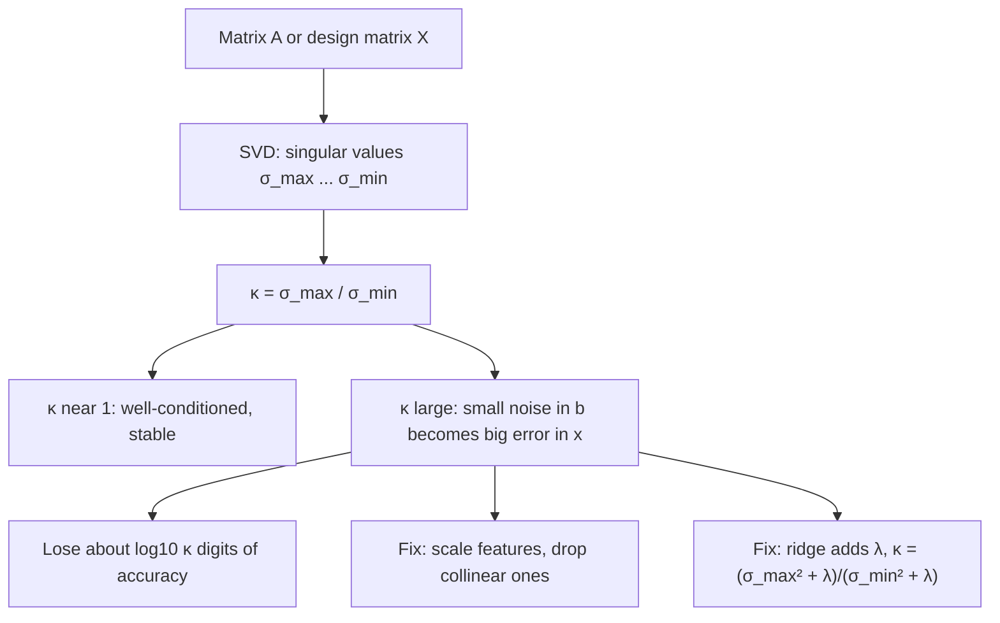

# Condition Number (matrix conditioning)

$$
\kappa(A) = \lVert A \rVert_2 \, \lVert A^{-1} \rVert_2 = \frac{\sigma_{\max}(A)}{\sigma_{\min}(A)}, \qquad \frac{\lVert \delta x \rVert}{\lVert x \rVert} \le \kappa(A)\, \frac{\lVert \delta b \rVert}{\lVert b \rVert}
$$

, where $\sigma_{\max}$ and $\sigma_{\min}$ are the largest and smallest singular values of $A$, and $Ax = b$, $A(x + \delta x) = b + \delta b$

## Deep Breakdown

What it tells me *(Situation Awareness)*:
The condition number measures how much a matrix can amplify relative errors when we solve $Ax = b$ (or invert $A$, or fit a regression). It is the ratio of the strongest to the weakest stretching the matrix applies to any direction. $\kappa = 1$ (orthogonal matrices) is perfect: a 1% change in the data moves the solution by at most 1%. A large $\kappa$ means some direction is almost squashed flat, so tiny noise in $b$ along that direction gets divided by a tiny $\sigma_{\min}$ and explodes in $x$. A matrix can have a determinant that looks harmless and still be terribly conditioned (the determinant depends on scale, $\kappa$ does not), and $\kappa = \infty$ means singular. Rule of thumb: you lose about $\log_{10}\kappa$ significant digits; with float64 (about 16 digits), $\kappa \approx 10^{12}$ leaves only about 4 trustworthy digits. In DA/DS: diagnosing multicollinearity in linear and logistic regression (unstable, sign-flipping coefficients), choosing ridge regularization, deciding to standardize features, explaining why the normal equations $X^\top X\beta = X^\top y$ are worse than QR/SVD solvers ($\kappa(X^\top X) = \kappa(X)^2$), checking covariance matrices before inverting them (Mahalanobis distance, Gaussian models, portfolio optimization), and understanding slow convergence of gradient descent on ill-conditioned losses.

## Flowchart



## Real-world use

### Where it is used

Regression diagnostics (`numpy.linalg.cond(X)`, statsmodels warns "The condition number is large ... strong multicollinearity"); numerical linear algebra libraries choosing solvers; covariance estimation in finance and Gaussian models (inverting a near-singular covariance); optimization (gradient descent converges in a number of steps roughly proportional to $\kappa$ of the Hessian); calibration and sensor-fusion systems; scientific computing error analysis.

### Problem it solves

A model can produce precise-looking numbers that are pure noise. With strongly correlated features (e.g. `marketing_spend` and `impressions`), the fitted coefficients can swing wildly or flip sign when a handful of rows change, even though predictions barely move. The condition number quantifies that fragility *before* we trust or report the coefficients.

### How it solves the problem

Write $A = U \Sigma V^\top$ (SVD). Solving $Ax = b$ divides each component of $U^\top b$ by a singular value. Noise in the direction of the smallest singular value is amplified by $1/\sigma_{\min}$ while the signal is typically carried by large singular values; the worst-case ratio of relative output error to relative input error is exactly $\sigma_{\max}/\sigma_{\min}$. Once diagnosed, we can improve conditioning: standardize columns, remove or combine collinear features, use an orthogonal decomposition (QR/SVD) instead of forming $X^\top X$, or add ridge regularization $X^\top X + \lambda I$, which lifts every squared singular value by $\lambda$ and so shrinks $\kappa$ dramatically.

### Example in a business

A marketing-mix model regresses weekly sales on TV spend, online spend and total spend, where total spend is almost the sum of the other two. Even after standardizing, $\kappa(X)$ is about 89 (so $\kappa(X^\top X)$ is about 7,900), and refitting on bootstrap samples gives a TV coefficient that ranges from negative to strongly positive, so the CMO hears "TV hurts sales" one week and "TV is our best channel" the next. Dropping the redundant column and adding a small ridge penalty brings $\kappa$ down to single digits, and the channel coefficients become stable enough to inform budget allocation.

## The formula, piece by piece

- $A$: square matrix of a linear system $Ax = b$ (or the design matrix $X$ in regression, using its singular values)
- $\lVert A \rVert_2 = \sigma_{\max}(A)$: the largest factor by which $A$ can stretch a vector
- $\lVert A^{-1} \rVert_2 = 1/\sigma_{\min}(A)$: the largest factor by which the inverse can stretch, huge when $A$ is nearly singular
- $\sigma_{\max}, \sigma_{\min}$: largest and smallest singular values (see [[singular_value_decomposition]]); for symmetric positive definite $A$ these are the largest and smallest eigenvalues
- $\kappa(A) \ge 1$: equals 1 for orthogonal/scaled-orthogonal matrices, $\infty$ for singular matrices
- $\delta b$: perturbation of the right-hand side (measurement noise, rounding, a few changed rows)
- $\delta x$: resulting change in the solution
- $\frac{\lVert \delta x \rVert}{\lVert x \rVert} \le \kappa \frac{\lVert \delta b \rVert}{\lVert b \rVert}$: the amplification bound; $\kappa$ is the worst-case multiplier of relative error
- $\kappa(X^\top X) = \kappa(X)^2$: forming the normal equations squares the condition number
- Ridge: $\kappa(X^\top X + \lambda I) = \frac{\sigma_{\max}^2 + \lambda}{\sigma_{\min}^2 + \lambda}$, always smaller than $\kappa(X)^2$ for $\lambda \gt 0$ (see [[ridge_regression_solution_l_2_penalty]])

## The formula in words

"The condition number is the worst-case factor by which a relative error in the inputs can grow in the solution; it equals the ratio of the largest to the smallest stretch the matrix applies." Tiny example: $A = \text{diag}(10, 0.1)$ stretches one axis by 10 and squashes the other to 0.1, so $\kappa = 10/0.1 = 100$; a 1% error in $b$ can become up to a 100% error in $x$.

## Critical Concepts

- **Scale-free, unlike the determinant:** $\det(cA) = c^n \det(A)$ but $\kappa(cA) = \kappa(A)$. A tiny determinant does not by itself mean ill-conditioning, and a moderate one does not rule it out. Use $\kappa$, not $\det$, to judge near-singularity (see [[inverse_matrix_22]]).
- **Digits lost:** relative error in the computed solution is roughly $\kappa \times$ machine epsilon ($2.2 \times 10^{-16}$ for float64). $\kappa = 10^{3}$ is harmless; $\kappa \gt 10^{10}$ deserves attention; $\kappa \approx 10^{16}$ means numerically singular.
- **Never form the inverse to solve:** use `np.linalg.solve`, `lstsq`, QR or Cholesky. Explicit inversion and the normal equations square or worsen the error.
- **Multicollinearity in regression:** a large $\kappa(X)$ after standardizing columns signals near-linear dependence among features. Complement with VIFs to identify *which* features are involved. Statsmodels' warning is based on $\kappa$ of the unscaled design, so standardize first to separate units problems from real collinearity.
- **Ridge improves conditioning:** adding $\lambda I$ raises the smallest eigenvalue of $X^\top X$ from $\sigma_{\min}^2$ to $\sigma_{\min}^2 + \lambda$, the reason ridge gives stable coefficients under collinearity, at the price of some bias.
- **Optimization link:** for a quadratic loss with Hessian $H$, gradient descent needs on the order of $\kappa(H)$ iterations; feature scaling and preconditioning (Adam, Newton-type methods) attack exactly this.

## Step-by-step calculation (tiny example)

*$A = \begin{pmatrix} 1 & 1 \\ 1 & 1.01 \end{pmatrix}$, $b = (2, 2.01)$. Exact solution $x = (1, 1)$.*

*Step 1: Singular values*
$A$ is symmetric positive definite, so its singular values are its eigenvalues: $\sigma_{\max} = 2.0050$, $\sigma_{\min} = 0.0049875$.

*Step 2: Condition number*
$\kappa = 2.0050 / 0.0049875 = 402.0$. Expect to lose about $\log_{10} 402 = 2.6$ digits.

*Step 3: Perturb b slightly*
$b' = (2, 2.02)$, so $\delta b = (0, 0.01)$ and $\lVert \delta b \rVert / \lVert b \rVert = 0.01 / 2.8355 = 0.0035$ (0.35%).

*Step 4: New solution*
Solving $A x' = b'$ gives $x' = (0, 2)$, so $\delta x = (-1, 1)$ and $\lVert \delta x \rVert / \lVert x \rVert = 1.4142 / 1.4142 = 1$ (100%).

*Step 5: Check the bound*
Amplification $= 1 / 0.003527 = 283.6 \le \kappa = 402.0$. $\checkmark$ A 0.35% change in the data produced a 100% change in the answer.

*Step 6: Normal equations and ridge*
$\kappa(A^\top A) = 402.0^2 = 161{,}610$. With ridge $\lambda = 0.1$: $\kappa(A^\top A + 0.1 I) = (4.0201 + 0.1)/(0.0000249 + 0.1) = 41.2$, about 3,900 times better conditioned.

## Code examples

### Beginner example (Python)

```python
import numpy as np

A = np.array([[1.0, 1.0], [1.0, 1.01]])
b = np.array([2.0, 2.01])
b_perturbed = np.array([2.0, 2.02])

s = np.linalg.svd(A, compute_uv=False)
kappa = s[0] / s[-1]
print(f"singular values: {s.round(7)}")                     # [2.0050125 0.0049875]
print(f"kappa = {kappa:.1f} (np.linalg.cond: {np.linalg.cond(A):.1f})")  # 402.0

x = np.linalg.solve(A, b)
x_new = np.linalg.solve(A, b_perturbed)
rel_in = np.linalg.norm(b_perturbed - b) / np.linalg.norm(b)
rel_out = np.linalg.norm(x_new - x) / np.linalg.norm(x)
print(f"x = {x.round(4)}, x' = {x_new.round(4)}")           # [1. 1.] -> [0. 2.]
print(f"relative change in b: {rel_in:.4f}, in x: {rel_out:.4f}, amplification: {rel_out / rel_in:.1f}")

AtA = A.T @ A
print(f"kappa(A^T A) = {np.linalg.cond(AtA):,.0f}")                         # 161,610
print(f"kappa(A^T A + 0.1 I) = {np.linalg.cond(AtA + 0.1 * np.eye(2)):.1f}")  # 41.2
```

### Beginner example (R)

```r
A <- matrix(c(1, 1, 1, 1.01), nrow = 2, byrow = TRUE)
s <- svd(A)$d
cat(sprintf("kappa = %.1f\n", s[1] / s[2]))            # 402.0
print(solve(A, c(2, 2.01)))                            # 1 1
print(solve(A, c(2, 2.02)))                            # 0 2
AtA <- t(A) %*% A
e <- eigen(AtA + 0.1 * diag(2))$values
cat(sprintf("kappa with ridge 0.1 = %.1f\n", max(e) / min(e)))  # 41.2
```

### Professional example (Python)

```python
import numpy as np
from sklearn.linear_model import LinearRegression, Ridge
from sklearn.preprocessing import StandardScaler

rng = np.random.default_rng(42)
n = 200

# Marketing-mix style data: total_spend is almost tv + online -> strong collinearity
tv = rng.normal(100, 20, n)
online = rng.normal(80, 15, n)
total = tv + online + rng.normal(0, 0.5, n)
sales = 3.0 * tv + 2.0 * online + rng.normal(0, 40, n)
X = np.column_stack([tv, online, total])
names = ["tv", "online", "total"]

Xs = StandardScaler().fit_transform(X)
print(f"kappa(X standardized)        = {np.linalg.cond(Xs):,.1f}")
print(f"kappa(X^T X)                 = {np.linalg.cond(Xs.T @ Xs):,.0f}")
for lam in [1.0, 10.0, 100.0]:
    print(f"kappa(X^T X + {lam:>5} I)       = {np.linalg.cond(Xs.T @ Xs + lam * np.eye(3)):,.1f}")
print(f"kappa(X without 'total')     = {np.linalg.cond(Xs[:, :2]):.2f}")


def bootstrap_coefs(model, X, y, n_boot=200):
    coefs = []
    for _ in range(n_boot):
        idx = rng.integers(0, len(y), len(y))
        coefs.append(model.fit(X[idx], y[idx]).coef_.copy())
    return np.array(coefs)


ols = bootstrap_coefs(LinearRegression(), Xs, sales)
ridge = bootstrap_coefs(Ridge(alpha=10.0), Xs, sales)
print("\nBootstrap coefficient spread (standardized features):")
print(f"{'feature':<8}{'OLS mean':>10}{'OLS sd':>9}{'OLS sign flips':>16}{'Ridge mean':>12}{'Ridge sd':>10}")
for j, name in enumerate(names):
    flips = np.mean(np.sign(ols[:, j]) != np.sign(np.median(ols[:, j])))
    print(f"{name:<8}{ols[:, j].mean():>10.1f}{ols[:, j].std():>9.1f}{flips:>16.0%}"
          f"{ridge[:, j].mean():>12.1f}{ridge[:, j].std():>10.1f}")

# Normal equations vs lstsq on an ill-conditioned Vandermonde (polynomial) design
t = np.linspace(0, 1, 50)
V = np.vander(t, 12, increasing=True)
beta_true = rng.normal(size=12)
y = V @ beta_true
beta_ne = np.linalg.solve(V.T @ V, V.T @ y)
beta_ls = np.linalg.lstsq(V, y, rcond=None)[0]
print(f"\nVandermonde kappa(V) = {np.linalg.cond(V):.2e}, kappa(V^T V) = {np.linalg.cond(V.T @ V):.2e}")
print(f"coef error, normal equations: {np.linalg.norm(beta_ne - beta_true):.2e}")
print(f"coef error, lstsq (SVD):      {np.linalg.norm(beta_ls - beta_true):.2e}")
```

---

*Source: domain knowledge*
