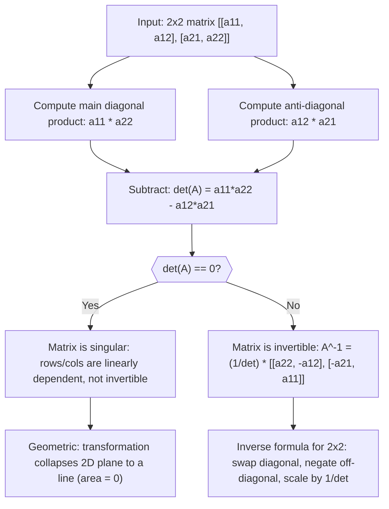

# Determinant (2×2)

$$
\det(A) = a_{11}a_{22} - a_{12}a_{21}
$$

## Deep Breakdown

What it tells me *(Situation Awareness)*:
For a $2 \times 2$ matrix $A = \begin{bmatrix}a_{11} & a_{12} \\ a_{21} & a_{22}\end{bmatrix}$, the determinant is $\det(A) = a_{11}a_{22} - a_{12}a_{21}$: the product of the main diagonal minus the product of the anti-diagonal. The determinant encodes the signed area scaling factor: if you apply the linear transformation defined by $A$ to the unit square, the resulting parallelogram has area $|\det(A)|$. A zero determinant means the matrix is singular (not invertible; it collapses 2D space into a line). In DA/DS you see $2 \times 2$ determinants in: checking whether two features are linearly independent (det of their correlation sub-matrix), computing the inverse of a $2 \times 2$ covariance submatrix, solving $2 \times 2$ systems via Cramer's rule, and as a building block of the general $n \times n$ Laplace expansion.

## Flowchart



## Real-world use

### Where it is used

Used in the $2 \times 2$ matrix inverse formula (required for closed-form solutions to $2 \times 2$ systems), in computing the Jacobian of a $2D$ transformation (e.g., checking that a coordinate change preserves orientation), in feature collinearity checks for pairs of features, and as the base case of cofactor expansion for larger determinants.

### Problem it solves

When you have a $2 \times 2$ system of equations or need to invert a $2 \times 2$ matrix, the determinant gives you a single number that tells you immediately whether a solution exists (det $\neq$ 0) and what the inverse is (via the adjugate formula). For $n > 2$ matrices, the $2 \times 2$ formula is the recursive building block of Laplace expansion.

### How it solves the problem

The formula $a_{11}a_{22} - a_{12}a_{21}$ is derived from the general Leibniz formula restricted to $n = 2$: there are only two permutations of $\{1, 2\}$, one even (identity: $+a_{11}a_{22}$) and one odd (swap: $-a_{12}a_{21}$). The signed sum of these two products is the determinant. Geometrically, it is the cross product of the two row vectors, giving the area of the parallelogram they span.

### Example in a business

A data analyst checks whether two marketing spend features (TV and digital) are collinear by looking at their $2 \times 2$ correlation sub-matrix $C = \begin{bmatrix}1 & r \\ r & 1\end{bmatrix}$. The determinant is $\det(C) = 1 - r^2$. If $r = 0.99$, $\det(C) = 1 - 0.98 = 0.02$: near zero, confirming near-collinearity. If $r = 0.3$, $\det(C) = 0.91$: the features are largely independent. This is a fast two-feature collinearity diagnostic without running full VIF.

## The formula, piece by piece

- $\det(A)$ (also written $|A|$): the determinant of matrix $A$; a scalar value summarizing the matrix's invertibility and area-scaling property
- $a_{11}$: entry at row 1, column 1 (top-left)
- $a_{22}$: entry at row 2, column 2 (bottom-right)
- $a_{11}a_{22}$: main diagonal product; contributes positively
- $a_{12}$: entry at row 1, column 2 (top-right)
- $a_{21}$: entry at row 2, column 1 (bottom-left)
- $a_{12}a_{21}$: anti-diagonal product; subtracted (contributes negatively) Full formula: $\det(A) = a_{11}a_{22} - a_{12}a_{21}$

## The formula in words

"Multiply the top-left entry by the bottom-right entry (main diagonal). Then multiply the top-right entry by the bottom-left entry (anti-diagonal). Subtract the second product from the first. If the result is zero, the matrix is singular." Tiny numeric example:
$A = \begin{bmatrix}3 & 2 \\ 1 & 4\end{bmatrix}$.
$\det(A) = 3 \cdot 4 - 2 \cdot 1 = 12 - 2 = 10 \neq 0$, so $A$ is invertible.
Geometric interpretation: the rows $[3, 2]$ and $[1, 4]$ span a parallelogram of area 10.

## Critical Concepts

- **Zero determinant = singular matrix:** if $\det(A) = 0$, the rows are linearly dependent (one is a scalar multiple of the other), the matrix is not invertible, and the linear system $Ax = b$ has either no solution or infinitely many.
- **Sign encodes orientation:** $\det > 0$ means the transformation preserves orientation (does not "flip" the plane); $\det < 0$ means it reverses orientation.
- **Inverse formula:** $A^{-1} = \frac{1}{\det(A)}\begin{bmatrix}a_{22} & -a_{12} \\ -a_{21} & a_{11}\end{bmatrix}$ (swap diagonal, negate off-diagonal, divide by determinant). Only valid when $\det(A) \neq 0$.
- **Scaling:** $\det(kA) = k^2 \det(A)$ for a $2 \times 2$ matrix (the exponent is the matrix dimension $n=2$).
- **Transpose:** $\det(A^T) = \det(A)$; the determinant is the same for a matrix and its transpose.
- **Product rule:** $\det(AB) = \det(A)\det(B)$; the determinant of a product is the product of determinants.
- **Numerical stability:** for computational purposes (even for $2 \times 2$), use `np.linalg.det(A)` rather than computing the formula by hand to handle floating-point edge cases correctly.

## Step-by-step calculation (tiny example)

*Step 1: Identify the four entries and label them*
$A = \begin{bmatrix}5 & -2 \\ 3 & 1\end{bmatrix}$.
$a_{11} = 5$, $a_{12} = -2$, $a_{21} = 3$, $a_{22} = 1$.

*Step 2: Compute main diagonal and anti-diagonal products*
Main diagonal: $a_{11} \cdot a_{22} = 5 \cdot 1 = 5$.
Anti-diagonal: $a_{12} \cdot a_{21} = (-2) \cdot 3 = -6$.

*Step 3: Subtract and interpret*
$\det(A) = 5 - (-6) = 5 + 6 = 11$.
Since $\det(A) = 11 \neq 0$, the matrix is invertible.
Inverse: $A^{-1} = \frac{1}{11}\begin{bmatrix}1 & 2 \\ -3 & 5\end{bmatrix}$.
Verify: $A \cdot A^{-1} = \frac{1}{11}\begin{bmatrix}5-6 & 10-10 \\ 3-3 & 6+5\end{bmatrix} = \frac{1}{11}\begin{bmatrix}-1 & 0 \\ 0 & 11\end{bmatrix}$... let me recompute properly: $A^{-1} = \frac{1}{11}\begin{bmatrix}1 & 2 \\ -3 & 5\end{bmatrix}$. Check: $A A^{-1} = \frac{1}{11}\begin{bmatrix}5\cdot1+(-2)(-3) & 5\cdot2+(-2)(5) \\ 3\cdot1+1\cdot(-3) & 3\cdot2+1\cdot5\end{bmatrix} = \frac{1}{11}\begin{bmatrix}11 & 0 \\ 0 & 11\end{bmatrix} = I$ ✓.

## Code examples

### Beginner example (Python)

```python
import numpy as np   # -- 2x2 determinant: formula, invertibility, and geometric meaning ---
A = np.array([[5.0, -2.0], [3.0, 1.0]])   # Manual formula
det_manual = A[0, 0] * A[1, 1] - A[0, 1] * A[1, 0]
det_numpy = float(np.linalg.det(A))
print(f"A:\n{A}")
print(f"\ndet(A) via formula : {det_manual}")
print(f"det(A) via numpy : {det_numpy:.6f}")
print(f"Invertible: {not np.isclose(det_numpy, 0)}")   # 2x2 inverse formula: (1/det) * [[a22, -a12], [-a21, a11]]
A_inv_manual = (1 / det_manual) * np.array([[ A[1,1], -A[0,1]], [-A[1,0], A[0,0]]])
print(f"\nInverse (manual formula):\n{A_inv_manual.round(4)}")
print(f"A @ A_inv = I: {np.allclose(A @ A_inv_manual, np.eye(2))}")   # Singular matrix example
A_sing = np.array([[2.0, 4.0], [1.0, 2.0]])   # row 2 = 0.5 * row 1
det_sing = float(np.linalg.det(A_sing))
print(f"\nSingular matrix A_sing det: {det_sing:.6f} (should be ~0)")
print(f"Linear dependence check: row2 = 0.5 * row1: {np.allclose(A_sing[1], 0.5 * A_sing[0])}")
```

### Beginner example (R)

```r
# -- 2x2 determinant: formula, invertibility, and inverse check -------
A <- matrix(c(5, -2, 3, 1), nrow = 2, byrow = TRUE)  # Manual formula
det_manual <- A[1,1] * A[2,2] - A[1,2] * A[2,1]
det_r <- det(A)
cat(sprintf("det(A) via formula: %.4f\n", det_manual))
cat(sprintf("det(A) via det(): %.4f\n", det_r))
cat(sprintf("Invertible: %s\n", !isTRUE(all.equal(det_r, 0))))  # 2x2 inverse via formula
A_inv <- (1 / det_manual) * matrix(c(A[2,2], -A[2,1], -A[1,2], A[1,1]), nrow = 2, byrow = TRUE)
cat("\nInverse:\n"); print(round(A_inv, 4))
cat(sprintf("A %%*%% A_inv == I: %s\n", isTRUE(all.equal(A %*% A_inv, diag(2)))))  # Singular matrix
A_sing <- matrix(c(2, 4, 1, 2), nrow = 2, byrow = TRUE)
cat(sprintf("\nSingular det: %.6f (should be 0)\n", det(A_sing)))
```

### Professional example (Python)

```python
import numpy as np
import pandas as pd
np.random.seed(42)   # -- Business scenario: pairwise feature collinearity check via 2x2 determinants
# For each pair of features, compute the 2x2 correlation sub-matrix determinant.
# det = 1 - r^2; near zero means near-collinear (VIF analog for pairs).
N_OBS = 200
CHANNEL_NAMES = ["tv", "digital", "search", "social", "print"]
N_CHANNELS = len(CHANNEL_NAMES)
COLLINEARITY_THRESHOLD = 0.05   # det < 0.05 means r > ~0.975 # Simulate with some near-collinear channels
base = np.random.normal(0, 1, N_OBS)
X = np.column_stack([ base + np.random.normal(0, 0.5, N_OBS),   # tv
    (near-collinear with digital) base + np.random.normal(0, 0.6, N_OBS),   # digital
    (near-collinear with tv) np.random.normal(0, 1, N_OBS),   # search
    (independent) np.random.normal(0, 1, N_OBS),   # social
    (independent) 0.95 * np.random.normal(0, 1, N_OBS) + np.random.normal(0, 0.1, N_OBS),   # print
    (borderline) ])   # Compute correlation matrix
X_std = (X - X.mean(axis=0)) / X.std(axis=0)
corr = X_std.T @ X_std / (N_OBS - 1)   # Pairwise 2x2 determinants
records = []
for i in range(N_CHANNELS):
    for j in range(i + 1, N_CHANNELS):
        r = float(corr[i, j])
    det = 1 - r**2   # 2x2 correlation sub-matrix determinant
records.append({ "pair": f"{CHANNEL_NAMES[i]} vs {CHANNEL_NAMES[j]}", "correlation_r": round(r, 4), "det_2x2": round(det, 4), "collinear": det < COLLINEARITY_THRESHOLD, })
result_df = pd.DataFrame(records)
print("Pairwise feature collinearity via 2x2 determinant (det = 1 - r^2):")
print(result_df.to_string(index=False))
print(f"\nPairs flagged as near-collinear (det < {COLLINEARITY_THRESHOLD}):")
print(result_df[result_df["collinear"]]"pair", "correlation_r", "det_2x2".to_string(index=False))
print("\nInterpretation: det(2x2 corr sub-matrix) = 1 - r^2; near zero means the pair spans a near-degenerate plane and will cause multicollinearity in regression.")
```

---

*Source: 1300 p. 115*
