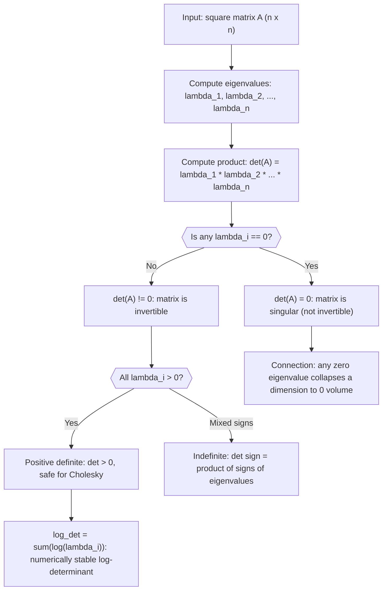

# Determinant Identity (eigenvalues)

$$
\det(A) = \prod_{i} \lambda_i
$$

## Deep Breakdown

What it tells me *(Situation Awareness)*:
The determinant of a square matrix equals the product of all its eigenvalues: $\det(A) = \prod_i \lambda_i$. This is one of the two fundamental eigenvalue identities (the other is the trace = sum of eigenvalues). Since the determinant encodes invertibility, this formula says: $A$ is singular if and only if at least one eigenvalue is zero. In DA/DS this appears when checking whether a covariance matrix is positive definite ($\det(\Sigma) = \prod_i \lambda_i > 0$ iff all eigenvalues are positive), computing the log-likelihood of a Gaussian ($\log|\Sigma| = \sum_i \log\lambda_i$ is much more stable than computing $\det(\Sigma)$ directly for high-dimensional data), and understanding why adding a small diagonal perturbation ($\varepsilon I$) makes a singular matrix invertible (shifts all eigenvalues up by $\varepsilon$, pushing the product away from zero).

## Flowchart



## Real-world use

### Where it is used

Used in the multivariate Gaussian log-likelihood (requires $\log|\Sigma|$), in testing positive definiteness of covariance matrices, in computing the volume scaling factor of a linear transformation, in PCA to measure how much "information" is compressed (small eigenvalues contribute near-zero to the product), and in checking whether a linear system has a unique solution.

### Problem it solves

Computing $\det(A)$ via cofactor expansion is $O(n!)$ for naive implementations and numerically unstable for large matrices. Using eigenvalues, you can compute $\det(A) = \prod_i \lambda_i$ from an $O(n^3)$ eigendecomposition. More importantly, the log-determinant $\log\det(A) = \sum_i \log\lambda_i$ avoids overflow/underflow for large covariance matrices (common in high-dimensional DA/DS), where $\det(\Sigma)$ would underflow to zero in float64.

### How it solves the problem

If $A = V\Lambda V^{-1}$ is the eigendecomposition, then $\det(A) = \det(V)\det(\Lambda)\det(V^{-1}) = \det(\Lambda)$ because $\det(V)\det(V^{-1}) = \det(VV^{-1}) = \det(I) = 1$. The determinant of the diagonal matrix $\Lambda$ is just the product of its diagonal entries $\lambda_i$.

### Example in a business

A data scientist computes the log-likelihood of a multivariate Gaussian model for customer lifetime value predictions across 20 features. The covariance matrix $\Sigma$ is $20 \times 20$. Direct $\det(\Sigma)$ is numerically unstable (product of 20 small numbers). Instead: compute eigenvalues $\lambda_1, \dots, \lambda_{20}$, compute $\log|\Sigma| = \sum_{i=1}^{20} \log\lambda_i$. This is numerically stable and connects directly to the Gaussian log-likelihood $-\frac{1}{2}(x - \mu)^T \Sigma^{-1}(x - \mu) - \frac{1}{2}\log|\Sigma| - \frac{n}{2}\log(2\pi)$.

## The formula, piece by piece

- $\det(A)$: the determinant of the $n \times n$ matrix $A$; a scalar
- $\prod_i$: product over all eigenvalue indices $i = 1, 2, \ldots, n$
- $\lambda_i$: the $i$-th eigenvalue of $A$ (possibly complex for non-symmetric matrices; for symmetric real matrices all eigenvalues are real)
- If any $\lambda_i = 0$: the whole product is zero, so $A$ is singular
- The product includes repeated eigenvalues with their algebraic multiplicity Full formula: $\det(A) = \prod_{i=1}^n \lambda_i = \lambda_1 \cdot \lambda_2 \cdots \lambda_n$

## The formula in words

"The determinant is the product of all eigenvalues. If even one eigenvalue is zero, the determinant is zero and the matrix is singular (non-invertible). The determinant encodes the total volume scaling of the transformation." Tiny numeric example:
$A = \begin{bmatrix}3 & 0 \\ 0 & 4\end{bmatrix}$ (diagonal). Eigenvalues: $\lambda_1 = 3$, $\lambda_2 = 4$.
$\det(A) = 3 \cdot 4 = 12$. Direct formula: $3 \cdot 4 - 0 \cdot 0 = 12$ ✓.
Non-diagonal: $A = \begin{bmatrix}2 & 1 \\ 1 & 2\end{bmatrix}$. Eigenvalues: $\lambda_1 = 3$, $\lambda_2 = 1$. $\det(A) = 3 \cdot 1 = 3$. Direct: $4 - 1 = 3$ ✓.

## Critical Concepts

- **Singular iff any eigenvalue is zero:** $\det(A) = 0 \iff \exists i: \lambda_i = 0$. A zero eigenvalue means there is a non-zero vector $v$ such that $Av = 0$, i.e., a direction that gets collapsed to the origin.
- **Log-determinant:** $\log\det(A) = \sum_i \log\lambda_i$. For positive definite matrices (all $\lambda_i > 0$), this is always defined and numerically stable. Use `np.linalg.slogdet(A)` which returns sign and log-abs-det.
- **Covariance matrix:** $\det(\Sigma) > 0$ iff $\Sigma$ is positive definite (all eigenvalues positive). $\det(\Sigma) = 0$ means the features are linearly dependent; the joint distribution is degenerate.
- **Companion identity:** $\text{tr}(A) = \sum_i \lambda_i$ (sum) and $\det(A) = \prod_i \lambda_i$ (product). These are the first two of the $n$ elementary symmetric polynomials of the eigenvalues.
- **Product rule:** $\det(AB) = \det(A)\det(B) = \prod_i\lambda_i(A) \cdot \prod_i\lambda_i(B)$.
- **Regularization effect:** $\det(A + \varepsilon I) = \prod_i (\lambda_i + \varepsilon)$; adding $\varepsilon I$ shifts every eigenvalue by $\varepsilon$, preventing the product from being zero when $\varepsilon > 0$ and $\lambda_i \geq 0$.

## Step-by-step calculation (tiny example)

*Step 1: Compute eigenvalues of a symmetric 3x3 matrix*
$A = \begin{bmatrix}4 & 1 & 0 \\ 1 & 3 & 1 \\ 0 & 1 & 2\end{bmatrix}$.
Characteristic polynomial: $\det(A - \lambda I) = 0$.
Eigenvalues (computed numerically): $\lambda_1 \approx 5.214$, $\lambda_2 \approx 2.0$, $\lambda_3 \approx 1.786$.

*Step 2: Compute the determinant via product of eigenvalues*
$\det(A) = 5.214 \times 2.0 \times 1.786 \approx 18.63$.

*Step 3: Verify directly*
Direct cofactor expansion: $\det(A) = 4(3 \cdot 2 - 1 \cdot 1) - 1(1 \cdot 2 - 1 \cdot 0) + 0 = 4(5) - 1(2) = 20 - 2 = 18$.
Close to $18.63$ (difference due to rounding of eigenvalues). Exact eigenvalues give exact product = 18.

## Code examples

### Beginner example (Python)

```python
import numpy as np   # -- det(A) = product of eigenvalues: verify and apply ----------------
A = np.array([[4.0, 1.0, 0.0], [1.0, 3.0, 1.0], [0.0, 1.0, 2.0]])
eigenvalues = np.linalg.eigvalsh(A)   # use eigvalsh for symmetric matrices
det_via_eigs = float(np.prod(eigenvalues))
det_via_numpy = float(np.linalg.det(A))
print(f"Eigenvalues: {eigenvalues.round(6)}")
print(f"\ndet via product of eigenvalues: {det_via_eigs:.6f}")
print(f"det via np.linalg.det: {det_via_numpy:.6f}")
print(f"Match: {np.isclose(det_via_eigs, det_via_numpy)}")   # Log-determinant (numerically stable)
sign, log_abs_det = np.linalg.slogdet(A)
log_det_via_eigs = float(np.sum(np.log(eigenvalues)))
print(f"\nlog|det(A)| via slogdet: {log_abs_det:.6f}")
print(f"log|det(A)| via sum(log(eig)): {log_det_via_eigs:.6f}")   # Singular matrix: one eigenvalue is 0
A_sing = np.array([[1.0, 2.0], [2.0, 4.0]])   # row 2 = 2 * row 1
print(f"\nSingular matrix eigenvalues: {np.linalg.eigvalsh(A_sing).round(6)}")
print(f"det (should be 0): {np.linalg.det(A_sing):.2e}")
```

### Beginner example (R)

```r
# -- det(A) = product of eigenvalues: verify -------------------------
A <- matrix(c(4, 1, 0, 1, 3, 1, 0, 1, 2), nrow = 3, byrow = TRUE)
ev <- eigen(A, symmetric = TRUE)$values
det_ev <- prod(ev)
det_r <- det(A)
cat(sprintf("Eigenvalues: %s\n", paste(round(ev, 6), collapse = ", ")))
cat(sprintf("det via product of eigenvalues: %.6f\n", det_ev))
cat(sprintf("det via det(): %.6f\n", det_r))
cat(sprintf("Match: %s\n", isTRUE(all.equal(det_ev, det_r, tolerance = 1e-8))))  # Log-determinant (stable)
log_det <- sum(log(ev[ev > 0]))
cat(sprintf("log|det(A)| via sum(log(eig)): %.6f\n", log_det))
```

### Professional example (Python)

```python
import numpy as np
import pandas as pd
np.random.seed(42)   # -- Business scenario: Gaussian log-likelihood for anomaly detection
# Fit a multivariate Gaussian to N_TRAIN normal campaign weeks.
# Score test campaigns via log-likelihood (uses log-determinant).
N_TRAIN = 150
N_TEST = 20
N_FEATURES = 8
KPI_NAMES = [f"kpi_{i}" for i in range(N_FEATURES)]
JITTER = 1e-6   # numerical stability for Cholesky # Simulate training data (normal campaign KPIs)
true_mean = np.zeros(N_FEATURES)
true_cov = np.random.uniform(0.1, 0.5, size=(N_FEATURES, N_FEATURES))
true_cov = true_cov @ true_cov.T + np.eye(N_FEATURES)   # ensure PD
X_train = np.random.multivariate_normal(true_mean, true_cov, N_TRAIN)
X_test = np.random.multivariate_normal(true_mean * 2, true_cov * 1.5, N_TEST)   # Estimate mean and covariance from training data
mu_hat = X_train.mean(axis=0)
cov_hat = np.cov(X_train.T) + JITTER * np.eye(N_FEATURES)   # Log-determinant via eigenvalues (numerically stable)
eigenvalues = np.linalg.eigvalsh(cov_hat)
log_det = float(np.sum(np.log(eigenvalues)))   # = log|cov_hat|
sign, log_det_np = np.linalg.slogdet(cov_hat)
print(f"Estimated cov eigenvalue range: [{eigenvalues.min():.4f}, {eigenvalues.max():.4f}]")
print(f"det(cov_hat) = prod(eigenvalues) = {float(np.prod(eigenvalues)):.4e} (tiny -- direct det would lose precision)")
print(f"log|det(cov_hat)| via eigenvalues: {log_det:.4f}")
print(f"log|det(cov_hat)| via slogdet: {log_abs_det_check:.4f}" if False else f"slogdet sign={sign}, log_abs_det={log_det_np:.4f}")   # Mahalanobis-based anomaly score (uses log-det in full Gaussian log-likelihood)
cov_inv = np.linalg.inv(cov_hat)

def gaussian_log_likelihood(x, mu, cov_inv, log_det, n_features):
    diff = x - mu
    maha = float(diff @ cov_inv @ diff)
    return -0.5 * (maha + log_det + n_features * np.log(2 * np.pi))
train_scores = [gaussian_log_likelihood(x, mu_hat, cov_inv, log_det, N_FEATURES) for x in X_train]
test_scores = [gaussian_log_likelihood(x, mu_hat, cov_inv, log_det, N_FEATURES) for x in X_test]
threshold = float(np.percentile(train_scores, 5))   # 5th percentile of training log-likelihoods
print(f"\nTraining log-likelihood: mean={np.mean(train_scores):.2f}, std={np.std(train_scores):.2f}")
print(f"Test log-likelihood: mean={np.mean(test_scores):.2f}, std={np.std(test_scores):.2f}")
print(f"Anomaly threshold (5th pct of training): {threshold:.2f}")
print(f"Test campaigns flagged as anomalous: {sum(s < threshold for s in test_scores)} / {N_TEST}")
print("\nInterpretation: log_det = sum(log(eigenvalues)) replaces det(Sigma) in the Gaussian formula, preventing numerical underflow in high-dimensional data.")
```

---

*Source: MYLA p. 5*
