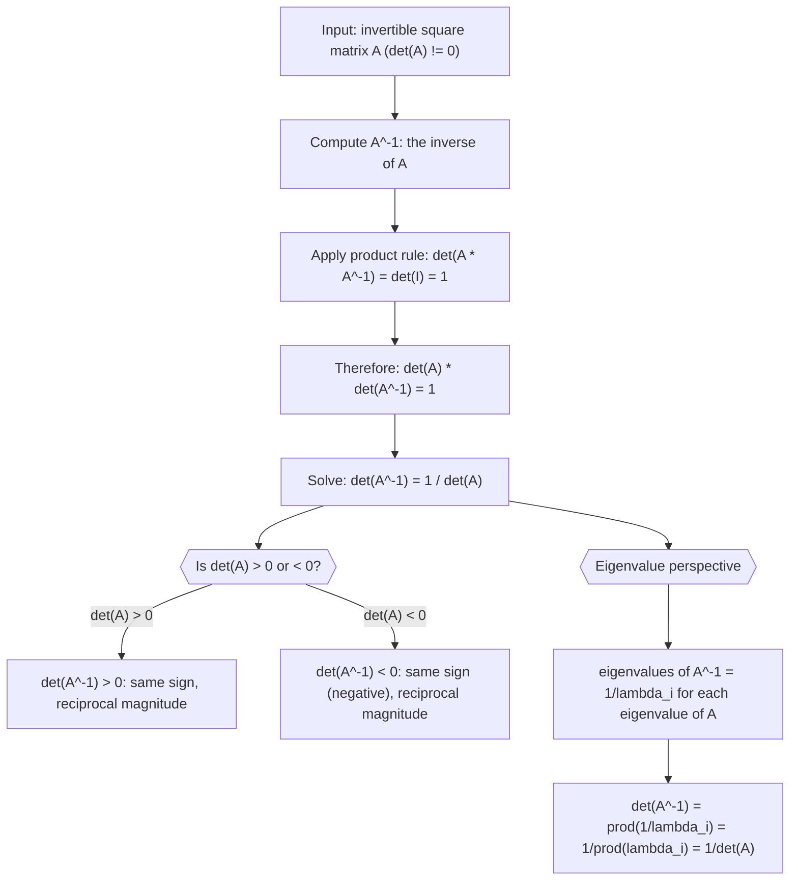

# Inverse determinant

$$
\det(A^{-1}) = \frac{1}{\det(A)}
$$

## Deep Breakdown

What it tells me *(Situation Awareness)*:
The determinant of an inverse matrix is the reciprocal of the determinant of the original: $\det(A^{-1}) = 1/\det(A)$. This follows directly from the product rule: $\det(A \cdot A^{-1}) = \det(I) = 1$, so $\det(A)\det(A^{-1}) = 1$, giving $\det(A^{-1}) = 1/\det(A)$. This confirms that $A^{-1}$ exists only when $\det(A) \neq 0$ (you cannot take the reciprocal of zero). In DA/DS, this identity appears when reasoning about precision matrices: if $\Sigma$ is a covariance matrix with $\det(\Sigma) = d$, then the precision matrix $\Sigma^{-1}$ has $\det(\Sigma^{-1}) = 1/d$. It also appears in the log-determinant of the inverse: $\log|\det(\Sigma^{-1})| = -\log|\det(\Sigma)|$, which shows up in the exponent of the multivariate Gaussian.

## Flowchart



## Real-world use

### Where it is used

Used when working with precision matrices $\Omega = \Sigma^{-1}$ (Gaussian graphical models), computing the log-determinant of inverse covariance in the Gaussian log-likelihood, verifying the consistency of a matrix and its inverse, and reasoning about condition numbers (a near-singular matrix has tiny $\det(A)$, so its inverse has a huge $\det(A^{-1})$, signaling numerical instability).

### Problem it solves

When you have a matrix $A$ and you compute $A^{-1}$ numerically, how do you quickly sanity-check whether the inversion was accurate? The identity $\det(A^{-1}) = 1/\det(A)$ gives a scalar check: compute $\det(A) \cdot \det(A^{-1})$ and verify it equals 1 (within floating-point tolerance). Also useful for switching between covariance and precision representations in probabilistic models.

### How it solves the problem

From the product rule $\det(AB) = \det(A)\det(B)$: set $B = A^{-1}$. Then $\det(A)\det(A^{-1}) = \det(AA^{-1}) = \det(I) = 1$. Dividing both sides by $\det(A)$ (valid since $\det(A) \neq 0$) gives $\det(A^{-1}) = 1/\det(A)$. The eigenvalue route: if $\lambda_i$ are eigenvalues of $A$, then $1/\lambda_i$ are eigenvalues of $A^{-1}$, and $\det(A^{-1}) = \prod_i (1/\lambda_i) = 1/\prod_i \lambda_i = 1/\det(A)$.

### Example in a business

A data scientist builds a Gaussian graphical model for a portfolio of 10 assets. The covariance matrix $\Sigma$ has $\det(\Sigma) = 0.0234$. The precision matrix $\Omega = \Sigma^{-1}$ (encoding conditional independencies) must satisfy $\det(\Omega) = 1/0.0234 \approx 42.7$. After computing $\Omega$ numerically, the analyst checks: $\det(\Sigma) \cdot \det(\Omega) \approx 1$ (within $10^{-12}$). A significant deviation would indicate numerical issues in the inversion.

## The formula, piece by piece

- $\det(A^{-1})$: the determinant of the inverse of $A$; requires $A$ to be invertible (square, non-singular)
- $A^{-1}$: the inverse matrix satisfying $AA^{-1} = A^{-1}A = I$
- $\frac{1}{\det(A)}$: the reciprocal of $\det(A)$; only defined when $\det(A) \neq 0$
- The formula follows from $\det(A)\det(A^{-1}) = \det(AA^{-1}) = \det(I) = 1$ Full formula: $\det(A^{-1}) = \dfrac{1}{\det(A)}$

## The formula in words

"The determinant of the inverse is one over the determinant of the original. A matrix that stretches volumes by factor $d$ has an inverse that compresses volumes by the same factor (and vice versa). The two scaling factors are always reciprocals." Tiny numeric example:
$A = \begin{bmatrix}2 & 1 \\ 1 & 3\end{bmatrix}$. $\det(A) = 6 - 1 = 5$.
$A^{-1} = \frac{1}{5}\begin{bmatrix}3 & -1 \\ -1 & 2\end{bmatrix}$.
$\det(A^{-1}) = \frac{1}{25}(6 - 1) = \frac{5}{25} = \frac{1}{5}$ ✓.

## Critical Concepts

- **Reciprocal relationship:** $\det(A)\det(A^{-1}) = 1$ always. Use this as a numerical sanity check after inverting a matrix.
- **Eigenvalue reciprocals:** eigenvalues of $A^{-1}$ are $1/\lambda_i$. Large eigenvalues of $A$ become small eigenvalues of $A^{-1}$ and vice versa. A near-zero eigenvalue in $A$ (near-singular) becomes a very large eigenvalue in $A^{-1}$ (ill-conditioned inverse).
- **Log-determinant:** $\log|\det(A^{-1})| = -\log|\det(A)|$; the log-determinant of the inverse is the negative of the log-determinant of the original. This appears in the Gaussian log-likelihood.
- **Condition number connection:** $\text{cond}(A) = \|A\| \|A^{-1}\|$. When $\det(A)$ is very small, the largest eigenvalue of $A^{-1}$ is very large, making the condition number large and the inversion numerically unreliable.
- **Never compute the inverse explicitly:** for solving $Ax = b$, use `np.linalg.solve(A, b)` rather than `np.linalg.inv(A) @ b`. The former is faster and more numerically stable.
- **Transpose of inverse:** $(A^{-1})^T = (A^T)^{-1}$; inverse and transpose commute.

## Step-by-step calculation (tiny example)

*Step 1: Compute det(A) for a 2x2 matrix*
$A = \begin{bmatrix}3 & 1 \\ 2 & 4\end{bmatrix}$.
$\det(A) = 3 \cdot 4 - 1 \cdot 2 = 12 - 2 = 10$.

*Step 2: Compute the inverse using the 2x2 inverse formula*
$A^{-1} = \frac{1}{10}\begin{bmatrix}4 & -1 \\ -2 & 3\end{bmatrix} = \begin{bmatrix}0.4 & -0.1 \\ -0.2 & 0.3\end{bmatrix}$.

*Step 3: Compute det(A^-1) and verify the reciprocal*
$\det(A^{-1}) = 0.4 \cdot 0.3 - (-0.1)(-0.2) = 0.12 - 0.02 = 0.10$.
Check: $1/\det(A) = 1/10 = 0.10$ ✓.
Cross-check: $\det(A) \cdot \det(A^{-1}) = 10 \cdot 0.10 = 1.0$ ✓.

## Code examples

### Beginner example (Python)

```python
import numpy as np   # -- det(A^-1) = 1 / det(A): verify the identity ----------------------
A = np.array([[3.0, 1.0], [2.0, 4.0]])
det_A = float(np.linalg.det(A))
A_inv = np.linalg.inv(A)
det_A_inv = float(np.linalg.det(A_inv))
print(f"A:\n{A}")
print(f"\ndet(A) = {det_A:.6f}")
print(f"det(A_inv) = {det_A_inv:.6f}")
print(f"1/det(A) = {1/det_A:.6f}")
print(f"\nIdentity check: det(A) * det(A_inv) = {det_A * det_A_inv:.8f} (should be 1)")
print(f"det(A_inv) == 1/det(A): {np.isclose(det_A_inv, 1/det_A)}")   # Eigenvalue perspective
eigenvalues_A = np.linalg.eigvals(A)
eigenvalues_A_inv = np.linalg.eigvals(A_inv)
print(f"\nEigenvalues of A: {eigenvalues_A.real.round(6)}")
print(f"Eigenvalues of A_inv: {eigenvalues_A_inv.real.round(6)}")
print(f"1/eigenvalues of A: {(1/eigenvalues_A).real.round(6)}")
print(f"Reciprocal property holds: {np.allclose(np.sort(eigenvalues_A_inv.real), np.sort((1/eigenvalues_A).real))}")
```

### Beginner example (R)

```r
# -- det(A^-1) = 1 / det(A): verify ----------------------------------
A <- matrix(c(3, 1, 2, 4), nrow = 2, byrow = TRUE)
det_A <- det(A)
A_inv <- solve(A)
det_A_inv <- det(A_inv)
cat(sprintf("det(A) = %.6f\n", det_A))
cat(sprintf("det(A_inv) = %.6f\n", det_A_inv))
cat(sprintf("1/det(A) = %.6f\n", 1/det_A))
cat(sprintf("det(A) * det(A_inv) = %.8f (should be 1)\n", det_A * det_A_inv))  # Eigenvalue reciprocal
ev_A <- eigen(A)$values
ev_A_inv <- eigen(A_inv)$values
cat(sprintf("\nEigenvalues of A: %s\n", paste(round(ev_A, 6), collapse = ", ")))
cat(sprintf("Eigenvalues of A_inv: %s\n", paste(round(ev_A_inv, 6), collapse = ", ")))
```

### Professional example (Python)

```python
import numpy as np
import pandas as pd
np.random.seed(42)   # -- Business scenario: precision matrix in a Gaussian graphical model
# Covariance matrix Sigma encodes total correlations.
# Precision matrix Omega = Sigma^-1 encodes partial correlations (conditional independence).
# Verify: det(Sigma) * det(Omega) = 1.
N_ASSETS = 8
ASSET_NAMES = [f"asset_{i}" for i in range(N_ASSETS)]
JITTER = 1e-6   # Simulate a valid covariance matrix
L_sim = np.random.uniform(0.1, 0.8, size=(N_ASSETS, N_ASSETS))
sigma = L_sim @ L_sim.T + JITTER * np.eye(N_ASSETS)   # Precision matrix
omega = np.linalg.inv(sigma)   # Determinants and the reciprocal check
det_sigma = float(np.linalg.det(sigma))
det_omega = float(np.linalg.det(omega))
product = det_sigma * det_omega   # Log-determinants (numerically stable for high-dim)
_, logdet_sigma = np.linalg.slogdet(sigma)
_, logdet_omega = np.linalg.slogdet(omega)   # Condition number check
cond_sigma = float(np.linalg.cond(sigma))
print(f"Covariance Sigma shape: {sigma.shape}")
print(f"\ndet(Sigma) = {det_sigma:.6e}")
print(f"det(Omega) = 1/det(Sig) = {det_omega:.6e}")
print(f"det(Sigma) * det(Omega) = {product:.8f} (should be 1.0)")
print(f"\nlog|det(Sigma)|: {logdet_sigma:.4f}")
print(f"log|det(Omega)|: {logdet_omega:.4f}")
print(f"Sum (should be ~0): {logdet_sigma + logdet_omega:.2e}")
print(f"\nCondition number of Sigma: {cond_sigma:.1f}")   # Eigenvalue check: eigenvalues of Omega = 1/eigenvalues of Sigma
ev_sigma = np.linalg.eigvalsh(sigma)[::-1]
ev_omega = np.linalg.eigvalsh(omega)[::-1]
print(f"\nEigenvalue reciprocal check (first 3):")
ev_df = pd.DataFrame({ "eigenvalue_Sigma": ev_sigma[:3].round(4), "eigenvalue_Omega": ev_omega[:3].round(4), "1/eig_Sigma": (1/ev_sigma[:3]).round(4), "match": np.isclose(ev_omega[:3], 1/ev_sigma[:3]),
})
print(ev_df.to_string(index=False))
print("\nInterpretation: det(Omega) = 1/det(Sigma) ensures the precision and covariance encode reciprocal volume-scaling; log|det(Omega)| = -log|det(Sigma)| is the stable way to compute log-likelihoods.")
```

---

*Source: 1300 p. 117*
