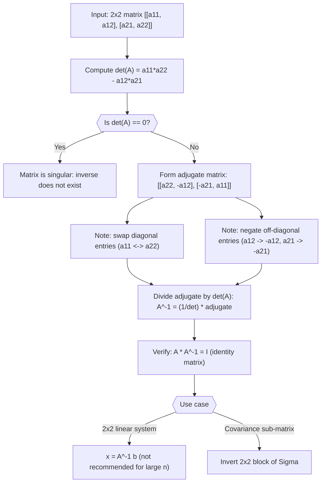

# Inverse matrix (2×2)

$$
A^{-1} = \frac{1}{\det(A)} \begin{bmatrix} a_{22} & -a_{12} \\ -a_{21} & a_{11} \end{bmatrix}
$$

## Deep Breakdown

What it tells me *(Situation Awareness)*:
For a $2 \times 2$ invertible matrix $A = \begin{bmatrix}a_{11} & a_{12} \\ a_{21} & a_{22}\end{bmatrix}$, the inverse is $A^{-1} = \frac{1}{\det(A)}\begin{bmatrix}a_{22} & -a_{12} \\ -a_{21} & a_{11}\end{bmatrix}$. The recipe is: swap the main diagonal entries ($a_{11} \leftrightarrow a_{22}$), negate the off-diagonal entries ($a_{12} \to -a_{12}$, $a_{21} \to -a_{21}$), then divide everything by $\det(A) = a_{11}a_{22} - a_{12}a_{21}$. This is the only closed-form inverse formula that is both simple to memorize and useful in practice. In DA/DS it appears when solving $2 \times 2$ normal equations by hand, computing the inverse of a $2 \times 2$ covariance sub-matrix, and as the base case for understanding the adjugate-based inverse formula for larger matrices.

## Flowchart



## Real-world use

### Where it is used

Used for hand-calculation of $2 \times 2$ linear systems (in exams and quick derivations), inverting $2 \times 2$ covariance sub-matrices analytically (e.g., partial correlations between two features given others), as the building block in the Schur complement for block matrix inversion, and in deriving the normal equations solution for a model with exactly 2 parameters.

### Problem it solves

For $n > 2$, computing the inverse numerically requires $O(n^3)$ Gaussian elimination. For $n = 2$, the explicit formula gives a closed-form solution in 5 arithmetic operations, which is useful for: pedagogically understanding what the inverse means structurally, symbolic derivations (keeping $a, b, c, d$ as symbols), and cases where you have a specific $2 \times 2$ sub-problem embedded in a larger computation.

### How it solves the problem

The inverse formula is derived from the adjugate (classical adjoint) divided by the determinant: $A^{-1} = \frac{1}{\det(A)}\text{adj}(A)$. For $2 \times 2$, the adjugate is the matrix of cofactors, which happens to be the matrix with swapped diagonal and negated off-diagonal. You can verify directly: $A \cdot A^{-1} = \frac{1}{d}\begin{bmatrix}a_{11}a_{22} - a_{12}a_{21} & 0 \\ 0 & a_{11}a_{22} - a_{12}a_{21}\end{bmatrix} = I$ (where $d = \det(A)$).

### Example in a business

A data scientist solves a simple $2 \times 2$ normal equation system arising from a regression with 2 features (TV spend and digital spend): $\begin{bmatrix}X_1^T X_1 & X_1^T X_2 \\ X_2^T X_1 & X_2^T X_2\end{bmatrix}\begin{bmatrix}\beta_1 \\ \beta_2\end{bmatrix} = \begin{bmatrix}X_1^T y \\ X_2^T y\end{bmatrix}$. The $2 \times 2$ inverse formula gives the closed-form solution: $\beta_1$ and $\beta_2$ are expressed as linear combinations of $X_1^T y$ and $X_2^T y$, divided by the Gram determinant. This is analytically tractable and interpretable.

## The formula, piece by piece

- $A^{-1}$: the inverse of $A$; satisfies $A A^{-1} = A^{-1} A = I$
- $\frac{1}{\det(A)}$: the scalar factor; reciprocal of the determinant; undefined if $\det(A) = 0$
- $\begin{bmatrix}a_{22} & -a_{12} \\ -a_{21} & a_{11}\end{bmatrix}$: the adjugate of $A$; formed by swapping $a_{11} \leftrightarrow a_{22}$ and negating $a_{12}$ and $a_{21}$
- The pattern: main diagonal swaps, off-diagonal changes sign, everything scales by $1/\det(A)$ Full formula: $A^{-1} = \dfrac{1}{a_{11}a_{22} - a_{12}a_{21}}\begin{bmatrix}a_{22} & -a_{12} \\ -a_{21} & a_{11}\end{bmatrix}$

## The formula in words

"To invert a $2 \times 2$ matrix: swap the top-left and bottom-right entries, flip the signs of the top-right and bottom-left entries, then divide everything by the determinant. If the determinant is zero, stop: the matrix has no inverse." Tiny numeric example:
$A = \begin{bmatrix}4 & 7 \\ 2 & 6\end{bmatrix}$.
$\det(A) = 24 - 14 = 10$.
$A^{-1} = \frac{1}{10}\begin{bmatrix}6 & -7 \\ -2 & 4\end{bmatrix} = \begin{bmatrix}0.6 & -0.7 \\ -0.2 & 0.4\end{bmatrix}$.
Verify: $A \cdot A^{-1} = \begin{bmatrix}4\cdot0.6+7(-0.2) & 4(-0.7)+7\cdot0.4 \\ 2\cdot0.6+6(-0.2) & 2(-0.7)+6\cdot0.4\end{bmatrix} = \begin{bmatrix}2.4-1.4 & -2.8+2.8 \\ 1.2-1.2 & -1.4+2.4\end{bmatrix} = \begin{bmatrix}1 & 0 \\ 0 & 1\end{bmatrix}$.

## Critical Concepts

- **Existence condition:** $A^{-1}$ exists if and only if $\det(A) \neq 0$. Always compute the determinant first before attempting to invert.
- **Adjugate pattern:** the transformation "swap diagonal, negate off-diagonal" is specific to $2 \times 2$. For $n > 2$, the adjugate is the matrix of cofactors, which requires much more computation.
- **Never invert explicitly for solving systems:** $A^{-1}b$ via explicit inversion is slower and less numerically stable than `np.linalg.solve(A, b)` for large $n$. For $2 \times 2$ by hand, the formula is fine.
- **Near-singular matrices:** if $\det(A)$ is very small (relative to the entries), the inverse entries blow up, making the solution numerically unreliable. Check $|\det(A)| / \|A\|_F^2$ as a rough singularity indicator.
- **Scaled form:** $(kA)^{-1} = \frac{1}{k}A^{-1}$; scaling a matrix scales its inverse by the reciprocal.
- **Verification:** always check $A A^{-1} \approx I$ (up to machine epsilon) when computing inverses numerically.

## Step-by-step calculation (tiny example)

*Step 1: Extract entries and compute the determinant*
$A = \begin{bmatrix}5 & 3 \\ 2 & 4\end{bmatrix}$.
$a_{11}=5$, $a_{12}=3$, $a_{21}=2$, $a_{22}=4$.
$\det(A) = 5\cdot4 - 3\cdot2 = 20 - 6 = 14 \neq 0$.

*Step 2: Form the adjugate matrix*
Swap diagonal: $a_{22} \leftrightarrow a_{11}$ in the adjugate: $4$ goes top-left, $5$ goes bottom-right.
Negate off-diagonal: $-a_{12} = -3$ (top-right), $-a_{21} = -2$ (bottom-left).
Adjugate: $\begin{bmatrix}4 & -3 \\ -2 & 5\end{bmatrix}$.

*Step 3: Scale by 1/det and verify*
$A^{-1} = \frac{1}{14}\begin{bmatrix}4 & -3 \\ -2 & 5\end{bmatrix}$.
Verify: $A A^{-1} = \frac{1}{14}\begin{bmatrix}5\cdot4+3(-2) & 5(-3)+3\cdot5 \\ 2\cdot4+4(-2) & 2(-3)+4\cdot5\end{bmatrix} = \frac{1}{14}\begin{bmatrix}14 & 0 \\ 0 & 14\end{bmatrix} = I$.

## Code examples

### Beginner example (Python)

```python
import numpy as np   # -- 2x2 inverse formula: manual computation and verification ----------
A = np.array([[5.0, 3.0], [2.0, 4.0]])
det_A = float(A[0, 0] * A[1, 1] - A[0, 1] * A[1, 0])   # Build adjugate: swap diagonal, negate off-diagonal
adj_A = np.array([[ A[1, 1], -A[0, 1]], [-A[1, 0], A[0, 0]]])
A_inv_manual = adj_A / det_A
A_inv_numpy = np.linalg.inv(A)
print(f"A:\n{A}")
print(f"\ndet(A) = {det_A}")
print(f"Adjugate:\n{adj_A}")
print(f"\nA_inv (manual formula):\n{A_inv_manual.round(6)}")
print(f"A_inv (numpy): \n{A_inv_numpy.round(6)}")
print(f"\nResults match: {np.allclose(A_inv_manual, A_inv_numpy)}")
print(f"A @ A_inv = I: {np.allclose(A @ A_inv_manual, np.eye(2))}")   # Singular matrix (no inverse)
A_sing = np.array([[2.0, 4.0], [1.0, 2.0]])
det_sing = A_sing[0, 0]*A_sing[1, 1] - A_sing[0, 1]*A_sing[1, 0]
print(f"\nSingular matrix det: {det_sing} (inverse does not exist)")
```

### Beginner example (R)

```r
# -- 2x2 inverse formula: manual computation and verification ----------
A <- matrix(c(5, 3, 2, 4), nrow = 2, byrow = TRUE)
det_A <- A[1,1]*A[2,2] - A[1,2]*A[2,1]
adj_A <- matrix(c(A[2,2], -A[2,1], -A[1,2], A[1,1]), nrow = 2, byrow = TRUE)
A_inv_manual <- adj_A / det_A
A_inv_r <- solve(A)
cat(sprintf("det(A) = %.4f\n", det_A))
cat("Adjugate:\n"); print(adj_A)
cat("\nA_inv (manual):\n"); print(round(A_inv_manual, 6))
cat("A_inv (solve()): \n"); print(round(A_inv_r, 6))
cat(sprintf("Results match: %s\n", isTRUE(all.equal(A_inv_manual, A_inv_r))))
cat(sprintf("A %%*%% A_inv == I: %s\n", isTRUE(all.equal(A %*% A_inv_manual, diag(2)))))
```

### Professional example (Python)

```python
import numpy as np
import pandas as pd
np.random.seed(42)   # -- Business scenario: closed-form 2-variable OLS via 2x2 inverse
# Regression of revenue on two features: tv_spend and digital_spend.
# Normal equations produce a 2x2 system solved by the explicit inverse formula.
N_WEEKS = 104   # 2 years of weekly data
TRUE_B1 = 0.8   # tv ROI
TRUE_B2 = 1.5   # digital ROI # Simulate data
x1 = np.random.normal(20_000, 3_000, N_WEEKS)   # tv spend
x2 = np.random.normal(15_000, 2_000, N_WEEKS)   # digital spend
y = TRUE_B1 * x1 + TRUE_B2 * x2 + np.random.normal(0, 5_000, N_WEEKS)   # Center features for numerical stability
x1_c = x1 - x1.mean()
x2_c = x2 - x2.mean()
y_c = y - y.mean()
X = np.column_stack([x1_c, x2_c])   # Normal equations: (X^T X) beta = X^T y -> 2x2 system
XtX = X.T @ X   # 2x2 Gram matrix
Xty = X.T @ y_c   # 2x1 right-hand side
a11, a12 = float(XtX[0, 0]), float(XtX[0, 1])
a21, a22 = float(XtX[1, 0]), float(XtX[1, 1])
det_XtX = a11 * a22 - a12 * a21   # 2x2 inverse of Gram matrix via formula
XtX_inv_manual = np.array([[ a22, -a12], [-a21, a11]]) / det_XtX
beta_manual = XtX_inv_manual @ Xty
beta_numpy = np.linalg.solve(XtX, Xty)
print(f"Gram matrix X^T X:\n{XtX.round(1)}")
print(f"\ndet(X^T X) = {det_XtX:.2e}")
print(f"\nCoefficients (true vs manual 2x2 formula vs numpy.solve):")
coef_df = pd.DataFrame({ "feature": ["tv_spend", "digital_spend"], "true": [TRUE_B1, TRUE_B2], "manual_2x2": beta_manual.round(4), "numpy_solve": beta_numpy.round(4),
})
print(coef_df.to_string(index=False))
print(f"\nMethods match: {np.allclose(beta_manual, beta_numpy)}")
y_hat = X @ beta_manual + y.mean()
r2 = float(1 - np.sum((y - y_hat)**2) / np.sum((y - y.mean())**2))
print(f"R-squared: {r2:.4f}")
print("\nInterpretation: the 2x2 inverse formula gives the exact analytical OLS solution for a 2-feature regression without iterative methods.")
```

### Professional example (R)

```r
# 2x2 OLS via explicit inverse: (X'X)^-1 X'y
set.seed(42)
N_WEEKS <- 104
TRUE_B1 <- 0.8
TRUE_B2 <- 1.5
x1 <- rnorm(N_WEEKS, 20000, 3000)
x2 <- rnorm(N_WEEKS, 15000, 2000)
y <- TRUE_B1*x1 + TRUE_B2*x2 + rnorm(N_WEEKS, 0, 5000)
x1_c <- x1 - mean(x1)
x2_c <- x2 - mean(x2)
y_c <- y - mean(y)
X <- cbind(x1_c, x2_c)
XtX <- t(X) %*% X
Xty <- t(X) %*% y_c
a11 <- XtX[1,1]; a12 <- XtX[1,2]; a21 <- XtX[2,1]; a22 <- XtX[2,2]
det_XtX <- a11*a22 - a12*a21
XtX_inv_manual <- matrix(c(a22, -a21, -a12, a11), 2, 2) / det_XtX
beta_manual <- as.vector(XtX_inv_manual %*% Xty)
beta_solve <- as.vector(solve(XtX, Xty))
cat(sprintf("det(X'X) = %.2e Methods match: %s\n", det_XtX, isTRUE(all.equal(beta_manual, beta_solve))))
y_hat <- X %*% beta_manual + mean(y)
r2 <- 1 - sum((y - y_hat)^2) / sum((y - mean(y))^2)
cat(sprintf("R-squared: %.4f\n", r2))
```

---

*Source: MYLA p. 6*
