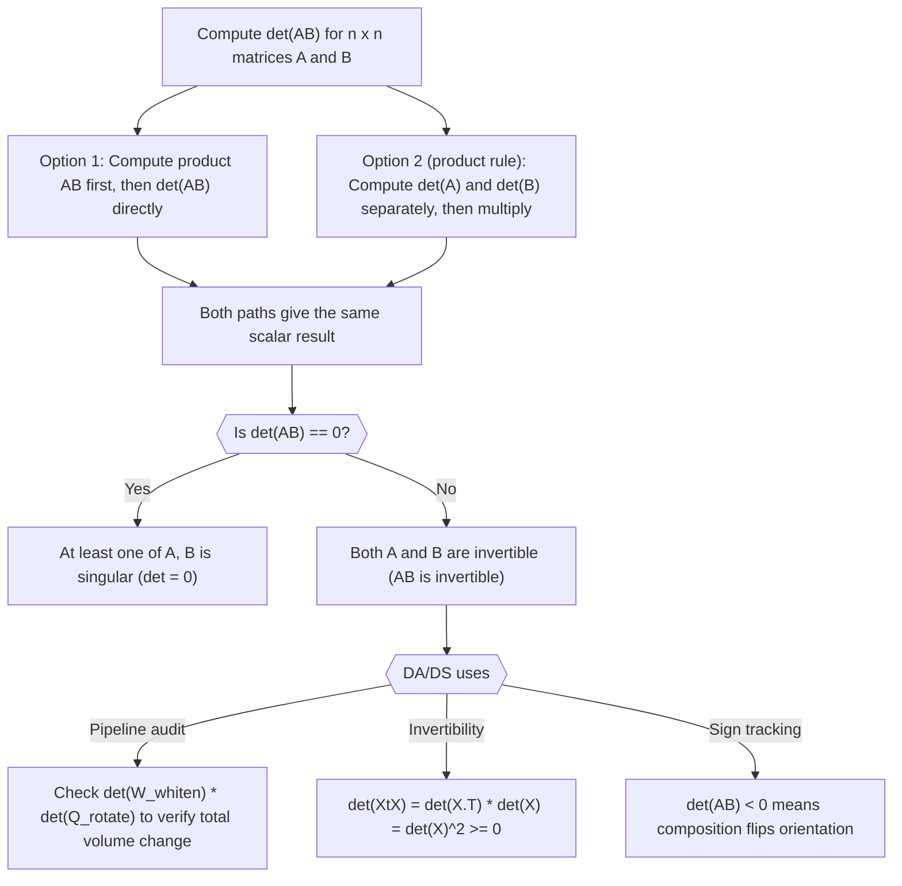

# Product determinant

$$
\det(AB) = \det(A)\det(B)
$$

## Deep Breakdown

What it tells me *(Situation Awareness)*:
The determinant of a product equals the product of determinants: $\det(AB) = \det(A)\det(B)$. This is the multiplicative property of the determinant. Since the determinant measures the volume scaling factor of a linear transformation, composing two transformations ($A$ then $B$, or equivalently the matrix $AB$) scales volume by $\det(A) \cdot \det(B)$. The identity extends to any finite product: $\det(A_1 A_2 \cdots A_k) = \prod_{i=1}^k \det(A_i)$. In DA/DS, this property appears when auditing pipelines of sequential matrix transformations (whitening, rotation, projection), when proving that covariance-preserving operations have $|\det| = 1$, and when checking that a composed transformation is invertible without explicitly computing the product matrix.

## Flowchart



## Real-world use

### Where it is used

Used when auditing a sequence of matrix operations to verify the overall transformation's invertibility, when proving that the Gram matrix $X^T X$ is positive semi-definite via $\det(X^T X) = \det(X^T)\det(X) = \det(X)^2 \geq 0$, when checking that a whitening-plus-rotation pipeline preserves volume, and when validating that multi-step feature transformations (centering, scaling, rotating) do not collapse the feature space.

### Problem it solves

Computing $\det(AB)$ directly requires forming the product matrix first, then running cofactor expansion or LU decomposition, which costs $O(n^3)$ on top of the multiply. The product rule lets you compute two smaller determinants independently and multiply two scalars, which is $2 \times O(n^3)$ but avoids the matrix multiplication cost when $AB$ is large or when only the sign or zero-check matters. More importantly, it gives structural insight: if you know $\det(A) = 0$, you immediately know $\det(AB) = 0$ without touching $B$.

### How it solves the problem

The proof uses LU decomposition: for any invertible matrix, $\det(A) = \prod \text{diagonal entries of } U$ (up to permutation sign). Composing $A$ and $B$ concatenates their LU factors, so the determinant of the product is the product of the determinants. For the singular case, $\det(A) = 0$ means the columns of $A$ are linearly dependent, so $AB$ maps all of $\mathbb{R}^n$ into a lower-dimensional subspace, giving $\det(AB) = 0$.

### Example in a business

A data scientist builds a multi-step preprocessing pipeline: first apply a whitening transformation $W$ (zero-mean, unit-variance, decorrelated features), then apply a PCA rotation $Q$ (orthogonal matrix). The composite transformation is $T = WQ$. To verify the pipeline is invertible and understand the total volume scaling, the scientist computes $\det(W)$ and $\det(Q)$ separately: $\det(Q) = \pm 1$ (orthogonal matrix), so the total volume scaling is just $|\det(W)|$, which measures how aggressively the whitening re-scales the feature space. No need to form $WQ$ explicitly.

## The formula, piece by piece

- $\det(AB)$: the determinant of the matrix product $AB$; both $A$ and $B$ must be square matrices of the same size $n \times n$
- $\det(A)$: the scalar determinant of matrix $A$; the volume scaling factor of the transformation represented by $A$
- $\det(B)$: the scalar determinant of matrix $B$; the volume scaling factor of the transformation represented by $B$
- The equality: the scaling factors compose multiplicatively, just as the transformations compose sequentially
- Extension: $\det(A^k) = \det(A)^k$ and $\det(A_1 \cdots A_k) = \prod_{i=1}^k \det(A_i)$ Full formula: $\det(AB) = \det(A) \cdot \det(B)$

## The formula in words

"The volume stretched or shrunk by applying transformation $A$ followed by transformation $B$ is simply the product of the two individual volume factors. If either transformation collapses the space to a lower dimension (determinant zero), the combined transformation also collapses it." Tiny numeric example:
$A = \begin{bmatrix}2 & 0 \\ 0 & 3\end{bmatrix}$, $\det(A) = 6$.
$B = \begin{bmatrix}1 & 1 \\ 0 & 2\end{bmatrix}$, $\det(B) = 2$.
$AB = \begin{bmatrix}2 & 2 \\ 0 & 6\end{bmatrix}$, $\det(AB) = 12 = 6 \times 2$.

## Critical Concepts

- **Only for square matrices:** the product rule requires $A$ and $B$ to be $n \times n$; rectangular matrix products do not have determinants.
- **Commutativity of the scalar product:** $\det(A)\det(B) = \det(B)\det(A)$, even though $AB \neq BA$ in general as matrices. The determinant collapses the non-commutativity.
- **Invertibility test:** $AB$ is invertible if and only if both $A$ and $B$ are invertible (i.e., both have non-zero determinants). One singular factor ruins invertibility.
- **Sign interpretation:** $\det < 0$ means the transformation flips orientation (e.g., includes a reflection). Two orientation-flipping matrices compose to a non-flipping one ($(-1)(-1) = 1$).
- **Gram matrix:** $\det(X^T X) = \det(X^T)\det(X) = \det(X)^2 \geq 0$. This is why the Gram matrix is always positive semi-definite; its determinant cannot be negative.
- **Orthogonal matrices:** $\det(Q) = \pm 1$, so $\det(QA) = \pm\det(A)$. Multiplying by an orthogonal matrix preserves $|\det|$: rotations and reflections do not change volume magnitude.
- **Numerical note:** for large matrices, computing $\det(A)$ directly can overflow or underflow.

Use `np.linalg.slogdet` to compute sign and log-determinant separately.

## Step-by-step calculation (tiny example)

*Step 1: Choose two simple 2×2 matrices and compute their individual determinants*
$A = \begin{bmatrix}3 & 1 \\ 0 & 2\end{bmatrix}$, $\det(A) = 3 \cdot 2 - 1 \cdot 0 = 6$.
$B = \begin{bmatrix}1 & -1 \\ 2 & 0\end{bmatrix}$, $\det(B) = 1 \cdot 0 - (-1) \cdot 2 = 2$.
Product of determinants: $6 \times 2 = 12$.

*Step 2: Compute the product matrix AB*
$AB = \begin{bmatrix}3\cdot1+1\cdot2 & 3\cdot(-1)+1\cdot0 \\ 0\cdot1+2\cdot2 & 0\cdot(-1)+2\cdot0\end{bmatrix} = \begin{bmatrix}5 & -3 \\ 4 & 0\end{bmatrix}$.

*Step 3: Compute det(AB) directly and verify*
$\det(AB) = 5 \cdot 0 - (-3) \cdot 4 = 0 + 12 = 12$.
Check: $\det(AB) = 12 = \det(A) \cdot \det(B) = 6 \times 2$.

## Code examples

### Beginner example (Python)

```python
import numpy as np   # -- det(AB) = det(A) * det(B): verification and zero-check --
A = np.array([[3.0, 1.0], [0.0, 2.0]])
B = np.array([[1.0, -1.0], [2.0, 0.0]])
det_A = np.linalg.det(A)
det_B = np.linalg.det(B)
det_AB = np.linalg.det(A @ B)
print(f"det(A) = {det_A:.4f}")
print(f"det(B) = {det_B:.4f}")
print(f"det(A) * det(B) = {det_A * det_B:.4f}")
print(f"det(A @ B) = {det_AB:.4f}")
print(f"Rule holds: {np.isclose(det_AB, det_A * det_B)}")   # Singular case: one factor has
det=0
A_sing = np.array([[1.0, 2.0], [2.0, 4.0]])   # rank 1
det_sing = np.linalg.det(A_sing)
print(f"\ndet(A_singular) = {det_sing:.6f} (effectively 0)")
print(f"det(A_sing @ B) = {np.linalg.det(A_sing @ B):.6f} (also 0)")
```

### Beginner example (R)

```r
# -- det(AB) = det(A) * det(B): verification and zero-check --
A <- matrix(c(3, 0, 1, 2), nrow = 2)  # column-major
A <- matrix(c(3, 1, 0, 2), nrow = 2, byrow = TRUE)
B <- matrix(c(1, -1, 2, 0), nrow = 2, byrow = TRUE)
det_A <- det(A)
det_B <- det(B)
det_AB <- det(A %*% B)
cat(sprintf("det(A) = %.4f\n", det_A))
cat(sprintf("det(B) = %.4f\n", det_B))
cat(sprintf("det(A) * det(B) = %.4f\n", det_A * det_B))
cat(sprintf("det(A %%*%% B) = %.4f\n", det_AB))
cat(sprintf("Rule holds: %s\n", isTRUE(all.equal(det_AB, det_A * det_B))))  # Singular case
A_sing <- matrix(c(1, 2, 2, 4), nrow = 2, byrow = TRUE)
cat(sprintf("\ndet(A_singular) = %.6f (zero)\n", det(A_sing)))
cat(sprintf("det(A_sing %%*%% B) = %.6f (also zero)\n", det(A_sing %*% B)))
```

### Professional example (Python)

```python
import numpy as np
import pandas as pd
np.random.seed(42)   # -- Business scenario: auditing a preprocessing pipeline for invertibility
# Pipeline: whiten X with W, then apply PCA rotation Q.
# Verify det(W @ Q) = det(W) * det(Q), and confirm |det(Q)| = 1.
N_OBS = 200
N_FEATURES = 5
FEATURE_NAMES = ["tv_spend", "digital_spend", "search_spend", "print_spend", "radio_spend"]   # Simulate correlated feature matrix
cov_true = np.array([ [9.0, 2.0, 1.5, 0.5, 0.3], [2.0, 4.0, 1.0, 0.2, 0.1], [1.5, 1.0, 3.0, 0.4, 0.2], [0.5, 0.2, 0.4, 2.0, 0.1], [0.3, 0.1, 0.2, 0.1, 1.5],
])
X_raw = np.random.multivariate_normal(np.zeros(N_FEATURES), cov_true, size=N_OBS)   # Step 1: whitening transformation W (ZCA whitening)
cov_sample = np.cov(X_raw.T)
eigenvalues, eigenvectors = np.linalg.eigh(cov_sample)
w_diag = np.diag(1.0 / np.sqrt(eigenvalues + 1e-10))
W = eigenvectors @ w_diag @ eigenvectors.T   # whitening matrix # Step 2: PCA rotation Q (orthogonal, columns = eigenvectors)
Q, _ = np.linalg.qr(eigenvectors)   # orthogonal matrix # Composed transformation
T = W @ Q
det_W = np.linalg.det(W)
det_Q = np.linalg.det(Q)
det_T_direct = np.linalg.det(T)
det_T_product_rule = det_W * det_Q
results = pd.DataFrame({ "quantity": ["det(W)", "det(Q)", "det(W)*det(Q)", "det(W @ Q)", "match"], "value": [ det_W, det_Q, det_T_product_rule, det_T_direct, float(np.isclose(det_T_direct, det_T_product_rule)), ],
}).astype({"value": float})
print("Preprocessing pipeline determinant audit:")
print(results.to_string(index=False))
print(f"\n|det(Q)| = {abs(det_Q):.6f} (should be 1.0 for orthogonal matrix)")
print(f"|det(W)| = {abs(det_W):.6f} (whitening volume scaling factor)")
print(f"|det(T)| = {abs(det_T_direct):.6f} (combined volume scaling = |det(W)| * 1)")
print("\nInterpretation: det(W@Q) = det(W)*det(Q) confirms the product rule. |det(Q)|=1 means the rotation adds no volume distortion; all scaling comes from the whitening step.")
```

---

*Source: 1300 p. 117*
