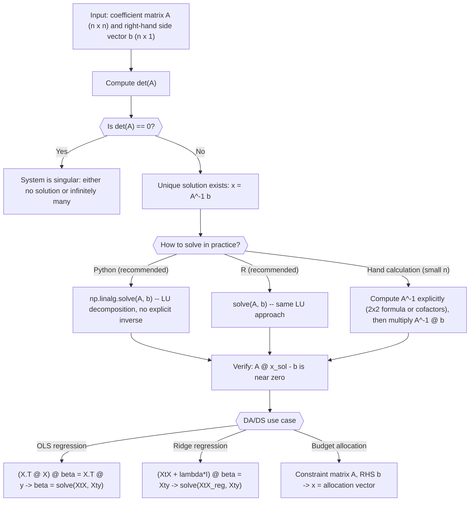

# Systems of Linear Equations

$$
Ax = b \implies x = A^{-1}b
$$

(if $\det(A) \ne 0$)

## Deep Breakdown

What it tells me *(Situation Awareness)*:
$Ax = b$ is the canonical form of a system of $n$ linear equations in $n$ unknowns: $A$ is the $n \times n$ coefficient matrix, $x$ is the unknown column vector, and $b$ is the right-hand side column vector. When $\det(A) \neq 0$ (i.e., $A$ is invertible), the unique solution is $x = A^{-1}b$. This formula is the theoretical foundation for every linear solver in statistics and ML: OLS normal equations $(X^T X)\hat{\theta} = X^T y$, ridge regression $(X^T X + \lambda I)\hat{\theta} = X^T y$, Kalman filter updates, and solving for portfolio weights under budget and risk constraints. In practice, you almost never compute $A^{-1}$ explicitly; instead you call `np.linalg.solve(A, b)` which uses LU decomposition and is faster and more numerically stable.

## Flowchart



## Real-world use

### Where it is used

Used to solve OLS normal equations (linear regression with a finite number of parameters), ridge regression, weighted least squares, Kalman filter state estimation, budget allocation problems with equality constraints, price optimization given supply-demand equations, and any DA/DS problem that reduces to a square invertible system.

### Problem it solves

Given $n$ simultaneous linear constraints $a_{1}^T x = b_1, \dots, a_n^T x = b_n$, find the unique $x$ that satisfies all of them. This is the most common structured computation in quantitative DA/DS: the normal equations of OLS are exactly this, with $A = X^T X$ and $b = X^T y$.

### How it solves the problem

When $A$ is invertible, the solution is algebraically $x = A^{-1}b$. Computationally, LU decomposition factors $A = LU$ (lower and upper triangular), then solves $Ly = b$ by forward substitution and $Ux = y$ by back substitution. This costs $O(n^3)$ for the factorization and $O(n^2)$ for each solve, which is faster than forming $A^{-1}$ ($O(n^3)$ plus an extra $O(n^2)$ multiply) and more numerically stable.

### Example in a business

A pricing analyst models demand across 4 product categories using a linear system of price-response equations: $Ap = q$ where $A$ captures cross-price elasticities, $p$ is the price vector, and $q$ is the target demand vector. Given a target demand $q^*$, the analyst solves $p^* = A^{-1}q^*$ (via `np.linalg.solve`) to find the prices that exactly hit the demand targets, subject to the elasticity model.

## The formula, piece by piece

- $A$: the $n \times n$ coefficient matrix; each row encodes one linear equation; invertible when $\det(A) \neq 0$
- $x$: the unknown $n \times 1$ column vector we want to find
- $b$: the $n \times 1$ right-hand side vector; the targets or constraints
- $A^{-1}$: the inverse of $A$; exists only when $\det(A) \neq 0$; in practice computed implicitly via LU decomposition, not explicitly
- $\implies$: "implies"; the existence of a solution depends on invertibility
- $\det(A) \neq 0$: the invertibility condition; guarantees a unique solution Full formula: $Ax = b \implies x = A^{-1}b$ when $\det(A) \neq 0$

## The formula in words

"If the system $Ax = b$ has an invertible coefficient matrix $A$, then the unique solution is found by multiplying both sides on the left by $A^{-1}$: the $n$ unknowns in $x$ are exactly $A^{-1}$ applied to the right-hand side $b$." Tiny numeric example:
$A = \begin{bmatrix}2 & 1 \\ 5 & 3\end{bmatrix}$, $b = \begin{bmatrix}5 \\ 13\end{bmatrix}$.
$\det(A) = 6 - 5 = 1 \neq 0$. $A^{-1} = \begin{bmatrix}3 & -1 \\ -5 & 2\end{bmatrix}$.
$x = A^{-1}b = \begin{bmatrix}3\cdot5 + (-1)\cdot13 \\ (-5)\cdot5 + 2\cdot13\end{bmatrix} = \begin{bmatrix}2 \\ 1\end{bmatrix}$.
Verify: $A x = \begin{bmatrix}2\cdot2+1\cdot1 \\ 5\cdot2+3\cdot1\end{bmatrix} = \begin{bmatrix}5 \\ 13\end{bmatrix} = b$ ✓.

## Critical Concepts

- **Never form the explicit inverse for large $n$:** `np.linalg.solve(A, b)` is faster, more stable, and the professional standard. Only use the explicit inverse formula for $n = 2$ by hand or when you need $A^{-1}$ for multiple right-hand sides.
- **Condition number:** a large condition number ($\kappa(A) = \|A\|\|A^{-1}\|$) means $A$ is nearly singular and small errors in $b$ lead to large errors in $x$. Always check `np.linalg.cond(A)` for values above $10^6$ before trusting a solution.
- **Overdetermined systems ($m > n$):** when there are more equations than unknowns, an exact solution usually does not exist. OLS finds $x$ that minimizes $\|Ax - b\|^2$; use `np.linalg.lstsq` not `solve`.
- **Underdetermined systems ($m < n$):** infinitely many solutions; add regularization (ridge, LASSO) to select a unique one.
- **Uniqueness:** exactly one solution when $\det(A) \neq 0$. Zero solutions when $b \notin \text{col}(A)$. Infinite solutions when $b \in \text{col}(A)$ and $A$ is singular.
- **Normal equations:** $X^T X \hat{\theta} = X^T y$ is $Ax = b$ with $A = X^T X$ (always positive semi-definite) and $b = X^T y$. Use `np.linalg.solve(XtX, Xty)` not `np.linalg.inv(XtX) @ Xty`.
- **Multiple right-hand sides:** if you need to solve $Ax = b_1, Ax = b_2, \dots$, stack the $b_i$ as columns: `np.linalg.solve(A, B_matrix)` solves all at once.

## Step-by-step calculation (tiny example)

*Step 1: Set up the system and check det(A)*
System: $2x_1 + 1x_2 = 5$ and $5x_1 + 3x_2 = 13$.
$A = \begin{bmatrix}2 & 1 \\ 5 & 3\end{bmatrix}$, $b = \begin{bmatrix}5 \\ 13\end{bmatrix}$.
$\det(A) = 2 \cdot 3 - 1 \cdot 5 = 1 \neq 0$. Unique solution exists.

*Step 2: Compute A inverse using the 2×2 formula and solve*
$A^{-1} = \frac{1}{1}\begin{bmatrix}3 & -1 \\ -5 & 2\end{bmatrix} = \begin{bmatrix}3 & -1 \\ -5 & 2\end{bmatrix}$.
$x = A^{-1}b = \begin{bmatrix}3 \cdot 5 - 1 \cdot 13 \\ -5 \cdot 5 + 2 \cdot 13\end{bmatrix} = \begin{bmatrix}15-13 \\ -25+26\end{bmatrix} = \begin{bmatrix}2 \\ 1\end{bmatrix}$.

*Step 3: Verify the solution*
$Ax = \begin{bmatrix}2(2)+1(1) \\ 5(2)+3(1)\end{bmatrix} = \begin{bmatrix}5 \\ 13\end{bmatrix} = b$ ✓.
Residual $\|Ax - b\| = 0$.

## Code examples

### Beginner example (Python)

```python
import numpy as np   # -- Solving Ax = b: the two approaches compared -----------------------
A = np.array([[2.0, 1.0], [5.0, 3.0]])
b = np.array([5.0, 13.0])   # Check invertibility first
det_A = np.linalg.det(A)
print(f"det(A) = {det_A:.4f} ({'invertible' if abs(det_A) > 1e-10 else 'singular'})")   # Approach 1: explicit inverse (only appropriate for small n)
A_inv = np.linalg.inv(A)
x_inv = A_inv @ b   # Approach 2: solve via LU decomposition (always preferred)
x_solve = np.linalg.solve(A, b)
print(f"\nx via explicit inverse: {x_inv}")
print(f"x via linalg.solve: {x_solve}")
print(f"Solutions match: {np.allclose(x_inv, x_solve)}")   # Verify residuals
print(f"\nResidual (A @ x_solve - b): {A @ x_solve - b}")   # Singular system example
A_sing = np.array([[1.0, 2.0], [2.0, 4.0]])
try:
    _ = np.linalg.solve(A_sing, b)
except np.linalg.LinAlgError as err:
    print(f"\nSingular system error: {err}")
print(f"det(A_singular) = {np.linalg.det(A_sing):.6f}")
```

### Beginner example (R)

```r
# -- Solving
Ax = b in R: solve() function -----------------------------
A <- matrix(c(2, 1, 5, 3), nrow = 2, byrow = TRUE)
b <- c(5, 13)
det_A <- det(A)
cat(sprintf("det(A) = %.4f (%s)\n", det_A, ifelse(abs(det_A) > 1e-10, "invertible", "singular")))  # solve(A, b) uses LU internally
x_solve <- solve(A, b)
cat(sprintf("\nx via solve(A, b): x1=%.4f, x2=%.4f\n", x_solve[1], x_solve[2]))  # solve(A) gives explicit inverse -- use only when truly needed
A_inv <- solve(A)
x_inv <- A_inv %*% b
cat(sprintf("x via A_inv %*% b: x1=%.4f, x2=%.4f\n", x_inv[1], x_inv[2]))  # Verify
residual <- A %*% x_solve - b
cat(sprintf("Residual norm: %.2e\n", sqrt(sum(residual^2))))
```

### Professional example (Python)

```python
import numpy as np
import pandas as pd
np.random.seed(42)   # -- Business scenario: OLS regression for 4-channel media mix model
# Solve the normal equations (X^T X) beta = X^T y via np.linalg.solve.
# Compare solve() vs explicit inverse to demonstrate numerical superiority.
N_WEEKS = 104
N_CHANNELS = 4
CHANNEL_NAMES = ["tv", "digital", "search", "print"]
TRUE_COEFS = np.array([0.6, 1.2, 1.8, 0.3])   # Simulate weekly channel spend (correlated, realistic)
X = np.random.normal(0, 1, size=(N_WEEKS, N_CHANNELS))
X[:, 1] += 0.6 * X[:, 0]   # digital correlated with tv
y = X @ TRUE_COEFS + np.random.normal(0, 0.5, N_WEEKS)   # Normal equations: (X^T X) beta = X^T y
XtX = X.T @ X   # (4 x 4) system matrix
Xty = X.T @ y   # (4 x 1) right-hand side
cond_num = np.linalg.cond(XtX)   # Method 1: solve (LU decomposition, recommended)
beta_solve = np.linalg.solve(XtX, Xty)   # Method 2: explicit inverse (not recommended for large n)
beta_inv = np.linalg.inv(XtX) @ Xty   # Residuals to assess each method's numerical accuracy
residual_solve = np.max(np.abs(XtX @ beta_solve - Xty))
residual_inv = np.max(np.abs(XtX @ beta_inv - Xty))
comparison_df = pd.DataFrame({ "channel": CHANNEL_NAMES, "true_coef": TRUE_COEFS, "beta_solve": beta_solve.round(4), "beta_inv": beta_inv.round(4),
})
print(f"Condition number of X^T X: {cond_num:.2f}")
print(f"\nCoefficient comparison (true vs solve vs explicit inverse):")
print(comparison_df.to_string(index=False))
print(f"\nMax residual |X^T X @ beta - X^T y|:")
print(f" solve(): {residual_solve:.2e}")
print(f" explicit inv(): {residual_inv:.2e}")
print(f"\nInterpretation: np.linalg.solve uses LU decomposition to implement x = A^-1 b without forming A^-1 explicitly, yielding better numerical precision especially when the condition number is large.")
```

### Professional example (R)

```r
# Normal equations (X'X)
beta = X'y: solve() vs explicit inverse set.seed(42)
N <- 200
CHANNEL_NAMES <- c("tv", "digital", "search", "radio")
X <- matrix(rnorm(N * 4), nrow = N)
TRUE_COEFS <- c(0.5, 1.1, 0.3, 0.8)
y <- X %*% TRUE_COEFS + rnorm(N, 0, 0.5)
XtX <- t(X) %*% X
Xty <- t(X) %*% y
cond_num <- 1 / min(abs(eigen(XtX, only.values = TRUE)$values)) * max(abs(eigen(XtX, only.values = TRUE)$values))
beta_solve <- as.vector(solve(XtX, Xty))
beta_inv <- as.vector(solve(XtX) %*% Xty)
residual_solve <- max(abs(XtX %*% beta_solve - Xty))
residual_inv <- max(abs(XtX %*% beta_inv - Xty))
cat(sprintf("Condition number: %.2f\n", cond_num))
cat("Coefficients (solve vs inv):\n")
print(data.frame(channel = CHANNEL_NAMES, true = TRUE_COEFS, beta_solve = round(beta_solve, 4), beta_inv = round(beta_inv, 4)))
cat(sprintf("Max residual solve: %.2e inv: %.2e\n", residual_solve, residual_inv))
```

---

*Source: 1300 p. 122*
