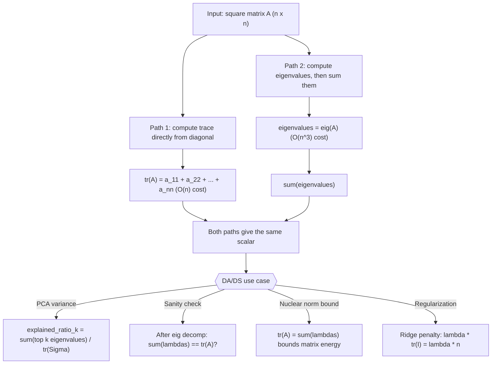

# Trace Identity (eigenvalues)

$$
\text{tr}(A) = \sum_{i} \lambda_i
$$

## Deep Breakdown

What it tells me *(Situation Awareness)*:
The trace of a square matrix equals the sum of its eigenvalues: $\text{tr}(A) = \sum_i \lambda_i$. This connects two different representations of the same matrix: the trace (computable in $O(n)$ from the diagonal) and the eigenvalues (requiring $O(n^3)$ eigendecomposition). The identity provides a fast sanity check after eigendecomposition and, more importantly, a direct interpretation of the trace in terms of the spectrum. In DA/DS and ML, this identity is used constantly in PCA: the trace of a covariance matrix $\Sigma$ equals the total variance in the data, and since $\text{tr}(\Sigma) = \sum_i \lambda_i$, the fraction of variance explained by the top $k$ principal components is $\frac{\sum_{i=1}^k \lambda_i}{\text{tr}(\Sigma)}$. It also appears in regularization theory, spectral graph analysis, and the Stein's lemma for risk estimation.

## Flowchart



## Real-world use

### Where it is used

Used in PCA to compute the explained variance ratio for each component, in spectral graph theory where $\text{tr}(A^k)$ counts closed walks of length $k$, as a fast sanity check after eigendecomposition, in covariance matrix analysis to interpret total data spread, and in trace-norm regularization for matrix completion (collaborative filtering, recommender systems).

### Problem it solves

Computing eigenvalues is expensive ($O(n^3)$). When you only need the sum of eigenvalues (e.g., to get total variance), you get it for free from the trace in $O(n)$. Conversely, when you already have the eigenvalues from a PCA, you can verify your computation by checking $\sum_i \lambda_i = \text{tr}(\Sigma)$ without recomputing the trace from scratch.

### How it solves the problem

The identity follows from the characteristic polynomial: $\text{tr}(A)$ equals the negative of the coefficient of $\lambda^{n-1}$ in $\det(\lambda I - A)$, which also equals $\sum_i \lambda_i$. More intuitively, in the eigenbasis $A = Q\Lambda Q^{-1}$, so $\text{tr}(A) = \text{tr}(Q\Lambda Q^{-1}) = \text{tr}(\Lambda Q^{-1}Q) = \text{tr}(\Lambda) = \sum_i \lambda_i$ (using the cyclic property of trace).

### Example in a business

A data scientist runs PCA on a customer behaviour dataset with $p = 20$ features. The covariance matrix eigenvalues are $\lambda_1, \dots, \lambda_{20}$. They compute the number of components needed to explain 90% of variance: the threshold is $\sum_{i=1}^k \lambda_i \geq 0.90 \cdot \text{tr}(\Sigma)$. Using `np.trace(cov_matrix)` (fast) for the denominator and the sorted eigenvalues for the numerator, they find $k = 6$ components explain 91% of variance, reducing 20 dimensions to 6.

## The formula, piece by piece

- $\text{tr}(A)$: the trace of matrix $A$; the sum of all diagonal entries $a_{11} + a_{22} + \cdots + a_{nn}$; computed in $O(n)$
- $\sum_i$: sum over all $n$ eigenvalues, each counted with its algebraic multiplicity
- $\lambda_i$: the $i$-th eigenvalue of $A$; possibly complex for non-symmetric $A$; always real for symmetric positive semi-definite matrices (like covariance matrices)
- The equality: invariant to basis change; both the trace and the eigenvalue sum are spectrum invariants Full formula: $\text{tr}(A) = \sum_{i=1}^n \lambda_i$

## The formula in words

"The sum of the diagonal entries of a matrix equals the sum of its eigenvalues. You don't need to compute eigenvalues to get their sum — the diagonal already encodes it. Conversely, after an eigendecomposition, the eigenvalue sum gives you a free sanity check." Tiny numeric example:
$A = \begin{bmatrix}5 & 2 \\ 2 & 3\end{bmatrix}$.
$\text{tr}(A) = 5 + 3 = 8$.
Eigenvalues: $\lambda^2 - 8\lambda + (15-4) = 0 \implies \lambda^2 - 8\lambda + 11 = 0 \implies \lambda = 4 \pm \sqrt{5}$.
$\lambda_1 + \lambda_2 = (4+\sqrt{5}) + (4-\sqrt{5}) = 8 = \text{tr}(A)$.

## Critical Concepts

- **Trace is basis-independent:** $\text{tr}(A) = \text{tr}(P^{-1}AP)$ for any invertible $P$. Changing the coordinate system doesn't change the sum of diagonal entries. This is why it equals the eigenvalue sum (spectrum = invariant).
- **Complex eigenvalues come in conjugate pairs for real matrices:** $\text{tr}$ is real, so the imaginary parts cancel. The sum of eigenvalues is always real for real $A$.
- **Repeated eigenvalues:** if $\lambda$ has algebraic multiplicity $m$, it contributes $m\lambda$ to the sum, not just $\lambda$.
- **PCA connection:** for a covariance matrix $\Sigma$, all eigenvalues are non-negative, so $\text{tr}(\Sigma) = \sum \lambda_i$ is the total variance. Explained variance ratio: $r_k = \sum_{i=1}^k \lambda_i / \text{tr}(\Sigma)$.
- **Relation to Frobenius norm:** $\|A\|_F^2 = \text{tr}(A^T A) = \sum_i \sigma_i^2$ (singular values squared), not eigenvalues. Don't confuse eigenvalues with singular values.
- **Trace of matrix power:** $\text{tr}(A^k) = \sum_i \lambda_i^k$.

In graph theory, $\text{tr}(A^3)/6$ counts triangles in the adjacency matrix.

## Step-by-step calculation (tiny example)

*Step 1: Compute the trace directly from the diagonal*
$A = \begin{bmatrix}4 & 1 \\ 3 & 2\end{bmatrix}$.
$\text{tr}(A) = a_{11} + a_{22} = 4 + 2 = 6$.

*Step 2: Find the eigenvalues via the characteristic polynomial*
$\det(\lambda I - A) = (\lambda - 4)(\lambda - 2) - 1 \cdot 3 = \lambda^2 - 6\lambda + 5 = 0$.
$(\lambda - 1)(\lambda - 5) = 0 \implies \lambda_1 = 1, \lambda_2 = 5$.

*Step 3: Verify the trace identity*
$\lambda_1 + \lambda_2 = 1 + 5 = 6 = \text{tr}(A)$.
Note: $\lambda_1 \cdot \lambda_2 = 5 = \det(A) = 8 - 3 = 5$ (trace = eigenvalue sum, det = eigenvalue product).

## Code examples

### Beginner example (Python)

```python
import numpy as np

# -- tr(A) = sum of eigenvalues: verification and PCA variance check ---
A = np.array([[4.0, 1.0], [3.0, 2.0]])
trace_direct = float(np.trace(A))
eigenvalues, _ = np.linalg.eig(A)
trace_from_eigs = float(np.sum(eigenvalues.real))   # real part (imag ~ 0 for real symm)
print(f"Matrix A:\n{A}")
print(f"\nTrace (diagonal sum): {trace_direct:.6f}")
print(f"Sum of eigenvalues: {trace_from_eigs:.6f}")
print(f"Identity holds: {np.isclose(trace_direct, trace_from_eigs)}")

# Symmetric PSD example: covariance matrix
np.random.seed(42)
cov = np.cov(np.random.randn(5, 50))   # 5x5 sample covariance
eigvals_cov = np.linalg.eigvalsh(cov)   # eigvalsh for symmetric: real eigenvalues
print(f"\nCovariance matrix trace: {float(np.trace(cov)):.6f}")
print(f"Sum of eigenvalues: {float(np.sum(eigvals_cov)):.6f}")
print(f"Explained variance ratio per component: {eigvals_cov[::-1] / np.trace(cov)}")
```

### Beginner example (R)

```r
# -- tr(A) = sum of eigenvalues: verification and PCA variance check ---
A <- matrix(c(4, 1, 3, 2), nrow = 2, byrow = TRUE)
trace_direct <- sum(diag(A))  # R has no built-in trace(); use sum(diag())
eig_result <- eigen(A)
trace_eigsum <- sum(Re(eig_result$values))
cat(sprintf("Trace (diagonal sum): %.6f\n", trace_direct))
cat(sprintf("Sum of eigenvalues: %.6f\n", trace_eigsum))
cat(sprintf("Identity holds: %s\n", isTRUE(all.equal(trace_direct, trace_eigsum))))

# PCA variance
set.seed(42)
X_data <- matrix(rnorm(50 * 5), nrow = 50, ncol = 5)
cov_mat <- cov(X_data)
eigvals <- eigen(cov_mat, symmetric = TRUE)$values  # sorted descending
cat(sprintf("\nCovariance matrix trace: %.6f\n", sum(diag(cov_mat))))
cat(sprintf("Sum of eigenvalues: %.6f\n", sum(eigvals)))
cat(sprintf("Explained variance ratio: %s\n", paste(round(eigvals / sum(diag(cov_mat)), 4), collapse = ", ")))
```

### Professional example (Python)

```python
import numpy as np
import pandas as pd
np.random.seed(42)

# -- Business scenario: PCA component selection using trace identity
# Customer behaviour dataset: 20 features.
# Use tr(Sigma) as the total-variance denominator (O(n) cost, no eigendecomp needed).
# Then determine how many PCA components explain >= 90% of variance.
N_OBS = 500
N_FEATURES = 20
VARIANCE_THRESHOLD = 0.90
FEATURE_NAMES = [f"behaviour_{i:02d}" for i in range(1, N_FEATURES + 1)]

# Simulate data with latent structure: first 5 factors drive most variance
latent_factors = np.random.randn(N_OBS, 5)
factor_scales = np.array([2.0, 1.5, 1.2, 0.8, 0.5])
loadings = np.random.randn(5, N_FEATURES) * factor_scales[:, None]   # scale each factor's row
noise = np.random.randn(N_OBS, N_FEATURES) * 0.3
X = latent_factors @ loadings + noise

# Center and compute covariance matrix
X_centered = X - X.mean(axis=0)
cov_matrix = np.cov(X_centered.T)   # (20 x 20)

# Total variance via trace (O(n), no eigendecomp required)
total_variance = float(np.trace(cov_matrix))

# Eigendecomposition for component analysis
eigenvalues = np.linalg.eigvalsh(cov_matrix)[::-1]   # sorted descending

# Verify trace identity
trace_vs_eigsum_match = np.isclose(total_variance, float(np.sum(eigenvalues)))

# Find k components to exceed the variance threshold
cumulative_ratio = np.cumsum(eigenvalues) / total_variance
k_components = int(np.searchsorted(cumulative_ratio, VARIANCE_THRESHOLD)) + 1

# Summary table
component_df = pd.DataFrame({
    "component": range(1, N_FEATURES + 1),
    "eigenvalue": eigenvalues.round(4),
    "explained_pct": (eigenvalues / total_variance * 100).round(2),
    "cumulative_pct": (cumulative_ratio * 100).round(2),
})
print(f"Total variance tr(Sigma) = {total_variance:.4f}")
print(f"Sum of eigenvalues = {float(np.sum(eigenvalues)):.4f}")
print(f"Trace identity holds : {trace_vs_eigsum_match}")
print(f"\nComponents needed for {VARIANCE_THRESHOLD*100:.0f}% variance: {k_components}")
print(f"\nPer-component breakdown (top 10):")
print(component_df.head(10).to_string(index=False))
print(f"\nInterpretation: tr(Sigma) = sum(lambda_i) gives the total variance in O(n) without eigendecomposition. Dividing each lambda_i by tr(Sigma) gives the PCA explained variance ratio, enabling component count selection.")
```

---

*Source: MYLA p. 6*
