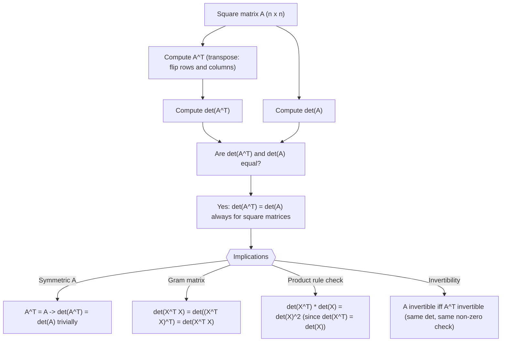

# Transpose determinant

$$
\det(A^T) = \det(A)
$$

## Deep Breakdown

What it tells me *(Situation Awareness)*:
Transposing a square matrix does not change its determinant: $\det(A^T) = \det(A)$. This means that row operations and column operations have symmetric effects on the determinant. The identity also confirms that every statement about rows of $A$ that involves the determinant has a corresponding statement about columns. In DA/DS, the most common implication is for symmetric matrices: covariance matrices $\Sigma$, Gram matrices $X^T X$, and correlation matrices are all symmetric ($A^T = A$), so $\det(A^T) = \det(A)$ is trivially satisfied. The identity becomes practically useful when you need to prove properties of these matrices or when verifying that a matrix factorization step preserved the determinant.

## Flowchart



## Real-world use

### Where it is used

Used when verifying that a covariance matrix or Gram matrix is symmetric (and therefore its determinant is unambiguous regardless of orientation), when deriving the positive semi-definiteness of $X^T X$ using $\det(X^T X) = \det(X^T)\det(X) = \det(X)^2 \geq 0$, in Cholesky decomposition proofs, and when confirming that regularizing a symmetric matrix ($\Sigma + \lambda I$) preserves symmetry and keeps the determinant well-defined.

### Problem it solves

When working with symmetric matrices (covariance, correlation, adjacency in undirected graphs), you often need to reason about their determinant without worrying whether you should be using $A$ or $A^T$. The identity guarantees they are the same, simplifying proofs and removing a source of ambiguity.

### How it solves the problem

The proof uses cofactor expansion: the cofactor expansion of $\det(A)$ along rows is identical to the cofactor expansion of $\det(A^T)$ along columns (since rows of $A$ become columns of $A^T$). More formally, the Leibniz formula for the determinant is symmetric in rows and columns: $\det(A) = \sum_{\sigma \in S_n} \text{sgn}(\sigma) \prod_i a_{i,\sigma(i)}$. Transposing replaces $a_{i,\sigma(i)}$ with $a_{\sigma(i),i}$, which over all permutations gives the same sum.

### Example in a business

A risk analyst builds a portfolio model with $p = 8$ assets. The covariance matrix $\Sigma$ is estimated from historical returns. Before computing the portfolio variance $w^T \Sigma w$, the analyst verifies $\det(\Sigma) > 0$ (required for the portfolio optimization to have a unique solution). Since $\Sigma$ is symmetric, they can confirm $\det(\Sigma^T) = \det(\Sigma)$ trivially, and a positive determinant confirms all eigenvalues are positive (positive definite), meaning no asset is a perfect linear combination of others.

## The formula, piece by piece

- $\det(A^T)$: the determinant of the transpose of $A$; same size as $A$, rows and columns swapped
- $\det(A)$: the determinant of the original matrix $A$
- The equality: the determinant is invariant to transposition; rows and columns contribute equally
- Symmetric case: if $A = A^T$ then $\det(A^T) = \det(A)$ trivially; the identity is non-trivial for non-symmetric $A$ Full formula: $\det(A^T) = \det(A)$ for any $n \times n$ square matrix $A$

## The formula in words

"Flipping a matrix along its main diagonal — swapping rows and columns — does not change the volume scaling factor it represents. The determinant is equally determined by the rows and by the columns of a matrix." Tiny numeric example:
$A = \begin{bmatrix}1 & 2 \\ 3 & 4\end{bmatrix}$, $\det(A) = 4 - 6 = -2$.
$A^T = \begin{bmatrix}1 & 3 \\ 2 & 4\end{bmatrix}$, $\det(A^T) = 4 - 6 = -2$.

## Critical Concepts

- **Invertibility is symmetric:** $A$ is invertible if and only if $A^T$ is invertible; since $\det(A^T) = \det(A) \neq 0$.
- **Symmetric matrices ($A = A^T$):** the identity is trivially true. For all covariance, correlation, Gram, and adjacency (undirected) matrices in DA/DS.
- **Connection to product rule:** $\det(X^T X) = \det(X^T)\det(X) = \det(X)^2 \geq 0$. This proves the Gram matrix always has a non-negative determinant, hence it is positive semi-definite.
- **Eigenvalues of $A$ vs $A^T$:** $A$ and $A^T$ have the same eigenvalues (the characteristic polynomial $\det(\lambda I - A) = \det((\lambda I - A)^T) = \det(\lambda I - A^T)$). Same determinant, same trace, same characteristic polynomial.
- **Not the same for non-square:** the transpose of an $m \times n$ matrix is $n \times m$; determinants are only defined for square matrices, so $\det(A^T) = \det(A)$ has no meaning for rectangular $A$.
- **Cholesky connection:** if $\Sigma = LL^T$ (Cholesky), then $\det(\Sigma) = \det(L)^2 = (\prod_i L_{ii})^2$; this uses $\det(L^T) = \det(L)$.

## Step-by-step calculation (tiny example)

*Step 1: Write A and its transpose*
$A = \begin{bmatrix}2 & 5 \\ 1 & 3\end{bmatrix}$.
$A^T = \begin{bmatrix}2 & 1 \\ 5 & 3\end{bmatrix}$ (rows become columns).

*Step 2: Compute det(A)*
$\det(A) = 2 \cdot 3 - 5 \cdot 1 = 6 - 5 = 1$.

*Step 3: Compute det(A^T) and verify equality*
$\det(A^T) = 2 \cdot 3 - 1 \cdot 5 = 6 - 5 = 1$.
$\det(A^T) = 1 = \det(A)$.

## Code examples

### Beginner example (Python)

```python
import numpy as np

# -- det(A^T) = det(A): verification for general and symmetric matrices --
A = np.array([[2.0, 5.0], [1.0, 3.0]])
det_A = np.linalg.det(A)
det_At = np.linalg.det(A.T)
print(f"A:\n{A}")
print(f"\ndet(A) = {det_A:.6f}")
print(f"det(A.T) = {det_At:.6f}")
print(f"Identity holds: {np.isclose(det_A, det_At)}")

# Symmetric matrix case (covariance-like)
S = np.array([[4.0, 1.5, 0.5], [1.5, 3.0, 1.0], [0.5, 1.0, 2.0]])
print(f"\nSymmetric matrix S (S == S.T: {np.allclose(S, S.T)})")
print(f"det(S) = {np.linalg.det(S):.6f}")
print(f"det(S.T) = {np.linalg.det(S.T):.6f}")

# Gram matrix: det(X^T X) = det(X)^2 >= 0
np.random.seed(42)
X = np.random.randn(4, 4)
gram = X.T @ X
print(f"\ndet(X) = {np.linalg.det(X):.6f}")
print(f"det(X)^2 = {np.linalg.det(X)**2:.6f}")
print(f"det(X^T X) = {np.linalg.det(gram):.6f}")
print(f"det(X.T)*det(X) = det(X^T X): {np.isclose(np.linalg.det(X.T)*np.linalg.det(X), np.linalg.det(gram))}")
```

### Beginner example (R)

```r
# -- det(A^T) = det(A): verification for general and symmetric matrices --
A <- matrix(c(2, 1, 5, 3), nrow = 2, byrow = TRUE)
det_A <- det(A)
det_At <- det(t(A))
cat(sprintf("det(A) = %.6f\n", det_A))
cat(sprintf("det(t(A)) = %.6f\n", det_At))
cat(sprintf("Identity holds: %s\n", isTRUE(all.equal(det_A, det_At))))

# Symmetric covariance matrix
S <- matrix(c(4.0, 1.5, 0.5, 1.5, 3.0, 1.0, 0.5, 1.0, 2.0), nrow = 3, byrow = TRUE)
cat(sprintf("\nS is symmetric: %s\n", isTRUE(all.equal(S, t(S)))))
cat(sprintf("det(S) = %.6f\n", det(S)))
cat(sprintf("det(t(S)) = %.6f\n", det(t(S))))

# Gram matrix
set.seed(42)
X <- matrix(rnorm(16), nrow = 4)
gram <- t(X) %*% X
cat(sprintf("\ndet(X)^2 = %.6f\n", det(X)^2))
cat(sprintf("det(t(X) %%*%% X) = %.6f\n", det(gram)))
```

### Professional example (Python)

```python
import numpy as np
import pandas as pd
np.random.seed(42)

# -- Business scenario: portfolio covariance matrix validation
# For a portfolio of 8 assets, verify the estimated covariance matrix is
# positive definite (all eigenvalues > 0, det > 0) using det(Sigma^T) = det(Sigma).
# Also demonstrate det(X.T @ X) = det(X)^2 for the returns matrix.
N_OBS = 252   # 1 year of daily returns
N_ASSETS = 8
ASSET_NAMES = [f"Asset_{chr(65 + i)}" for i in range(N_ASSETS)]

# Simulate daily log-returns (mildly correlated assets)
true_corr = np.eye(N_ASSETS)
for i in range(N_ASSETS - 1):
    true_corr[i, i+1] = true_corr[i+1, i] = 0.3
true_vols = np.diag(np.random.uniform(0.01, 0.03, N_ASSETS))   # daily vol
true_cov = true_vols @ true_corr @ true_vols
returns = np.random.multivariate_normal(np.zeros(N_ASSETS), true_cov, size=N_OBS)

# Sample covariance matrix
cov_sample = np.cov(returns.T)   # (8 x 8) symmetric PSD

# Key checks
is_symmetric = np.allclose(cov_sample, cov_sample.T)
det_sigma = np.linalg.det(cov_sample)
det_sigma_t = np.linalg.det(cov_sample.T)
det_identity_hold = np.isclose(det_sigma, det_sigma_t)
eigenvalues = np.linalg.eigvalsh(cov_sample)
is_pos_def = bool(np.all(eigenvalues > 0))

# Returns matrix: det(R^T R) = det(R)^2
R_centered = returns - returns.mean(axis=0)
gram_matrix = R_centered.T @ R_centered / (N_OBS - 1)
det_gram = np.linalg.det(gram_matrix)

summary = pd.DataFrame({
    "check": [
        "Symmetric (Sigma == Sigma^T)",
        "det(Sigma)",
        "det(Sigma^T)",
        "det(Sigma^T) == det(Sigma)",
        "Positive definite (all eigvals > 0)",
        "Optimization feasible",
    ],
    "result": [
        str(is_symmetric),
        f"{det_sigma:.4e}",
        f"{det_sigma_t:.4e}",
        str(det_identity_hold),
        str(is_pos_def),
        str(is_pos_def and det_identity_hold),
    ],
})
print("Portfolio covariance matrix validation:")
print(summary.to_string(index=False))
print(f"\nEigenvalues (all positive = positive definite):")
print(pd.Series(eigenvalues, name="eigenvalue").round(6).to_string())
print(f"\nInterpretation: det(Sigma^T) = det(Sigma) confirms the covariance matrix is well-defined regardless of orientation. Positive det confirms positive definiteness, which is required for the portfolio optimisation to have a unique minimum-variance solution.")
```

---

*Source: 1300 p. 117*
