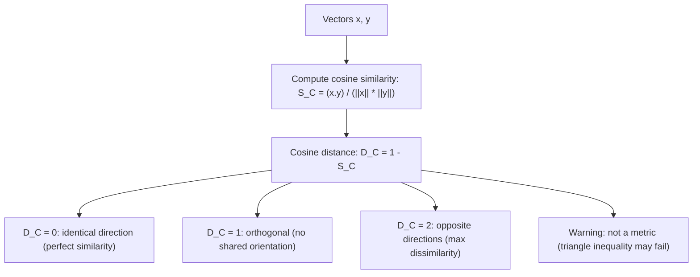

# Cosine Distance

$$
D_C(x,y) = 1 - S_C(x,y)
$$

## Deep Breakdown

What it tells me *(Situation Awareness)*:
Cosine distance converts cosine similarity into a dissimilarity measure by subtracting from 1. Since $S_C \in [-1, 1]$, we get $D_C \in [0, 2]$; for non-negative vectors (text, counts) $D_C \in [0, 1]$. A value of 0 means identical direction (maximum similarity); a value of 2 means opposite directions. Critically: cosine distance is NOT a proper metric because it does not satisfy the triangle inequality in general. Despite this, it is widely used in information retrieval, NLP, and clustering algorithms (e.g., DBSCAN, $k$-means on text embeddings) because the angular dissimilarity is exactly what you want in those domains.

## Flowchart



## Real-world use

### Where it is used

DBSCAN clustering on TF-IDF or embedding vectors using `metric='cosine'`, $k$-means clustering on text (sklearn `cosine` metric variant), nearest-neighbor retrieval in FAISS/ANN indices, semantic deduplication, and any pipeline where "angular dissimilarity" needs to be passed as a distance argument.

### Problem it solves

Many algorithms require a distance (dissimilarity) input, not a similarity. Cosine similarity goes the wrong direction: 1 = same, 0 = different. Cosine distance flips it: 0 = same, larger = different. This makes it compatible with distance-based APIs (`sklearn`, `scipy`, `FAISS`) that expect smaller = closer.

### How it solves the problem

Simple arithmetic: $D_C = 1 - S_C$. Since $S_C \in [-1,1]$, $D_C \in [0, 2]$. The monotone transformation preserves ranking: the most similar pair by $S_C$ is also the nearest pair by $D_C$. The conversion also enables direct use in `scipy.spatial.distance.cosine` and `sklearn.metrics.pairwise.cosine_distances`.

### Example in a business

A DS uses DBSCAN to cluster news articles by topic using TF-IDF vectors. DBSCAN requires a distance metric. Setting `metric='cosine'` makes DBSCAN use cosine distance internally. The clusters produced correspond to distinct topic groups, regardless of article length or word frequency magnitude.

## The formula, piece by piece

- $D_C(x,y)$: cosine distance; always $\geq 0$
- $S_C(x,y) = \frac{x \cdot y}{\|x\|\|y\|}$: cosine similarity (see Cosine Similarity note)
- $1 - S_C$: subtract similarity from 1 to convert to distance
- Range: $D_C \in [0, 2]$ for real-valued vectors; $D_C \in [0, 1]$ for non-negative vectors
- $D_C = 0$: $x$ and $y$ point in the same direction (identical up to scaling)
- $D_C = 1$: $x \perp y$ (orthogonal, no angular overlap)
- $D_C = 2$: $x$ and $y$ are antiparallel (opposite directions)
- **Note:** $D_C$ is NOT a proper metric — triangle inequality can fail

## The formula in words

"Compute how similar the directions of $x$ and $y$ are (cosine similarity). Then subtract from 1 to get a dissimilarity: 0 means they point the same way, 1 means perpendicular, 2 means opposite." Tiny example: $S_C(x,y) = 0.70$.
$D_C = 1 - 0.70 = 0.30$. Low distance: $x$ and $y$ are fairly similar in direction.

## Critical Concepts

- **NOT a proper metric:** cosine distance violates the triangle inequality. Example in 2D: $a=(1,0)$, $b=(0,1)$, $c=(-1,0)$. $D_C(a,b) = 1$, $D_C(b,c) = 1$, $D_C(a,c) = 2 > 1+1$. Only the non-strict triangle inequality can fail.
- **Angular metric alternative:** $D_{\text{angle}}(x,y) = \arccos(S_C(x,y)) / \pi \in [0,1]$ IS a proper metric for normalized vectors. Use this if metric properties are required.
- **Non-negative data:** for TF-IDF or count vectors ($x_i \geq 0$), $S_C \in [0,1]$ so $D_C \in [0,1]$.
- **Scale invariance inherited:** $D_C(x, cx) = 0$ for any scalar $c > 0$. Only direction matters.
- **sklearn behavior:** `cosine_distances(X, Y)` returns $1 - S_C$. `cosine_similarity(X, Y)` returns $S_C$. Make sure you use the right one for your algorithm.
- **FAISS:** for maximum inner product search, normalize vectors to unit length first; then inner product = cosine similarity, so argmax inner product = argmin cosine distance.

## Step-by-step calculation (tiny example)

*Step 1: Compute cosine similarity*
$x = (3, 0, 4)$, $y = (0, 5, 0)$.
$x \cdot y = 0$. $\|x\| = 5$. $\|y\| = 5$.
$S_C = 0/(5 \times 5) = 0$. ($x \perp y$.)

*Step 2: Compute cosine distance*
$D_C = 1 - 0 = 1$. Maximum angular dissimilarity for non-negative vectors.

*Step 3: Another example*
$x = (1, 2)$, $y = (2, 4)$. ($y = 2x$, same direction.)
$S_C = (2+8)/(\sqrt{5}\cdot\sqrt{20}) = 10/10 = 1$.
$D_C = 1 - 1 = 0$. $\checkmark$ (same direction = zero distance.)

## Code examples

### Beginner example (Python)

```python
import numpy as np
from scipy.spatial.distance import cosine as scipy_cosine_dist

def cosine_distance(x: np.ndarray, y: np.ndarray) -> float:
    """Cosine distance = 1 - cosine similarity."""
    norm_x = np.linalg.norm(x)
    norm_y = np.linalg.norm(y)
    if norm_x == 0.0 or norm_y == 0.0:
        raise ValueError("Undefined for zero vectors.")
    return float(1.0 - np.dot(x, y) / (norm_x * norm_y))
x = np.array([1.0, 2.0, 3.0])
y = np.array([4.0, 5.0, 6.0])
z = 2.0 * x   # same direction as x
print(f"D_C(x, y) = {cosine_distance(x, y):.4f}")
print(f"D_C(x, z) = {cosine_distance(x, z):.4f} (z = 2x, should be 0.0)")
print(f"scipy cosine(x, y) = {scipy_cosine_dist(x, y):.4f}")   # sklearn
from sklearn.metrics.pairwise import cosine_distances
X = np.vstack([x, y, z])
print(f"\nsklearn cosine_distances:\n{cosine_distances(X).round(4)}")
```

### Beginner example (R)

```r
# -- Cosine
distance = 1 - cosine similarity ---
cosine_dist <- function(x, y) { 1 - sum(x * y) / (sqrt(sum(x^2)) * sqrt(sum(y^2)))
}
x <- c(1, 2, 3)
y <- c(4, 5, 6)
z <- 2 * x  # same direction
cat(sprintf("D_C(x, y) = %.4f\n", cosine_dist(x, y)))
cat(sprintf("D_C(x, z) = %.4f (z = 2x, should be 0)\n", cosine_dist(x, z)))  # With proxy package
#
library(proxy)
# dist(rbind(x, y),
method="cosine")
```

### Professional example (Python)

```python
import numpy as np
import pandas as pd
from sklearn.cluster import DBSCAN
from sklearn.feature_extraction.text import TfidfVectorizer
np.random.seed(42)   # -- Business scenario: topic clustering of news articles via cosine distance ---
ARTICLES = [ "neural network deep learning training optimization gradient", "transformer attention mechanism BERT language model", "supervised learning classification regression model evaluation", "customer churn prediction retention marketing model", "SQL database query optimization index performance", "data pipeline ETL Airflow scheduling orchestration", "football match score goal penalty stadium", "basketball NBA player points rebounds championship", "stock market investment portfolio risk return", "cryptocurrency bitcoin blockchain decentralized finance",
]
vectorizer = TfidfVectorizer(stop_words='english')
X_tfidf = vectorizer.fit_transform(ARTICLES).toarray()   # Normalize to unit vectors (cosine distance = 1 - dot product for unit vectors)
norms = np.linalg.norm(X_tfidf, axis=1, keepdims=True)
X_unit = X_tfidf / np.where(norms == 0, 1, norms)   # DBSCAN with cosine metric
# eps is in cosine distance units: 0 = identical, 1 = orthogonal
db = DBSCAN(eps=0.7, min_samples=2, metric='cosine')
labels = db.fit_predict(X_unit)
results = pd.DataFrame({ "article": [a[:45] for a in ARTICLES], "cluster": labels,
})
print("DBSCAN clustering with cosine distance (eps=0.7):")
print(results.to_string(index=False))
print(f"\nUnique clusters (excl. noise=-1): {sorted(set(labels) - {-1})}")
```

---

*Source: domain knowledge*
