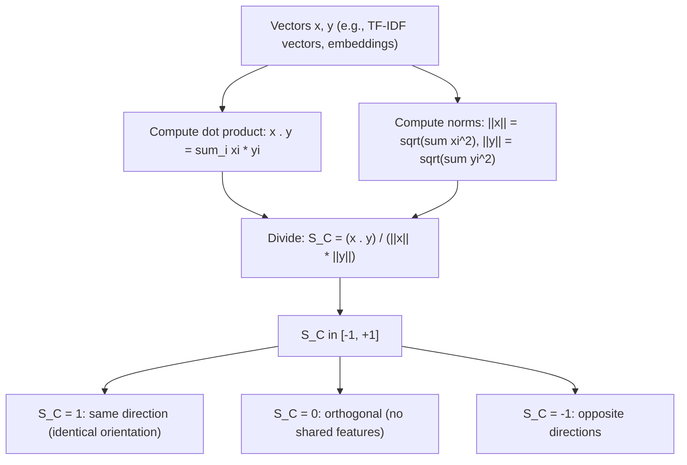

# Cosine Similarity

$$
S_C(x,y) = \frac{x \cdot y}{\|x\| \|y\|} = \frac{\sum x_i y_i}{\sqrt{\sum x_i^2}\,\sqrt{\sum y_i^2}}
$$

## Deep Breakdown

What it tells me *(Situation Awareness)*:
Cosine similarity measures the cosine of the angle between two vectors, ranging from $-1$ (opposite directions) to $+1$ (same direction), with $0$ meaning orthogonal (no shared orientation). It is scale-invariant: $S_C(x, 2x) = 1$ because scaling does not change direction. In DA/DS: cosine similarity is the default similarity metric for text, embeddings, and sparse feature vectors, because documents of different lengths should be comparable by their topic profile (direction), not their word count (magnitude). It drives document search engines, recommendation systems, semantic similarity scoring, and NLP embedding space analysis.

## Flowchart



## Real-world use

### Where it is used

Text similarity (TF-IDF, BM25, bag-of-words vectors), sentence/document embedding comparison (BERT, SBERT, OpenAI embeddings), recommendation engines (user-item vectors), image retrieval (CNN feature vector similarity), and nearest-neighbor search in high-dimensional embedding spaces.

### Problem it solves

Different documents or users may have very different total activity levels (word counts, interaction counts), making raw vector magnitude irrelevant. A short focused essay and a long essay on the same topic should be similarly close to a query. Cosine similarity ignores magnitude and compares only direction (topic profile, preference profile).

### How it solves the problem

Dividing the dot product by the product of the norms normalizes both vectors to unit length: $S_C(x,y) = \hat{x} \cdot \hat{y}$ where $\hat{x} = x/\|x\|$. The dot product of unit vectors is exactly the cosine of the angle between them (from the definition $x \cdot y = \|x\|\|y\|\cos\theta$). Result: only the angle (direction) matters, not magnitude.

### Example in a business

A DS builds a content recommendation engine. Each article is represented as a TF-IDF vector. For a user who just read article $q$, the system computes cosine similarity between $q$'s TF-IDF vector and all other articles, then returns the top-5 most similar ones. Long articles and short articles on the same topic score nearly identically — which is the correct behavior for semantic similarity.

## The formula, piece by piece

- $x \cdot y = \sum_i x_i y_i$: dot product; measures shared "energy" across all dimensions
- $\|x\| = \sqrt{\sum_i x_i^2}$: $L_2$ norm (magnitude) of $x$
- $\|y\| = \sqrt{\sum_i y_i^2}$: $L_2$ norm of $y$
- $\frac{x \cdot y}{\|x\|\|y\|}$: dividing normalizes both vectors to unit length; the result is $\hat{x} \cdot \hat{y}$
- Range: $S_C \in [-1, +1]$ for real-valued vectors; $S_C \in [0, 1]$ for non-negative vectors (e.g., TF-IDF, counts)
- $S_C = 1$: $x$ and $y$ are parallel (same direction, possibly different magnitudes)
- $S_C = 0$: $x \perp y$ (no shared features in the same direction)
- $S_C = -1$: $x$ and $y$ are antiparallel (opposite directions)
- Cauchy-Schwarz inequality ensures $|x \cdot y| \leq \|x\|\|y\|$, so $S_C \in [-1,1]$

## The formula in words

"Normalize each vector to unit length (direction only), then take their dot product. The result is the cosine of the angle between them. Values near 1 mean they point in nearly the same direction (high similarity); near 0 means they share nothing; near -1 means they are opposite." Tiny example: $x = (1, 1, 0)$, $y = (1, 0, 0)$.
$x \cdot y = 1$. $\|x\| = \sqrt{2}$. $\|y\| = 1$.
$S_C = 1/\sqrt{2} \approx 0.707$. Angle $= 45°$. $\checkmark$

## Critical Concepts

- **Scale invariance:** $S_C(x, cx) = 1$ for any scalar $c > 0$. Doubling word counts does not change topic similarity.
- **Not a proper distance metric:** cosine similarity is a similarity, not a distance. Cosine distance $= 1 - S_C$ turns it into a dissimilarity (see Cosine Distance note).
- **Efficient computation via normalization:** pre-normalizing all vectors to unit length reduces similarity computation to a dot product. For a query $q$: `similarities = X_normalized @ q_normalized` in one matrix-vector multiply — this is how most ANN (approximate nearest neighbor) search works.
- **Degenerate case:** if $\|x\| = 0$ or $\|y\| = 0$ (the zero vector), cosine similarity is undefined. Handle with a guard clause.
- **Connection to inner product geometry:** $S_C = \cos\theta$ where $\theta$ is the angle between $x$ and $y$ — directly from $x \cdot y = \|x\|\|y\|\cos\theta$.
- **Asymmetry of magnitudes:** cosine similarity ignores how "confident" or "strong" either vector is.

In recommendation, a user who rated 1 movie and a user who rated 1000 movies may have identical cosine similarity to a query — but very different reliability. This is a known limitation.

## Step-by-step calculation (tiny example)

*Step 1: Compute the dot product*
$x = (2, 3, 1)$, $y = (1, 2, 4)$.
$x \cdot y = 2\cdot1 + 3\cdot2 + 1\cdot4 = 2 + 6 + 4 = 12$.

*Step 2: Compute the norms*
$\|x\| = \sqrt{4+9+1} = \sqrt{14} \approx 3.742$.
$\|y\| = \sqrt{1+4+16} = \sqrt{21} \approx 4.583$.

*Step 3: Divide*
$S_C = 12 / (3.742 \times 4.583) = 12 / 17.146 \approx 0.6995$.
Angle $= \arccos(0.6995) \approx 45.6°$. Moderately similar. $\checkmark$

## Code examples

### Beginner example (Python)

```python
import numpy as np

def cosine_similarity(x: np.ndarray, y: np.ndarray) -> float:
    """Compute cosine similarity between non-zero vectors x and y."""
    norm_x = np.linalg.norm(x)
    norm_y = np.linalg.norm(y)
    if norm_x == 0.0 or norm_y == 0.0:
        raise ValueError("Cosine similarity undefined for zero vectors.")
    return float(np.dot(x, y) / (norm_x * norm_y))
x = np.array([2.0, 3.0, 1.0])
y = np.array([1.0, 2.0, 4.0])
z = np.array([4.0, 6.0, 2.0])   # z = 2x (same direction)
print(f"S_C(x, y) = {cosine_similarity(x, y):.4f}")
print(f"S_C(x, z) = {cosine_similarity(x, z):.4f} (z = 2x, should be 1.0)")
print(f"Angle(x, y) = {np.degrees(np.arccos(cosine_similarity(x, y))):.2f} degrees")   # Using sklearn
from sklearn.metrics.pairwise import cosine_similarity as sk_cosine
print(f"\nsklearn cosine_similarity: {sk_cosine(x.reshape(1,-1), y.reshape(1,-1))[0,0]:.4f}")
```

### Beginner example (R)

```r
# -- Cosine similarity ---
cosine_sim <- function(x, y) { norm_x <- sqrt(sum(x^2))
  norm_y <- sqrt(sum(y^2))
  if (norm_x == 0 || norm_y == 0) stop("Zero vector has undefined cosine similarity") sum(x * y) / (norm_x * norm_y)
}
x <- c(2, 3, 1)
y <- c(1, 2, 4)
z <- 2 * x  # same direction as x
cat(sprintf("S_C(x, y) = %.4f\n", cosine_sim(x, y)))
cat(sprintf("S_C(x, z) = %.4f (z = 2x, should be 1)\n", cosine_sim(x, z)))
cat(sprintf("Angle(x,y) = %.2f degrees\n", acos(cosine_sim(x, y)) * 180 / pi))
```

### Professional example (Python)

```python
import numpy as np
import pandas as pd
from sklearn.feature_extraction.text import TfidfVectorizer
np.random.seed(42)   # -- Business scenario: TF-IDF cosine similarity document retrieval ---
DOCUMENTS = [ "machine learning model training data features", "deep learning neural network gradient descent", "data pipeline ETL transformation warehouse SQL", "customer churn prediction logistic regression model", "python pandas numpy data analysis visualization", "marketing campaign ROI conversion funnel analytics", "A/B testing hypothesis statistical significance p-value", "recommendation system collaborative filtering user item",
]
QUERY = "machine learning prediction model"
vectorizer = TfidfVectorizer()
X_tfidf = vectorizer.fit_transform(DOCUMENTS)
q_tfidf = vectorizer.transform([QUERY])   # Cosine similarities via dot product (vectors already normalized internally by sklearn)
# Manually: normalize then dot product
X_norms = np.linalg.norm(X_tfidf.toarray(), axis=1, keepdims=True)
X_unit = X_tfidf.toarray() / np.where(X_norms == 0, 1, X_norms)
q_arr = q_tfidf.toarray().flatten()
q_norm = np.linalg.norm(q_arr)
q_unit = q_arr / q_norm if q_norm > 0 else q_arr
similarities = X_unit @ q_unit   # all cosine similarities at once
results = pd.DataFrame({ "doc_id": range(len(DOCUMENTS)), "snippet": [d[:40] for d in DOCUMENTS], "cosine_sim": similarities.round(4),
}).sort_values("cosine_sim", ascending=False)
print(f"Query: '{QUERY}'\n")
print("Top matches by cosine similarity:")
print(results.to_string(index=False))
```

---

*Source: domain knowledge*
