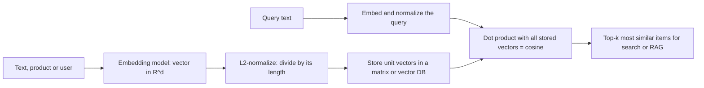

# Embedding Similarity

$$
\text{sim}(u, v) = \cos\theta = \frac{u \cdot v}{\lVert u \rVert \, \lVert v \rVert} = \hat{u} \cdot \hat{v}
$$

, where $\hat{u} = u / \lVert u \rVert$ and $\hat{v} = v / \lVert v \rVert$ are the unit-normalized embeddings

## Deep Breakdown

What it tells me *(Situation Awareness)*:
An embedding model maps a piece of content (a sentence, a product, a user, an image) to a dense vector so that *similar meaning lands in a similar direction*. Embedding similarity is how we read that geometry: almost always cosine similarity, the cosine of the angle between the two vectors, from $-1$ (opposite) through $0$ (unrelated, orthogonal) to $1$ (same direction). The practical trick is to L2-normalize every embedding once, at write time; after that, cosine similarity is just a dot product, so comparing one query against a million documents is a single matrix-vector product, and Euclidean distance gives the same ranking because $\lVert \hat{u} - \hat{v} \rVert^2 = 2 - 2\,\hat{u} \cdot \hat{v}$. Normalizing also removes the effect of vector length, which in many models correlates with things like text length or word frequency rather than meaning. In DA/DS: semantic search (find help articles that answer a question even with no shared keywords), retrieval for RAG, deduplicating near-identical tickets or product listings, clustering free-text feedback into themes, "similar items" recommendations, zero-shot classification by similarity to label descriptions, and measuring drift between old and new content.

## Flowchart



## Real-world use

### Where it is used

Semantic search over FAQs, contracts, tickets and product catalogues; the retrieval step of RAG systems that feed an LLM; duplicate-question detection in support queues; grouping open-ended survey answers; "customers who liked this also liked" with item embeddings; matching CVs to job descriptions; zero-shot routing of messages to teams.

### Problem it solves

Keyword search fails when users and documents use different words ("cancel my plan" vs "how to end a subscription"). Raw dot products are biased towards long vectors, so frequent or long items dominate results regardless of relevance. We need a fast, scale-free measure of *semantic* closeness.

### How it solves the problem

The embedding model places paraphrases near each other in direction. Cosine similarity compares only direction, ignoring length. Normalizing all vectors to unit length makes cosine equal to the dot product, so similarity for all documents is $\hat{D} \hat{q}$: one matrix-vector multiply, trivially batched and supported by every vector database and ANN index (see [[vector_search_approximate_nearest_neighbors]]).

### Example in a business

A SaaS company embeds its 3,000 help-centre articles once and stores the normalized vectors. When a customer types "my card was charged twice", the chatbot embeds the question, computes the dot product with all 3,000 vectors, and passes the top 5 articles (cosine around 0.8) to an LLM to draft an answer. Articles about "duplicate payment refunds" are retrieved even though they never contain the word "charged". Questions whose best match is below a tuned threshold (e.g. 0.5) are routed to a human because the knowledge base probably does not cover them.

## The formula, piece by piece

- $u, v$: embedding vectors of two items, each in $\mathbb{R}^d$ (typically $d$ = 384 to 3,072)
- $u \cdot v = \sum_{i=1}^{d} u_i v_i$: dot product; large when the vectors point the same way and are long
- $\lVert u \rVert = \sqrt{u \cdot u}$: Euclidean length (L2 norm) of the vector (see [[euclidean_norm_l_2_norm]])
- $\frac{u \cdot v}{\lVert u \rVert \lVert v \rVert}$: cosine of the angle $\theta$ between them, in $[-1, 1]$ (see [[cosine_similarity]])
- $\hat{u} = u / \lVert u \rVert$: unit vector; same direction, length 1
- $\hat{u} \cdot \hat{v}$: for unit vectors the dot product *is* the cosine; no division needed at query time
- $1 - \cos\theta$: cosine distance, used when a library expects a distance (see [[cosine_distance]])
- $\lVert \hat{u} - \hat{v} \rVert^2 = 2 - 2\cos\theta$: Euclidean distance between unit vectors is a monotone function of cosine, so both rank identically

## The formula in words

"Two items are similar if their embedding vectors point in the same direction; make every vector length 1 and the similarity is just the dot product." Tiny example: $u = (3, 4)$, $v = (4, 3)$. Lengths are both 5, unit vectors $(0.6, 0.8)$ and $(0.8, 0.6)$, dot product $0.48 + 0.48 = 0.96$: very similar. $w = (-4, 3)$ gives $\hat{u} \cdot \hat{w} = -0.48 + 0.48 = 0$: unrelated.

## Critical Concepts

- **Normalize once, at write time:** store unit vectors; then cosine, dot product and Euclidean ranking all agree, and any index or database metric gives the same top-$k$. Also normalize the query.
- **Scores are model-specific:** "0.8" means different things for different embedding models; many models produce cosines concentrated in a narrow band (e.g. 0.6 to 0.9). Calibrate thresholds on labelled pairs from your own data, never copy them between models.
- **Use the same model for queries and documents:** vectors from different models (or versions) live in unrelated spaces; comparing them is meaningless. Re-embed everything when you upgrade the model.
- **Asymmetric models:** some retrieval models expect a prefix such as "query:" vs "passage:"; skipping it lowers quality silently.
- **Length bias of raw dot products:** without normalization, long or frequent items get large norms and float to the top of every query. Only skip normalization if the model was explicitly trained for raw dot-product (inner-product) scoring.
- **Similarity is not relevance:** cosine finds topically close text, including contradictory statements ("refunds are allowed" vs "refunds are not allowed" can be very similar). RAG systems often add a re-ranker or keyword search (hybrid search) on top.
- **Mean-centering for analysis:** for clustering or visualizing a corpus, subtracting the corpus mean embedding before normalizing can spread out scores that are otherwise all high.

## Step-by-step calculation (tiny example)

*Three 2-d "embeddings": query $q = (3, 4)$, article A $= (4, 3)$, article B $= (-4, 3)$, and article C $= (30, 40)$ (same direction as $q$ but 10 times longer).*

*Step 1: Norms*
$\lVert q \rVert = \sqrt{9 + 16} = 5$, $\lVert A \rVert = 5$, $\lVert B \rVert = 5$, $\lVert C \rVert = 50$.

*Step 2: Normalize*
$\hat{q} = (0.6, 0.8)$, $\hat{A} = (0.8, 0.6)$, $\hat{B} = (-0.8, 0.6)$, $\hat{C} = (0.6, 0.8)$.

*Step 3: Cosine = dot product of unit vectors*
$\hat{q} \cdot \hat{A} = 0.48 + 0.48 = 0.96$
$\hat{q} \cdot \hat{B} = -0.48 + 0.48 = 0.00$
$\hat{q} \cdot \hat{C} = 0.36 + 0.64 = 1.00$

*Step 4: Compare with raw dot products*
$q \cdot A = 24$, $q \cdot B = 0$, $q \cdot C = 250$. The raw score of C is inflated by its length; cosine says C is simply "same direction" (1.00) and A is a close second (0.96).

## Code examples

### Beginner example (Python)

```python
import numpy as np

q = np.array([3.0, 4.0])
docs = {"A": np.array([4.0, 3.0]), "B": np.array([-4.0, 3.0]), "C": np.array([30.0, 40.0])}


def normalize(v: np.ndarray) -> np.ndarray:
    return v / np.linalg.norm(v)


q_hat = normalize(q)
for name, v in docs.items():
    cos = float(normalize(v) @ q_hat)
    print(f"{name}: raw dot = {q @ v:6.1f} | cosine = {cos:.2f}")
# A: 24.0 | 0.96   B: 0.0 | 0.00   C: 250.0 | 1.00

u_hat, v_hat = normalize(q), normalize(docs["A"])
print(f"||u-v||^2 = {np.sum((u_hat - v_hat) ** 2):.2f} = 2 - 2*cos = {2 - 2 * (u_hat @ v_hat):.2f}")  # 0.08
```

### Beginner example (R)

```r
normalize <- function(v) v / sqrt(sum(v^2))
q <- c(3, 4)
A <- c(4, 3); B <- c(-4, 3); C <- c(30, 40)
for (doc in list(A = A, B = B, C = C)) {
  cat(sprintf("raw dot = %6.1f | cosine = %.2f\n", sum(q * doc), sum(normalize(q) * normalize(doc))))
}
```

### Professional example (Python)

```python
import numpy as np

rng = np.random.default_rng(42)
d = 64

# Synthetic help-centre corpus: each article = topic direction + noise; some articles have big norms
topic_names = ["billing", "shipping", "returns", "login", "privacy"]
topic_vecs = rng.normal(size=(len(topic_names), d))
doc_topic = np.repeat(np.arange(len(topic_names)), 40)                 # 200 articles, 40 per topic
docs = topic_vecs[doc_topic] + 0.8 * rng.normal(size=(len(doc_topic), d))
docs *= rng.uniform(0.5, 3.0, size=(len(doc_topic), 1))               # norms vary (e.g. long articles)


def l2_normalize(M: np.ndarray) -> np.ndarray:
    return M / np.linalg.norm(M, axis=-1, keepdims=True)


docs_hat = l2_normalize(docs)                                        # normalize ONCE at write time


def search(query: np.ndarray, k: int = 5, normalized: bool = True) -> tuple[np.ndarray, np.ndarray]:
    if normalized:
        scores = docs_hat @ l2_normalize(query)                       # cosine via one mat-vec
    else:
        scores = docs @ query                                         # raw dot product
    top = np.argsort(-scores)[:k]
    return top, scores[top]


# 300 synthetic user questions with known intent
n_q = 300
q_topic = rng.integers(0, len(topic_names), n_q)
queries = topic_vecs[q_topic] + 1.2 * rng.normal(size=(n_q, d))

for normalized in (True, False):
    hits = [np.mean(doc_topic[search(q, 5, normalized)[0]] == t) for q, t in zip(queries, q_topic)]
    label = "cosine (normalized)" if normalized else "raw dot product"
    print(f"precision@5 with {label:<20}: {np.mean(hits):.3f}")

# Inspect one query and set a 'no good answer' threshold
top, sims = search(queries[0])
print(f"\nQuery intent: {topic_names[q_topic[0]]}")
for i, s in zip(top, sims):
    print(f"  article {i:>3} ({topic_names[doc_topic[i]]:<8}) cosine = {s:.3f}")

off_topic = rng.normal(size=d)                                       # a question the corpus cannot answer
best = search(off_topic, 1)[1][0]
print(f"\nBest cosine for an off-topic query: {best:.3f} -> route to human if below a tuned threshold")

# Equivalence check: Euclidean ranking on unit vectors == cosine ranking
qh = l2_normalize(queries[0])
eucl_rank = np.argsort(np.linalg.norm(docs_hat - qh, axis=1))[:5]
print("Euclidean top-5 == cosine top-5:", np.array_equal(eucl_rank, top))
```

---

*Source: domain knowledge*
